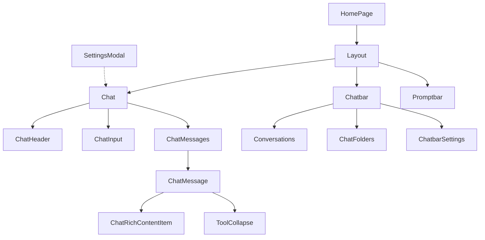
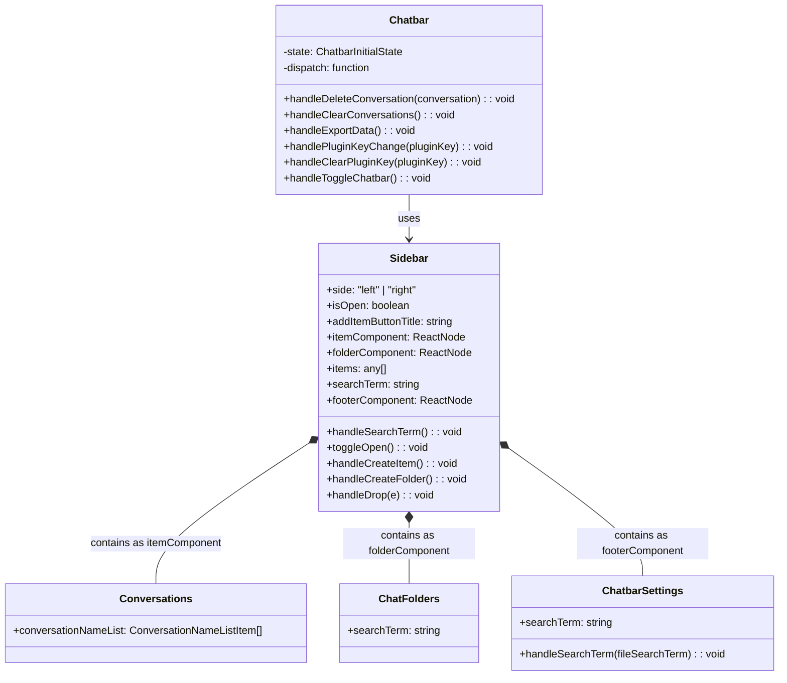
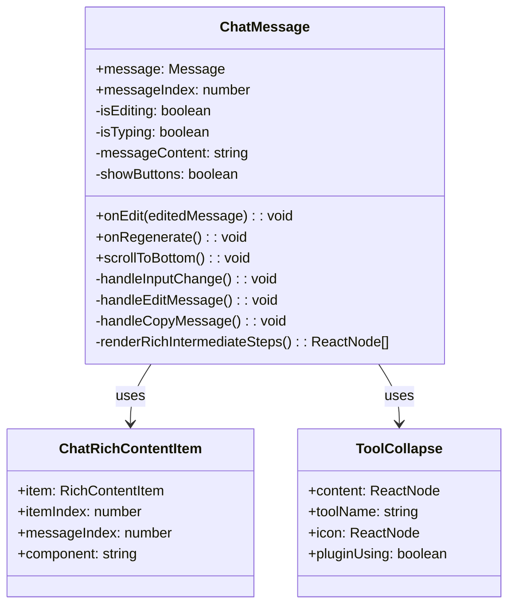
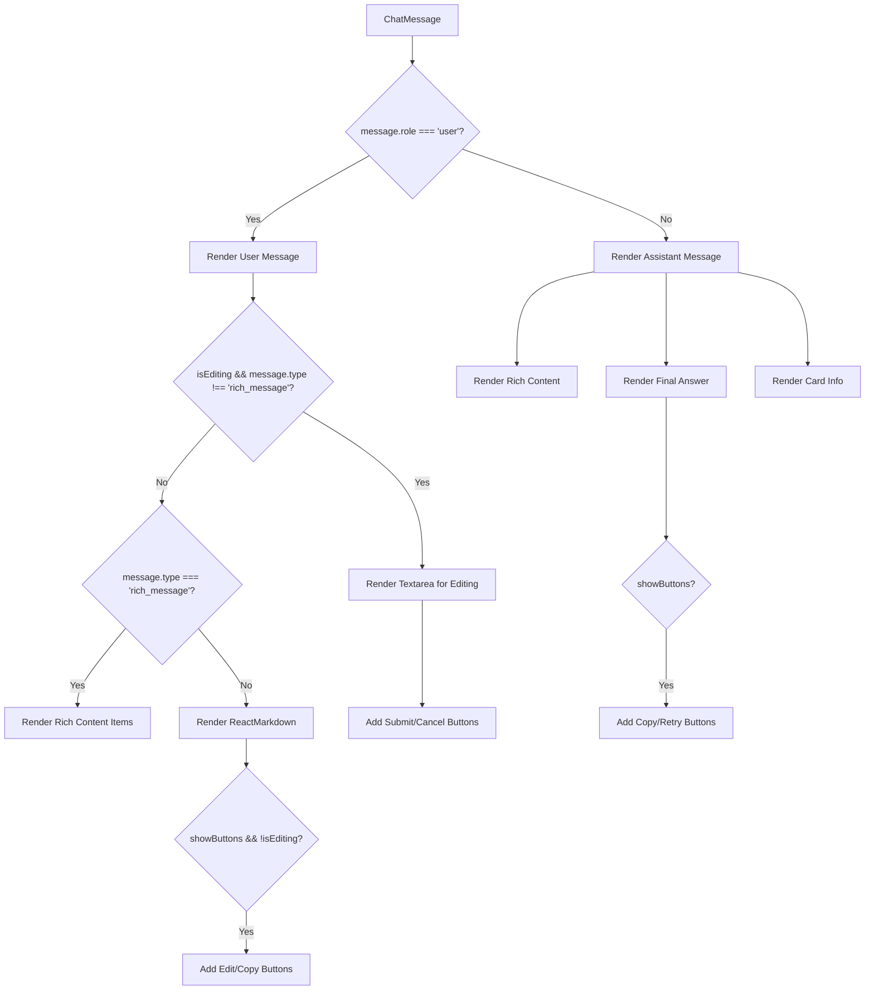
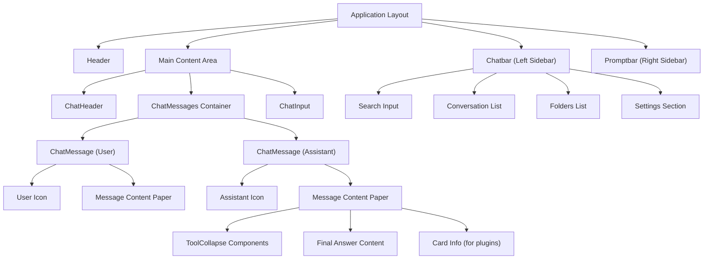
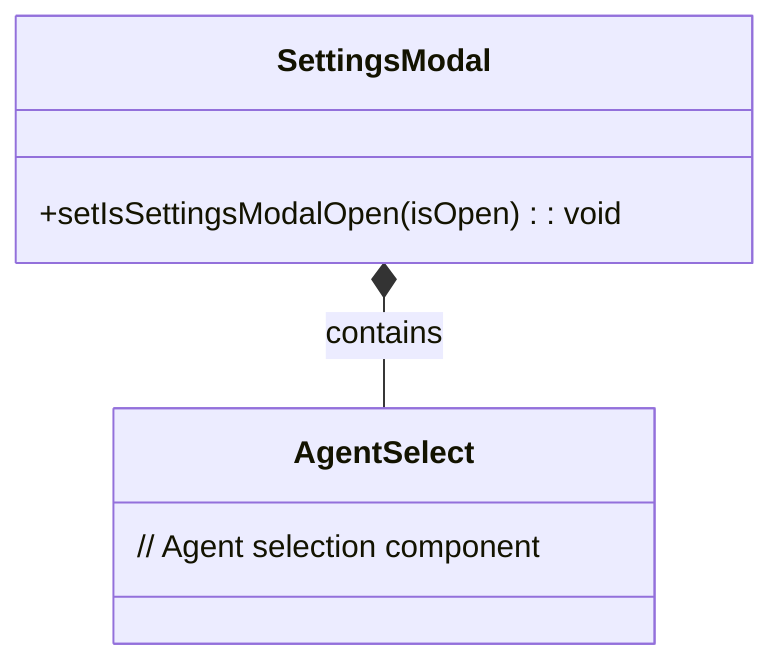
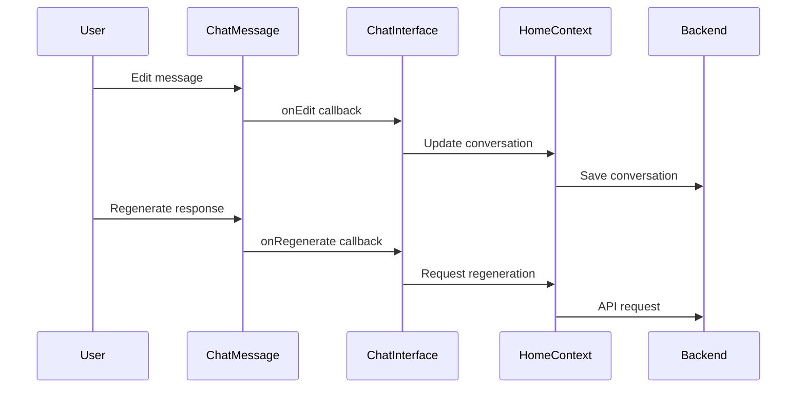
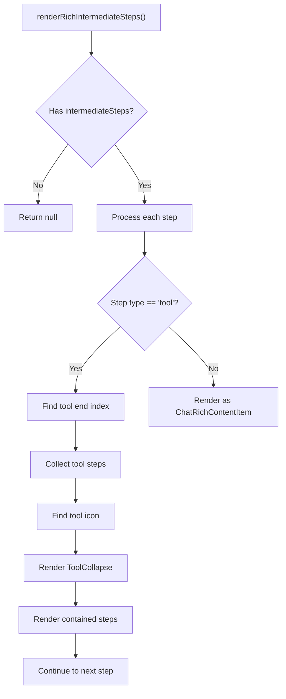

<!-- source: DeepWiki mcp.deepwiki.com · repo xlang-ai/OpenAgents · page 4.3 Component Structure · fetched 2026-10-26 -->

# Component Structure

<details>
<summary>Relevant source files</summary>

The following files were used as context for generating this wiki page:

- [frontend/components/Chat/ChatMessage.tsx](frontend/components/Chat/ChatMessage.tsx)
- [frontend/components/Chat/SettingsModal.tsx](frontend/components/Chat/SettingsModal.tsx)
- [frontend/components/Chatbar/Chatbar.tsx](frontend/components/Chatbar/Chatbar.tsx)

</details>


This page documents the key frontend UI components in OpenAgents, their relationships, and how they work together to create the user interface. This documentation focuses on the React component architecture, not on state management which is covered in [State Management](#4.2).

## Overview of Frontend Component Architecture

The OpenAgents frontend is built using React and Next.js, following a component-based architecture with several key categories:

- **Chat Interface Components** - Components that handle the display and interaction with chat messages
- **Navigation Components** - Sidebars and navigation elements
- **Modal Components** - Overlay UI elements for settings and configurations
- **Utility Components** - Reusable components for common UI patterns



Sources: [frontend/components/Chat/ChatMessage.tsx](frontend/components/Chat/ChatMessage.tsx), [frontend/components/Chat/SettingsModal.tsx](frontend/components/Chat/SettingsModal.tsx), [frontend/components/Chatbar/Chatbar.tsx](frontend/components/Chatbar/Chatbar.tsx)

## Key Component Hierarchies

### Sidebar Components

The UI includes sidebar components that manage navigation and settings:



Sources: [frontend/components/Chatbar/Chatbar.tsx:267-305](frontend/components/Chatbar/Chatbar.tsx)

### Chat Message Components

The `ChatMessage` component is one of the most complex components, handling different message types and interactive elements:



Sources: [frontend/components/Chat/ChatMessage.tsx:40-535](frontend/components/Chat/ChatMessage.tsx)

## Chat Message Structure and Rendering Flow

The `ChatMessage` component has a complex rendering flow that handles different types of messages:



Sources: [frontend/components/Chat/ChatMessage.tsx:313-534](frontend/components/Chat/ChatMessage.tsx)

## Component Props Interface

Key component interfaces define the data structure passed between components:

### ChatMessage Props

```typescript
interface Props {
  message: Message;
  messageIndex: number;
  onEdit?: (editedMessage: Message) => void;
  onRegenerate?: () => void;
  scrollToBottom?: () => void;
}
```

Sources: [frontend/components/Chat/ChatMessage.tsx:40-46](frontend/components/Chat/ChatMessage.tsx)

### SettingsModal Props

```typescript
interface SettingsModalProps {
  setIsSettingsModalOpen: (isSettingsModalOpen: boolean) => void;
}
```

Sources: [frontend/components/Chat/SettingsModal.tsx:5-7](frontend/components/Chat/SettingsModal.tsx)

## Detailed Component Layout Structure

The following diagram shows the hierarchical layout of UI components as rendered in the browser:



Sources: [frontend/components/Chat/ChatMessage.tsx:313-532](frontend/components/Chat/ChatMessage.tsx), [frontend/components/Chatbar/Chatbar.tsx:267-305](frontend/components/Chatbar/Chatbar.tsx)

## Modal Components

Modals are used for settings and configurations:



Sources: [frontend/components/Chat/SettingsModal.tsx:9-62](frontend/components/Chat/SettingsModal.tsx)

## Responsive Design Implementation

The component structure implements responsive design through:

1. Dynamic width calculations based on sidebar visibility
2. Media queries for different screen sizes
3. Flexible containers that adapt to available space

For example, the ChatMessage component adjusts its maximum width based on the sidebar state:

```jsx
<Paper
  elevation={3}
  className={`relative w-fit ${
    showChatbar
      ? 'max-w-[calc(100vw-260px-20.4rem)]'
      : 'max-w-[calc(100vw-25.7rem)]'
  } my-4 flex items-center p-3 text-base rounded-2xl
  ${
    message.role === 'user'
      ? 'bg-[#E2E2E2] mr-4 ml-40'
      : 'bg-white ml-4 mr-40'
  }`}
>
```

Sources: [frontend/components/Chat/ChatMessage.tsx:329-341](frontend/components/Chat/ChatMessage.tsx)

## Chat Message Type Handling

The ChatMessage component handles multiple message types with different rendering logic:

| Message Type | Role | Rendering Approach |
|--------------|------|-------------------|
| Plain text | User | ReactMarkdown |
| Plain text | Assistant | ReactMarkdown |
| Rich message | User | Custom RichContentItem components |
| Rich message | Assistant | ToolCollapse + RichContentItem components |
| Alert message | Assistant | Red text span |

Sources: [frontend/components/Chat/ChatMessage.tsx:383-503](frontend/components/Chat/ChatMessage.tsx)

## Component Event Flow

The component system uses a combination of React context and props to manage event flow:



Sources: [frontend/components/Chat/ChatMessage.tsx:100-108](frontend/components/Chat/ChatMessage.tsx)

## Rich Content Rendering

The system has special handling for rich content, particularly for agent tool usage:



Sources: [frontend/components/Chat/ChatMessage.tsx:144-293](frontend/components/Chat/ChatMessage.tsx)

## Conclusion

The OpenAgents frontend uses a modular component structure organized around key UI elements like chat messages, sidebars, and modals. The architecture employs React context for state management and component composition for UI organization. The most complex component is the ChatMessage, which handles multiple rendering scenarios for different message types, roles, and interactive elements.

---

