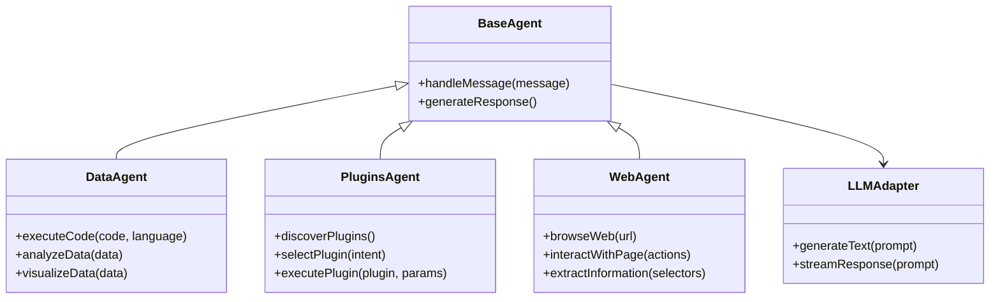
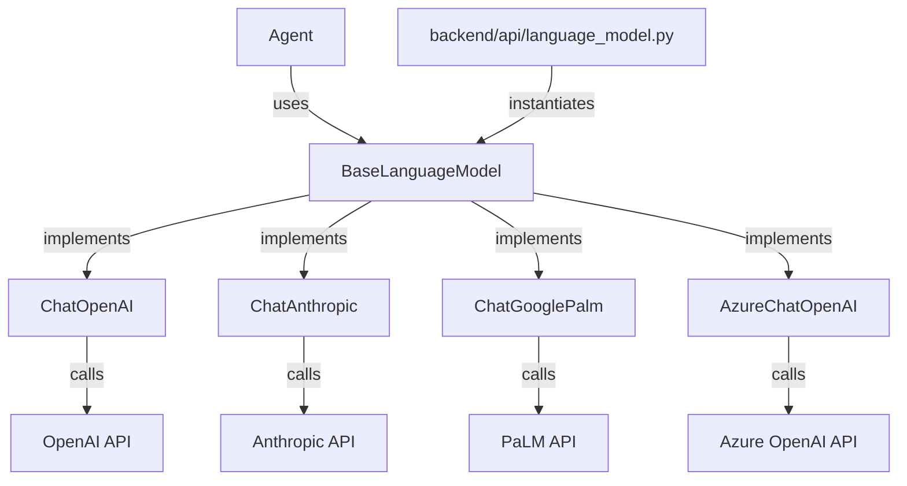
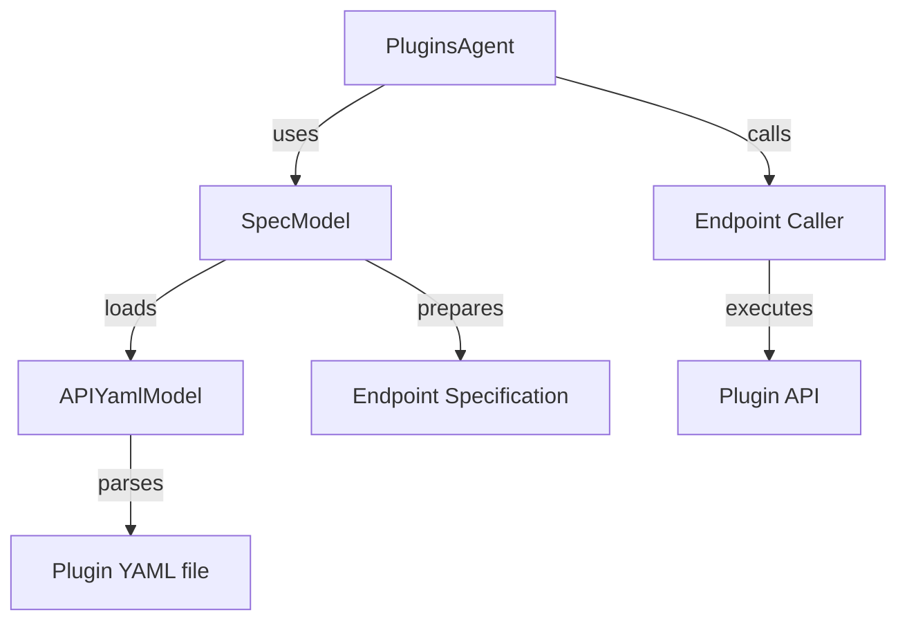
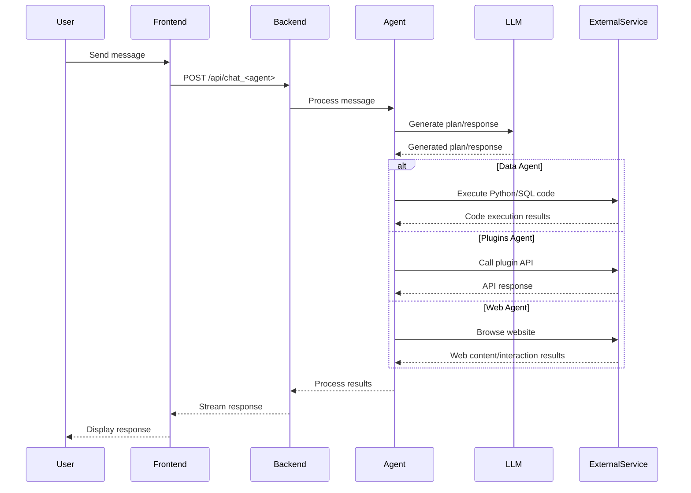

<!-- source: DeepWiki mcp.deepwiki.com · repo xlang-ai/OpenAgents · page 5 Agents · fetched 2026-10-26 -->

# Agents

<details>
<summary>Relevant source files</summary>

The following files were used as context for generating this wiki page:

- [README.md](README.md)
- [README_ZH.md](README_ZH.md)
- [backend/api/language_model.py](backend/api/language_model.py)
- [real_agents/adapters/data_model/message.py](real_agents/adapters/data_model/message.py)
- [real_agents/adapters/data_model/plugin/spec.py](real_agents/adapters/data_model/plugin/spec.py)
- [real_agents/adapters/models/__init__.py](real_agents/adapters/models/__init__.py)
- [real_agents/adapters/models/azure_openai.py](real_agents/adapters/models/azure_openai.py)

</details>


This page provides a comprehensive overview of the agent system in OpenAgents. It covers the architecture, implementation details, and shared components of the three main agent types: Data Agent, Plugins Agent, and Web Agent. The document describes how these agents interact with language models, process messages, and utilize tools to perform their specialized functions.

For more detailed information about specific agent types, refer to:
- [Data Agent](#5.1)
- [Plugins Agent](#5.2)
- [Web Agent](#5.3)
- [Shared Adapters](#5.4)

## Agent Architecture

The OpenAgents platform implements a modular agent architecture where each agent type inherits from a common base agent implementation while providing specialized capabilities. The system follows a clean separation of concerns with agents implemented as standalone modules under the `real_agents` directory.



This diagram shows the inheritance relationship between the base agent and specialized agents. The `BaseAgent` provides common functionality for all agent types, while each specialized agent implements additional methods specific to its domain.

Sources: [README.md:212-253]()

## Agent Types

### Data Agent

The Data Agent specializes in data analysis and visualization tasks. Its key capabilities include:

- Executing Python and SQL code
- Handling and manipulating various data formats
- Creating visualizations of data
- Analyzing data patterns and trends

This agent serves as a computational assistant that can process data files, perform analysis, and generate informative visualizations based on user requests.

Sources: [README.md:87-96]()

### Plugins Agent

The Plugins Agent integrates with external tools and services through a plugin system. Its core functionalities include:

- Discovering and listing available plugins
- Selecting appropriate plugins based on user intent
- Executing plugin operations with required parameters
- Combining multiple plugins to accomplish complex tasks

The Plugins Agent currently supports over 200 third-party tools and features an automatic plugin selection mechanism to streamline user interactions.

Sources: [README.md:102-129]()

### Web Agent

The Web Agent enables autonomous web browsing through integration with a Chrome extension. Its primary capabilities include:

- Navigating to websites and following links
- Interacting with web elements (clicking, scrolling, filling forms)
- Extracting information from web pages
- Performing complex sequences of web actions

This agent is particularly effective for automating web-based workflows and retrieving information from online sources.

Sources: [README.md:135-156]()

## Agent Message Processing

Agents use a structured message processing system to handle user inputs and generate appropriate responses. The diagram below illustrates the typical message flow:

```mermaid
sequenceDiagram
    participant User
    participant Frontend
    participant BackendAPI["backend/api/chat_<agent>.py"]
    participant Agent["real_agents/<agent_type>"]
    participant MessageDataModel["adapters/data_model/message.py"]
    participant LLM["adapters/models/<model>.py"]

    User->>Frontend: Send message
    Frontend->>BackendAPI: POST /api/chat_<agent>
    BackendAPI->>Agent: Process message
    Agent->>MessageDataModel: Format message
    MessageDataModel->>MessageDataModel: Count tokens
    MessageDataModel->>MessageDataModel: Truncate if needed
    Agent->>LLM: Generate response
    LLM-->>Agent: Stream generated text
    Agent->>MessageDataModel: Process response
    MessageDataModel->>MessageDataModel: Extract actions/results
    Agent->>BackendAPI: Return processed response
    BackendAPI->>Frontend: Stream response
    Frontend->>User: Display response
```

The `MessageDataModel` class provides utilities for message processing, including:

1. Token counting to ensure messages fit within model context limits
2. Text truncation for long outputs
3. Chat history management to maintain conversation context
4. Action and tool response extraction and formatting

Sources: [real_agents/adapters/data_model/message.py:1-206]()

### Message Formats

The agent system uses standardized formats for different types of messages:

#### Action Format
The agent uses this format to indicate what action it intends to take:

```
```json
{
    "action": "<action_name>",
    "action_input": "<action_parameters>"
}
```
```

#### Tool Response Format
This format is used to structure tool execution results:

For code execution:
```
[RESPONSE_BEGIN]
<code>
<intermediate_steps>
</code>

<output>
<result>
</output>
[RESPONSE_END]
```

For plugin calls:
```
[RESPONSE_BEGIN]
<plugin_call>
<intermediate_steps>
</plugin_call>

<output>
<result>
</output>
[RESPONSE_END]
```

These standardized formats ensure consistent parsing and rendering of agent actions and responses throughout the system.

Sources: [real_agents/adapters/data_model/message.py:8-39]()

## Language Model Integration

The agent system integrates with multiple language models through a unified adapter interface. This abstraction allows agents to work with different LLMs while maintaining consistent behavior.



The backend API layer handles model selection and instantiation through the `get_llm` function, which creates the appropriate adapter based on the requested model name.

The OpenAgents platform currently supports these language models:

| Model | Provider | Description |
|-------|----------|-------------|
| gpt-3.5-turbo-16k | OpenAI | GPT-3.5 with 16k token context window |
| gpt-4 | OpenAI | More powerful GPT-4 model |
| claude-v1 | Anthropic | Claude v1 model |
| claude-2 | Anthropic | Claude 2 model |
| lemur-chat | xlang.ai | Custom hosted model (lemur-70b-chat-v1) |

Each model adapter handles the specific requirements for interacting with the model's API while presenting a consistent interface to the agent system.

Sources: [real_agents/adapters/models/__init__.py:1-19](), [backend/api/language_model.py:1-58](), [real_agents/adapters/models/azure_openai.py:1-132]()

## Plugin System Architecture

The Plugins Agent relies on a structured system for discovering, loading, and executing plugins:



The plugin system has several key components:

1. **Plugin Specification Files**: Each plugin requires:
   - `ai-plugin.json`: Contains plugin metadata
   - `openapi.yaml`: Defines the API endpoints and parameters

2. **SpecModel**: Processes plugin specifications and prepares them for use:
   - Loads and parses YAML specifications
   - Processes endpoint parameters
   - Formats specifications for agent consumption

3. **Endpoint Caller**: Executes API calls to the plugin services

The system's modular design allows for easy addition of new plugins without modifying the core agent code.

Sources: [real_agents/adapters/data_model/plugin/spec.py:1-165]()

## Extending the Agent System

The OpenAgents platform is designed to be extensible. To create a new agent:

1. Create a new directory under `real_agents/`
2. Implement the agent logic based on shared components in `adapters/`
3. Add a new API endpoint in `backend/api/chat_<new_agent>.py`
4. Register constants in `backend/schemas.py`
5. Add a new `OpenAgentID` in frontend code and implement UI components

To add a new language model, implement an adapter class in `real_agents/adapters/models/` and register it in `backend/api/language_model.py`.

To add a new plugin, create required specification files in `real_agents/plugins_agent/plugins/` and register the plugin name in `plugin_names.py`.

Sources: [README.md:262-273]()

## Agent Interaction Flow

The following diagram illustrates the end-to-end interaction flow when using an agent:



This flow demonstrates how the different agent types interact with their respective external services to accomplish user-requested tasks.

Sources: [README.md:171-174]()

## Summary

OpenAgents implements a flexible agent architecture that supports specialized functionality while maintaining a consistent user experience. The system's modular design enables:

1. **Consistent User Interface**: All agents use the same chat-based frontend
2. **Specialized Capabilities**: Each agent type focuses on specific domains
3. **Extensibility**: New agents, language models, and tools can be added with minimal changes
4. **Unified Backend**: Common infrastructure handles message routing, memory, and streaming

The agent system serves as the core intelligence of the OpenAgents platform, providing the reasoning and execution capabilities that power the user experience.

---

