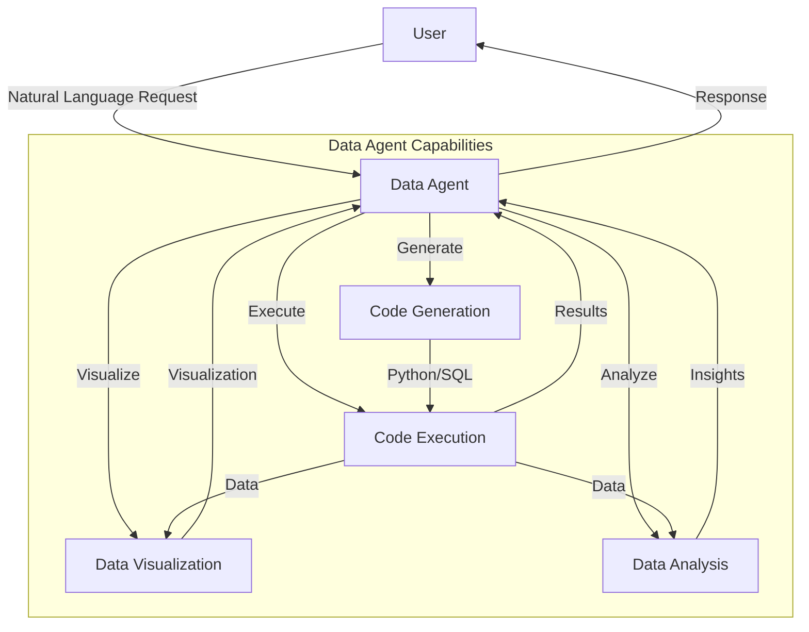
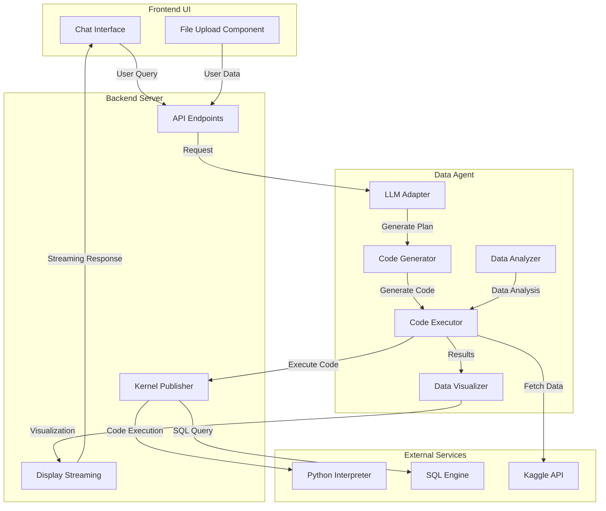
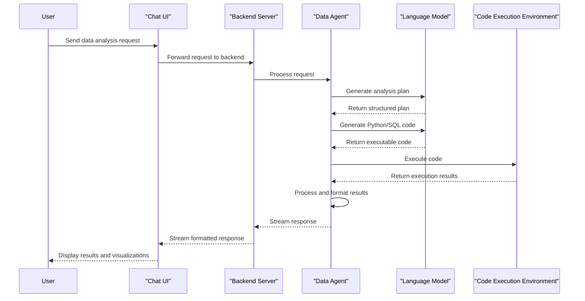
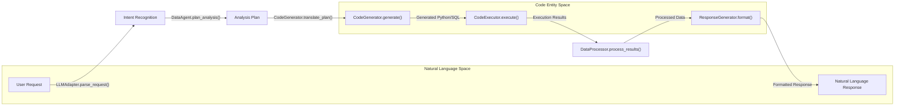
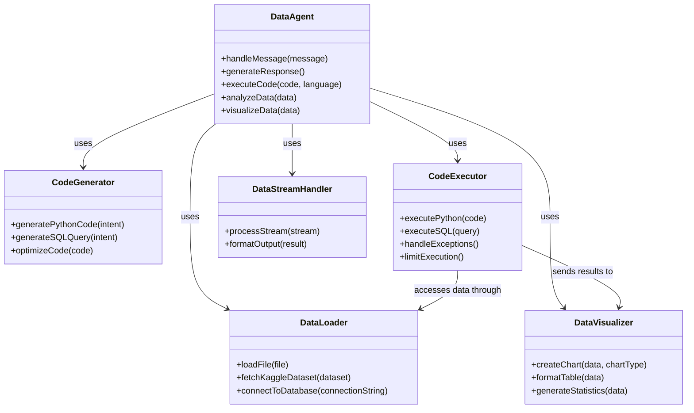
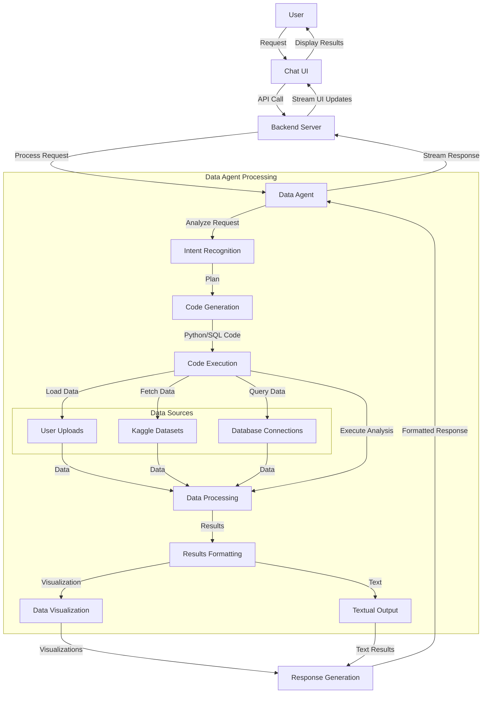

<!-- source: DeepWiki mcp.deepwiki.com · repo xlang-ai/OpenAgents · page 5.1 Data Agent · fetched 2026-10-26 -->

# Data Agent

Relevant source files

The following files were used as context for generating this wiki page:

- [README.md](README.md)
- [README_ZH.md](README_ZH.md)
- [backend/static/images/DataProfiling.cache](backend/static/images/DataProfiling.cache)
- [backend/static/images/Echarts.cache](backend/static/images/Echarts.cache)
- [backend/static/images/KaggleDataLoader.cache](backend/static/images/KaggleDataLoader.cache)
- [backend/static/images/PythonCodeBuilder.cache](backend/static/images/PythonCodeBuilder.cache)
- [backend/static/images/SQLQueryBuilder.cache](backend/static/images/SQLQueryBuilder.cache)

The Data Agent is a specialized language agent within the OpenAgents platform designed for data analysis, visualization, and manipulation tasks. It serves as an AI assistant that can help users explore, analyze, and visualize data through natural language interactions, generating and executing Python and SQL code on behalf of users. This document covers the architecture, capabilities, and implementation details of the Data Agent.

For information about other agents in the platform, see [Plugins Agent](#5.2) and [Web Agent](#5.3).

## Overview and Capabilities

The Data Agent is designed to be a comprehensive toolkit for data operations, providing four core capabilities:

1. **Search**: Locate and retrieve data from various sources
2. **Handle**: Preprocess and prepare data for analysis
3. **Manipulate**: Transform and analyze data using Python and SQL
4. **Visualize**: Generate visual representations of data for insights

These capabilities are enabled through the agent's ability to interpret user requests in natural language, generate appropriate code, execute it in a controlled environment, and present the results back to the user.

Sources: [README.md:89-96]()

## Architecture

The Data Agent is integrated into the OpenAgents platform and interacts with various system components to provide its functionality.

Sources: [README.md:89-96](), [README.md:211-253]()

## Core Components

The Data Agent consists of several core components that work together to interpret user requests, generate code, execute it, and present the results.

### Code Generation and Execution

The Data Agent's capability to generate and execute code is central to its functionality:

1. **Python Code Builder**: Generates Python code based on user requests to perform data analysis tasks
2. **SQL Query Builder**: Creates SQL queries to retrieve and manipulate data in databases
3. **Code Executor**: Safely executes the generated code in a controlled environment

The code is executed in a sandboxed environment for security, with access to popular data science libraries.

### Data Sources and Loading

The Data Agent can work with various data sources:

1. **Kaggle Data Loader**: Retrieves datasets from Kaggle
2. **File Upload**: Processes user-uploaded files (CSV, Excel, etc.)
3. **Database Connections**: Connects to and queries databases

### Data Visualization

The Data Agent uses various visualization tools to represent data graphically:

1. **Echarts**: Creates interactive charts and visualizations
2. **Matplotlib/Seaborn**: Generates statistical visualizations
3. **Plotly**: Creates interactive plots

### Data Analysis

1. **Data Profiling**: Analyzes dataset characteristics and provides statistical summaries
2. **Statistical Analysis**: Performs statistical tests and analyses
3. **Machine Learning**: Applies basic machine learning algorithms for prediction and classification

Sources: [backend/static/images/KaggleDataLoader.cache](), [backend/static/images/DataProfiling.cache](), [backend/static/images/Echarts.cache](), [backend/static/images/SQLQueryBuilder.cache](), [backend/static/images/PythonCodeBuilder.cache]()

## Implementation Details

### Request Processing Flow

The Data Agent processes user requests through a multi-stage pipeline:

Sources: [README.md:211-253]()

### Code to Natural Language Mapping

The Data Agent translates between user natural language requests and executable code through a series of transformations:

Sources: [README.md:211-253]()

## Integration with OpenAgents Platform

The Data Agent is tightly integrated with the OpenAgents platform's backend and frontend:

### Backend Integration

The Data Agent communicates with the backend server through API endpoints. When a user sends a request to the Data Agent, the backend server routes the request to the appropriate handler, which then invokes the Data Agent's processing pipeline.

Key integration points:

1. **API Endpoints**: The backend provides RESTful APIs for interacting with the Data Agent
2. **Kernel Publisher**: Manages code execution requests and queuing
3. **Display Streaming**: Renders streaming responses from the Data Agent to the frontend

### Frontend Integration

The frontend provides a chat interface for users to interact with the Data Agent, as well as components for displaying code, execution results, and visualizations.

Key frontend components:

1. **Chat Interface**: Allows users to send natural language requests to the Data Agent
2. **File Upload**: Enables users to upload data files for analysis
3. **Code Display**: Shows the generated Python or SQL code
4. **Results Display**: Presents execution results, including text and visualizations

Sources: [README.md:211-253]()

## Capabilities Comparison

The following table compares the capabilities of the Data Agent with the other agents in the OpenAgents platform:

| Capability | Data Agent | Plugins Agent | Web Agent |
|------------|------------|--------------|-----------|
| **Primary Focus** | Data analysis and visualization | Integration with external services | Web browsing and interaction |
| **Code Execution** | Yes (Python/SQL) | No | No |
| **Data Visualization** | Yes | Limited | No |
| **External APIs** | Limited (Kaggle) | 200+ plugins | Web access |
| **Data Analysis** | Advanced | Limited | Limited |
| **File Handling** | Yes | Limited | No |
| **Database Access** | Yes (SQL) | Limited | No |

Sources: [README.md:52-56](), [README.md:89-96](), [README.md:111-120](), [README.md:142-151]()

## Technical Implementation

### Data Agent Components

The Data Agent consists of several key components that work together to provide its data analysis capabilities:

Sources: [README.md:211-253]()

### Python and SQL Code Execution

The Data Agent can execute both Python and SQL code to perform data analysis tasks:

1. **Python Execution**: Uses a sandboxed Python interpreter with access to data science libraries like pandas, numpy, scikit-learn, and matplotlib
2. **SQL Execution**: Processes SQL queries against user-provided datasets or connected databases

The code execution is managed by a kernel publisher system that handles execution requests, resource allocation, and result streaming.

Sources: [README.md:211-253]()

## Data Flow

The following diagram illustrates the flow of data through the Data Agent system:

Sources: [README.md:211-253]()

## Use Cases

The Data Agent is designed to assist users with a variety of data-related tasks:

1. **Exploratory Data Analysis**: Examining datasets to understand their characteristics
2. **Data Cleaning and Transformation**: Preprocessing data for analysis
3. **Statistical Analysis**: Performing statistical tests and analyses
4. **Data Visualization**: Creating charts and graphs to represent data
5. **Machine Learning**: Building and evaluating basic machine learning models
6. **SQL Queries**: Writing and executing SQL queries to retrieve and manipulate data

Sources: [README.md:96]()

## Conclusion

The Data Agent is a powerful component of the OpenAgents platform that enables users to interact with data through natural language. By combining code generation, execution, and visualization capabilities, it provides a comprehensive toolkit for data analysis tasks without requiring users to write code manually.

The Data Agent demonstrates how large language models can be applied to domain-specific tasks like data analysis, making these tasks more accessible to users without programming expertise.

---

