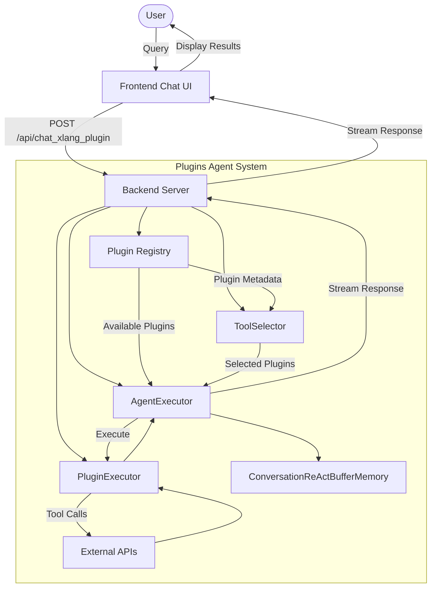
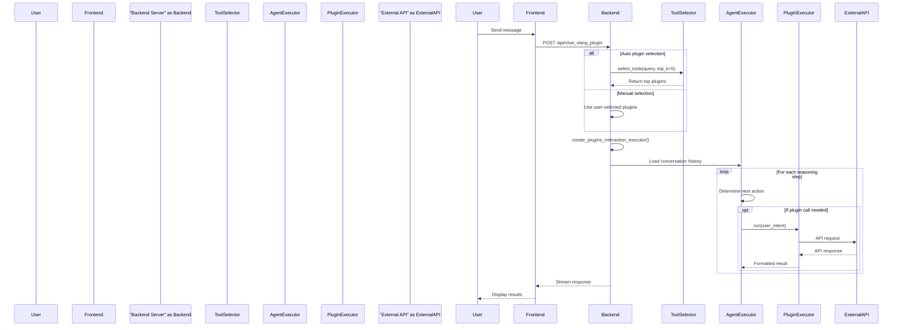
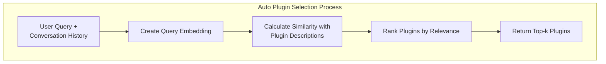
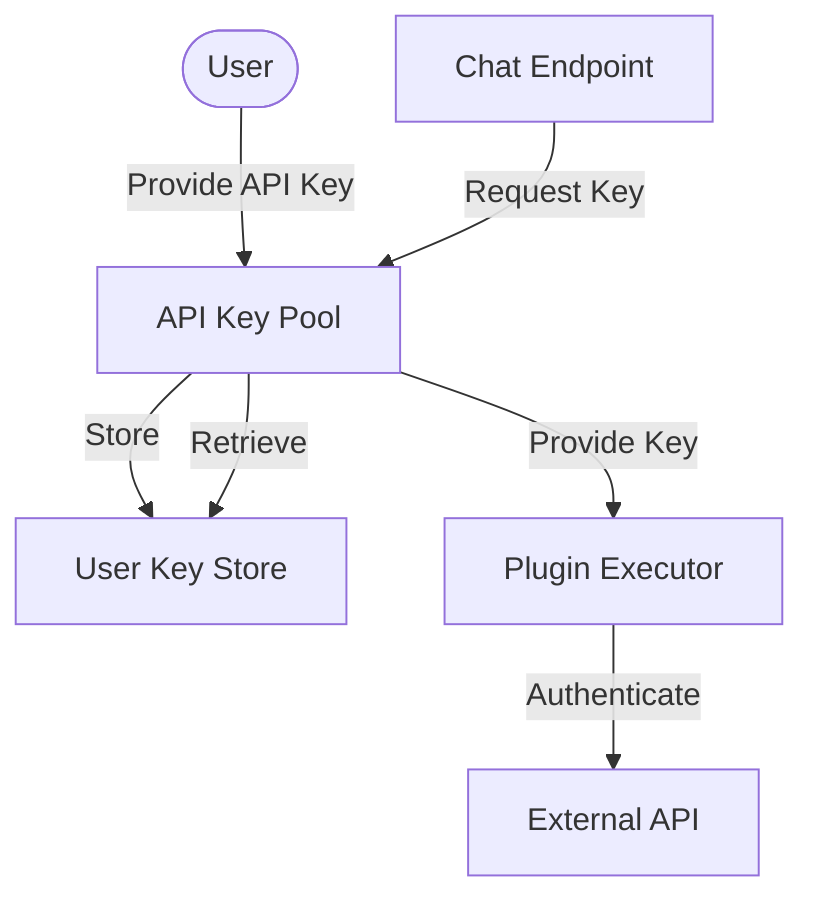
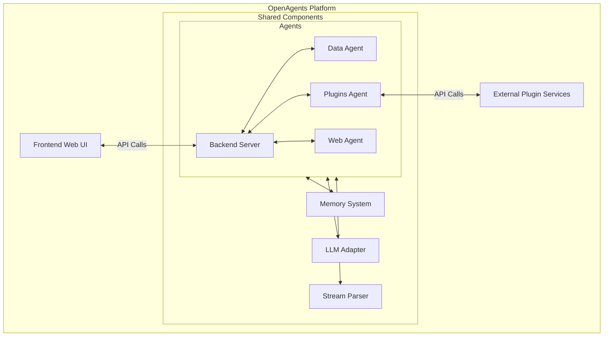

<!-- source: DeepWiki mcp.deepwiki.com · repo xlang-ai/OpenAgents · page 5.2 Plugins Agent · fetched 2026-10-26 -->

# Plugins Agent

<details>
<summary>Relevant source files</summary>

The following files were used as context for generating this wiki page:

- [README.md](README.md)
- [README_ZH.md](README_ZH.md)
- [backend/api/chat_plugin.py](backend/api/chat_plugin.py)

</details>


The Plugins Agent is a specialized language agent within the OpenAgents platform that connects users to over 200 third-party tools and services through a unified chat interface. This agent enables users to accomplish a wide range of daily tasks by leveraging external plugins such as shopping assistants, weather services, scientific calculators, travel planners, and more.

For information about other agent types available in OpenAgents, see [Data Agent](#5.1) and [Web Agent](#5.3).

## Architecture Overview

The Plugins Agent architecture consists of several interconnected components that work together to provide a seamless experience for users interacting with external services.



Sources: [backend/api/chat_plugin.py:110-185](), [backend/api/chat_plugin.py:188-277]()

## Key Components

### 1. Plugin Registry

The Plugin Registry maintains information about all available plugins in the system, including their metadata, descriptions, icons, and API specifications.

```mermaid
classDiagram
    class "Plugin Registry" {
        +List~plugins~ plugins
        +load_all_plugins_elements()
        +register_plugin(plugin)
    }
    
    class "Plugin Info" {
        +String id
        +String name
        +String name_for_human
        +String description
        +String icon
        +Boolean require_api_key
    }
    
    "Plugin Registry" --> "Plugin Info" : contains
```

Sources: [backend/api/chat_plugin.py:31-107]()

### 2. Tool Selector

The Tool Selector component automatically identifies the most relevant plugins for a user's query using an embedding-based approach.

```mermaid
classDiagram
    class "ToolSelector" {
        +List~plugins~ tools_list
        +String mode
        +select_tools(query, top_k)
        +load_query_from_message_list(messages, user_intent)
    }
    
    "ToolSelector" --> "Plugin Registry" : uses
```

Sources: [backend/api/chat_plugin.py:34-39](), [backend/api/chat_plugin.py:228-236]()

### 3. Plugin Executor

The Plugin Executor handles the execution of individual plugins, converting user intent into API calls and processing responses.

```mermaid
classDiagram
    class "PluginExecutor" {
        +String name
        +String api_key
        +String full_description
        +from_plugin_name(name)
        +run(user_intent, llm)
        +load_personnel_info()
    }
    
    class "RunPlugin" {
        +PluginExecutor plugin
        +BaseLanguageModel llm
        +run(term)
    }
    
    "RunPlugin" --> "PluginExecutor" : wraps
```

Sources: [backend/api/chat_plugin.py:133-161](), [backend/api/chat_plugin.py:164-178]()

### 4. Agent Executor

The Agent Executor orchestrates the entire interaction, maintaining conversation context, deciding when to use which plugin, and generating coherent responses.

```mermaid
classDiagram
    class "AgentExecutor" {
        +List~Tool~ tools
        +BaseLanguageModel llm
        +ConversationReActBufferMemory memory
        +run(input)
    }
    
    class "Tool" {
        +String name
        +Function func
        +String description
    }
    
    class "ConversationReActBufferMemory" {
        +String memory_key
        +Boolean return_messages
        +String style
        +Integer max_token_limit
    }
    
    "AgentExecutor" --> "Tool" : uses
    "AgentExecutor" --> "ConversationReActBufferMemory" : maintains
```

Sources: [backend/api/chat_plugin.py:110-185]()

## Plugin Execution Flow

The following sequence diagram illustrates the execution flow when a user interacts with the Plugins Agent:



Sources: [backend/api/chat_plugin.py:188-277]()

## Auto Plugin Selection

A key feature of the Plugins Agent is its ability to automatically select relevant plugins based on the user's query and conversation history:

1. When `"auto"` is specified as the selected plugin, the Tool Selector is activated
2. The selector processes the conversation history and current user query
3. It ranks plugins by relevance to the user's needs
4. The top 5 most relevant plugins are selected for use in the interaction



Sources: [backend/api/chat_plugin.py:228-236]()

## API Integration

### Chat API Endpoint

The primary API endpoint for the Plugins Agent is `/api/chat_xlang_plugin`, which handles chat requests with plugin support.

| Parameter | Type | Description |
|-----------|------|-------------|
| `user_id` | String | User identifier |
| `chat_id` | String | Chat session identifier |
| `user_intent` | String | User's message/query |
| `parent_message_id` | String | ID of previous message |
| `selected_plugins` | List[String] | Plugins to use (or `["auto"]`) |
| `llm_name` | String | Language model to use |
| `temperature` | Float | Temperature parameter for LLM |

The endpoint returns a streaming response containing:
- Agent reasoning steps
- Plugin calls and their results
- Final formatted response

Sources: [backend/api/chat_plugin.py:188-277]()

### Plugin API Keys

For plugins requiring authentication, users can provide API keys, which are securely stored and retrieved when needed:



Sources: [backend/api/chat_plugin.py:169-173]()

## Plugin Configuration

Each plugin in the Plugins Agent is defined by several key files:

1. **ai-plugin.json** - Plugin manifest containing metadata such as name, description, and logo URL
2. **openapi.yaml** - OpenAPI specification defining the plugin's endpoints and parameters
3. **Implementation files** - Code handling the API calls and processing responses

Plugins are loaded from the `real_agents/plugins_agent/plugins/` directory, where each plugin has its own subdirectory.

Sources: [backend/api/chat_plugin.py:41-107]()

## Memory Management

The Plugins Agent maintains conversation history using `ConversationReActBufferMemory`, which:

1. Stores previous messages and their responses
2. Preserves plugin call results for context
3. Formats conversation history for the language model
4. Manages token limits to prevent context overflow

This memory system enables the agent to maintain coherent multi-turn conversations and reference previous information when needed.

Sources: [backend/api/chat_plugin.py:128-131]()

## Extending with New Plugins

To add a new plugin to the Plugins Agent, follow these steps:

1. Create a new directory in `real_agents/plugins_agent/plugins/`
2. Create `ai-plugin.json` with your plugin's metadata
3. Define the API specification in `openapi.yaml`
4. Implement the plugin logic
5. Register the plugin name in `plugin_names.py`

For more detailed information on adding custom plugins, see [Adding New Plugins](#7.2).

Sources: [README.md:269-286]()

## Integration with OpenAgents Platform

The Plugins Agent is one of the three specialized agents in the OpenAgents platform and shares many common components with the other agents:



For information about the shared components used across all agents, see [Shared Adapters](#5.4).

Sources: [README.md:83-157]()

---

