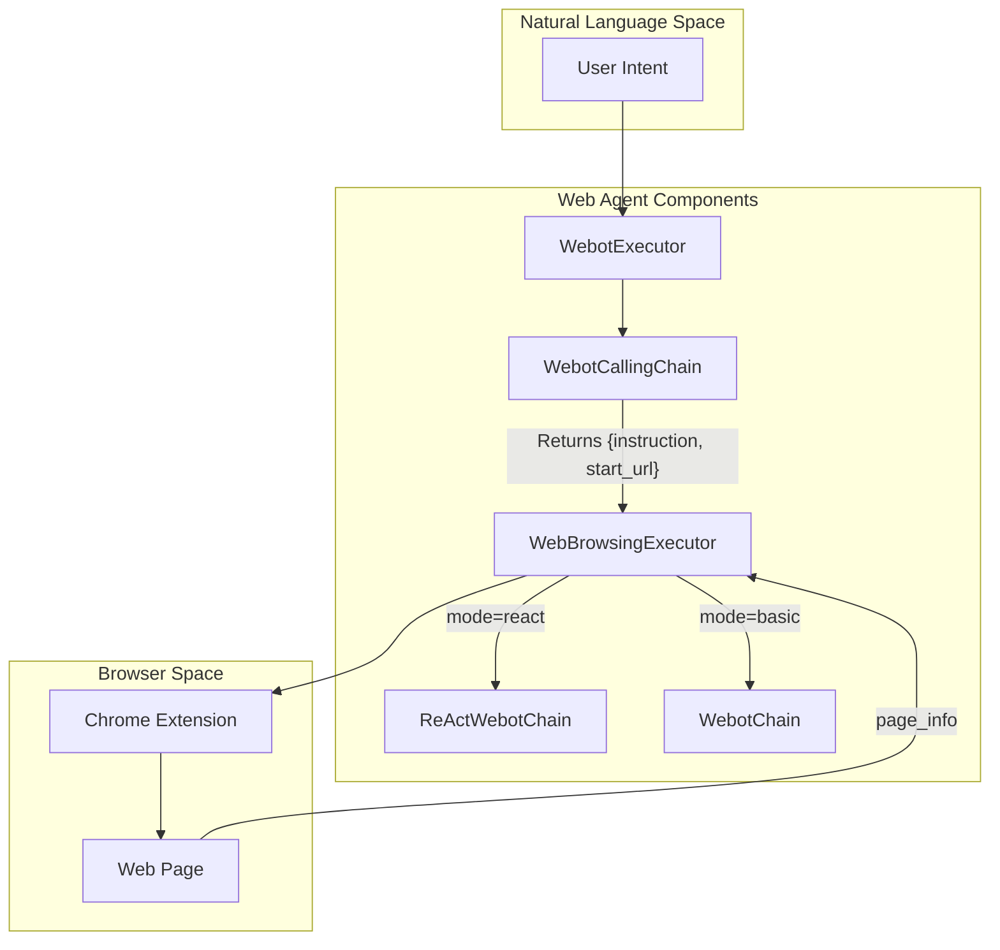
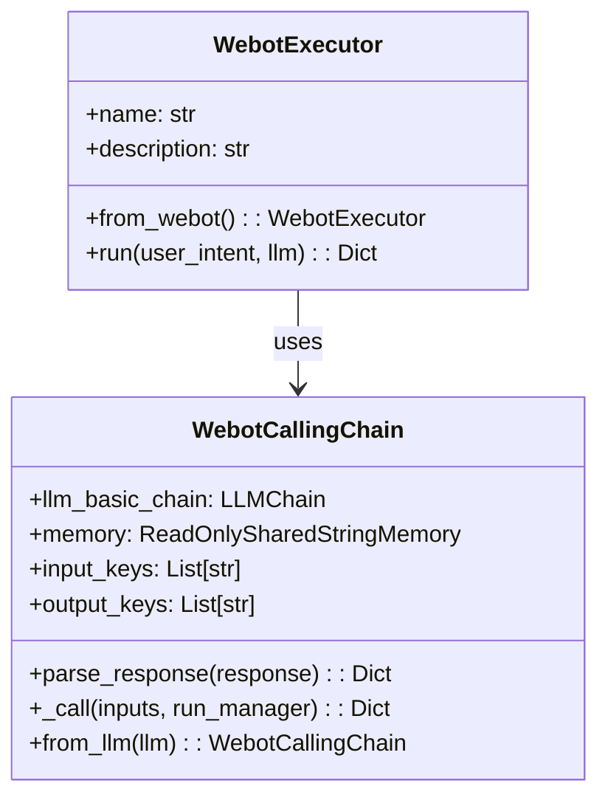
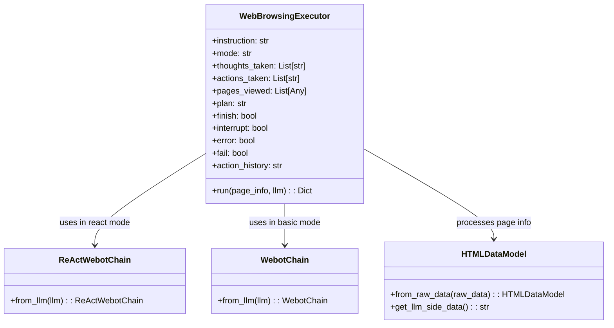
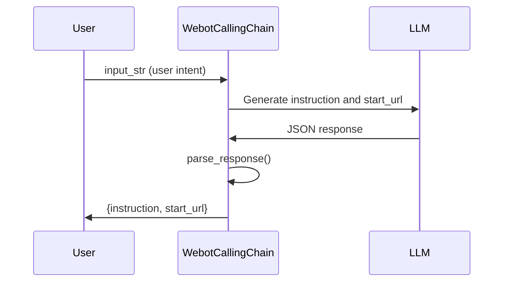
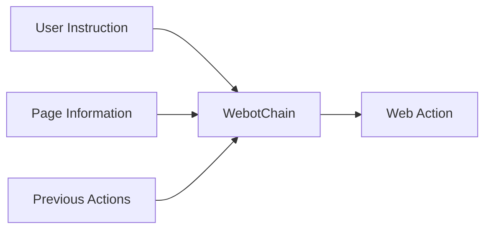
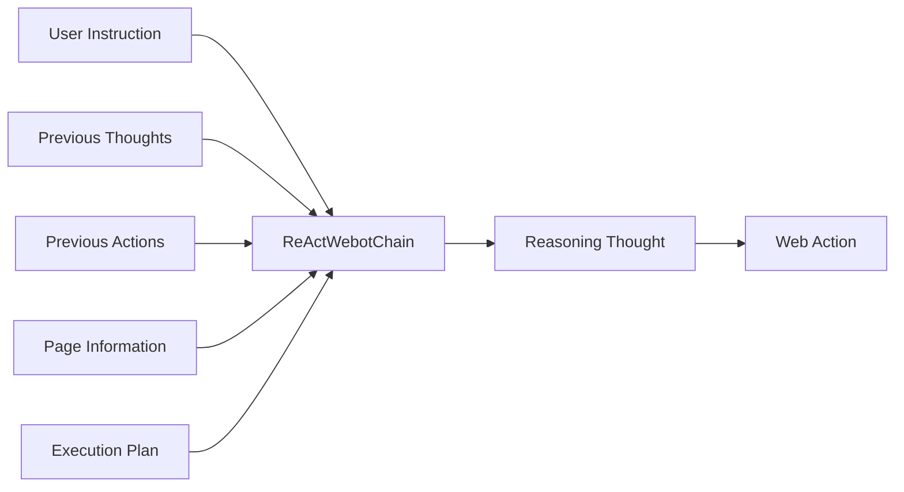
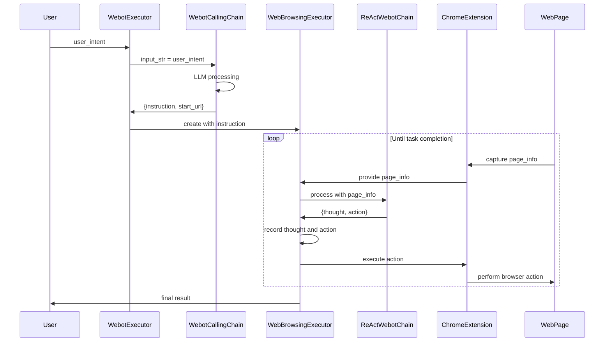
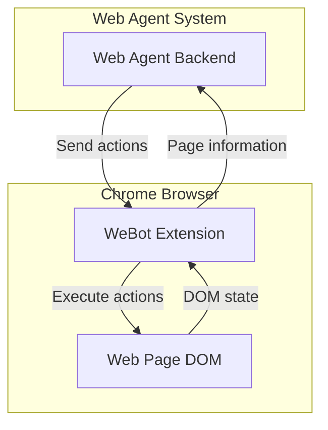

<!-- source: DeepWiki mcp.deepwiki.com · repo xlang-ai/OpenAgents · page 5.3 Web Agent · fetched 2026-10-26 -->

# Web Agent

Relevant source files

The following files were used as context for generating this wiki page:

- [README.md](README.md)
- [README_ZH.md](README_ZH.md)
- [real_agents/web_agent/README.md](real_agents/web_agent/README.md)
- [real_agents/web_agent/__init__.py](real_agents/web_agent/__init__.py)
- [real_agents/web_agent/executors/web_browsing_executor.py](real_agents/web_agent/executors/web_browsing_executor.py)
- [real_agents/web_agent/executors/webot_executor.py](real_agents/web_agent/executors/webot_executor.py)
- [real_agents/web_agent/web_browsing/base.py](real_agents/web_agent/web_browsing/base.py)

## Introduction
The Web Agent is an autonomous web interaction system that enables users to automate web browsing tasks through natural language instructions. It leverages a Chrome extension to navigate websites, perform actions, and retrieve information without requiring direct user intervention in the browser.

Unlike the [Data Agent](#5.1) which focuses on data analysis and the [Plugins Agent](#5.2) which connects to various external APIs, the Web Agent specializes in directly interacting with web pages through browser automation.

Sources: [real_agents/web_agent/README.md:7-14]()

## Architecture Overview

The Web Agent architecture consists of several key components that work together to transform user intentions into web browser actions.

The Web Agent operates through a multi-step process that converts natural language into browser actions:

1. The user provides an intent in natural language
2. WebotExecutor processes this intent to determine the appropriate web browsing instruction and starting URL
3. WebBrowsingExecutor receives these inputs and manages the execution of web actions
4. Based on the mode (basic or react), different reasoning chains are used
5. Actions are executed in the Chrome browser through the extension
6. The web page information is returned to the agent for the next action decision

Sources: [real_agents/web_agent/executors/webot_executor.py:16-36](), [real_agents/web_agent/executors/web_browsing_executor.py:15-47](), [real_agents/web_agent/web_browsing/base.py:28-42]()

## Key Components

### WebotExecutor

The `WebotExecutor` serves as the entry point for the Web Agent. It takes the user's intent as input and produces an instruction and start URL for web browsing.

The `WebotExecutor` is specifically designed for chat interface usage rather than direct extension usage. It leverages the `WebotCallingChain` to process user intents and generate appropriate web browsing instructions.

Sources: [real_agents/web_agent/executors/webot_executor.py:16-47]()

### WebBrowsingExecutor

The `WebBrowsingExecutor` is responsible for executing the web browsing task. It takes an instruction and manages the iterative process of performing actions on web pages.

The `WebBrowsingExecutor` supports two operational modes:

1. **basic mode**: Uses `WebotChain` for straightforward action execution
2. **react mode**: Uses `ReActWebotChain` which implements more sophisticated reasoning and planning

It also tracks various execution states such as actions taken, thoughts (in react mode), pages viewed, and completion status.

Sources: [real_agents/web_agent/executors/web_browsing_executor.py:15-100]()

### WebotCallingChain

The `WebotCallingChain` is responsible for converting user intents into specific instructions and start URLs for web browsing. It uses an LLM to generate these outputs and parses the response.

The chain attempts to parse the LLM response as a JSON object containing the instruction and start URL. If parsing fails, it tries to extract JSON from code blocks in the response.

Sources: [real_agents/web_agent/web_browsing/base.py:28-133]()

## Web Agent Operation Modes

The Web Agent supports two operational modes that determine how it reasons about and executes web actions:

### Basic Mode

In basic mode, the Web Agent uses the `WebotChain` to directly map from the current page state and user instruction to actions. This mode is simpler and more straightforward, with less explicit reasoning.

### React Mode

React mode (Reasoning and Acting) uses the `ReActWebotChain` to implement a more sophisticated approach that includes explicit reasoning steps. In this mode, the agent first formulates a thought about what to do next, then determines the appropriate action.

The react mode enables more complex reasoning by maintaining a history of thoughts and actions, and by following a plan. This makes it suitable for more complex web tasks that require multi-step reasoning.

Sources: [real_agents/web_agent/executors/web_browsing_executor.py:69-97]()

## Workflow

The complete workflow of the Web Agent operates as follows:

1. User provides an intent like "Book a flight from NYC to LA"
2. WebotExecutor processes this intent using WebotCallingChain to determine:
   - Instruction: "Search for flights from NYC to LA and book the cheapest one"
   - Start URL: "https://www.expedia.com"
3. WebBrowsingExecutor is initialized with the instruction
4. The Chrome extension loads the start URL
5. The web page information is captured and sent to WebBrowsingExecutor
6. WebBrowsingExecutor uses the appropriate chain (based on mode) to determine the next action
7. The action is executed in the browser via the Chrome extension
8. This process repeats until the task is completed or fails
9. Results are returned to the user

Sources: [real_agents/web_agent/executors/webot_executor.py:37-47](), [real_agents/web_agent/executors/web_browsing_executor.py:62-100](), [real_agents/web_agent/web_browsing/base.py:90-105]()

## Use Cases

The Web Agent is designed to handle various web automation tasks, including:

- **Information Retrieval**: Searching for specific information across websites
- **Form Filling**: Automating the completion of online forms
- **Navigation**: Finding routes and directions on mapping sites
- **Social Media Interaction**: Posting updates or retrieving information from social platforms
- **E-commerce**: Product search and comparison

Specific examples include:

1. **Google Maps Navigation**: Providing directions between locations
2. **Twitter Posting**: Composing and submitting tweets
3. **Google Form Completion**: Filling out online forms with provided information

Sources: [real_agents/web_agent/README.md:9-15](), [README.md:143-154]()

## Chrome Extension Integration

The Web Agent relies on a Chrome extension (referred to as "WeBot") to interact with web pages. The extension is responsible for:

1. Capturing the current state of the web page
2. Executing actions instructed by the WebBrowsingExecutor
3. Returning results back to the agent

The extension is packaged in `frontend/webot_extension.zip` and needs to be installed in Chrome for the Web Agent to function properly.

The integration allows the Web Agent to perceive web page content, interact with elements (clicking, typing, scrolling), and navigate between pages - essentially performing the same actions a human user would in a browser.

Sources: [README.md:143-154](), [real_agents/web_agent/README.md:7-15]()

## Technical Limitations and Considerations

When using the Web Agent, it's important to be aware of several technical considerations:

1. **Website Compatibility**: Some websites with complex JavaScript, anti-bot measures, or unusual DOM structures may present challenges
2. **Authentication**: Sites requiring login may need special handling
3. **Dynamic Content**: Highly dynamic websites with content that changes rapidly may be difficult to interact with reliably
4. **Browser Dependencies**: The agent requires Chrome with the WeBot extension installed
5. **Action Tracking**: The agent maintains a history of actions and thoughts which can grow large for complex tasks

These considerations should be taken into account when planning to use the Web Agent for specific web automation tasks.

Sources: [real_agents/web_agent/executors/web_browsing_executor.py:32-45]()

---

