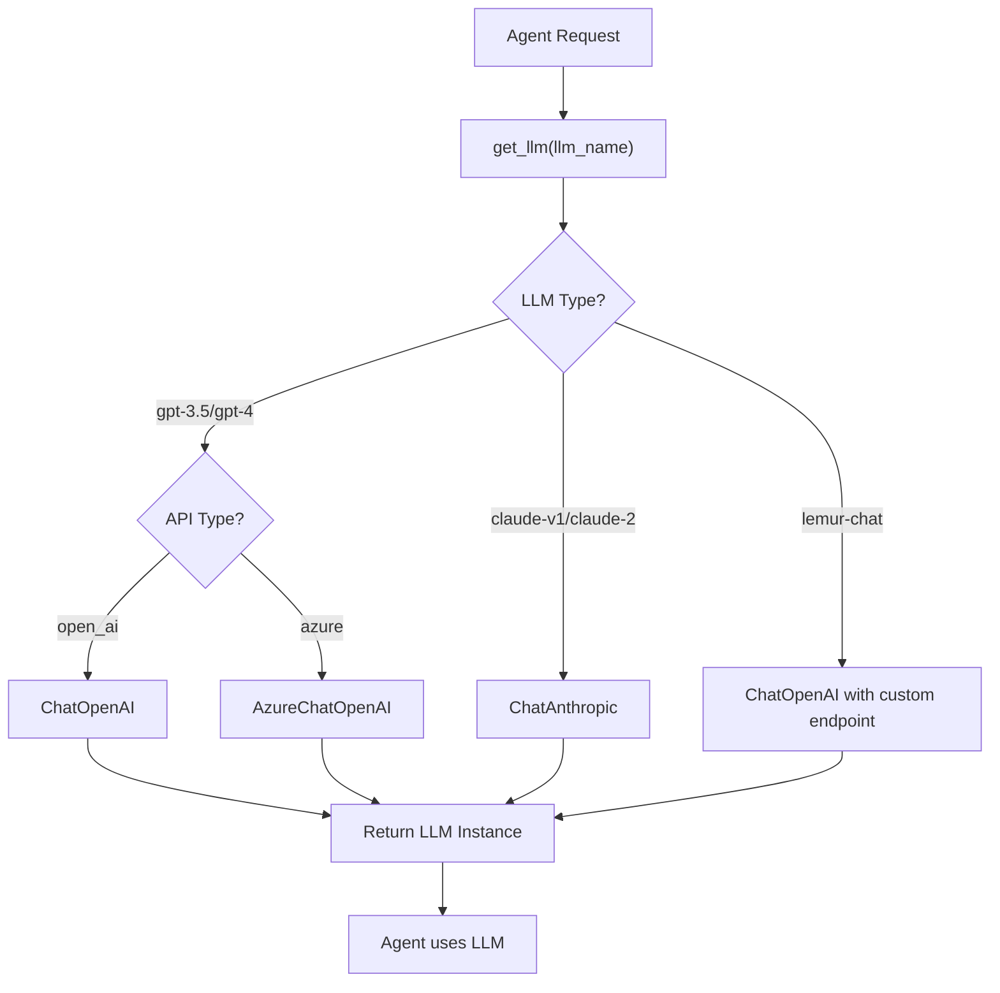
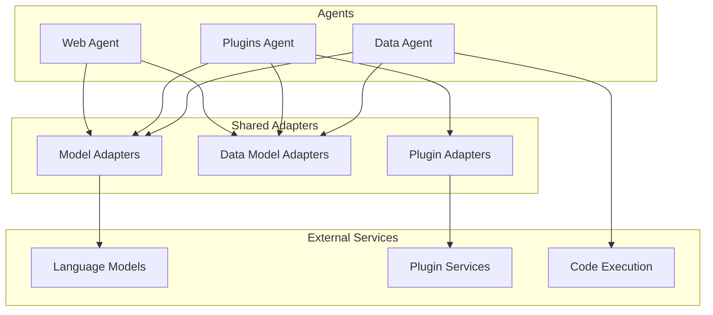
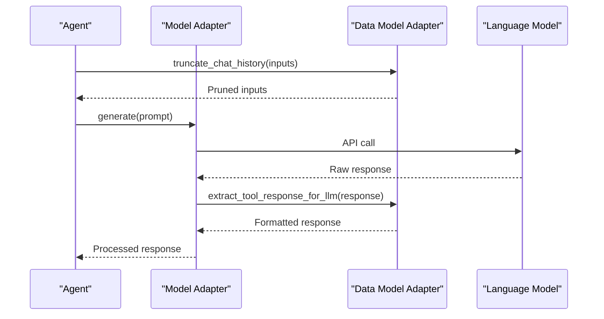

<!-- source: DeepWiki mcp.deepwiki.com · repo xlang-ai/OpenAgents · page 5.4 Shared Adapters · fetched 2026-10-26 -->

# Shared Adapters

<details>
<summary>Relevant source files</summary>

The following files were used as context for generating this wiki page:

- [backend/api/language_model.py](backend/api/language_model.py)
- [real_agents/adapters/data_model/message.py](real_agents/adapters/data_model/message.py)
- [real_agents/adapters/data_model/plugin/spec.py](real_agents/adapters/data_model/plugin/spec.py)
- [real_agents/adapters/models/__init__.py](real_agents/adapters/models/__init__.py)
- [real_agents/adapters/models/azure_openai.py](real_agents/adapters/models/azure_openai.py)

</details>


Shared Adapters in OpenAgents provide a common interface layer that allows all agent types (Data, Plugins, and Web Agents) to interact with various language models, process messages, and manage data formats consistently. They serve as an abstraction layer that decouples agent-specific logic from underlying services and models.

## Purpose and Scope

This document covers the shared adapter components used across all agent types in the OpenAgents platform. For information about agent-specific implementations, see the respective agent documentation ([Data Agent](#5.1), [Plugins Agent](#5.2), or [Web Agent](#5.3)).

## Adapter Types Overview

The OpenAgents platform includes several types of shared adapters:

| Adapter Type | Purpose | Key Components |
|--------------|---------|----------------|
| Model Adapters | Unified interface to different LLMs | `ChatOpenAI`, `ChatAnthropic`, `AzureChatOpenAI` |
| Data Model Adapters | Message formatting, token counting, text processing | `MessageDataModel` |
| Plugin Adapters | Process plugin specifications | `SpecModel` |
| Memory | Manage conversation history | Not covered in provided files |
| Callbacks | Handle event callbacks | Not covered in provided files |

## Model Adapters

Model adapters create a standardized interface for interacting with various Large Language Models, allowing agents to use different models interchangeably without changing their core logic.

### Supported Models

OpenAgents supports multiple language models through its adapter system:

| Model Type | Adapter Class | Supported Models |
|------------|---------------|------------------|
| OpenAI | `ChatOpenAI` | gpt-3.5-turbo-16k, gpt-4 |
| Anthropic | `ChatAnthropic` | claude-v1, claude-2 |
| Google | `ChatGooglePalm` | Google PaLM |
| Azure OpenAI | `AzureChatOpenAI` | Azure-hosted OpenAI models |
| Lemur Chat | Specialized `ChatOpenAI` | lemur-70b-chat-v1 |

Sources: [real_agents/adapters/models/__init__.py:1-19](), [backend/api/language_model.py:10-58]()

### Model Adapter Architecture

**Model Adapter Class Hierarchy**

```mermaid
classDiagram
    class "BaseLanguageModel" {
        +generateText(prompt)
        +streamResponse(prompt)
    }
    
    class "ChatOpenAI" {
        +model_name: str
        +temperature: float
        +streaming: bool
        +_default_params()
        +_create_chat_result()
    }
    
    class "ChatAnthropic" {
        +model: str
        +temperature: float
        +streaming: bool
        +anthropic_api_key: str
    }
    
    class "ChatGooglePalm" {
        +model: str
        +temperature: float
        +streaming: bool
    }
    
    class "AzureChatOpenAI" {
        +deployment_name: str
        +openai_api_type: str
        +openai_api_base: str
        +openai_api_version: str
    }
    
    "BaseLanguageModel" <|-- "ChatOpenAI"
    "BaseLanguageModel" <|-- "ChatAnthropic" 
    "BaseLanguageModel" <|-- "ChatGooglePalm"
    "ChatOpenAI" <|-- "AzureChatOpenAI"
```

The diagram shows how all model adapter classes inherit from a common `BaseLanguageModel` base class, which defines the standard interface. `AzureChatOpenAI` extends the `ChatOpenAI` class with Azure-specific functionality.

Sources: [real_agents/adapters/models/__init__.py:1-19](), [real_agents/adapters/models/azure_openai.py:1-132]()

### Model Selection Process

**LLM Selection Flow**



The `get_llm` function in the backend handles model selection based on the requested model name and environment configuration, returning the appropriate adapter instance.

Sources: [backend/api/language_model.py:24-58]()

## Data Model Adapters

Data model adapters handle processing and formatting of messages, managing token limitations, and standardizing data structures throughout the system.

### MessageDataModel

The `MessageDataModel` class provides essential utilities for working with text and messages in the context of LLM interactions:

**MessageDataModel Class Structure**

```mermaid
classDiagram
    class "MessageDataModel" {
        +_count_tokens(text): int
        +_get_num_tokens_from_messages(buffer): int
        +truncate_text(raw_text, max_token, trunc_ratio): str
        +truncate_chat_history(full_inputs, max_token): Dict
        +_extract_value(json_string, key): str
        +_extract_response(chat_history, markers): str
        +extract_action_for_llm(text, max_token): str
        +extract_tool_response_for_llm(text, tool_style, max_token): str
        +extract_code_for_python_tool(text, max_token, trunc_ratio): str
        +extract_code_for_sql_tool(text, max_token, trunc_ratio): str
    }
```

Key functionalities include:
- Token counting using the `tiktoken` library
- Intelligent text truncation to fit within token limits
- Chat history management to maintain context within limits
- Message and action extraction from LLM outputs
- Code extraction for Python and SQL tools

Sources: [real_agents/adapters/data_model/message.py:1-206]()

### Message Formatting Constants

The `message.py` file defines several formatting constants:

| Constant | Purpose | Format |
|----------|---------|--------|
| `ACTION_FORMAT` | Format agent actions | JSON with action and action_input fields |
| `TOOL_FORMAT` | Format tool calls and outputs | HTML-like tags for code/plugin calls and outputs |
| `TOOL_RESPONSE_FORMAT` | Wrap tool responses | Response wrapped in marker tags |

These constants ensure consistent formatting across the system, making it easier to parse and process messages.

Sources: [real_agents/adapters/data_model/message.py:7-39]()

## Plugin Adapters

Plugin adapters process plugin specifications and handle interactions with external plugin services.

### SpecModel

The `SpecModel` class processes OpenAPI YAML specifications for plugins, converting them into formats that can be used by language models:

**SpecModel Architecture**

```mermaid
classDiagram
    class "SpecModel" {
        +yaml_path: str
        +full_spec: Dict
        +paths: Dict
        +__init__(yaml_path, model_name)
        +load_personnel_info(api_key): Tuple
        +prepare_spec(include_params): str
        +list_endpoints(): str
        +prepare_spec_for_one_path(path_name, include_api_info, include_params): str
    }
    
    class "APIYamlModel" {
        +to_json(): Dict
        +from_yaml(yaml_path): APIYamlModel
    }
    
    "SpecModel" --> "APIYamlModel" : uses
```

Key functionalities include:
- Reading and processing YAML specifications for plugins
- Creating human-readable documentation for plugin endpoints
- Ensuring descriptions stay within token limits
- Loading custom code for plugin interactions

Sources: [real_agents/adapters/data_model/plugin/spec.py:1-164]()

## Adapter Integration in System Architecture

**Adapter Integration in Agent System**



This diagram shows how different agent types utilize shared adapters to interact with external services. All agents use model adapters to communicate with language models and data model adapters for message processing. The Plugins Agent additionally uses plugin adapters for external plugin interactions.

## Message Processing Flow

**Data Flow Through Adapters**



This sequence diagram illustrates how messages flow through the adapters during a typical agent-LLM interaction, showing the preprocessing of inputs, LLM generation, and post-processing of responses.

## Model Registration and Type Mapping

The model adapters are registered in a dictionary that maps model types to their respective adapter classes:

```python
type_to_cls_dict = {
    "chat_anthropic": ChatAnthropic,
    "chat_google_palm": ChatGooglePalm,
    "chat_openai": ChatOpenAI,
    "azure_chat_openai": AzureChatOpenAI,
}
```

This mapping allows the system to dynamically select the appropriate adapter class based on the requested model type.

Sources: [real_agents/adapters/models/__init__.py:14-19]()

## Summary

The shared adapters in OpenAgents provide a crucial abstraction layer that enables:

1. **Model Agnosticism**: Agents can work with different language models through a unified interface
2. **Structured Data Handling**: Consistent formatting and processing of messages and responses
3. **Token Management**: Intelligent handling of token limitations across different models
4. **Plugin Integration**: Standardized processing of plugin specifications and interactions
5. **Code Management**: Extraction and formatting of code snippets for execution

By decoupling agent logic from implementation details of external services and models, these adapters significantly enhance system extensibility and maintainability.

---

