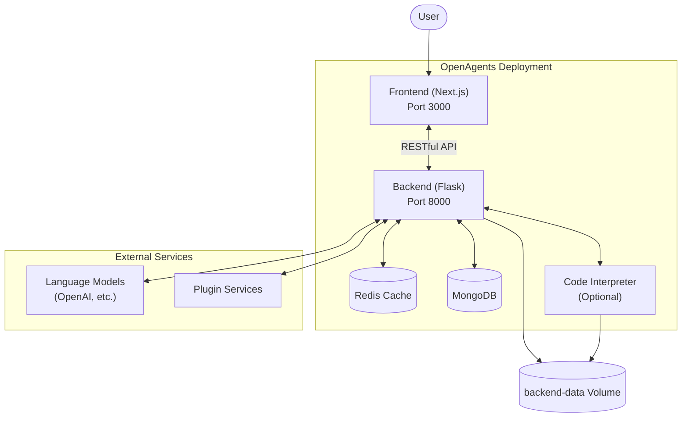
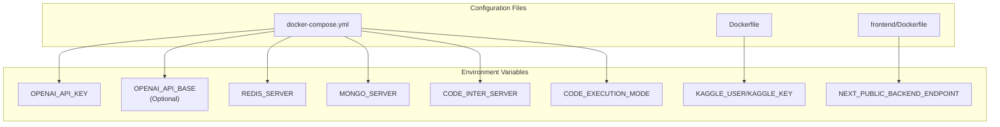
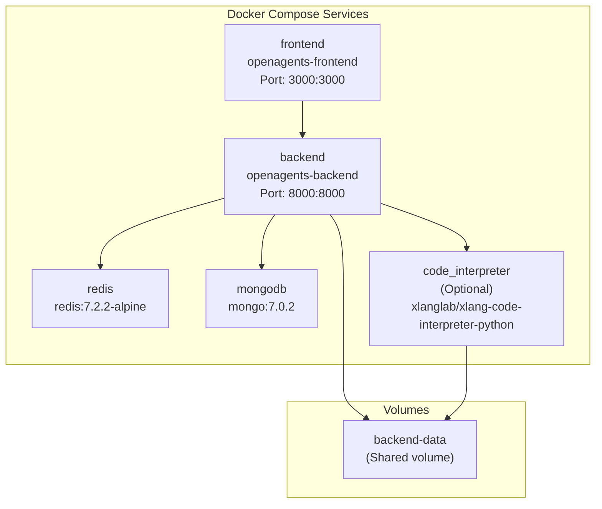

<!-- source: DeepWiki mcp.deepwiki.com · repo xlang-ai/OpenAgents · page 6 Deployment · fetched 2026-10-26 -->

# Deployment

<details>
<summary>Relevant source files</summary>

The following files were used as context for generating this wiki page:

- [Dockerfile](Dockerfile)
- [README.md](README.md)
- [README_ZH.md](README_ZH.md)
- [docker-compose.yml](docker-compose.yml)
- [frontend/Dockerfile](frontend/Dockerfile)
- [frontend/next.config.js](frontend/next.config.js)

</details>


This page documents how to deploy the OpenAgents platform in various environments. It covers both Docker-based and source code deployment methods, along with configuration options and requirements.

For information about extending the platform with new agents or tools, see [Extending OpenAgents](#7).

## Deployment Architecture

OpenAgents follows a microservice architecture with several interconnected components that need to be deployed together:



Sources: [README.md:158-165](), [docker-compose.yml:1-67]()

## Deployment Options

OpenAgents offers two primary deployment methods:

1. **Docker Deployment**: Recommended for most users, providing an automated setup of all components.
2. **Source Code Deployment**: For development or customization purposes, with manual setup of each component.

### System Requirements

Before deploying OpenAgents, ensure your system meets these requirements:

| Component | Minimum Requirement |
|-----------|---------------------|
| CPU | 2+ cores |
| RAM | 4GB+ (8GB+ recommended) |
| Disk Space | 10GB+ |
| GPU | Optional, for better performance |
| Network | Internet access for API calls |

Sources: [README.md:166-174]()

## Docker Deployment

Docker deployment is the simplest method for setting up OpenAgents, using Docker Compose to orchestrate all required services.

### Prerequisites

- Docker and Docker Compose installed
- OpenAI API key (or other supported LLM API key)
- Optional: NVIDIA Container Toolkit (for GPU support)

### Configuration

The main configuration happens in the `docker-compose.yml` and `Dockerfile` files:



Sources: [docker-compose.yml:38-54](), [Dockerfile:187-189](), [frontend/Dockerfile:14-15]()

### Basic Docker Deployment Steps

1. Clone the repository:
```bash
git clone https://github.com/xlang-ai/OpenAgents
cd OpenAgents
```

2. Configure API keys in `docker-compose.yml`:
```yaml
environment:
  - OPENAI_API_KEY=your_openai_api_key_here
```

3. If using Kaggle datasets, modify `Dockerfile`:
```dockerfile
ENV KAGGLE_USER="your_kaggle_username" \
    KAGGLE_KEY="your_kaggle_api_key" 
```

4. If not running locally, set the backend endpoint in `frontend/Dockerfile`:
```dockerfile
ENV NEXT_PUBLIC_BACKEND_ENDPOINT http://your.server.ip:8000
```

5. Build and start the services:
```bash
docker compose build
docker compose up -d
```

6. Access the application:
   - Frontend: http://localhost:3000
   - Backend API: http://localhost:8000

Sources: [README.md:177-207](), [docker-compose.yml:1-67]()

### Environment Variables

The following environment variables can be configured in `docker-compose.yml`:

| Environment Variable | Description | Required | Default |
|----------------------|-------------|----------|---------|
| OPENAI_API_KEY | API key for OpenAI | Yes | - |
| OPENAI_API_BASE | Custom OpenAI API endpoint | No | https://api.openai.com/v1 |
| REDIS_SERVER | Redis server hostname | Yes | redis |
| MONGO_SERVER | MongoDB server hostname | Yes | mongodb |
| CODE_INTER_SERVER | Code interpreter hostname | No | code_interpreter |
| CODE_EXECUTION_MODE | Execution mode (local/docker) | Yes | local |

Sources: [docker-compose.yml:38-54]()

### GPU Support

To enable GPU acceleration for the backend:

1. Install [NVIDIA Container Toolkit](https://docs.nvidia.com/datacenter/cloud-native/container-toolkit/latest/install-guide.html)

2. Uncomment the GPU configuration in `docker-compose.yml`:
```yaml
deploy:
  resources:
    reservations:
      devices:
      - driver: nvidia
        device_ids: ['0']
        capabilities: [gpu]
```

Sources: [README.md:193-195](), [docker-compose.yml:55-62]()

### Code Interpreter Configuration

The Code Interpreter provides a sandboxed environment for executing Python code in the Data Agent. To enable it:

1. Uncomment the code_interpreter service in `docker-compose.yml`:
```yaml
code_interpreter:
  image: xlanglab/xlang-code-interpreter-python
  env_file:
    - ./real_agents/data_agent/.code_interpreter_docker_env
  volumes:
    - backend-data:/home
  cap_add:
    - SYS_RESOURCE
    - SYS_PTRACE
    - NET_ADMIN
```

2. Set the CODE_EXECUTION_MODE to "docker" in the backend environment:
```yaml
environment:
  - CODE_EXECUTION_MODE=docker
```

Sources: [docker-compose.yml:26-36](), [README.md:189-192]()

## Source Code Deployment

For development or customization, you can deploy components individually.

### Backend Deployment

1. Navigate to the backend directory:
```bash
cd backend
```

2. Follow the setup instructions in the Backend README file to:
   - Install dependencies
   - Configure environment variables
   - Start the Flask server

Sources: [README.md:168-171]()

### Frontend Deployment

1. Navigate to the frontend directory:
```bash
cd frontend
```

2. Follow the setup instructions in the Frontend README file to:
   - Install dependencies
   - Configure the backend endpoint
   - Start the Next.js development server

Sources: [README.md:172]()

## Docker Compose Service Architecture

The Docker Compose setup creates a network of interconnected services:



Sources: [docker-compose.yml:1-67]()

## Production Considerations

When deploying to production, consider the following:

### Security

- Use HTTPS for all communications
- Set up proper authentication for MongoDB
- Keep API keys secure using environment variables
- Implement proper network security rules

### Scaling

- For higher load, consider:
  - Multiple backend instances behind a load balancer
  - Redis clustering for better cache performance
  - MongoDB replication for data redundancy

### Monitoring

- Implement health checks for each service
- Set up logging for troubleshooting
- Monitor resource usage (CPU, memory, disk)

## Build Process

The build process for the Docker images is defined in the Dockerfiles:

### Backend Dockerfile

The backend Dockerfile:
1. Uses NVIDIA CUDA as the base image
2. Installs Python 3.10
3. Copies backend and real_agents code
4. Installs required Python packages
5. Configures environment variables
6. Sets up Kaggle credentials (if provided)

Sources: [Dockerfile:1-194]()

### Frontend Dockerfile

The frontend Dockerfile:
1. Uses Node.js 18 as the base image
2. Installs dependencies
3. Builds the Next.js application
4. Creates an optimized production build
5. Configures the backend endpoint

Sources: [frontend/Dockerfile:1-37](), [frontend/next.config.js:1-19]()

## Troubleshooting

### Common Issues

1. **Connection refused to backend**:
   - Ensure the backend server is running
   - Check if ports are correctly mapped
   - Verify NEXT_PUBLIC_BACKEND_ENDPOINT is set correctly

2. **OpenAI API errors**:
   - Validate your API key
   - Check API rate limits
   - Ensure you have billing set up

3. **Plugin timeouts**:
   - Some regions may have connectivity issues to HuggingFace
   - Consider using a VPN or proxy
   - Manually download models if needed

4. **Memory issues**:
   - Increase Docker container memory limits
   - Consider enabling swap on your host
   - Optimize backend cache settings

Sources: [README.md:70-71]()

For additional help, join the Discord community or create an issue on GitHub as mentioned in the README.

---

