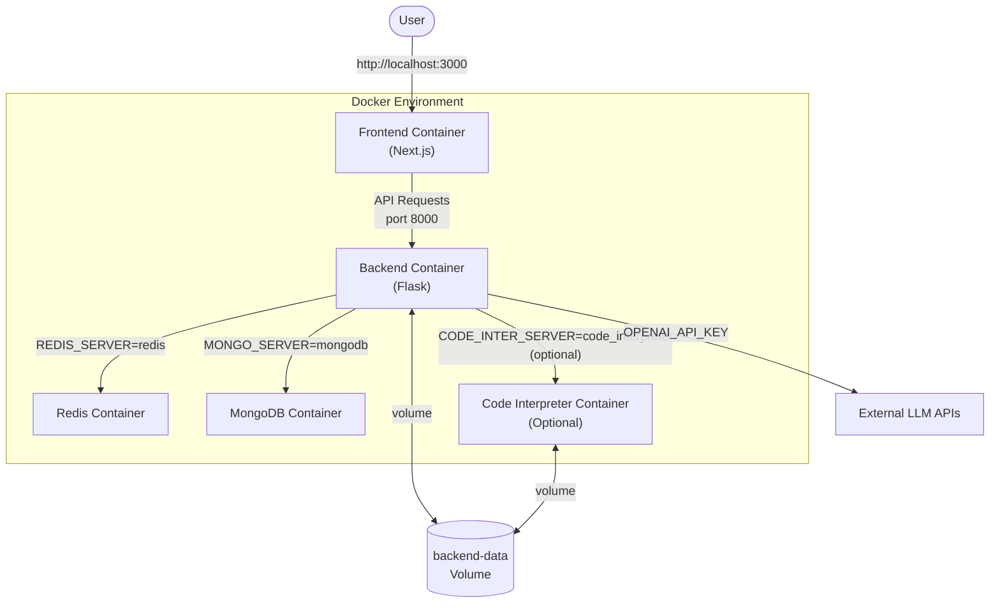
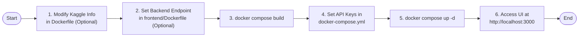
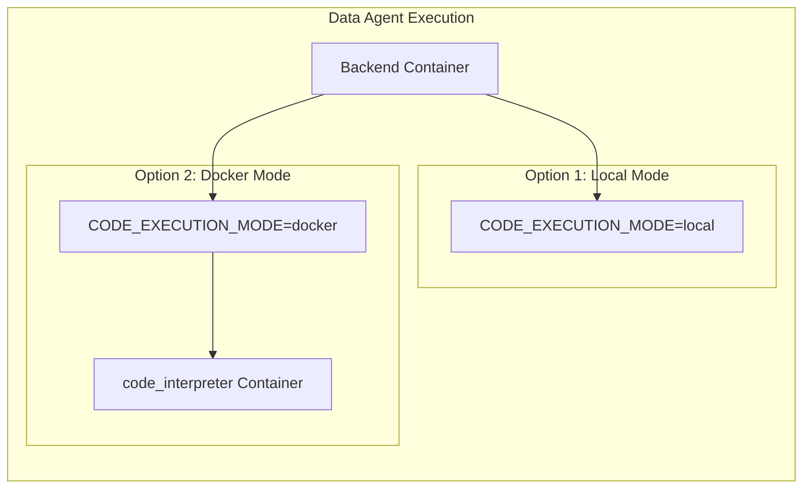
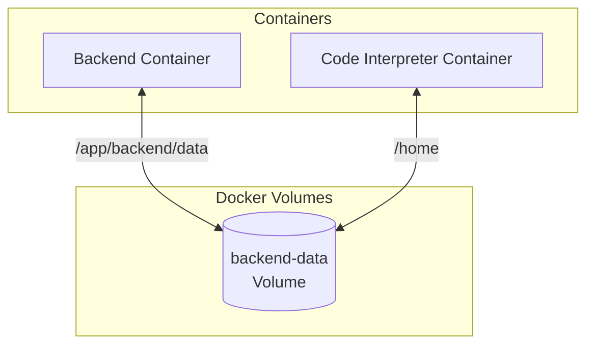
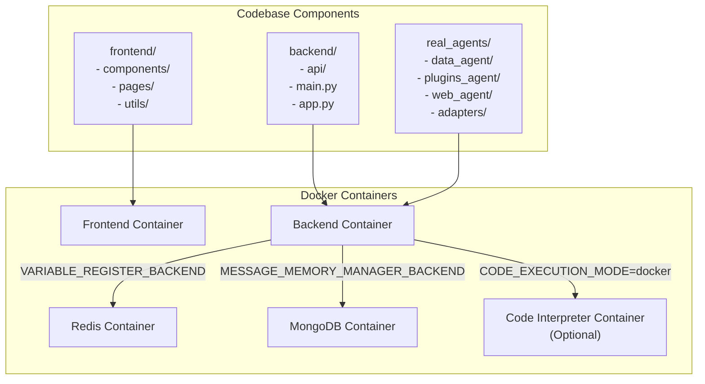

<!-- source: DeepWiki mcp.deepwiki.com · repo xlang-ai/OpenAgents · page 6.1 Docker Deployment · fetched 2026-10-26 -->

# Docker Deployment

<details>
<summary>Relevant source files</summary>

The following files were used as context for generating this wiki page:

- [Dockerfile](Dockerfile)
- [README.md](README.md)
- [README_ZH.md](README_ZH.md)
- [docker-compose.yml](docker-compose.yml)
- [frontend/Dockerfile](frontend/Dockerfile)
- [frontend/next.config.js](frontend/next.config.js)

</details>


This page details the process for deploying the OpenAgents platform using Docker, which provides a containerized environment for running all the necessary components with minimal configuration. For information about specific environment variables and configuration options, see [Environment Variables](#6.2).

## Overview

OpenAgents can be deployed using Docker and Docker Compose to create a containerized environment with all required services, including the backend server, frontend UI, Redis cache, MongoDB database, and optionally the code interpreter service. This approach enables consistent deployment across different environments and simplifies the setup process.



**Diagram: Docker Deployment Architecture**

Sources: [docker-compose.yml](), [Dockerfile](), [README.md:186-206]()

## Docker Components

The OpenAgents Docker deployment consists of the following containers:

| Container | Description | Base Image | Port |
|-----------|-------------|------------|------|
| frontend | Next.js frontend UI | node:18-alpine | 3000 |
| backend | Flask backend server | nvidia/cuda:12.2.0-base-ubuntu22.04 | 8000 |
| redis | Redis cache server | redis:7.2.2-alpine | - |
| mongodb | MongoDB database | mongo:7.0.2 | - |
| code_interpreter | (Optional) Sandboxed code execution environment | xlanglab/xlang-code-interpreter-python | - |

Sources: [docker-compose.yml](), [Dockerfile](), [frontend/Dockerfile]()

## Deployment Process

The deployment process involves configuring the Docker environment, building the images, and starting the containers. Below is a step-by-step guide to the process:



**Diagram: Docker Deployment Process**

Sources: [README.md:186-206]()

### Prerequisites

Before deploying OpenAgents with Docker, ensure you have:

1. Docker and Docker Compose installed on your system
2. API keys for external services (e.g., OpenAI)
3. Sufficient disk space for the Docker images and volumes
4. If using GPU: [NVIDIA Container Toolkit](https://docs.nvidia.com/datacenter/cloud-native/container-toolkit/latest/install-guide.html) installed

Sources: [README.md:205-206]()

### Configuration

Several configuration steps are required before building and running the Docker containers:

#### 1. Kaggle Configuration (Optional)

If you want to use Kaggle datasets, modify the Kaggle authentication information in the `Dockerfile`:

```
# In Dockerfile (around line 188-189)
ENV KAGGLE_USER="" \
    KAGGLE_KEY="" 
```

Sources: [Dockerfile:188-189](), [README.md:192-195]()

#### 2. Backend Endpoint Configuration

If you are not deploying locally or need to specify a different backend endpoint IP address, modify the environment variable in `frontend/Dockerfile`:

```
# In frontend/Dockerfile (around line 15)
ENV NEXT_PUBLIC_BACKEND_ENDPOINT http://x.x.x.x:8000
```

Sources: [frontend/Dockerfile:15](), [README.md:196-198]()

#### 3. LLM API Configuration

Configure your OpenAI API key or other LLM service settings in `docker-compose.yml`:

```
# In docker-compose.yml (around line 49-50)
environment:
  - OPENAI_API_KEY= #need your key here
  # - OPENAI_API_BASE=
```

If you're using alternative LLM services like FastChat, uncomment and set the `OPENAI_API_BASE` variable.

Sources: [docker-compose.yml:49-50](), [README.md:199-201]()

### Building and Running

After configuration, follow these steps to build and run the Docker containers:

1. Build the Docker images:
   ```bash
   docker compose build
   ```

2. Start all the services:
   ```bash
   docker compose up -d
   ```

3. Access the UI at `http://localhost:3000`

Sources: [README.md:202-205]()

## Code Interpreter Configuration

The OpenAgents Data Agent can execute code in two ways:

1. **Local execution** (default): Code runs within the backend container
2. **Sandboxed execution**: Code runs in a separate container for better isolation

To enable the sandboxed code interpreter:

1. Uncomment the `code_interpreter` service section in `docker-compose.yml` (lines 27-36)
2. Set `CODE_EXECUTION_MODE=docker` in the backend environment variables (line 54)



**Diagram: Code Interpreter Execution Modes**

Sources: [docker-compose.yml:27-37](), [docker-compose.yml:54]()

## GPU Support

For machine learning tasks and better performance, you can enable GPU support in the backend container:

1. Ensure the NVIDIA Container Toolkit is installed on your host system
2. Uncomment the GPU configuration section in `docker-compose.yml` (lines 56-62)

```
# In docker-compose.yml (lines 56-62)
deploy:
  resources:
    reservations:
      devices:
      - driver: nvidia
        device_ids: ['0']
        capabilities: [gpu]
```

Sources: [docker-compose.yml:56-62](), [README.md:205-206]()

## Data Persistence

The Docker setup uses a named volume (`backend-data`) to persist data between container restarts:



**Diagram: Docker Volume Configuration**

Sources: [docker-compose.yml:46-47](), [docker-compose.yml:32](), [docker-compose.yml:64-66]()

## Network Configuration

The Docker Compose setup creates an internal network for the containers to communicate, and exposes the following ports to the host:

| Container | Internal Port | Host Port | Purpose |
|-----------|---------------|-----------|---------|
| frontend | 3000 | 3000 | Web UI access |
| backend | 8000 | 8000 | API access |

The containers communicate using their service names as hostnames within the Docker network:
- Redis is accessed as `redis`
- MongoDB is accessed as `mongodb`
- Code interpreter (if enabled) is accessed as `code_interpreter`

Sources: [docker-compose.yml:19-20](), [docker-compose.yml:41-42](), [docker-compose.yml:51-53]()

## Code to Docker Mapping

The following diagram shows how the OpenAgents codebase maps to Docker containers:



**Diagram: Code to Docker Container Mapping**

Sources: [docker-compose.yml](), [Dockerfile:164-165](), [Dockerfile:183-186]()

## Troubleshooting

### Common Issues and Solutions

1. **Auto Plugin Connection Timeouts**:
   - When using Auto Plugin, the system will download weight files from Hugging Face
   - In some regions, connection timeouts may occur
   - Solution: Configure appropriate network proxies or download files manually

2. **Docker Build Failures**:
   - Ensure you have sufficient disk space
   - Make sure you're in the root project directory when running Docker commands
   - Check that all required files are present

3. **Slower Performance**:
   - The Docker version may have slower response times compared to source code deployment
   - For optimal performance, consider deploying from source code

Sources: [README.md:206-207]()

## Summary

Docker deployment provides a convenient way to run the OpenAgents platform with minimal configuration. The containerized environment includes all necessary components and can be easily deployed on any system with Docker installed. For more advanced configuration options, refer to the [Environment Variables](#6.2) page.

Sources: [README.md:186-207](), [docker-compose.yml](), [Dockerfile]()

---

