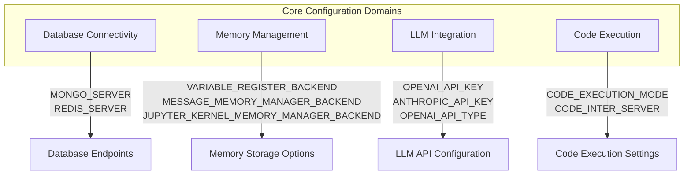
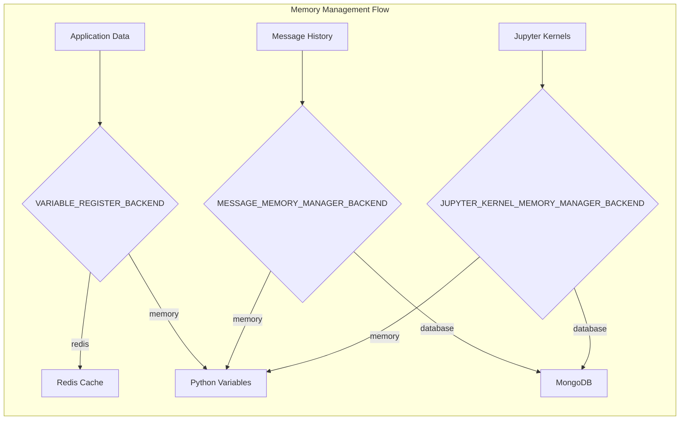
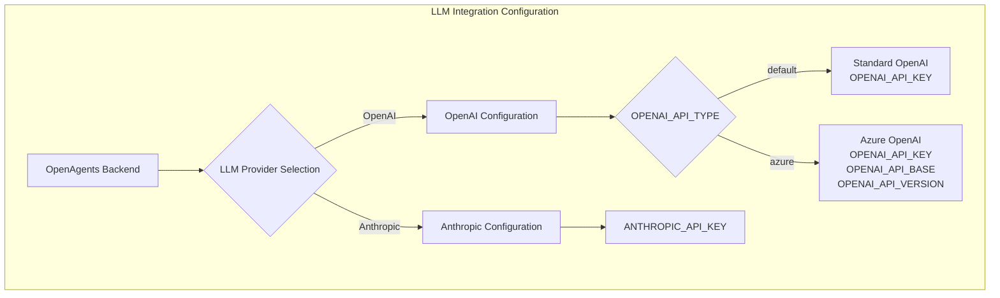
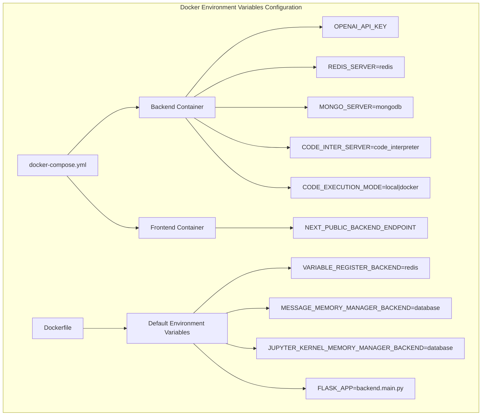

<!-- source: DeepWiki mcp.deepwiki.com · repo xlang-ai/OpenAgents · page 6.2 Environment Variables · fetched 2026-10-26 -->

# Environment Variables

<details>
<summary>Relevant source files</summary>

The following files were used as context for generating this wiki page:

- [Dockerfile](Dockerfile)
- [backend/README.md](backend/README.md)
- [backend/setup_script.sh](backend/setup_script.sh)
- [docker-compose.yml](docker-compose.yml)
- [frontend/Dockerfile](frontend/Dockerfile)
- [frontend/next.config.js](frontend/next.config.js)

</details>


This document provides a comprehensive reference for all environment variables used in OpenAgents. These variables control various aspects of the system's configuration, from database connections to language model integrations. For information about deploying OpenAgents with Docker, see [Docker Deployment](#6.1).

## Core Configuration Variables

Environment variables are critical for configuring OpenAgents' behavior across different deployment scenarios. The following diagram illustrates the primary configuration domains and their respective variables:



Sources: [backend/README.md:105-116](), [docker-compose.yml:49-54]()

## Backend Environment Variables

### Database Connection Variables

These variables configure connections to the primary data stores used by OpenAgents.

| Variable | Description | Default Value | Required |
|----------|-------------|---------------|----------|
| `MONGO_SERVER` | MongoDB server address | `127.0.0.1` in development | Yes |
| `REDIS_SERVER` | Redis server address | Not set by default | Yes |

When using Docker Compose, these are automatically set to their respective service names (`mongodb` and `redis`).

Sources: [backend/README.md:114](), [docker-compose.yml:51-52]()

### Memory Management Variables

These variables control how different types of data are stored and cached in the system.

| Variable | Description | Options | Default |
|----------|-------------|---------|---------|
| `VARIABLE_REGISTER_BACKEND` | Backend used for variable registry | `redis`, `memory` | `memory` |
| `MESSAGE_MEMORY_MANAGER_BACKEND` | Backend for message storage | `database`, `memory` | `memory` |
| `JUPYTER_KERNEL_MEMORY_MANAGER_BACKEND` | Backend for Jupyter kernel storage | `database`, `memory` | `memory` |

When set to `redis` or `database`, persistent storage is used. When set to `memory`, data is stored in Python global variables and will be lost on restart.



Sources: [backend/README.md:105-116](), [Dockerfile:183-186](), [backend/setup_script.sh:53-56]()

### LLM Integration Variables

OpenAgents supports multiple LLM providers. The following variables configure these integrations:

#### OpenAI Configuration

| Variable | Description | Required for OpenAI |
|----------|-------------|---------------------|
| `OPENAI_API_KEY` | API key for OpenAI services | Yes |
| `OPENAI_API_TYPE` | Type of OpenAI service (`azure` or default) | No |
| `OPENAI_API_BASE` | Base URL for Azure OpenAI | Only with `OPENAI_API_TYPE=azure` |
| `OPENAI_API_VERSION` | API version for Azure OpenAI | Only with `OPENAI_API_TYPE=azure` |

#### Anthropic Configuration

| Variable | Description | Required for Anthropic |
|----------|-------------|------------------------|
| `ANTHROPIC_API_KEY` | API key for Anthropic services | Yes |



Sources: [backend/README.md:126-142](), [docker-compose.yml:49-50]()

### Code Execution Variables

These variables control how Python code is executed in the Data Agent:

| Variable | Description | Options | Default |
|----------|-------------|---------|---------|
| `CODE_EXECUTION_MODE` | Where code is executed | `local`, `docker` | `local` |
| `CODE_INTER_SERVER` | Address of code interpreter service | Container name or URL | `code_interpreter` |

When `CODE_EXECUTION_MODE` is set to `docker`, code runs in a sandboxed Docker container for improved security. When set to `local`, code runs directly in the local environment.

Sources: [backend/README.md:172-193](), [docker-compose.yml:53-54]()

### Optional Tool Configuration

#### Kaggle Search Tool Configuration

If you use the Kaggle Search Tool in the Data Agent:

| Variable | Description | Required for Kaggle |
|----------|-------------|---------------------|
| `KAGGLE_USER` | Kaggle username | Yes |
| `KAGGLE_KEY` | Kaggle API key | Yes |

These can also be configured by placing a `kaggle.json` file at `~/.kaggle/kaggle.json` with the appropriate credentials.

Sources: [backend/README.md:155-157](), [Dockerfile:188-192]()

## Frontend Environment Variables

| Variable | Description | Required |
|----------|-------------|----------|
| `NEXT_PUBLIC_BACKEND_ENDPOINT` | URL of the backend service | No - defaults to same-origin |
| `DOCKER` | Whether build is for Docker deployment | No - affects build output |

The `NEXT_PUBLIC_BACKEND_ENDPOINT` variable is particularly important when deploying in a multi-server environment where the frontend and backend are hosted separately.

Sources: [frontend/Dockerfile:14-15](), [frontend/next.config.js:2-16]()

## Docker Deployment Environment Variables

When deploying with Docker Compose, environment variables can be set in the `docker-compose.yml` file. Here's a configuration map showing which variables are set where:



Sources: [docker-compose.yml:49-54](), [Dockerfile:183-186]()

## Setting Environment Variables

### Development Environment

For local development, you can set environment variables in your terminal:

```bash
# Database Configuration
export MONGO_SERVER=127.0.0.1
export VARIABLE_REGISTER_BACKEND=redis
export MESSAGE_MEMORY_MANAGER_BACKEND=database
export JUPYTER_KERNEL_MEMORY_MANAGER_BACKEND=database

# LLM Configuration
export OPENAI_API_KEY=<your-openai-api-key>
export ANTHROPIC_API_KEY=<your-anthropic-api-key>

# For Azure OpenAI (if applicable)
export OPENAI_API_TYPE=azure
export OPENAI_API_BASE=<your-azure-endpoint>
export OPENAI_API_VERSION=<your-azure-api-version>

# Code Execution (if using sandboxed execution)
export CODE_EXECUTION_MODE=docker
```

To make these settings persistent across terminal sessions, add them to your shell profile (`~/.bashrc`, `~/.zshrc`, etc.).

Sources: [backend/README.md:105-142](), [backend/setup_script.sh:53-56]()

### Using the Setup Script

The OpenAgents backend provides a setup script that configures the essential environment variables:

```bash
backend/setup_script.sh
```

This script sets up MongoDB, Redis, and the core environment variables for you automatically.

Sources: [backend/setup_script.sh:1-59]()

### Docker Production Environment

For production deployment with Docker, environment variables should be configured in the `docker-compose.yml` file as shown earlier. Sensitive information like API keys should ideally be stored in a separate `.env` file or using a secrets management system.

Sources: [docker-compose.yml:49-54]()

## Troubleshooting Environment Variables

If you encounter issues with OpenAgents, check that:

1. All required environment variables are set correctly
2. Database services (MongoDB, Redis) are running and accessible
3. API keys for external services (OpenAI, Anthropic) are valid
4. Docker container networking is correctly configured when using container-based deployment

The system logs may include error messages related to missing or incorrect environment variables.

---

