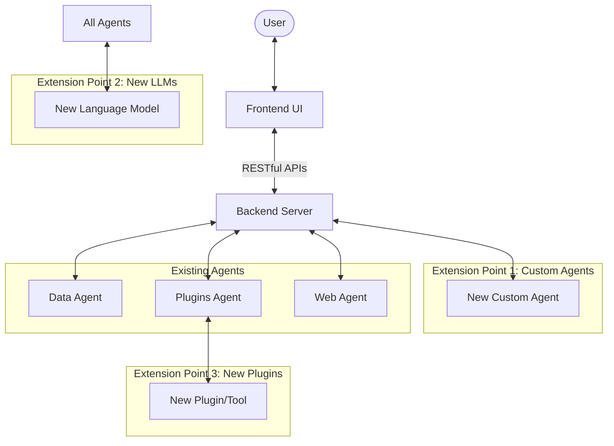
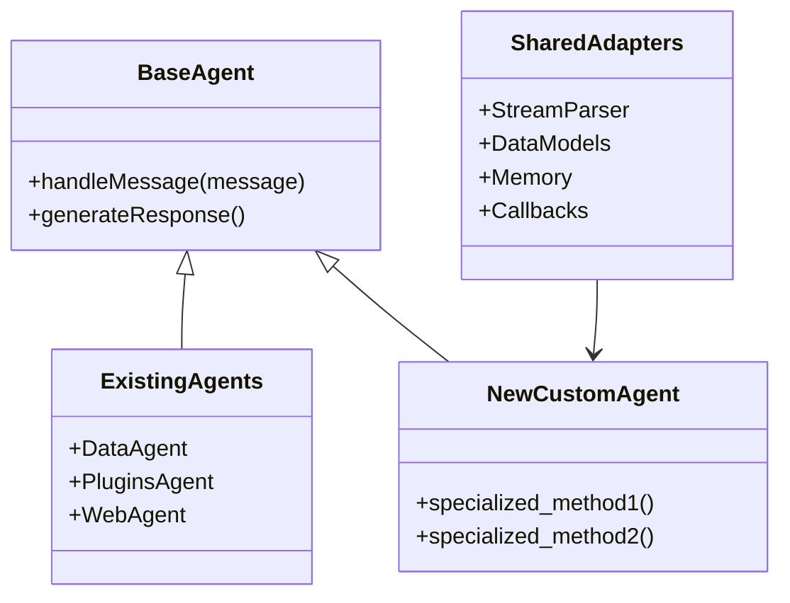
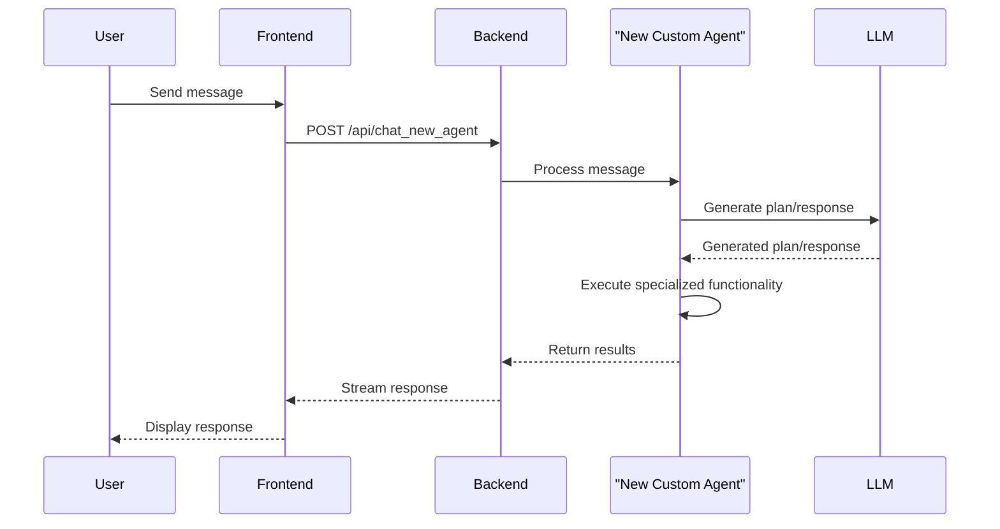
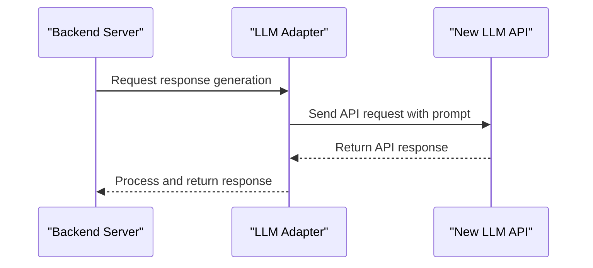
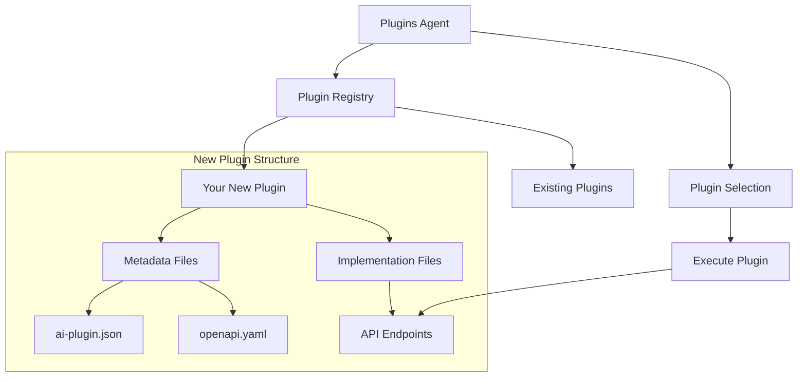

<!-- source: DeepWiki mcp.deepwiki.com · repo xlang-ai/OpenAgents · page 7 Extending OpenAgents · fetched 2026-10-26 -->

# Extending OpenAgents

<details>
<summary>Relevant source files</summary>

The following files were used as context for generating this wiki page:

- [CONTRIBUTING.md](CONTRIBUTING.md)
- [README.md](README.md)
- [README_ZH.md](README_ZH.md)
- [frontend/pages/_document.tsx](frontend/pages/_document.tsx)

</details>


This document provides a comprehensive guide for developers who want to extend the OpenAgents platform with custom functionality. OpenAgents is designed with modularity in mind, allowing you to enhance its capabilities by adding new agents, language models (LLMs), and tools/plugins.

For information about deploying OpenAgents, see [Deployment](#6). For background on the core architecture, see [Architecture](#1.1).

## Overview of Extension Points

OpenAgents offers three primary extension points for developers:

1. **Creating Custom Agents**: Build new agent types beyond the existing Data, Plugins, and Web agents
2. **Integrating New LLMs**: Add support for new language models
3. **Adding New Plugins/Tools**: Extend the Plugins Agent with additional functionality

**Diagram: OpenAgents Extension Points**



Sources: [README.md:198-286]()

## Creating Custom Agents

A custom agent can extend OpenAgents with capabilities beyond what the existing agents provide. This section outlines how to create and integrate a new agent.

### System Architecture for Custom Agents

The agent architecture in OpenAgents follows a modular design, with common components shared across all agents:

**Diagram: Custom Agent Integration Architecture**



Sources: [README.md:264-271](), [real_agents/adapters]()

### Implementation Steps

To create and integrate a new agent:

1. **Create a new folder for your agent in `real_agents/`**
   - Follow the "one agent, one folder" design pattern used by existing agents
   - Example: `real_agents/my_new_agent/`

2. **Implement the agent logic using shared adapters**
   - Reuse components from the `adapters/` folder (stream parsing, data models, memory, callbacks)
   - Implement specialized functionality specific to your agent

3. **Add a chat API endpoint in the backend**
   - Create a `chat_<new_agent>.py` file in `backend/api/`
   - Define the API for interacting with your agent

4. **Register constants in the backend**
   - Add necessary constants in `backend/schemas.py`

5. **Add frontend support**
   - Add a new `OpenAgentID` in `frontend/types/agent.ts`
   - Add corresponding API definitions in `frontend/utils/app/api.ts` and `frontend/utils/app/const.ts`
   - Implement the agent UI in `frontend/components/Chat/Chat.tsx` and `frontend/components/Chat/ChatMessage.tsx`

6. **Handle new data types (if needed)**
   - If your agent produces new data types beyond text, image, table, and JSON, implement parsing logic in `backend/display_streaming.py`

Sources: [README.md:264-271]()

### Integration Flow

The following diagram shows how a new agent integrates with the OpenAgents system:

**Diagram: Custom Agent Message Flow**



Sources: [README.md:264-271]()

## Integrating New LLMs

OpenAgents allows you to integrate new language models through its LLM adapter system. This section outlines how to add support for a new LLM.

### Adding a Hosted LLM (API-accessible)

If the LLM is already hosted and accessible via an API, integration is straightforward:

1. **Register the new model in `backend/api/language_model.py`**
   - Use existing implementations (e.g., Lemur-chat) as a template
   - Example:
     ```python
     # Adding a new LLM provider
     elif model_name == "my-new-llm":
         # Configure API endpoint, authentication, etc.
         # Handle response formatting
     ```

2. **Update the frontend** (if applicable)
   - Add the model to the model selection UI components

Sources: [README.md:275-279]()

### Integration Flow for Hosted LLMs

**Diagram: Hosted LLM Integration**



Sources: [README.md:275-279]()

### Adding a Self-Hosted LLM

For self-hosted LLMs, additional steps are required:

1. **Deploy the LLM**
   - Set up the necessary hardware and software environment
   - Deploy the model using frameworks like Hugging Face Transformers, PyTorch, or TensorFlow

2. **Expose the LLM as an API**
   - Create an API endpoint that accepts prompts and returns responses
   - Ensure the API handles both synchronous and streaming responses

3. **Integrate with OpenAgents** following the same steps as for hosted LLMs

Sources: [README.md:275-279]()

## Adding New Plugins/Tools

The Plugins Agent in OpenAgents can be extended with new tools. This section outlines how to create and integrate a new plugin.

### Plugin Structure

Each plugin in OpenAgents requires the following components:

| Component | Description |
|-----------|-------------|
| `ai-plugin.json` | Describes the plugin metadata |
| `openapi.yaml` | Defines the API endpoints |
| Implementation files | Contains the actual functionality of the plugin |

Sources: [README.md:281-286]()

### Implementation Steps

To create and integrate a new plugin:

1. **Create a new folder for your plugin**
   - Location: `real_agents/plugins_agent/plugins/your_plugin_name/`
   - Use existing plugins as reference templates

2. **Create the metadata files**
   - Generate `ai-plugin.json` and `openapi.yaml` (can be created using an LLM by following existing templates)
   - Example `ai-plugin.json`:
     ```json
     {
       "schema_version": "v1",
       "name_for_human": "Your Plugin Name",
       "name_for_model": "your_plugin_name",
       "description_for_human": "Description of what your plugin does",
       "description_for_model": "Detailed description for the LLM",
       "auth": {
         "type": "none"
       },
       "api": {
         "type": "openapi",
         "url": "http://localhost:3333/plugins/your_plugin_name/openapi.yaml"
       },
       "logo_url": "http://localhost:3333/plugins/your_plugin_name/logo.png"
     }
     ```

3. **Implement the plugin functionality**
   - Create API endpoint handlers in the plugin's `paths/` directory

4. **Register the plugin**
   - Add the plugin name to `real_agents/plugins_agent/plugins/plugin_names.py`

Sources: [README.md:281-286]()

### Plugin Integration Flow

**Diagram: Plugin Integration Architecture**



Sources: [README.md:281-286]()

## Best Practices for Extending OpenAgents

When extending OpenAgents, consider these best practices:

1. **Study existing implementations** before creating your extensions
   - Examine how similar components are implemented in the codebase
   - Follow the established patterns for consistency

2. **Reuse shared components**
   - Make use of the adapters and utilities in `real_agents/adapters/`
   - Avoid duplicating functionality that already exists

3. **Maintain backward compatibility**
   - Ensure your extensions don't break existing functionality
   - Test thoroughly with existing agents and features

4. **Handle streaming responses**
   - OpenAgents uses streaming for real-time feedback
   - Ensure your extensions properly handle streaming data

5. **Follow appropriate error handling patterns**
   - Implement proper error handling to ensure robustness
   - Provide meaningful error messages to users

6. **Document your extensions**
   - Add comments to your code explaining complex logic
   - Update or create documentation for your extension

Sources: [README.md:264-286](), [CONTRIBUTING.md:1-53]()

## Example: Adding a Simple Custom Agent

Here's a simplified example of the key files you would need to modify to add a new agent:

1. **Agent Implementation**: Create a new folder `real_agents/my_new_agent/` with your agent implementation

2. **Backend API**: Add `backend/api/chat_my_new_agent.py` with an API endpoint:
   ```python
   @app.route("/api/chat_my_new_agent", methods=["POST"])
   def chat_my_new_agent():
       # Implementation for chat with your new agent
       pass
   ```

3. **Frontend Support**: Add your agent ID in `frontend/types/agent.ts`:
   ```typescript
   export enum OpenAgentID {
     // Existing agent IDs
     DATA_AGENT = 'data_agent',
     PLUGINS_AGENT = 'plugins_agent',
     WEB_AGENT = 'web_agent',
     // Your new agent
     MY_NEW_AGENT = 'my_new_agent',
   }
   ```

4. **Frontend API**: Update `frontend/utils/app/api.ts` to include your agent's API endpoint

5. **UI Component**: Modify `frontend/components/Chat/Chat.tsx` to handle your agent's specific UI requirements

Sources: [README.md:264-271]()

By following this guide, you can successfully extend OpenAgents with custom functionality while maintaining compatibility with the existing system architecture.

---

