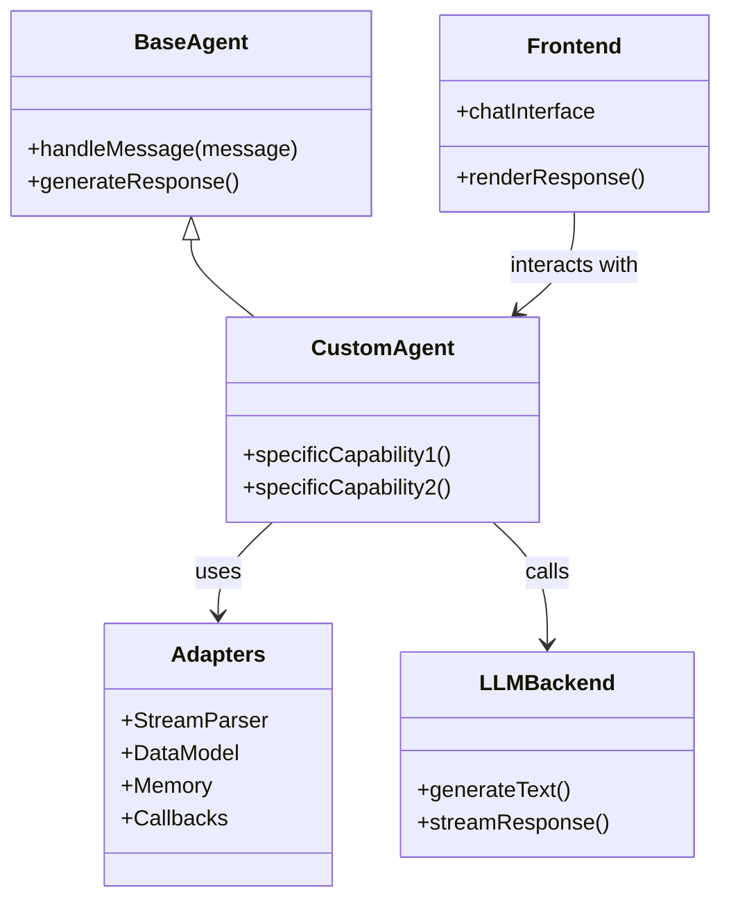
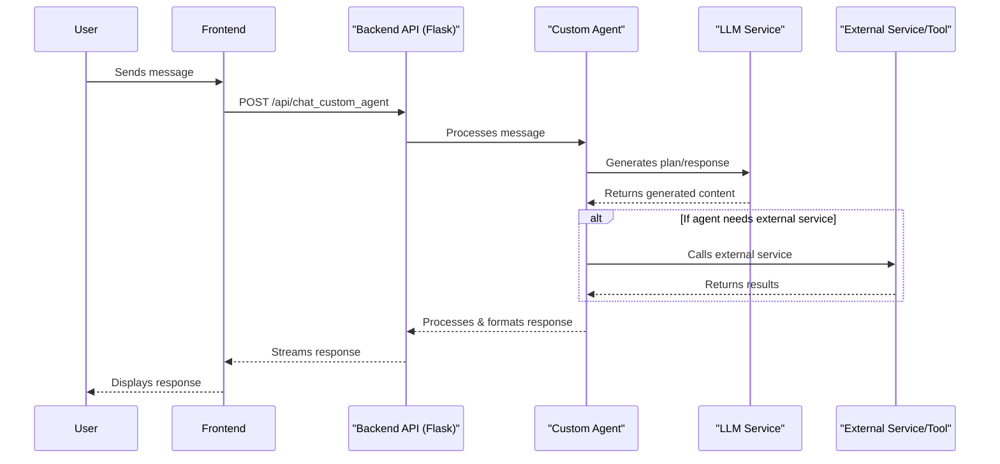
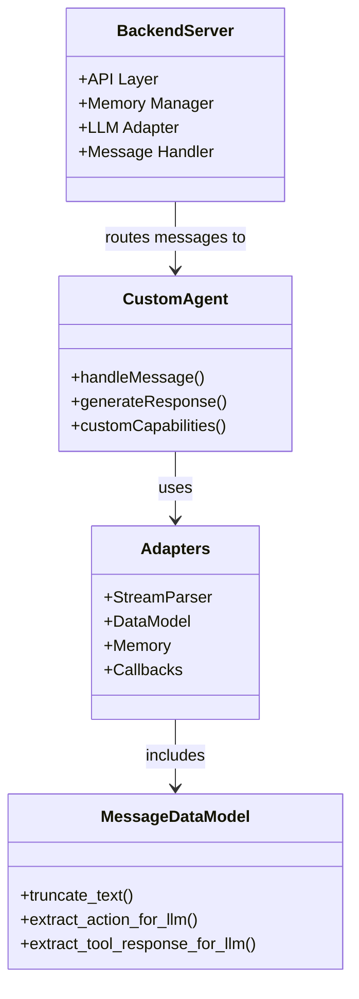
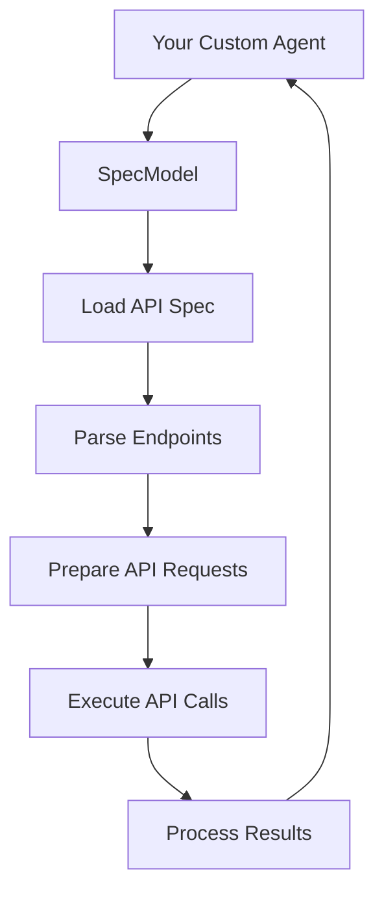

<!-- source: DeepWiki mcp.deepwiki.com · repo xlang-ai/OpenAgents · page 7.1 Creating Custom Agents · fetched 2026-10-26 -->

# Creating Custom Agents

<details>
<summary>Relevant source files</summary>

The following files were used as context for generating this wiki page:

- [CONTRIBUTING.md](CONTRIBUTING.md)
- [README.md](README.md)
- [README_ZH.md](README_ZH.md)
- [frontend/pages/_document.tsx](frontend/pages/_document.tsx)
- [real_agents/adapters/data_model/message.py](real_agents/adapters/data_model/message.py)
- [real_agents/adapters/data_model/plugin/spec.py](real_agents/adapters/data_model/plugin/spec.py)

</details>


This page provides a comprehensive guide for developers who want to extend OpenAgents by creating new agent types beyond the three built-in agents (Data Agent, Plugins Agent, and Web Agent). You'll learn how to build, integrate, and deploy custom agents within the OpenAgents platform.

For information about extending existing agents with new tools, see [Adding New Plugins](#7.2). For integrating new language models, see [Integrating New LLMs](#7.3).

## Agent Architecture in OpenAgents

Before creating a custom agent, it's important to understand how agents are structured in the OpenAgents system.



In OpenAgents, all agents inherit from a core agent class that provides the basic functionality for handling messages and generating responses. Each specialized agent adds its own capabilities, utilizing shared components from the `adapters` module for functionality like stream parsing, data modeling, memory management, and callbacks.

Sources: [README.md:211-262]()

## Custom Agent Components & Flow

When a user interacts with a custom agent, the request flows through multiple system components:



This diagram illustrates the typical interaction flow when using a custom agent. The frontend sends user messages to the backend API, which routes them to the appropriate agent. The agent processes the message, potentially using an LLM to generate a response and integrating with external services. The results are then streamed back to the user through the backend and frontend.

Sources: [README.md:211-262](), [README.md:172-174]()

## Step-by-Step Guide to Creating a Custom Agent

### 1. Create a New Agent Folder

Start by creating a new folder in the `real_agents/` directory for your custom agent:

```
real_agents/
├── adapters/        # Shared components
├── data_agent/      # Existing agent
├── plugins_agent/   # Existing agent
├── web_agent/       # Existing agent
└── custom_agent/    # Your new agent folder
```

This follows the "one agent, one folder" design principle of OpenAgents.

Sources: [README.md:248-262]()

### 2. Implement Agent Logic

Within your agent folder, implement the core logic for your agent. Refer to the existing agents as templates for implementation patterns. Your agent should leverage the shared components in the `adapters/` folder when needed.

The typical structure for an agent implementation includes:

- **Core agent class**: Extends base agent functionality
- **Tool implementations**: Specific capabilities the agent provides
- **Prompt templates**: For agent task instructions
- **Utility functions**: Helper methods specific to your agent

Sources: [README.md:264-270]()

### 3. Create Backend API Integration

Add a new file named `chat_<custom_agent>.py` in the `backend/api/` folder to define the chat API for your new agent. This file will create API endpoints that allow the frontend to communicate with your agent.

```
backend/
├── api/
│   ├── chat_data.py
│   ├── chat_plugins.py
│   ├── chat_web.py
│   └── chat_custom.py    # Your new API file
```

The API file should include endpoints for starting conversations and processing messages with your custom agent.

Sources: [README.md:264-270]()

### 4. Register Constants

If your agent introduces new message types, data formats, or configuration options, register these constants in `backend/schemas.py`.

Sources: [README.md:264-270]()

### 5. Add Frontend Support

To make your agent accessible through the UI, you'll need to:

1. Add a new `OpenAgentID` in `frontend/types/agent.ts`
2. Add the corresponding API endpoints in `frontend/utils/app/api.ts`
3. Register the agent in `frontend/utils/app/const.ts`
4. Implement UI components in `frontend/components/Chat/Chat.tsx` and `frontend/components/Chat/ChatMessage.tsx`

Sources: [README.md:264-270]()

### 6. Implement Message Parsing Logic

If your agent uses data types beyond text, images, tables, and JSON, you'll need to implement new parsing logic in `backend/display_streaming.py`. This ensures the frontend can properly display the agent's responses.

Sources: [README.md:271-273]()

## Agent Implementation Details

### Agent-Backend Integration

The following diagram shows how a custom agent integrates with the backend components:



The backend server routes messages to your custom agent, which utilizes shared adapters for functionality like stream parsing and data modeling. The `MessageDataModel` class in particular handles important tasks like text truncation and extracting structured information from messages.

Sources: [real_agents/adapters/data_model/message.py:1-206]()

### Message Handling

Custom agents need to implement proper message handling to work with the OpenAgents platform. The key message formats include:

| Message Type | Format | Description |
|--------------|--------|-------------|
| Action | JSON format with `action` and `action_input` fields | Used to specify agent actions |
| Tool Response | Wrapped tool call and tool output | Used to format tool execution results |
| Code/Plugin Output | Content between defined markers | Used for displaying execution results |

These message formats are defined in `message.py` and should be used consistently in your agent implementation.

Sources: [real_agents/adapters/data_model/message.py:8-39]()

### Working with External Tools and APIs

If your agent needs to interact with external tools or APIs, you can leverage patterns similar to the Plugins Agent. The `SpecModel` class provides utilities for loading and processing API specifications:



Use the `SpecModel` to load API specifications, parse endpoints, prepare API requests, and handle responses for your custom agent's external tool integration.

Sources: [real_agents/adapters/data_model/plugin/spec.py:1-165]()

## Advanced Customization

### Adding New Data Types

If your agent works with novel data types beyond text, images, tables, and JSON, you'll need to implement:

1. **Data model classes**: Define structures for your new data types
2. **Parsing logic**: Add code to extract and format your data types
3. **Rendering components**: Create frontend components to display your data types

The agent will need to properly format responses using the established message formats in `MessageDataModel` to ensure proper display in the frontend.

Sources: [real_agents/adapters/data_model/message.py:42-206]()

### Memory and State Management

Custom agents can utilize the built-in memory management system for maintaining conversation history and state. The memory system handles:

- Storing conversation history
- Caching intermediate results
- Truncating history when it gets too long
- Persisting agent state between user interactions

Your agent can leverage this functionality to provide a consistent experience across user sessions.

Sources: [real_agents/adapters/data_model/message.py:103-118]()

## Testing Your Custom Agent

After implementing your agent, test it by:

1. Starting the backend server with your new agent registered
2. Starting the frontend application
3. Selecting your agent in the UI
4. Testing various conversational flows
5. Debugging any issues that arise

Make sure to test edge cases and error handling to ensure a robust implementation.

Sources: [README.md:271]()

## Example Agent Structure

Here's a template for the file structure of a custom agent:

```
real_agents/custom_agent/
├── __init__.py                    # Package initialization
├── agent.py                       # Core agent implementation
├── prompts/                       # Prompt templates
│   └── custom_agent_prompt.py
├── tools/                         # Agent-specific tools
│   ├── __init__.py
│   └── custom_tool.py
└── utils/                         # Helper utilities
    └── helpers.py
```

This structure follows the pattern used by the existing agents in OpenAgents.

Sources: [README.md:235-247]()

## Best Practices

1. **Reuse existing components**: Leverage the shared adapters and utilities when possible
2. **Consistent message formats**: Follow the established message formats for actions and responses
3. **Proper error handling**: Implement robust error handling to provide graceful failure modes
4. **Progressive enhancement**: Start with basic functionality and add features incrementally
5. **Test thoroughly**: Test with various inputs and edge cases to ensure reliability

By following these guidelines, you can create a custom agent that integrates seamlessly with the OpenAgents platform and provides a consistent experience for users.

---

