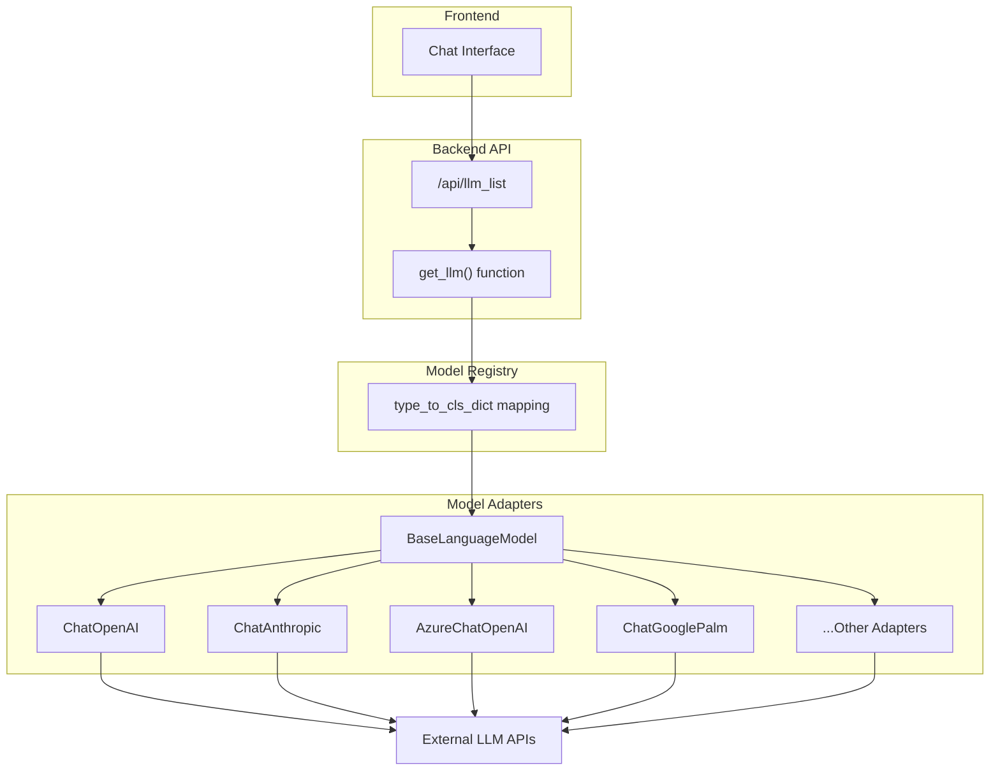
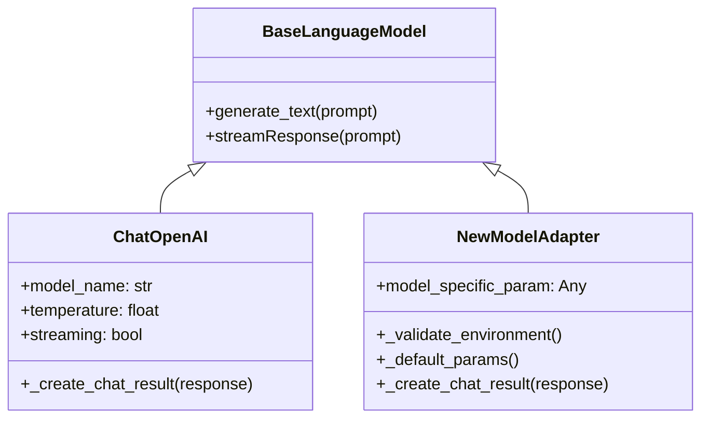
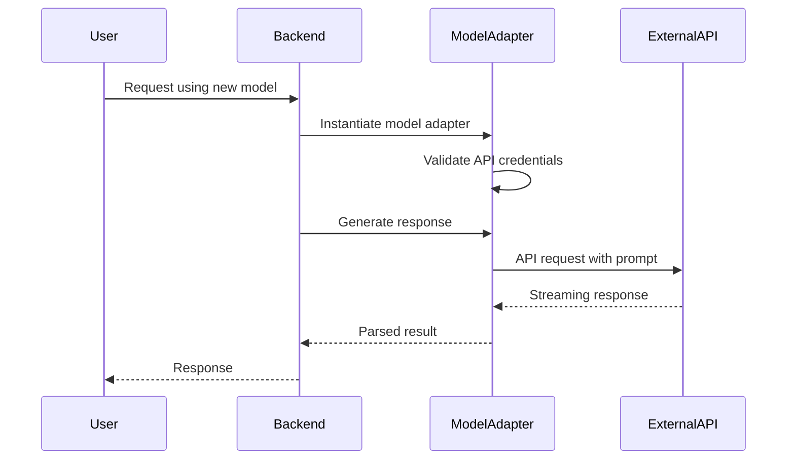

<!-- source: DeepWiki mcp.deepwiki.com · repo xlang-ai/OpenAgents · page 7.3 Integrating New LLMs · fetched 2026-10-26 -->

# Integrating New LLMs

<details>
<summary>Relevant source files</summary>

The following files were used as context for generating this wiki page:

- [CONTRIBUTING.md](CONTRIBUTING.md)
- [README.md](README.md)
- [README_ZH.md](README_ZH.md)
- [backend/api/language_model.py](backend/api/language_model.py)
- [frontend/pages/_document.tsx](frontend/pages/_document.tsx)
- [real_agents/adapters/models/__init__.py](real_agents/adapters/models/__init__.py)
- [real_agents/adapters/models/azure_openai.py](real_agents/adapters/models/azure_openai.py)

</details>


This document provides a systematic approach to integrating new Large Language Models (LLMs) into the OpenAgents platform. It covers the current architecture of LLM integration, step-by-step instructions for adding a new model, and important configuration details. For information about creating custom agents, see [Creating Custom Agents](#7.1), and for adding plugins, see [Adding New Plugins](#7.2).

## Architecture Overview

OpenAgents is designed with a flexible architecture that allows for straightforward integration of different language models. The system abstracts away the complexities of various LLM APIs, providing a unified interface for all agents to use.



Sources: [backend/api/language_model.py](), [real_agents/adapters/models/__init__.py]()

## Current LLM Support

OpenAgents currently supports several LLM providers out of the box:

| Provider | Model Types | Adapter Class | Environment Variables |
|----------|-------------|--------------|----------------------|
| OpenAI | GPT-3.5, GPT-4 | `ChatOpenAI` | `OPENAI_API_KEY` |
| Anthropic | Claude v1, Claude 2 | `ChatAnthropic` | `ANTHROPIC_API_KEY` |
| Azure OpenAI | Azure deployments | `AzureChatOpenAI` | `OPENAI_API_KEY`, `OPENAI_API_BASE`, `OPENAI_API_VERSION` |
| Google PaLM | PaLM models | `ChatGooglePalm` | `GOOGLE_API_KEY` |
| Custom (e.g., Lemur) | Custom models | Varies | Varies by implementation |

Sources: [backend/api/language_model.py:10-58](), [real_agents/adapters/models/__init__.py:1-19]()

## Integration Process

### 1. Create a Model Adapter (if needed)

If the new LLM has a unique API that isn't already covered by existing adapters, you'll need to create a new adapter class.



The adapter should inherit from the appropriate base class (typically extending an existing adapter like `ChatOpenAI` or directly from `BaseLanguageModel`).

Sources: [real_agents/adapters/models/azure_openai.py:1-132]()

### 2. Register the Model in the Registry

Add your model to the type mapping dictionary in the models initialization file:

```
type_to_cls_dict = {
    "chat_anthropic": ChatAnthropic,
    "chat_google_palm": ChatGooglePalm,
    "chat_openai": ChatOpenAI,
    "azure_chat_openai": AzureChatOpenAI,
    "new_model_type": NewModelAdapter,  # Add your new model here
}
```

Sources: [real_agents/adapters/models/__init__.py:14-19]()

### 3. Update the LLM API

Modify the backend API to support your new model:

1. Add your model to the LLM list endpoint:

```python
@app.route("/api/llm_list", methods=["POST"])
def get_llm_list():
    """Gets the whole llm list."""
    return [
        {"id": llm, "name": llm} for llm in [
            "gpt-3.5-turbo-16k",
            "gpt-4",
            "claude-v1",
            "claude-2",
            "lemur-chat",
            "your-new-model"  # Add your new model name here
        ]
    ]
```

2. Update the `get_llm` function to handle your new model:

```python
def get_llm(llm_name: str, **kwargs) -> BaseLanguageModel:
    """Gets the llm model by its name."""
    # ... existing code ...
    
    elif llm_name == "your-new-model":
        # Initialize and return your new model with appropriate parameters
        return NewModelAdapter(
            model_param="value",
            streaming=True,
            verbose=True,
            # other parameters specific to your model
            **kwargs
        )
    
    else:
        raise ValueError(f"llm_name {llm_name} not found")
```

Sources: [backend/api/language_model.py:10-58]()

## Example: Integrating a Hosted API Model

Here's a practical example showing how to integrate a model that's accessed through a REST API (similar to the Lemur model integration):



For models that are similar to existing ones (like another OpenAI-compatible API):

```python
# In backend/api/language_model.py
elif llm_name == "new-compatible-model":
    return ChatOpenAI(
        model_name="model-name-or-deployment",
        streaming=True,
        openai_api_base="https://your-api-endpoint.com/v1",
        verbose=True,
        max_tokens=2048,
        **kwargs
    )
```

Sources: [backend/api/language_model.py:48-56]()

## Configuration and Environment Variables

Each LLM typically requires specific environment variables or configuration parameters:

1. Create environment variables for your model's API keys and endpoints
2. Use the `get_from_dict_or_env` utility to safely access these variables
3. Handle any model-specific validation logic in your adapter

Example of environment validation in a model adapter:

```python
@root_validator()
def validate_environment(cls, values: Dict) -> Dict:
    """Validate that api key and python package exists in environment."""
    api_key = get_from_dict_or_env(
        values,
        "api_key",
        "MODEL_API_KEY",
    )
    api_endpoint = get_from_dict_or_env(
        values,
        "api_endpoint",
        "MODEL_API_ENDPOINT",
    )
    # Additional validation logic...
    return values
```

Sources: [real_agents/adapters/models/azure_openai.py:50-105]()

## Self-Hosted Model Integration

For self-hosted models that expose an OpenAI-compatible API (like models deployed with [FastChat](https://github.com/lm-sys/FastChat) or similar frameworks), you can use the existing OpenAI adapter with a custom base URL:

```python
return ChatOpenAI(
    model_name="your-model-name",
    streaming=True,
    openai_api_base="http://your-server:8000/v1",  # Point to your model server
    openai_api_key="not-needed",  # Can be any string if auth is disabled
    verbose=True,
    **kwargs
)
```

This approach works for any model that implements the OpenAI API specification.

Sources: [backend/api/language_model.py:26-39](), [README.md:195-207]()

## Best Practices

1. **Error Handling**: Implement robust error handling for API failures and rate limits
2. **Streaming Support**: Ensure your adapter properly supports streaming responses
3. **Temperature and Parameters**: Match OpenAgents' parameter conventions (temperature, max_tokens, etc.)
4. **Testing**: Test your integration with all agent types to ensure compatibility
5. **Documentation**: Document any model-specific behaviors or limitations

## Conclusion

By following this guide, you can integrate new language models into the OpenAgents platform, expanding its capabilities and ensuring compatibility with the latest LLM developments. The modular architecture allows for straightforward integration of both hosted and self-hosted models.

Sources: [README.md:275-280]()

---

