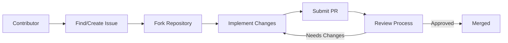
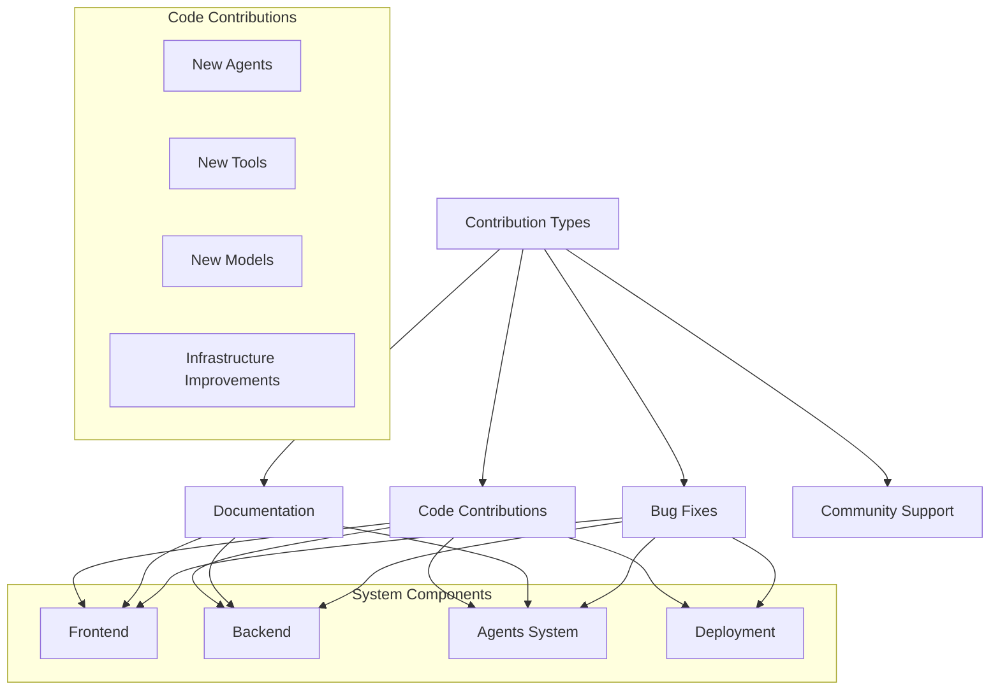
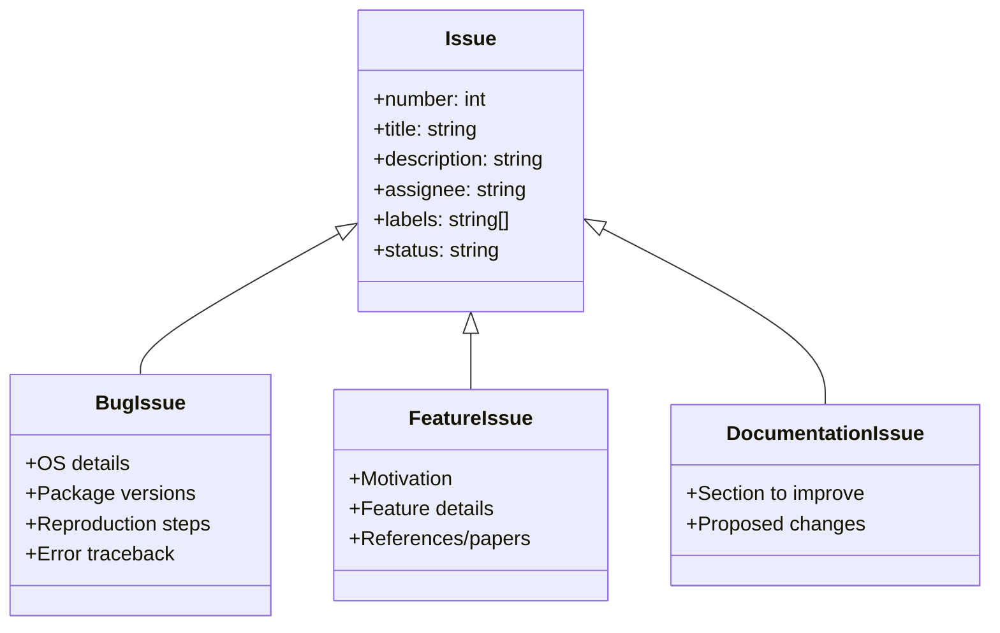
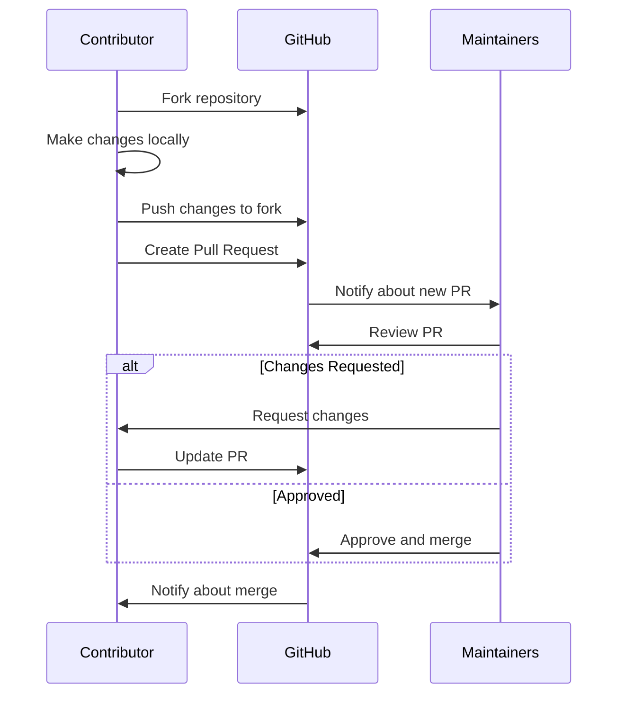
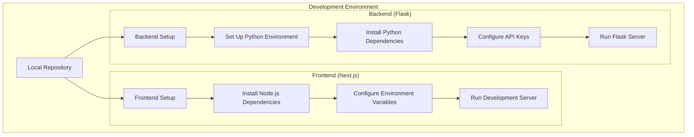
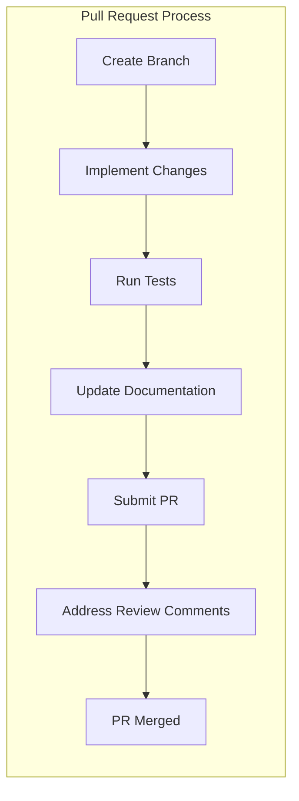

<!-- source: DeepWiki mcp.deepwiki.com · repo xlang-ai/OpenAgents · page 8 Contributing · fetched 2026-10-26 -->

# Contributing

<details>
<summary>Relevant source files</summary>

The following files were used as context for generating this wiki page:

- [CONTRIBUTING.md](CONTRIBUTING.md)
- [LICENSE](LICENSE)
- [frontend/pages/_document.tsx](frontend/pages/_document.tsx)

</details>


This page provides comprehensive guidelines for contributing to the OpenAgents project. It outlines the contribution process, development workflow, and best practices for submitting issues and pull requests. For information about extending OpenAgents with custom functionality, see [Extending OpenAgents](#7).

## Contribution Overview

OpenAgents welcomes contributions in various forms, from code enhancements to documentation improvements. The project follows an open development model with a structured contribution process to ensure quality and consistency.



Sources: [CONTRIBUTING.md:9-18]()

## Contribution Areas

The OpenAgents project welcomes various types of contributions across different components of the system.



Sources: [CONTRIBUTING.md:3-7]()

## Contribution Workflow

OpenAgents uses a "fork and pull request" model for contributions. This section outlines the step-by-step process for contributing to the project.

### Step 1: Find or Create an Issue

Before starting work on a contribution, find an existing issue or create a new one to discuss the proposed changes.

- For bugs or deployment issues: Include OS details, Python version, package versions, and steps to reproduce
- For new features: Describe the motivation and details of the feature
- For documentation: Use the centralized issue for minor text corrections or create a new issue for substantial changes



Sources: [CONTRIBUTING.md:19-42]()

### Step 2: Fork and Clone the Repository

1. Fork the OpenAgents repository to your GitHub account
2. Clone your fork locally
3. Add the original repository as an upstream remote

```
git clone https://github.com/your-username/OpenAgents.git
cd OpenAgents
git remote add upstream https://github.com/xlang-ai/OpenAgents.git
```

### Step 3: Create a Branch and Implement Changes

1. Create a new branch for your feature or fix
2. Implement your changes following the project's coding standards
3. Write tests if applicable
4. Update documentation as needed

### Step 4: Submit a Pull Request

Once your changes are ready, submit a pull request to the main repository with:

- A clear title summarizing the changes
- A reference to the related issue (e.g., "Fixes #123")
- A description of the changes implemented
- Any additional context or screenshots



Sources: [CONTRIBUTING.md:45-51]()

## Development Environment Setup

To contribute to OpenAgents, you'll need to set up your development environment for both frontend and backend components.

### Frontend Setup

The frontend is built with Next.js and requires the following setup:

1. Navigate to the frontend directory
2. Install dependencies
3. Start the development server

Refer to the frontend README for detailed instructions.

### Backend Setup

The backend is built with Flask and requires:

1. Navigate to the backend directory
2. Set up a Python virtual environment
3. Install dependencies
4. Configure environment variables
5. Start the development server

Refer to the backend README for detailed instructions.



Sources: [CONTRIBUTING.md:53-58]()

## Issue Guidelines

When creating issues, follow these best practices to ensure efficient handling:

### Bug Reports

For bug reports, include:
1. Your operating system and version
2. Python, LangChain, and other relevant package versions
3. A minimal code snippet to reproduce the bug
4. The full error traceback
5. Any additional helpful information like screenshots

### Feature Requests

When proposing new features:
1. Explain the motivation behind the feature
2. Provide detailed specifications if possible
3. Include references to relevant papers or implementations

### Documentation Improvements

- For minor typos and grammar issues, contribute to the centralized issue
- For substantial documentation changes, create a separate issue

Sources: [CONTRIBUTING.md:19-42]()

## Pull Request Guidelines

When submitting pull requests:

1. **Title**: Use a clear title that summarizes the changes
2. **Issue Reference**: Include a reference to the related issue (e.g., "Fix #123")
3. **Description**: Provide a concise description of the changes
4. **Scope**: Keep PRs focused on a single issue or feature
5. **Tests**: Include tests if applicable
6. **Documentation**: Update relevant documentation



Sources: [CONTRIBUTING.md:45-51]()

## License Information

OpenAgents is licensed under the Apache License 2.0. By contributing to the project, you agree that your contributions will be licensed under the same license.

The license grants users the freedom to:
- Use the software for any purpose
- Modify the software
- Distribute the software
- Patent claims
- Private use

While requiring:
- License and copyright notice
- State changes
- Disclose source

Sources: [LICENSE:1-201]()

## Contribution Code of Conduct

All contributors are expected to adhere to a code of conduct that promotes a welcoming and inclusive environment. This includes:

- Using inclusive language
- Being respectful of differing viewpoints
- Gracefully accepting constructive criticism
- Focusing on what is best for the community
- Showing empathy towards other community members

By participating in the project, you agree to abide by these principles.

## Non-Code Contributions

Beyond code contributions, you can help OpenAgents by:

- Spreading the word about the project
- Referencing OpenAgents in blog posts or social media
- Giving the project a star on GitHub
- Providing feedback on usability and features
- Helping other users with questions

These contributions are equally valuable to the project's success.

Sources: [CONTRIBUTING.md:3-7]()

---

