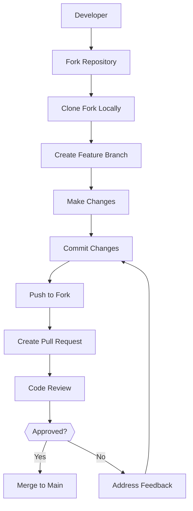
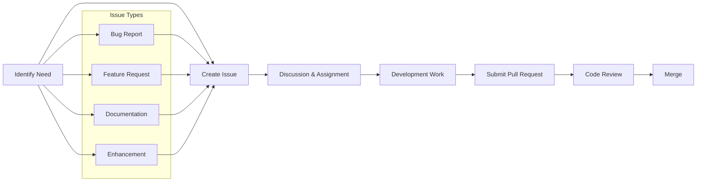
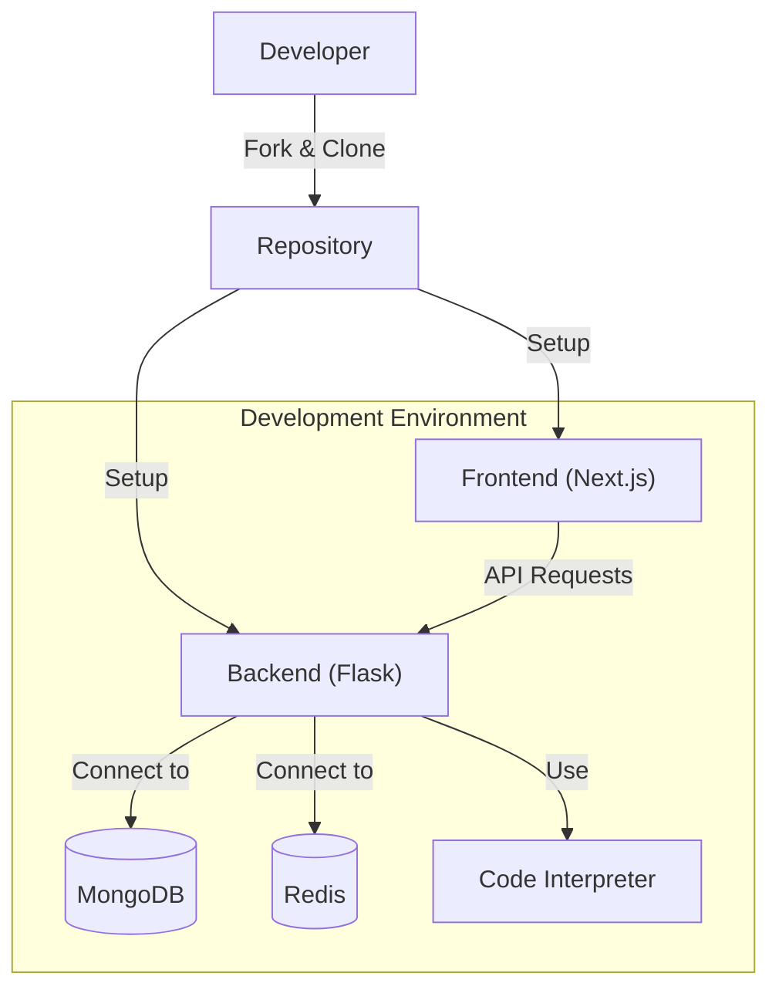
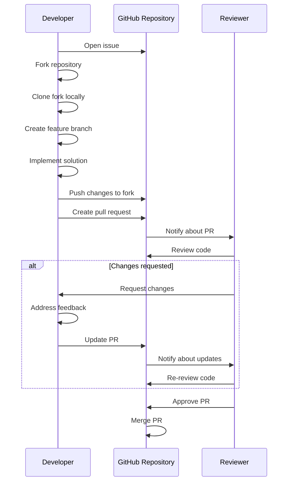
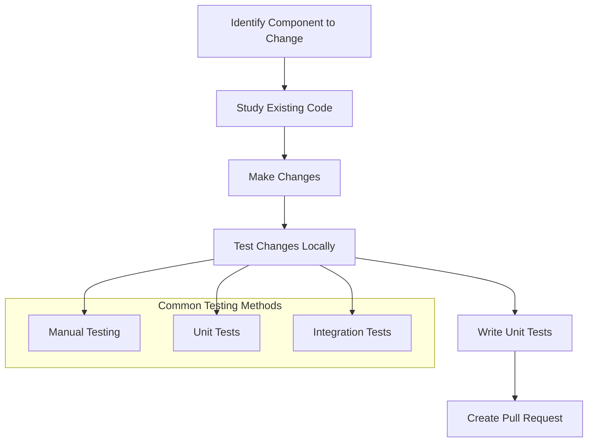
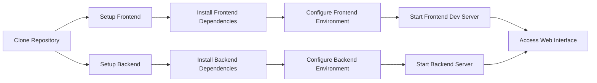

<!-- source: DeepWiki mcp.deepwiki.com · repo xlang-ai/OpenAgents · page 8.1 Development Workflow · fetched 2026-10-26 -->

# Development Workflow

Relevant source files

The following files were used as context for generating this wiki page:

- [CONTRIBUTING.md](CONTRIBUTING.md)
- [frontend/pages/_document.tsx](frontend/pages/_document.tsx)

This document outlines the development and contribution process for the OpenAgents project. It provides detailed guidance for developers interested in contributing to the codebase, from setting up the development environment to submitting pull requests. For information about coding standards and conventions, see [Code Style and Conventions](#8.2).

## Contribution Model

OpenAgents follows a "fork and pull request" model for contributions, which ensures that all changes are reviewed before being integrated into the main codebase.

Sources: [CONTRIBUTING.md:11-17]()

## Issue and Feature Lifecycle

Before making code contributions, developers should first open or claim an existing issue. This ensures proper coordination and avoids duplicate work.

Sources: [CONTRIBUTING.md:14-17](), [CONTRIBUTING.md:19-42]()

## Setting Up Development Environment

Before contributing to OpenAgents, you need to set up both the frontend and backend environments. The setup process involves installing dependencies and configuring the necessary environment variables.

### Development Environment Architecture

Sources: [CONTRIBUTING.md:53-57]()

## Contribution Workflow

The contribution workflow for OpenAgents consists of several key steps that ensure code quality and maintainability.

### Issue Creation

Before starting work on a contribution, create or claim an issue:

1. **Bug Reports**: Include details about your environment, a reproduction code snippet, and the full error traceback if applicable.
2. **Feature Requests**: Explain the motivation for the feature, provide details about the implementation, and include reference links if relevant.
3. **Documentation Improvements**: For minor typos, contribute to the centralized issue. For substantial documentation changes, open a new issue.

### Pull Request Submission

When submitting a pull request, follow these guidelines:

1. Create a descriptive title that summarizes the changes
2. Reference the related issue (e.g., "Fix #123")
3. Provide a brief description of the changes if necessary

Sources: [CONTRIBUTING.md:45-51]()

## Technical Implementation Workflow

When implementing a new feature or fixing a bug, follow this general workflow:

### For Frontend Changes

1. Understand the component structure in the Next.js application
2. Make changes to the relevant components
3. Test changes locally
4. Create unit tests if applicable
5. Submit a pull request

### For Backend Changes

1. Identify the relevant modules in the Flask backend
2. Make changes to the necessary files
3. Test changes locally with appropriate API calls
4. Write unit tests if applicable
5. Submit a pull request

### For Agent System Changes

1. Identify which agent type requires modification (Data, Plugins, or Web)
2. Understand the agent architecture and shared components
3. Implement changes in the relevant agent files
4. Test the changes with appropriate test cases
5. Submit a pull request

Sources: [CONTRIBUTING.md:11-17]()

## Local Development Setup

Follow these steps to set up your local development environment:

### Frontend Setup

1. Navigate to the frontend directory
2. Install dependencies
3. Configure environment variables
4. Start the development server

For detailed instructions, refer to the frontend README.

### Backend Setup

1. Navigate to the backend directory
2. Install dependencies
3. Configure environment variables
4. Start the Flask server

For detailed instructions, refer to the backend README.

Sources: [CONTRIBUTING.md:53-57]()

## Best Practices for Contributions

To ensure your contributions are accepted quickly:

1. **Follow existing patterns**: Maintain consistency with the existing codebase
2. **Document your changes**: Add appropriate comments and update documentation
3. **Write tests**: Include unit tests for new functionality
4. **Keep changes focused**: Submit separate PRs for unrelated changes
5. **Communicate**: Respond promptly to feedback on your PR

## Conclusion

The OpenAgents development workflow is designed to ensure code quality and maintainability through a structured contribution process. By following these guidelines, contributors can effectively participate in the development of the OpenAgents platform.

For questions about the development process, please refer to the CONTRIBUTING.md file in the repository or open an issue on GitHub.

Sources: [CONTRIBUTING.md]()

---

