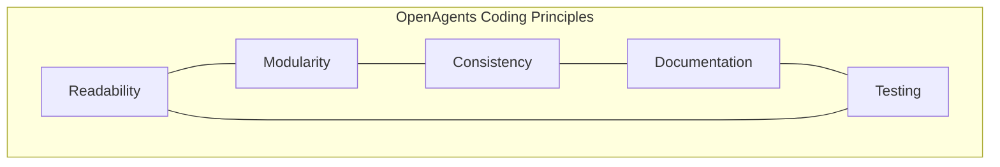
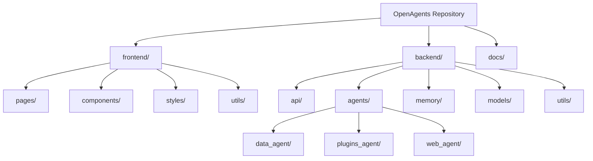
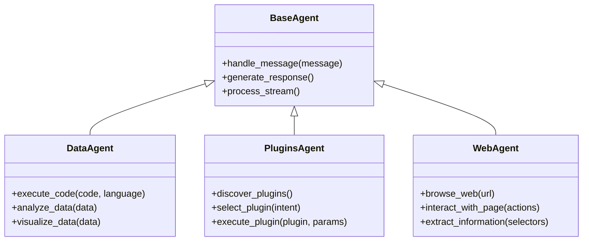
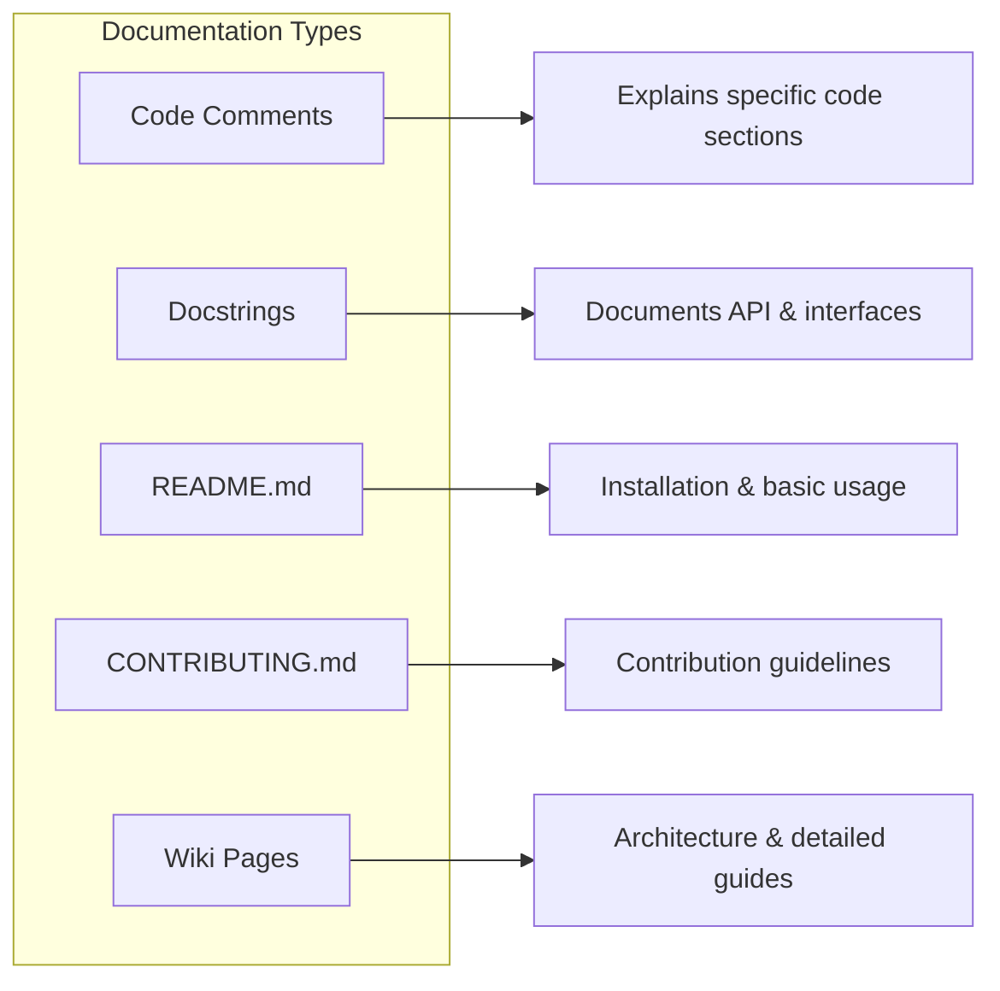
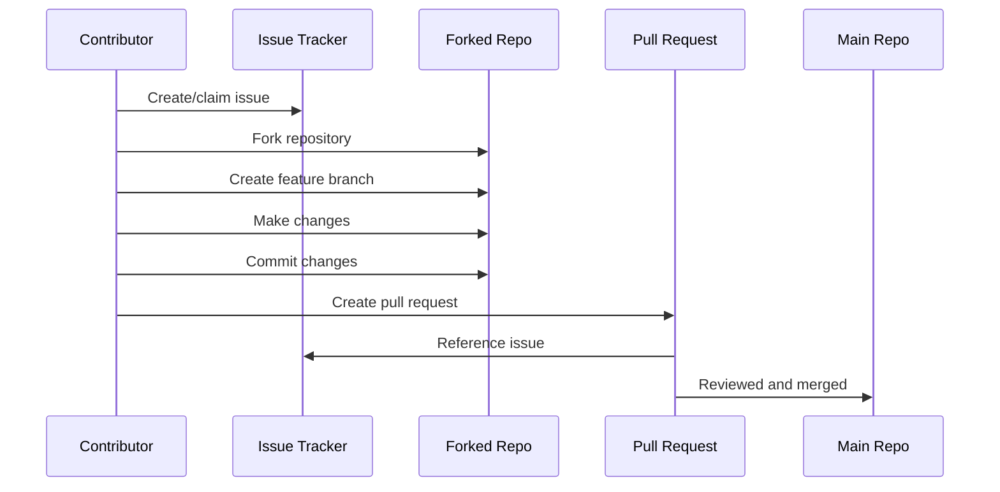
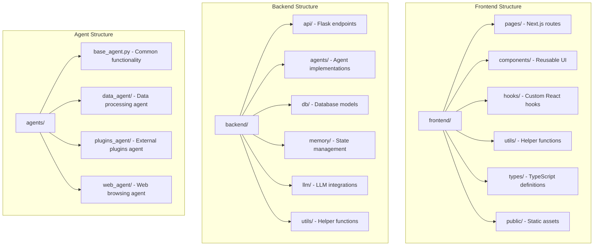
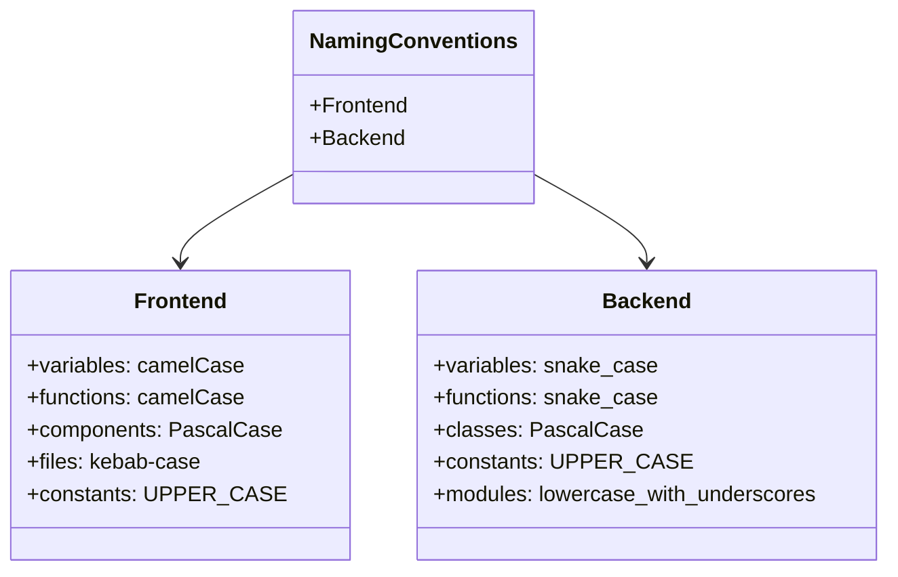
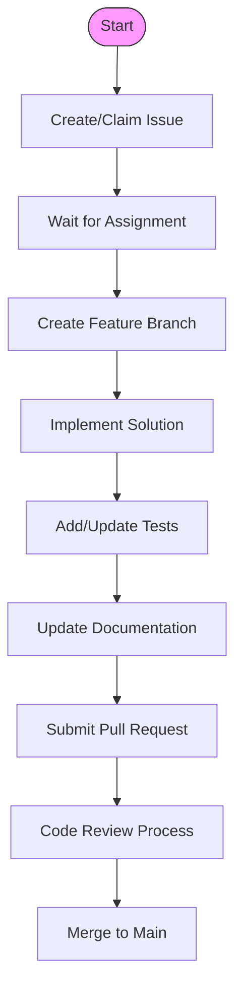

<!-- source: DeepWiki mcp.deepwiki.com · repo xlang-ai/OpenAgents · page 8.2 Code Style and Conventions · fetched 2026-10-26 -->

# Code Style and Conventions

<details>
<summary>Relevant source files</summary>

The following files were used as context for generating this wiki page:

- [CONTRIBUTING.md](CONTRIBUTING.md)
- [frontend/pages/_document.tsx](frontend/pages/_document.tsx)

</details>


This document outlines the coding standards, style guidelines, and conventions used throughout the OpenAgents project. Following these standards ensures code consistency, readability, and maintainability across the codebase. For information about the overall development workflow and contribution process, see [Development Workflow](#8.1).

## General Coding Principles

OpenAgents follows these general coding principles across all components of the codebase:

1. **Readability**: Code should be clear and self-documenting whenever possible.
2. **Modularity**: Components should be designed with clean separation of concerns.
3. **Consistency**: Similar patterns should be used for similar problems throughout the codebase.
4. **Documentation**: Code should be well-documented with comments explaining "why" rather than "what".
5. **Testing**: Critical functionality should be accompanied by appropriate tests.



Sources: [CONTRIBUTING.md:1-59]()

## Project Structure Conventions

The OpenAgents project follows a clear separation between frontend, backend, and various specialized agents. This structure should be maintained when adding new components.



Sources: [CONTRIBUTING.md:53-57]()

## Frontend Code Style

The frontend uses Next.js with TypeScript and React. The following conventions should be observed:

### TypeScript Conventions

- Use strict TypeScript types for all components, props, and state
- Define clear interfaces for component props
- Use type annotations for function parameters and return values
- Minimize use of `any` type

### React Component Structure

- Use functional components with hooks rather than class components
- Follow a consistent component file structure:
  - Imports
  - Type definitions
  - Component function
  - Exports

### Example Component Structure

```
import { ... } from '...';

type ComponentProps = {
  // prop types here
};

export default function ComponentName(props: ComponentProps) {
  // hooks
  
  // helper functions
  
  // render
  return (
    // JSX
  );
}
```

Sources: [frontend/pages/_document.tsx:1-21]()

## Backend Code Style

The backend is built with Flask and Python. The following conventions apply:

### Python Code Style

- Follow PEP 8 style guidelines for Python code
- Use docstrings for all functions, classes, and modules
- Use type hints for function parameters and return values
- Organize imports in the following order:
  1. Standard library imports
  2. Third-party library imports
  3. Local application imports

### API Endpoint Naming

- Use RESTful conventions for endpoint naming
- Endpoints should follow the pattern: `/api/resource_name`
- Use HTTP methods appropriately (GET, POST, PUT, DELETE)



Sources: [CONTRIBUTING.md:30-32]()

## Documentation Conventions

### Code Documentation

- Document all public functions, classes, and methods
- Use docstrings that clearly explain:
  - Purpose of the function/class
  - Parameters and their types
  - Return values and their types
  - Exceptions that may be raised
- Add comments for complex logic explaining the "why" not just the "what"

### Project Documentation

- Use Markdown for all documentation files
- Include code examples where appropriate
- For README files, include:
  - Project overview
  - Installation instructions
  - Usage examples
  - Configuration options



Sources: [CONTRIBUTING.md:40-42]()

## Git Workflow Conventions

OpenAgents uses a fork and pull request model for contributions. The following conventions apply:

### Branch Naming

- Feature branches: `feature/short-description`
- Bug fix branches: `fix/issue-description`
- Documentation branches: `docs/what-is-being-documented`

### Commit Messages

- Use clear, descriptive commit messages
- Start with a verb in imperative form (Add, Fix, Update, Refactor, etc.)
- Keep the first line under 72 characters
- Reference issue numbers where applicable

### Pull Request Process

1. Create an issue or reference an existing one
2. Fork the repository
3. Create a feature branch
4. Make your changes
5. Submit a pull request referencing the issue



Sources: [CONTRIBUTING.md:11-17](), [CONTRIBUTING.md:45-51]()

## Code Review Standards

When submitting or reviewing code, the following standards should be applied:

### Pull Request Requirements

- PRs should address a specific issue or feature
- Each PR should be focused on a single concern
- Include a clear description of changes
- Reference the issue being addressed
- Ensure code passes all tests

### Review Criteria

- Code adheres to project style and conventions
- New functionality includes appropriate tests
- Documentation is updated to reflect changes
- No unnecessary code or dependencies are added
- Performance considerations are addressed

Sources: [CONTRIBUTING.md:45-51]()

## File Organization



Sources: [CONTRIBUTING.md:53-57]()

## Language-Specific Conventions

### TypeScript/JavaScript (Frontend)

- Use camelCase for variable and function names
- Use PascalCase for component names
- Use kebab-case for file names
- Use functional components with hooks
- Import order: React, third-party libraries, local components, styles

### Python (Backend)

- Use snake_case for variable and function names
- Use PascalCase for class names
- Use ALL_CAPS for constants
- Follow PEP 8 guidelines for spacing and line length
- Document classes and functions with docstrings



Sources: [frontend/pages/_document.tsx:1-21]()

## Issue and Feature Development Conventions

When developing new features or fixing issues, the following conventions apply:

1. **Create an issue** describing the feature or bug before starting work
2. **Wait for issue assignment** before beginning development
3. **Create a feature branch** in your fork of the repository
4. **Follow coding standards** for the relevant part of the codebase
5. **Add tests** for new functionality
6. **Update documentation** to reflect changes
7. **Submit a PR** referencing the original issue



Sources: [CONTRIBUTING.md:11-17](), [CONTRIBUTING.md:19-39]()

## Testing Conventions

### Frontend Tests

- Use Jest for unit tests
- Use React Testing Library for component tests
- Place test files alongside the code they test with `.test.tsx` or `.spec.tsx` suffix

### Backend Tests

- Use pytest for Python tests
- Organize tests to mirror the structure of the code being tested
- Use fixtures for test data setup
- Mock external services and dependencies

Sources: [CONTRIBUTING.md:22-28]()

## Conclusion

Following these code style and conventions ensures consistency across the OpenAgents codebase and makes collaboration more efficient. When in doubt about a specific pattern or convention, look for similar existing implementations in the codebase or ask for guidance in the related issue.

For questions about the development workflow or contribution process, refer to the [Development Workflow](#8.1) page.