# Page: Overview

# Overview

<details>
<summary>Relevant source files</summary>

The following files were used as context for generating this wiki page:

- [README.md](README.md)
- [README_JA.md](README_JA.md)
- [README_KO.md](README_KO.md)
- [README_ZH.md](README_ZH.md)
- [pics/data_agent_demo.png](pics/data_agent_demo.png)
- [pics/openagents_overview.png](pics/openagents_overview.png)
- [pics/plugins_agent_demo.png](pics/plugins_agent_demo.png)
- [pics/system_design.png](pics/system_design.png)
- [pics/web_agent_demo.png](pics/web_agent_demo.png)

</details>


OpenAgents is an open platform for language agents in the wild of everyday life. This document provides a comprehensive overview of the OpenAgents system architecture, components, and how they interact to enable AI agents that can analyze data, call plugins, and autonomously browse the web.

The platform bridges the gap between proof-of-concept language agents and practical applications by providing a unified interface for both end users and developers. Unlike other language agent frameworks that focus solely on technical implementation, OpenAgents delivers a complete solution with a user-friendly web UI, backend services, and ready-to-use agent implementations.

For detailed information on getting started with local deployment, see [Getting Started](#2). For specific details about the agent implementations, see [Agents](#5).

Sources: [README.md:49-67]()

## System Architecture

OpenAgents employs a modular, service-oriented architecture that separates concerns between frontend, backend, and agent implementations. The following diagram illustrates the high-level architecture of the system:

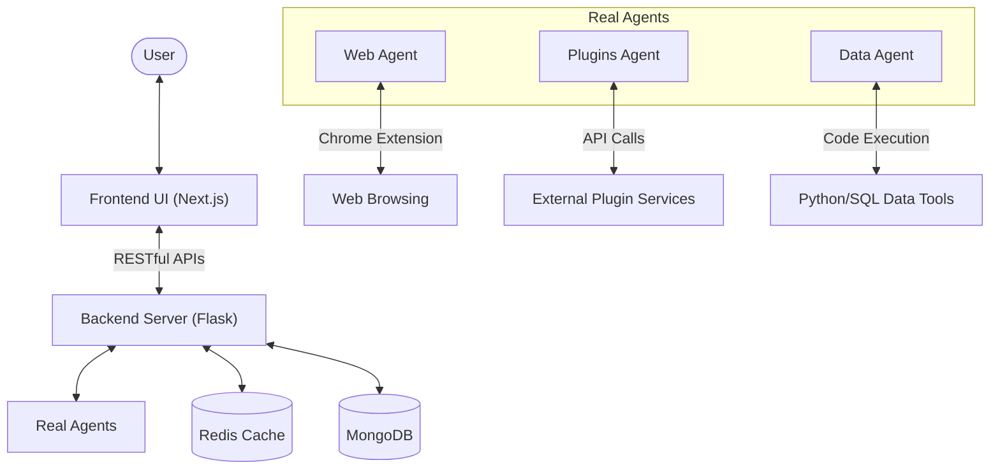

The architecture consists of:

1. **Frontend UI**: A Next.js-based web application providing chat interface, file management, and agent selection.
2. **Backend Server**: A Flask-based server handling API requests, memory management, and communication with agents.
3. **Real Agents**: Implementations of the three agent types with their specialized capabilities.
4. **Storage**: MongoDB for persistence and Redis for caching.

Each component is designed to be independently deployable and scalable, with well-defined interfaces facilitating communication between them.

Sources: [README.md:171-174](), [backend/README.md](), [frontend/README.md]()

## Component Organization

The codebase is organized into three main directories that reflect the architecture:

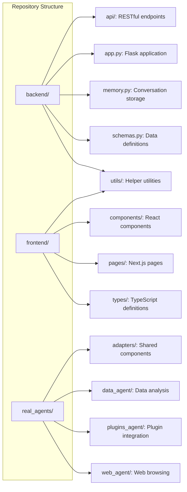

This organization follows a "one agent, one folder" design principle, making it easier to understand and extend the system with new agents. The `adapters/` folder contains shared components like stream parsing, data models, memory, and callbacks that help integrate agents with the backend.

Sources: [README.md:212-253]()

## Agent Types

OpenAgents implements three main agent types, each with specific capabilities:

| Agent Type | Description | Key Capabilities | Source Code |
|------------|-------------|------------------|-------------|
| **Data Agent** | Comprehensive toolkit for efficient data operations | Search, handle, manipulate, and visualize data; execute Python/SQL code | [real_agents/data_agent/]()|
| **Plugins Agent** | Integration with 200+ third-party plugins | Shopping, weather, scientific exploration; auto plugin selection | [real_agents/plugins_agent/]()|
| **Web Agent** | Autonomous web browsing via Chrome extension | Navigate websites, extract information, interact with web pages | [real_agents/web_agent/]()|

Each agent type is implemented as a specialized class that handles specific types of tasks while sharing a common interface for integration with the backend.

Sources: [README.md:87-164]()

## Message Flow Sequence

The following diagram illustrates how messages flow through the system when a user interacts with an agent:

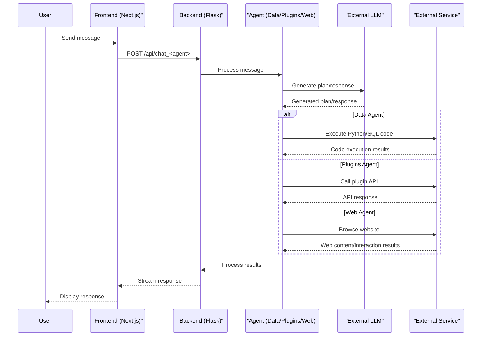

This sequence highlights the streaming nature of the system, which provides real-time feedback during long-running operations. The backend processes the initial request, routes it to the appropriate agent, which then interacts with external services as needed before streaming results back to the user.

Sources: [README.md:84-165](), [backend/api/](), [backend/display_streaming.py]()

## Deployment Architecture

OpenAgents can be deployed using Docker for a consistent environment across development and production:

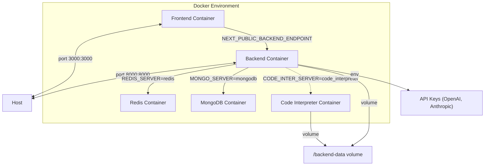

The containers communicate through Docker's internal networking, with volumes used to persist data between restarts. The Code Interpreter container provides a sandboxed environment for executing code securely.

Sources: [README.md:185-207](), [Dockerfile](), [docker-compose.yml]()

## Extensibility

OpenAgents is designed to be extensible, allowing developers to add new agents, LLMs, and tools. The system follows a plugin architecture that makes it easy to extend its functionality.

### Extending with New Agents

To build a new agent beyond the three provided:

1. Create a new folder in `real_agents/` for the agent implementation
2. Implement the agent logic using components from the `adapters/` folder
3. Add a `chat_<new_agent>.py` file in `backend/api/` for the chat API
4. Register new constants in `backend/schemas.py`
5. Add a new `OpenAgentID` in frontend type definitions and corresponding API endpoints
6. Implement the agent UI in frontend components

Sources: [README.md:264-274]()

### Adding New Language Models

To extend with a new LLM as the agent backbone:

1. Register the new model in `backend/api/language_model.py`
2. If the LLM is not hosted yet, deploy it first and expose it as an API

Sources: [README.md:276-280]()

### Adding New Tools to Plugins Agent

To extend the Plugins Agent with new tools:

1. Create a new folder in `real_agents/plugins_agent/plugins/`
2. Implement the tool logic, including `ai-plugin.json` and `openapi.yaml`
3. Register the new tool name in `real_agents/plugins_agent/plugins/plugin_names.py`

Sources: [README.md:282-286]()

## Key Architectural Characteristics

The OpenAgents architecture has several notable characteristics:

1. **Clean Separation of Concerns**: The frontend handles user interaction, the backend manages communication and state, and real agents implement domain-specific logic.

2. **Modular Agent Design**: The three agent types (Data, Plugins, Web) are specialized for different tasks but share common adapters and interfaces.

3. **Containerized Deployment**: Docker containers provide a consistent environment across development and production.

4. **Streaming-First Design**: The system is built to handle streaming responses, enabling real-time feedback during long-running operations.

5. **Stateful Memory Management**: User conversations and agent states are persisted in MongoDB with Redis caching for performance.

This architecture balances flexibility and maintainability, making it suitable for both development and production environments while providing clear pathways for extending functionality.

Sources: [README.md:171-174](), [backend/memory.py]()

---

# Page: Architecture

# Architecture

<details>
<summary>Relevant source files</summary>

The following files were used as context for generating this wiki page:

- [README.md](README.md)
- [README_ZH.md](README_ZH.md)
- [pics/data_agent.png](pics/data_agent.png)
- [pics/data_agent_demo.png](pics/data_agent_demo.png)
- [pics/openagents_overview.png](pics/openagents_overview.png)
- [pics/plugins_agent.png](pics/plugins_agent.png)
- [pics/plugins_agent_demo.png](pics/plugins_agent_demo.png)
- [pics/system_design.png](pics/system_design.png)
- [pics/web_agent.png](pics/web_agent.png)
- [pics/web_agent_demo.png](pics/web_agent_demo.png)

</details>


This document provides a comprehensive overview of the OpenAgents system architecture, detailing the relationships between components, data flow patterns, and the technical implementation of the system. It covers the high-level architecture, component interactions, deployment model, and extension points.

For an introduction to OpenAgents and its purpose, see [Overview](#1). For detailed information about specific agent types, see [Agent Types](#1.2).

## System Overview

OpenAgents is designed with a modular, service-oriented architecture that separates concerns between the frontend user interface, backend services, and agent implementations. The system follows a client-server model with streaming capabilities to provide real-time feedback during long-running operations.

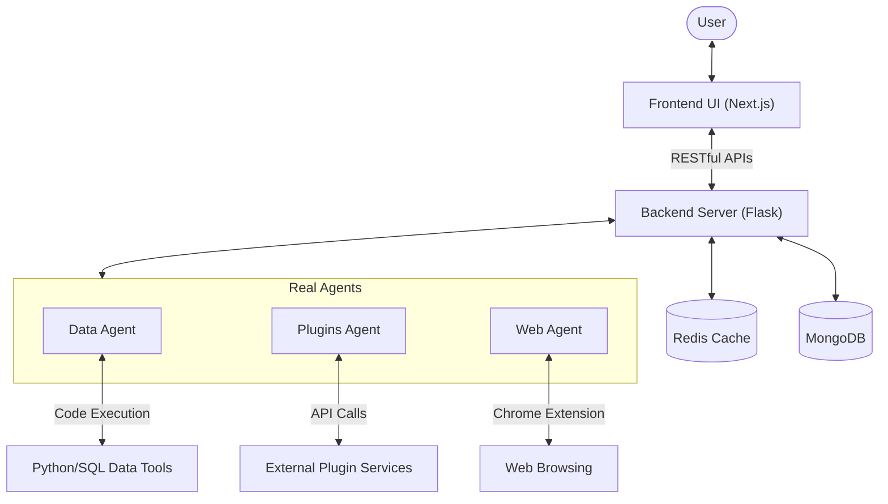

The architecture consists of five major components:

1. **Frontend UI**: A Next.js application providing the user interface
2. **Backend Server**: A Flask server handling requests, managing state, and coordinating agents
3. **Real Agents**: Three specialized agents for different tasks (Data, Plugins, Web)
4. **External Services**: Integration with web browsing, plugin APIs, and data tools
5. **Storage**: Redis for caching and MongoDB for data persistence

Sources: 
- [README.md:38-67](）
- [pics/system_design.png]()

## Component Architecture

The following diagram illustrates the detailed component architecture of OpenAgents, showing how the various subsystems interact:

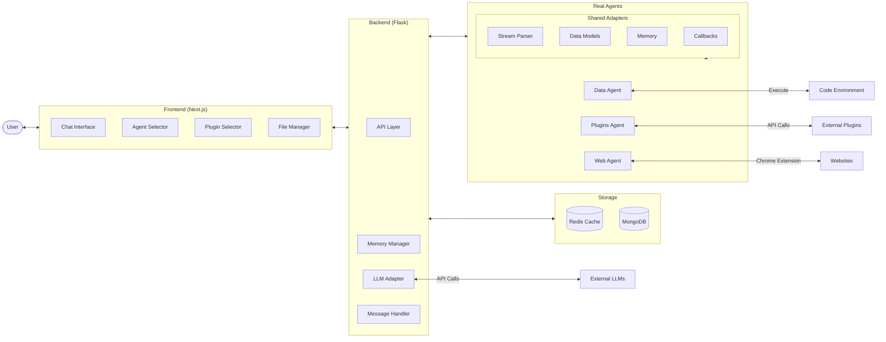

### Frontend Components

The frontend is built with Next.js and includes the following key components:

- **Chat Interface**: Handles the conversation UI and message display
- **Agent Selector**: Allows users to choose which agent to interact with
- **Plugin Selector**: For selecting and configuring plugins (Plugins Agent)
- **File Manager**: For managing data files (Data Agent)

The frontend communicates with the backend through RESTful APIs defined in the `/frontend/utils/app/api.ts` file.

### Backend Components

The backend is implemented as a Flask server with these core components:

- **API Layer**: REST endpoints for agent interactions and system operations
- **Memory Manager**: Manages conversation history and system state
- **LLM Adapter**: Provides a unified interface to different language models
- **Message Handler**: Processes and routes messages between components

### Agent Implementation

The "Real Agents" are the core of the system's functionality, with three specialized agent types:

- **Data Agent**: For data analysis with Python/SQL execution capabilities
- **Plugins Agent**: For integrating with external services via plugin APIs
- **Web Agent**: For autonomous web browsing via Chrome extension

These agents share common components through adapters:

- **Stream Parser**: For parsing streaming responses
- **Data Models**: Shared data structures
- **Memory**: For maintaining agent state
- **Callbacks**: For event handling

Sources:
- [README.md:170-235](）
- [pics/system_design.png]()

## Data Flow and Message Processing

The following sequence diagram illustrates the typical message flow in the OpenAgents system:

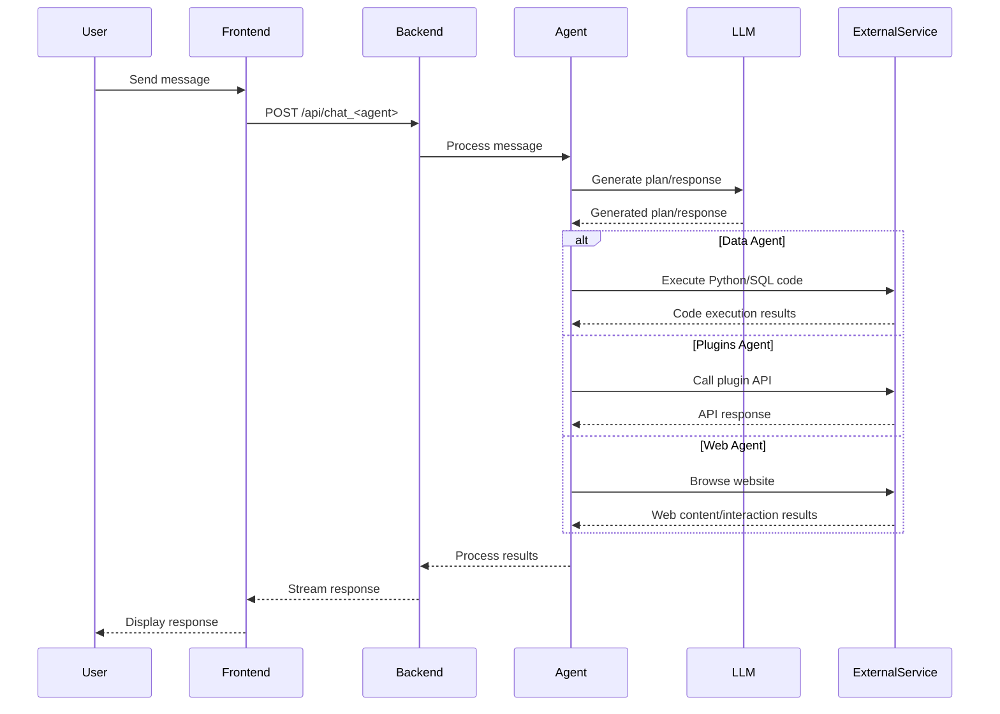

1. The user sends a message through the frontend interface
2. The frontend forwards the message to the appropriate backend endpoint
3. The backend routes the message to the corresponding agent
4. The agent uses an LLM to generate a plan or response
5. Depending on the agent type, it may interact with external services:
   - Data Agent executes code in a sandboxed environment
   - Plugins Agent calls external APIs
   - Web Agent interacts with websites through a Chrome extension
6. Results are processed and streamed back to the user

This streaming design allows for real-time feedback during long-running operations, enhancing the user experience.

Sources:
- [README.md:84-96](）
- [README.md:102-108](）
- [README.md:126-132](）
- [README.md:144-156](）

## Code Organization

The OpenAgents codebase is organized into three main directories:

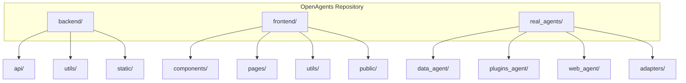

### Backend Structure

The backend code is organized as follows:

- `backend/app.py`: Main Flask application
- `backend/api/`: RESTful API endpoints
- `backend/memory.py`: Conversation history and state management
- `backend/schemas.py`: Data structure definitions
- `backend/utils/`: Utility functions

### Frontend Structure

The frontend code follows Next.js conventions:

- `frontend/components/`: React components
- `frontend/pages/`: Next.js pages
- `frontend/utils/`: Utility functions and API calls
- `frontend/public/`: Static assets
- `frontend/webot_extension.zip`: Chrome extension for Web Agent

### Agent Structure

The "real_agents" directory contains the implementation of the three agents:

- `real_agents/data_agent/`: Data Agent implementation
- `real_agents/plugins_agent/`: Plugins Agent implementation
- `real_agents/web_agent/`: Web Agent implementation
- `real_agents/adapters/`: Shared adapters used by all agents

This "one agent, one folder" design makes it easy to understand and extend the system with new agent types.

Sources:
- [README.md:212-253](）

## Agent System Design

The agent system follows an object-oriented design with inheritance for code reuse:

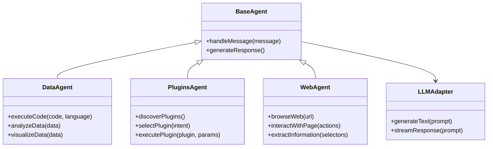

### BaseAgent

The BaseAgent class provides common functionality for all agent types, including message handling and response generation. It serves as the foundation for the specialized agent implementations.

### Specialized Agents

Each specialized agent extends the BaseAgent class with specific capabilities:

- **DataAgent**: Handles data analysis, code execution, and visualization
- **PluginsAgent**: Manages plugin discovery, selection, and execution
- **WebAgent**: Controls web browsing, page interaction, and information extraction

### LLM Integration

All agents interact with large language models through the LLMAdapter, which provides a unified interface to different LLM providers. This design makes it easy to switch between different LLMs or add support for new ones.

Sources:
- [README.md:262-287](）

## Deployment Architecture

OpenAgents is designed for deployment using Docker containers:

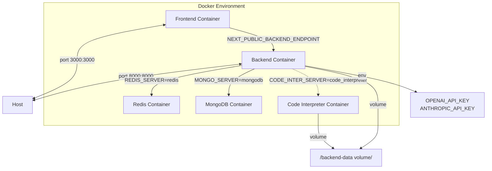

### Docker Containers

The system is composed of multiple containers:

- **Frontend Container**: Next.js application exposed on port 3000
- **Backend Container**: Flask server exposed on port 8000
- **Redis Container**: For caching
- **MongoDB Container**: For data persistence
- **Code Interpreter Container**: Sandboxed environment for code execution

### Container Communication

The containers communicate through Docker's internal networking:

- The frontend connects to the backend using the `NEXT_PUBLIC_BACKEND_ENDPOINT` environment variable
- The backend connects to Redis and MongoDB using the respective environment variables
- The backend communicates with the Code Interpreter container for secure code execution

### Data Persistence

Data persistence is handled through:

- MongoDB for storing conversation history and agent state
- Shared volumes for exchanging data between containers

### Environment Configuration

The system is configured using environment variables:

- LLM API keys (OPENAI_API_KEY, ANTHROPIC_API_KEY)
- Service endpoints and connection strings
- Feature flags and configuration parameters

Sources:
- [README.md:186-207](）

## Extension Points

OpenAgents is designed to be extensible in various ways:

### Adding New Agents

To add a new agent:

1. Create a new folder under `real_agents/` for your agent implementation
2. Implement the agent logic, extending the BaseAgent class
3. Add a new API endpoint in `backend/api/chat_<new_agent>.py`
4. Register constants in `backend/schemas.py`
5. Add the new agent ID in `frontend/types/agent.ts`
6. Update the frontend components to support the new agent

### Adding New LLMs

To add support for a new LLM:

1. Register the new model in `backend/api/language_model.py`
2. Implement the interface methods required by the LLMAdapter

### Adding New Plugins

To add a new plugin to the Plugins Agent:

1. Create a new folder under `real_agents/plugins_agent/plugins/`
2. Implement the plugin logic including `ai-plugin.json` and `openapi.yaml`
3. Register the plugin name in `real_agents/plugins_agent/plugins/plugin_names.py`

Sources:
- [README.md:264-287](）

## Conclusion

The OpenAgents architecture is designed to be modular, extensible, and maintainable. The clean separation of concerns between frontend, backend, and agent implementations makes it easy to understand and extend the system.

Key architectural characteristics include:

1. **Modular Design**: Clear separation between frontend, backend, and agent implementations
2. **Extensibility**: Well-defined extension points for adding new agents, LLMs, and plugins
3. **Streaming-First**: Designed for real-time feedback during long-running operations
4. **Containerized Deployment**: Docker-based deployment for consistent environments
5. **Stateful Memory Management**: Persistent conversation history and agent state
6. **Language Model Abstraction**: Unified interface to different LLM providers

This architecture provides a solid foundation for building and deploying language agents in real-world settings.

---

# Page: Agent Types

# Agent Types

<details>
<summary>Relevant source files</summary>

The following files were used as context for generating this wiki page:

- [README.md](README.md)
- [README_ZH.md](README_ZH.md)
- [pics/amazon.svg](pics/amazon.svg)
- [pics/data_agent.png](pics/data_agent.png)
- [pics/data_agent_demo.png](pics/data_agent_demo.png)
- [pics/google_research.svg](pics/google_research.svg)
- [pics/openagents_overview.png](pics/openagents_overview.png)
- [pics/plugins_agent.png](pics/plugins_agent.png)
- [pics/plugins_agent_demo.png](pics/plugins_agent_demo.png)
- [pics/salesforce.webp](pics/salesforce.webp)
- [pics/system_design.png](pics/system_design.png)
- [pics/web_agent.png](pics/web_agent.png)
- [pics/web_agent_demo.png](pics/web_agent_demo.png)

</details>


This page provides an overview of the three types of language agents implemented in the OpenAgents platform: Data Agent, Plugins Agent, and Web Agent. It covers their core capabilities, implementation structure, and how they interact with the rest of the system.

For information about the overall system architecture, see [Architecture](#1.1).

## Overview of Agent Types

OpenAgents implements three specialized agent types, each designed for different use cases while sharing a common framework:

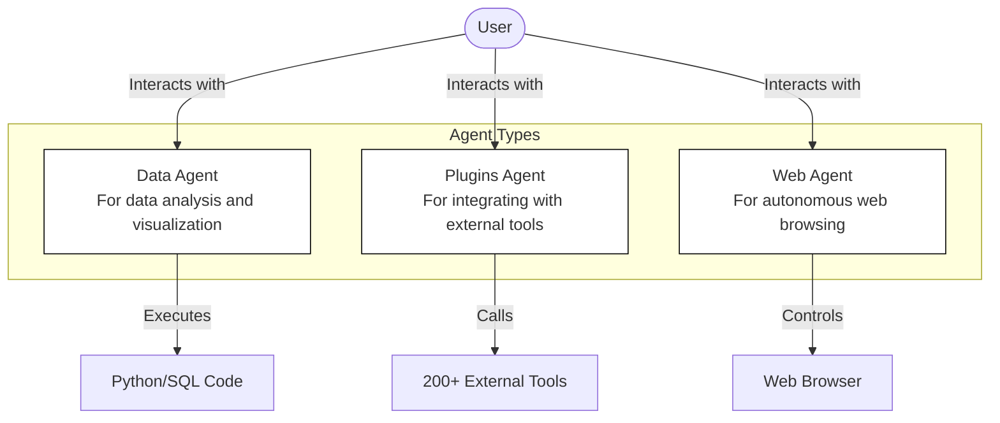

Sources: `README.md`

## Agent Architecture and Framework

All three agent types are built on a common architecture, following the "one agent, one folder" design principle. The agents are located in the `real_agents` directory, with shared components in the `adapters` subdirectory.

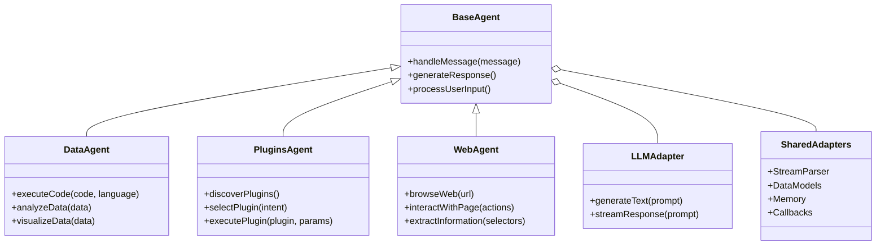

Sources: `README.md`

### Common Components

The `real_agents/adapters` directory contains shared components used by all three agent types:

| Component | Purpose |
|-----------|---------|
| Stream Parser | Handles streaming responses from language models |
| Data Models | Defines common data structures used across agents |
| Memory | Manages conversation history and agent state |
| Callbacks | Implements event hooks for agent operations |

These adapters enable the agents to interact with the backend system in a consistent way while implementing their specialized capabilities.

Sources: `README.md`

## Data Agent

The Data Agent is designed for efficient data operations, providing comprehensive capabilities for data analysis and visualization.

### Core Capabilities

- 🔍 **Search**: Quickly locate data you need
- 🛠️ **Handle**: Streamline data acquisition and processing
- 🔄 **Manipulate**: Modify data to suit specific requirements
- 📊 **Visualize**: Represent data through charts and graphs

### Implementation Structure

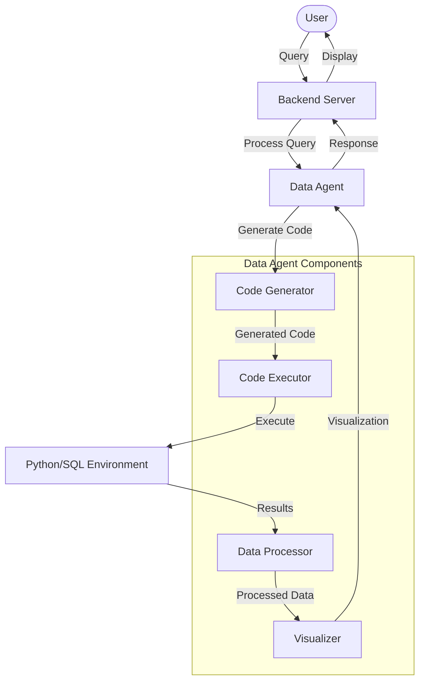

The Data Agent is implemented in `real_agents/data_agent/` and can write and execute code to perform a wide range of data-centric tasks, from simple data manipulation to complex statistical analysis and visualization.

Sources: `README.md`

### Use Cases

The Data Agent excels at tasks such as:

- Data analysis with Python and pandas
- Database queries with SQL
- Statistical analysis and hypothesis testing
- Data visualization through charts and plots
- File format conversion and data extraction

Sources: `README.md`

## Plugins Agent

The Plugins Agent seamlessly integrates with over 200 third-party plugins, each selected to enhance various aspects of daily life.

### Core Capabilities

- 🔌 **Plugin Discovery**: Find and use appropriate plugins for tasks
- 🔄 **Multi-plugin Usage**: Combine multiple plugins for complex workflows
- 🔍 **Auto Plugin Selection**: Intelligently suggest the most suitable plugins
- 🌐 **API Integration**: Connect to external services through standardized APIs

### Implementation Structure

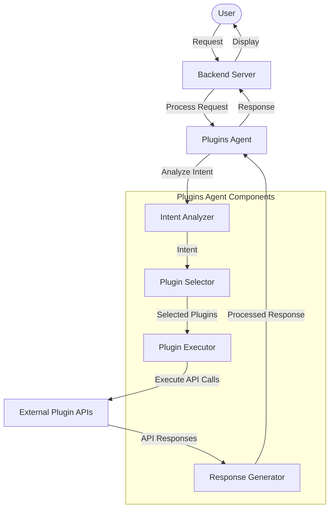

The Plugins Agent is implemented in `real_agents/plugins_agent/` and maintains a registry of available plugins, their capabilities, and instructions for interacting with them.

Sources: `README.md`

### Sample Plugins

The Plugins Agent can use a variety of plugins, including:

- 🛍️ **Shopping**: Klarna Shopping
- ☁️ **Weather**: XWeather
- 🔬 **Scientific Exploration**: Wolfram Alpha
- And 200+ more tools covering diverse domains

Sources: `README.md`

## Web Agent

The Web Agent harnesses the power of a Chrome extension to navigate and explore websites autonomously, streamlining the web browsing experience.

### Core Capabilities

- 🌐 **Web Navigation**: Browse websites and follow links automatically
- 🖱️ **Page Interaction**: Fill forms, click buttons, and interact with elements
- 📝 **Information Extraction**: Collect and summarize content from web pages
- ⚙️ **Task Automation**: Automate repetitive web-based workflows

### Implementation Structure

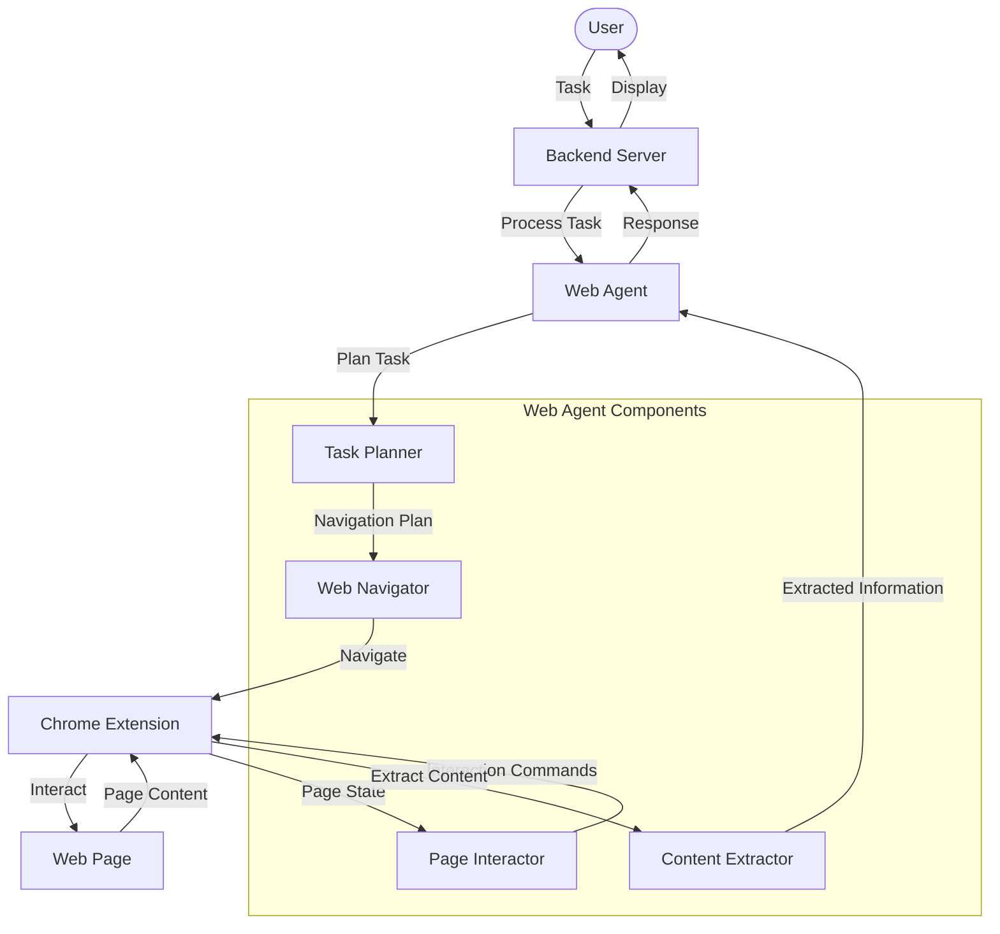

The Web Agent is implemented in `real_agents/web_agent/` and leverages a Chrome extension to control web browsing actions.

Sources: `README.md`

### Example Use Cases

The Web Agent can handle tasks such as:

- 📍 **Google Maps Navigation**: Finding routes between locations
- 🐦 **Social Media Posting**: Creating and submitting posts
- 📝 **Form Completion**: Filling out online forms with provided information
- 🔍 **Research Assistance**: Gathering information from multiple web sources

Sources: `README.md`

## Agent Interaction Flow

All three agent types follow a similar message flow pattern when processing user requests:

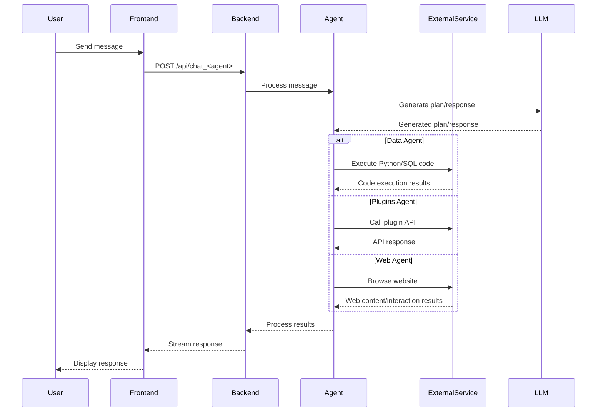

This diagram illustrates how:
1. User messages are sent to the backend via specific API endpoints
2. The appropriate agent processes the message
3. The agent generates a plan or response using a language model
4. Based on the agent type, different external services are called
5. Results are processed and streamed back to the user

Sources: `README.md`

## Integration with LLM Models

All agent types interface with Large Language Models to process natural language requests and generate appropriate responses. The agents use adapters to communicate with these models in a standardized way.

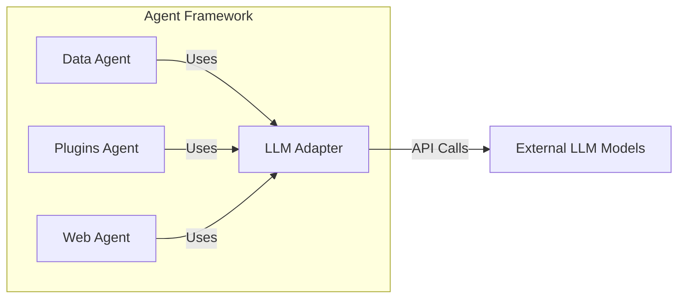

This architecture allows the system to be model-agnostic, supporting different language models as needed.

Sources: `README.md`

## Extending Agent Types

The OpenAgents platform is designed to be extensible, allowing developers to create new agent types beyond the three provided ones. To extend the system with a new agent type:

1. Create a new folder under `real_agents/` for your agent
2. Implement agent logic using components from the `adapters/` folder
3. Add a `chat_<new_agent>.py` file under `backend/api/`
4. Register new constants in `backend/schemas.py`
5. Add a new `OpenAgentID` in `frontend/types/agent.ts`
6. Implement the frontend components in `frontend/components/Chat/`

This modular design makes it straightforward to enhance the platform with additional specialized agents.

Sources: `README.md`

## Summary

The three agent types in OpenAgents provide complementary capabilities:

| Agent Type | Primary Purpose | Key Capabilities | External Integrations |
|------------|----------------|------------------|----------------------|
| Data Agent | Data analysis and visualization | Code execution, data manipulation, visualization | Python/SQL environments |
| Plugins Agent | Integration with external tools | Plugin discovery, selection, and execution | 200+ external APIs |
| Web Agent | Autonomous web browsing | Web navigation, page interaction, content extraction | Chrome extension |

All agents share a common architectural framework while implementing specialized functionality for their respective domains. This design allows for both consistency in implementation and flexibility in capabilities.

Sources: `README.md`

---

# Page: Getting Started

# Getting Started

<details>
<summary>Relevant source files</summary>

The following files were used as context for generating this wiki page:

- [Dockerfile](Dockerfile)
- [README.md](README.md)
- [README_ZH.md](README_ZH.md)
- [backend/README.md](backend/README.md)
- [backend/setup_script.sh](backend/setup_script.sh)
- [docker-compose.yml](docker-compose.yml)
- [frontend/Dockerfile](frontend/Dockerfile)
- [frontend/next.config.js](frontend/next.config.js)

</details>


This document provides step-by-step instructions for setting up and running OpenAgents on your local machine. It covers both Docker-based and source code deployment options, required prerequisites, and initial configuration. For information about extending the platform with custom functionality, see [Extending OpenAgents](#7).

## System Architecture Overview

Before diving into installation, let's understand the basic architecture of OpenAgents:

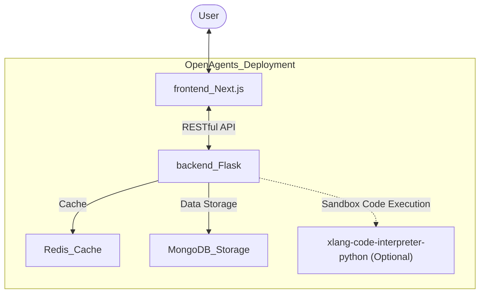

Sources: [README.md:165-166](), [docker-compose.yml:1-67]()

OpenAgents consists of:
- A Next.js frontend that provides the user interface
- A Flask backend that implements the agent logic and API endpoints
- Redis for caching conversation history and state
- MongoDB for persistent data storage
- An optional code interpreter container for sandboxed code execution

## Deployment Options

OpenAgents offers two deployment methods:

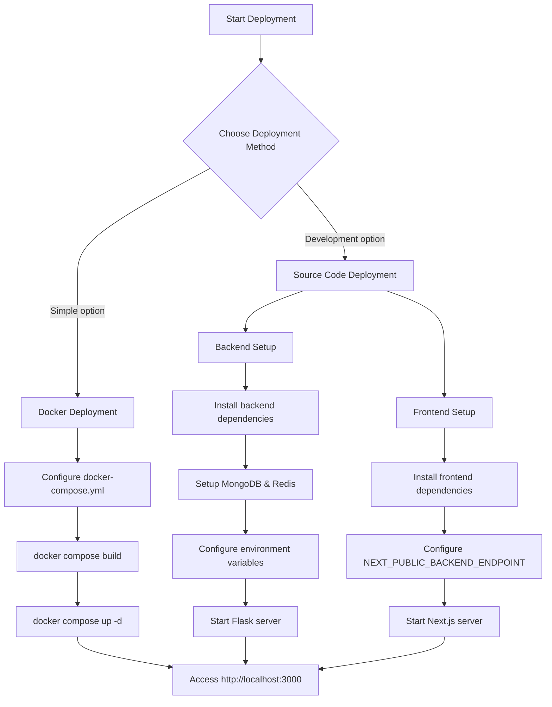

Sources: [README.md:167-197](), [backend/README.md:1-206](), [frontend/Dockerfile:1-38]()

### Docker Deployment

Docker deployment is the simplest option and requires Docker and Docker Compose to be installed.

1. Clone the repository:
   ```bash
   git clone https://github.com/xlang-ai/OpenAgents.git
   cd OpenAgents
   ```

2. Configure your OpenAI API key in `docker-compose.yml`:
   ```yaml
   environment:
     - OPENAI_API_KEY=your_key_here  # Required
   ```

3. If you're not running locally, modify the backend endpoint in `frontend/Dockerfile`:
   ```
   ENV NEXT_PUBLIC_BACKEND_ENDPOINT http://x.x.x.x:8000
   ```

4. Build and start the containers:
   ```bash
   docker compose build
   docker compose up -d
   ```

5. Access the web interface at `http://localhost:3000`

Sources: [README.md:180-197](), [docker-compose.yml:38-62](), [frontend/Dockerfile:15-16]()

### Source Code Deployment

Source code deployment gives you more flexibility and is recommended for development.

#### Backend Setup

1. Create and activate a conda environment:
   ```bash
   conda create -n openagents python=3.10
   conda activate openagents
   pip install -r backend/requirements.txt
   ```

2. Set up MongoDB and Redis:
   
   Using the setup script (recommended):
   ```bash
   bash backend/setup_script.sh
   ```
   
   Or follow the manual instructions in [backend/README.md:25-96]()

3. Configure environment variables:
   ```bash
   export VARIABLE_REGISTER_BACKEND=redis
   export MESSAGE_MEMORY_MANAGER_BACKEND=database
   export JUPYTER_KERNEL_MEMORY_MANAGER_BACKEND=database
   export MONGO_SERVER=127.0.0.1
   export OPENAI_API_KEY=your_key_here
   ```

4. Start the Flask server:
   ```bash
   export FLASK_APP=backend.main.py
   flask run -p 8000
   ```

Sources: [backend/README.md:1-206](), [backend/setup_script.sh:1-59]()

#### Frontend Setup

1. Install frontend dependencies:
   ```bash
   cd frontend
   npm install
   ```

2. Configure the backend endpoint if necessary (by default points to localhost:8000)

3. Start the Next.js development server:
   ```bash
   npm run dev
   ```

4. Access the web interface at `http://localhost:3000`

Sources: [frontend/next.config.js:1-20]()

## LLM Configuration

OpenAgents supports multiple Large Language Model providers:

| Provider | Required Environment Variables |
|----------|--------------------------------|
| OpenAI   | `OPENAI_API_KEY` |
| Azure OpenAI | `OPENAI_API_TYPE=azure`<br>`OPENAI_API_BASE=<endpoint>`<br>`OPENAI_API_VERSION=<version>`<br>`OPENAI_API_KEY=<key>` |
| Anthropic | `ANTHROPIC_API_KEY` |

Sources: [backend/README.md:125-143]()

## Optional Components

### Code Interpreter Container

For sandboxed code execution (recommended for security), set up the code interpreter container:

```bash
docker pull xlanglab/xlang-code-interpreter-python
docker run -d --rm \
    --name codeint \
    --env-file real_agents/data_agent/.code_interpreter_docker_env \
    --mount type=bind,source=$(pwd)/backend/data,target=/home \
    -p 8100:8100 \
    --ip=10.1.1.2 \
    --cap-add SYS_RESOURCE \
    --cap-add SYS_PTRACE \
    --cap-add NET_ADMIN \
    xlanglab/xlang-code-interpreter-python
```

Then configure the backend to use it:
```bash
export CODE_EXECUTION_MODE="docker"
```

If using Docker Compose, uncomment the `code_interpreter` service in [docker-compose.yml:27-37]()

Sources: [backend/README.md:172-194](), [docker-compose.yml:26-37]()

### Kaggle Integration

To use the Kaggle Search Tool in the Data Agent:

1. Follow [Kaggle's API documentation](https://www.kaggle.com/docs/api#installation) to get your API token
2. Save it to `~/.kaggle/kaggle.json`
3. If using Docker, update your Kaggle credentials in [Dockerfile:188-189]()

Sources: [backend/README.md:155-157](), [Dockerfile:187-192]()

### Auto Tool Selection

For the "Auto" plugin selection feature in the Plugins Agent:

```bash
git clone https://github.com/xlang-ai/instructor-embedding
cd instructor-embedding
pip install -r requirements.txt
pip install InstructorEmbedding
cd ..
```

Sources: [backend/README.md:159-169]()

## Component Interaction

The following diagram shows how the different components interact when processing a user query:

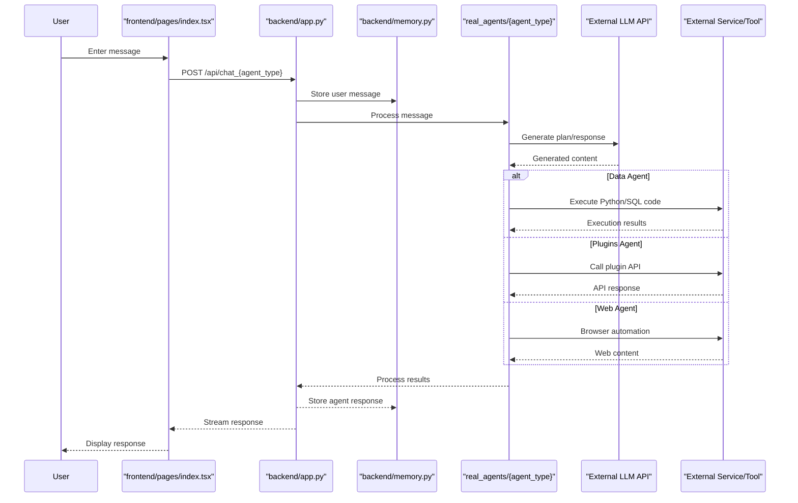

Sources: [README.md:84-157]()

## First-Time Usage

After setting up OpenAgents:

1. Navigate to `http://localhost:3000` in your web browser
2. You'll see the OpenAgents chat interface
3. Click on "New Chat" to start a conversation
4. Select one of the three agents:
   - **Data Agent**: For data analysis with Python/SQL
   - **Plugins Agent**: For using external tools and services
   - **Web Agent**: For browser automation (requires Chrome extension)
5. Enter your query and start interacting with the agent

## Troubleshooting

If you encounter issues during setup or usage:

1. Check that all required environment variables are properly set
2. Ensure MongoDB and Redis are running
3. Verify your API keys are valid
4. Check the logs for error messages:
   - Backend logs: `flask` output or Docker logs
   - Frontend logs: Browser console or Next.js development server

For detailed information about specific components, see:
- [Backend System](#3) for information about the backend architecture
- [Frontend System](#4) for information about the frontend architecture
- [Agents](#5) for information about the three agent types

Sources: [README.md:70-71]()

## Next Steps

Now that you have OpenAgents running, you might want to:

- Explore the capabilities of each agent in [Agent Types](#1.2)
- Learn how to develop custom agents in [Creating Custom Agents](#7.1)
- Add new plugins in [Adding New Plugins](#7.2)
- Integrate additional LLMs in [Integrating New LLMs](#7.3)

Sources: [README.md:210-287]()

---

# Page: Prerequisites

# Prerequisites

<details>
<summary>Relevant source files</summary>

The following files were used as context for generating this wiki page:

- [Dockerfile](Dockerfile)
- [README.md](README.md)
- [README_ZH.md](README_ZH.md)
- [backend/README.md](backend/README.md)
- [backend/setup_script.sh](backend/setup_script.sh)

</details>


This page outlines all system requirements and dependencies needed before installing and running the OpenAgents platform. Meeting these prerequisites is essential for a successful deployment of the system.

For installation instructions, see [Installation](#2.2).

## System Requirements

### Hardware Requirements

- **CPU**: Any modern multi-core processor
- **Memory**: Minimum 8GB RAM (16GB+ recommended for running all agents)
- **Storage**: At least 10GB free disk space
- **GPU**: Optional but recommended for better performance with language models
  - If using GPU acceleration, requires NVIDIA GPU with CUDA support

### Operating System Compatibility

- **Linux**: Ubuntu recommended and most thoroughly tested
- **macOS**: Fully supported
- **Windows**: Not directly supported (use WSL or Docker)

## Software Dependencies Diagram

```mermaid
graph TD
    subgraph "Core Dependencies"
        PY["Python 3.10"]
        MONGO["MongoDB (Persistence)"]
        REDIS["Redis (Caching)"]
        CONDA["Conda (Environment Management)"]
    end
    
    subgraph "Database Setup"
        MONGO --> MCOLL["Required Collections: user, message, conversation, folder"]
        REDIS --> RCFG["Redis Server Configuration"]
    end
    
    subgraph "LLM Integration"
        LLMS["Language Models"]
        LLMS --> OPENAI["OpenAI API"]
        LLMS --> ANTHRO["Anthropic API (Optional)"]
    end
    
    OPENAGENTS["OpenAgents Platform"] --> PY
    OPENAGENTS --> MONGO
    OPENAGENTS --> REDIS
    OPENAGENTS --> LLMS
```

Sources: [backend/README.md:13-19](), [backend/README.md:30-40](), [backend/README.md:71-95](), [backend/README.md:125-143]()

## Core Software Prerequisites

### Python Environment

- **Python 3.10**
- **Conda** (recommended for environment management)
- Python packages from `backend/requirements.txt`

```bash
conda create -n openagents python=3.10
conda activate openagents
pip install -r backend/requirements.txt
```

Sources: [backend/README.md:16-19](), [backend/setup_script.sh:4-7]()

### Database Requirements

#### MongoDB

MongoDB is required for persistent data storage:
- **macOS**: MongoDB Community 6.0
- **Linux**: MongoDB 4.4

The following collections need to be created in a database named `xlang`:
- `user`
- `message`
- `conversation`
- `folder`

Sources: [backend/README.md:30-60](), [backend/setup_script.sh:14-40]()

#### Redis

Redis is required for caching and in-memory storage:
- Ensure Redis server is installed and running
- The maximum Redis memory is set to 500MB by default
- When memory is full, LRU data will be removed

Sources: [backend/README.md:71-95](), [backend/README.md:107-108](), [backend/setup_script.sh:24-48]()

## Agent-Specific Prerequisites

Each agent in OpenAgents may have additional specific requirements:

```mermaid
graph TD
    subgraph "Agent-Specific Prerequisites"
        subgraph "Data Agent"
            KGAPI["Kaggle API (Optional)"]
            CODE["Code Executor (Optional)"]
        end
        
        subgraph "Plugins Agent"
            AUTO["Auto Tool Selection (Optional)"]
            INST["Instructor Embedding"]
        end
        
        subgraph "Web Agent"
            CHROME["Chrome Extension"]
        end
    end
    
    AUTO --> INST
    KGAPI -- "Requires" --> KGCRED["Kaggle Credentials"]
    CODE -- "Requires" --> DOCKER["Docker"]
```

Sources: [README.md:53-56](), [backend/README.md:155-193]()

### Data Agent Prerequisites

- **Kaggle Integration** (Optional):
  - Required for Kaggle Search Tool
  - Kaggle API credentials configured in `~/.kaggle/kaggle.json`
  - Follow the [Kaggle Public API documentation](https://www.kaggle.com/docs/api#installation) to set up API token

- **Code Execution Environment** (Optional):
  - Docker for sandboxed code execution
  - Docker image: `xlanglab/xlang-code-interpreter-python`
  - Required if you want to execute Python code in a secure sandbox

Sources: [backend/README.md:155-158](), [backend/README.md:172-193]()

### Plugins Agent Prerequisites

- **Auto Tool Selection** (Optional):
  - Instructor Embedding package
  - Additional disk space for embedding models

Installation commands:
```bash
git clone https://github.com/xlang-ai/instructor-embedding
cd instructor-embedding
pip install -r requirements.txt
pip install InstructorEmbedding
```

Sources: [backend/README.md:160-169]()

### Web Agent Prerequisites

- **Chrome Browser**
- **WeBot Chrome Extension** (included in the repository at `frontend/webot_extension.zip`)

Sources: [README.md:56](), [README.md:143-145]()

## External Service Credentials

### LLM API Access

At least one of the following is required:

- **OpenAI API Key**
  ```bash
  export OPENAI_API_KEY=<your-openai-api-key>
  ```

- **Anthropic API Key** (Optional, for Claude models)
  ```bash
  export ANTHROPIC_API_KEY=<your-anthropic-api-key>
  ```

For Azure OpenAI users, additional variables are required:
```bash
export OPENAI_API_TYPE=azure
export OPENAI_API_BASE=<azure-endpoint>
export OPENAI_API_VERSION=<api-version>
export OPENAI_API_KEY=<azure-api-key>
```

Sources: [backend/README.md:125-143]()

## Environment Variables

Several environment variables must be configured for proper operation:

| Variable | Purpose | Required Value |
|----------|---------|----------------|
| `VARIABLE_REGISTER_BACKEND` | Storage for variable registration | `redis` |
| `MESSAGE_MEMORY_MANAGER_BACKEND` | Storage for message memory | `database` |
| `JUPYTER_KERNEL_MEMORY_MANAGER_BACKEND` | Storage for Jupyter kernel memory | `database` |
| `MONGO_SERVER` | MongoDB server address | `127.0.0.1` (or container name in Docker) |
| `CODE_EXECUTION_MODE` | Code execution environment | `local` (default) or `docker` |

Sources: [backend/README.md:105-114](), [backend/README.md:190-193](), [backend/setup_script.sh:52-56]()

## Docker-Specific Requirements

If deploying with Docker:

- Docker and Docker Compose installed
- For GPU support: [NVIDIA Container Toolkit](https://docs.nvidia.com/datacenter/cloud-native/container-toolkit/latest/install-guide.html)
- Configured environment variables in `docker-compose.yml`
- Optional: Kaggle credentials in the Dockerfile

```bash
# To build Docker images
docker compose build

# To start all services
docker compose up -d
```

Sources: [README.md:186-206](), [Dockerfile:187-192]()

## One-Click Setup Script

For convenience, a setup script is provided that will install and configure most prerequisites automatically:

```bash
backend/setup_script.sh
```

This script:
1. Creates a conda environment with Python 3.10
2. Installs required Python packages
3. Sets up MongoDB and creates needed collections
4. Installs and starts Redis
5. Sets up environment variables

After running the script, you still need to set up:
1. LLM API keys
2. Optional agent-specific prerequisites

Sources: [backend/README.md:5-9](), [backend/setup_script.sh:1-59]()

---

# Page: Installation

# Installation

<details>
<summary>Relevant source files</summary>

The following files were used as context for generating this wiki page:

- [Dockerfile](Dockerfile)
- [README.md](README.md)
- [README_ZH.md](README_ZH.md)
- [backend/README.md](backend/README.md)
- [backend/setup_script.sh](backend/setup_script.sh)
- [docker-compose.yml](docker-compose.yml)
- [frontend/Dockerfile](frontend/Dockerfile)
- [frontend/next.config.js](frontend/next.config.js)

</details>


This document provides comprehensive instructions for installing and deploying the OpenAgents platform. It covers both source code installation and Docker-based deployment options to get the system running on your local machine. For configuration options after installation, see [Configuration](#2.3).

## System Overview

Before diving into installation, let's understand what we're installing:

```mermaid
flowchart TD
    subgraph "OpenAgents Platform"
        FE["Frontend (Next.js)"]
        BE["Backend (Flask)"]
        Redis[(Redis Cache)]
        MongoDB[(MongoDB)]
        CodeInt["Code Interpreter\n(Optional)"]
    end
    
    User(["User"]) <--> FE
    FE <--> BE
    BE <--> Redis
    BE <--> MongoDB
    BE <-.-> CodeInt
    BE <--> API["External APIs\n(OpenAI, etc.)"]
```

Sources: [README.md:158-166](), [docker-compose.yml:1-66]()

## Installation Options

OpenAgents can be installed using two primary methods:

| Method | Advantages | Use Case |
|--------|------------|----------|
| Source Code | More customizable, better for development | Development, research, customization |
| Docker | Easier setup, consistent environment | Quick testing, production deployment |

Sources: [README.md:167-183]()

## Prerequisites

Before installation, ensure you have:

1. **Hardware Requirements**:
   - CPU: 4+ cores recommended
   - RAM: 8GB+ (16GB+ recommended for data-intensive tasks)
   - Storage: At least 10GB of free space

2. **Software Requirements**:
   - Git
   - For source code installation:
     - Python 3.10
     - Node.js 18+
     - npm/yarn
   - For Docker installation:
     - Docker
     - Docker Compose

Sources: [backend/README.md:11-19](), [frontend/Dockerfile:1-2]()

## Source Code Installation

### One-Click Setup Script

For a streamlined installation experience, you can use the provided setup script:

```bash
# Clone the repository
git clone https://github.com/xlang-ai/OpenAgents.git
cd OpenAgents

# Run the setup script
./backend/setup_script.sh
```

The script automatically installs dependencies and sets up MongoDB and Redis for both macOS and Linux environments.

Sources: [backend/README.md:5-9](), [backend/setup_script.sh:1-59]()

### Manual Backend Setup

If you prefer to set up manually or encounter issues with the script, follow these steps:

1. **Create and Activate Conda Environment**:
   ```bash
   conda create -n openagents python=3.10
   conda activate openagents
   pip install -r backend/requirements.txt
   ```

2. **Set Up MongoDB**:
   
   For macOS:
   ```bash
   brew tap mongodb/brew
   brew update
   brew install mongodb-community@6.0
   brew services start mongodb-community@6.0
   ```
   
   For Linux:
   ```bash
   wget -qO - https://www.mongodb.org/static/pgp/server-4.4.asc | sudo apt-key add -
   echo "deb [ arch=amd64,arm64 ] https://repo.mongodb.org/apt/ubuntu bionic/mongodb-org/4.4 multiverse" | sudo tee /etc/apt/sources.list.d/mongodb-org-4.4.list
   sudo apt-get update
   sudo apt-get install -y mongodb-org
   sudo systemctl start mongod
   ```
   
   Create collections:
   ```bash
   mongosh
   > use xlang
   > db.createCollection("user")
   > db.createCollection("message")
   > db.createCollection("conversation")
   > db.createCollection("folder")
   > show collections
   ```

3. **Set Up Redis**:
   
   For macOS:
   ```bash
   brew install redis
   brew services start redis
   ```
   
   For Linux:
   ```bash
   curl -fsSL https://packages.redis.io/gpg | sudo gpg --dearmor -o /usr/share/keyrings/redis-archive-keyring.gpg
   echo "deb [signed-by=/usr/share/keyrings/redis-archive-keyring.gpg] https://packages.redis.io/deb $(lsb_release -cs) main" | sudo tee /etc/apt/sources.list.d/redis.list
   sudo apt-get update
   sudo apt-get install redis
   sudo systemctl start redis-server
   ```

4. **Configure Environment Variables**:
   ```bash
   export VARIABLE_REGISTER_BACKEND=redis
   export MESSAGE_MEMORY_MANAGER_BACKEND=database
   export JUPYTER_KERNEL_MEMORY_MANAGER_BACKEND=database
   export MONGO_SERVER=127.0.0.1
   ```

5. **Set Up LLM API Keys**:
   ```bash
   # For OpenAI API
   export OPENAI_API_KEY=<your-openai-api-key>
   
   # For Azure OpenAI (if using)
   export OPENAI_API_TYPE=azure
   export OPENAI_API_BASE=<azure-api-base>
   export OPENAI_API_VERSION=<azure-api-version>
   export OPENAI_API_KEY=<azure-api-key>
   
   # For Anthropic API (if using)
   export ANTHROPIC_API_KEY=<your-anthropic-api-key>
   ```

6. **Optional Components**:
   
   - For Kaggle Search Tool:
     ```bash
     # Set up Kaggle API credentials in ~/.kaggle/kaggle.json
     ```
   
   - For Auto Tool Selection:
     ```bash
     git clone https://github.com/xlang-ai/instructor-embedding
     cd instructor-embedding
     pip install -r requirements.txt
     pip install InstructorEmbedding
     cd ..
     ```
   
   - For Code Execution Docker:
     ```bash
     docker pull xlanglab/xlang-code-interpreter-python
     docker run -d --rm \
         --name codeint \
         --env-file real_agents/data_agent/.code_interpreter_docker_env \
         --mount type=bind,source=<PATH_TO_PROJECT>/backend/data,target=/home \
         -p 8100:8100 \
         --ip=10.1.1.2 \
         --cap-add SYS_RESOURCE \
         --cap-add SYS_PTRACE \
         --cap-add NET_ADMIN \
         xlanglab/xlang-code-interpreter-python
     
     export CODE_EXECUTION_MODE="docker"
     ```

7. **Start the Backend Server**:
   ```bash
   export FLASK_APP=backend.main.py
   flask run -p 8000
   ```

Sources: [backend/README.md:22-205]()

### Frontend Setup

1. **Navigate to the Frontend Directory**:
   ```bash
   cd frontend
   ```

2. **Install Dependencies**:
   ```bash
   npm install
   ```

3. **Configure Backend Endpoint** (if needed):
   Edit `frontend/.env.local` to point to your backend:
   ```
   NEXT_PUBLIC_BACKEND_ENDPOINT=http://localhost:8000
   ```

4. **Start the Frontend Development Server**:
   ```bash
   npm run dev
   ```

The frontend will be available at http://localhost:3000

Sources: [frontend/Dockerfile:1-37](), [frontend/next.config.js:1-20]()

## Docker Installation

### Basic Setup

1. **Clone the Repository**:
   ```bash
   git clone https://github.com/xlang-ai/OpenAgents.git
   cd OpenAgents
   ```

2. **Add Your API Keys**:
   Edit `docker-compose.yml` to add your API keys:
   ```yaml
   backend:
     environment:
       - OPENAI_API_KEY=your_openai_api_key
   ```

3. **Build the Docker Images**:
   ```bash
   docker compose build
   ```

4. **Start the Services**:
   ```bash
   docker compose up -d
   ```

5. **Access the Application**:
   Open http://localhost:3000 in your browser

Sources: [README.md:186-207](), [docker-compose.yml:1-66]()

### Advanced Docker Configuration

The Docker deployment can be customized for various scenarios:

```mermaid
flowchart TD
    subgraph "Docker Environment"
        Frontend["Frontend Container\nport 3000:3000"]
        Backend["Backend Container\nport 8000:8000"]
        Redis["Redis Container"]
        MongoDB["MongoDB Container"]
        CodeInterpreter["Code Interpreter Container\n(Optional)"]
    end
    
    Backend -- "REDIS_SERVER=redis" --> Redis
    Backend -- "MONGO_SERVER=mongodb" --> MongoDB
    Backend -. "CODE_INTER_SERVER=code_interpreter" .-> CodeInterpreter
    Frontend -- "NEXT_PUBLIC_BACKEND_ENDPOINT" --> Backend
    
    subgraph "Volumes"
        BackendData[/"backend-data"/]
    end
    
    Backend --> BackendData
    CodeInterpreter --> BackendData
```

#### Using Kaggle Dataset

To use Kaggle's dataset, modify the information in the Dockerfile:

```yaml
ENV KAGGLE_USER="your_kaggle_username" \
    KAGGLE_KEY="your_kaggle_key"
```

Sources: [README.md:190-195](), [Dockerfile:187-192]()

#### External Backend Access

If you're not running locally, modify the accessible IP to the backend service in `frontend/Dockerfile`:

```yaml
ENV NEXT_PUBLIC_BACKEND_ENDPOINT http://your_ip:8000
```

Sources: [README.md:196-198](), [frontend/Dockerfile:14-15]()

#### Using GPU Acceleration

To use GPU acceleration, install the [Nvidia Container Toolkit](https://docs.nvidia.com/datacenter/cloud-native/container-toolkit/latest/install-guide.html) and uncomment the GPU configuration in `docker-compose.yml`:

```yaml
deploy:
  resources:
    reservations:
      devices:
      - driver: nvidia
        device_ids: ['0']
        capabilities: [gpu]
```

Sources: [README.md:204-207](), [docker-compose.yml:55-62]()

#### Using Sandbox Code Execution

To use sandbox code execution instead of local execution, uncomment the code interpreter service in `docker-compose.yml` and set `CODE_EXECUTION_MODE=docker` in the backend environment.

Sources: [README.md:208](), [docker-compose.yml:26-36](), [docker-compose.yml:53]()

## Verification

To verify your installation works correctly:

1. **Check Backend Services**:
   - MongoDB is running
   - Redis is running
   - Flask server is running on port 8000

2. **Check Frontend**:
   - Next.js server is running on port 3000
   - You can access the UI at http://localhost:3000

3. **Test Agent Functionality**:
   - Try a simple chat with one of the agents
   - Verify API connectivity by checking responses

## Troubleshooting

### Common Issues

1. **MongoDB Connection Errors**:
   - Ensure MongoDB is running: `systemctl status mongod` or `brew services list`
   - Check MongoDB connection string: `MONGO_SERVER` environment variable

2. **Redis Connection Errors**:
   - Ensure Redis is running: `systemctl status redis-server` or `brew services list`
   - Check Redis connection string: `REDIS_SERVER` environment variable

3. **API Key Issues**:
   - Verify API keys are correctly set in environment variables or docker-compose.yml
   - Check if API keys have sufficient permissions and credits

4. **Docker Volume Problems**:
   - Delete the volume and recreate: `docker volume rm openagents_backend-data`
   - Check permissions on the host mount point

5. **Auto Plugin Selection Timeout**:
   - Network issues when downloading weights from Hugging Face
   - Consider using a VPN or proxy if in restricted regions

For more detailed troubleshooting, see the [Discord community](https://discord.gg/4Gnw7eTEZR) or open an [issue](https://github.com/xlang-ai/OpenAgents/issues).

Sources: [README.md:70-71]()

---

# Page: Configuration

# Configuration

<details>
<summary>Relevant source files</summary>

The following files were used as context for generating this wiki page:

- [Dockerfile](Dockerfile)
- [README.md](README.md)
- [README_ZH.md](README_ZH.md)
- [backend/README.md](backend/README.md)
- [backend/setup_script.sh](backend/setup_script.sh)
- [docker-compose.yml](docker-compose.yml)
- [frontend/Dockerfile](frontend/Dockerfile)
- [frontend/next.config.js](frontend/next.config.js)

</details>


This page documents the configuration options and environment variables for the OpenAgents platform. Configuration in OpenAgents spans multiple components, including backend services, databases, caching, LLM integrations, and deployment options. For information about installation procedures, see [Installation](#2.2).

## Configuration Overview

OpenAgents requires configuration across several components to function properly. The platform uses environment variables extensively to customize behavior without code changes. Configuration can be divided into the following categories:

1. Backend core configuration
2. Database and cache configuration
3. LLM API configuration
4. Tool-specific configuration
5. Deployment configuration

```mermaid
flowchart TD
    subgraph "Configuration Categories"
        direction TB
        BackendConfig["Backend Core Configuration"]
        DatabaseConfig["Database Configuration"]
        CacheConfig["Cache Configuration"]
        LLMConfig["LLM API Configuration"]
        ToolConfig["Tool-specific Configuration"]
        DeployConfig["Deployment Configuration"]
    end
    
    subgraph "Application Components"
        direction TB
        BackendServer["Backend Server"]
        FrontendUI["Frontend UI"]
        DataAgent["Data Agent"]
        PluginsAgent["Plugins Agent"]
        WebAgent["Web Agent"]
        MongoDB[(MongoDB)]
        Redis[(Redis)]
        CodeExecution["Code Execution Environment"]
    end
    
    BackendConfig --> BackendServer
    DatabaseConfig --> MongoDB
    CacheConfig --> Redis
    LLMConfig --> |Used by all agents| BackendServer
    ToolConfig --> |Affects specific tools| DataAgent & PluginsAgent & WebAgent
    DeployConfig --> BackendServer & FrontendUI & MongoDB & Redis & CodeExecution
```

Sources: [backend/README.md:103-114](), [backend/setup_script.sh:52-56](), [docker-compose.yml:38-54]()

## Backend Core Configuration

The backend service relies on several environment variables to control its behavior. These variables define how data is managed and how the backend interacts with other services.

### Core Environment Variables

| Variable | Description | Default Value | Example |
|----------|-------------|---------------|---------|
| `VARIABLE_REGISTER_BACKEND` | Defines where variables are stored | `memory` | `redis` |
| `MESSAGE_MEMORY_MANAGER_BACKEND` | Backend for message storage | `memory` | `database` |
| `JUPYTER_KERNEL_MEMORY_MANAGER_BACKEND` | Backend for kernel storage | `memory` | `database` |
| `FLASK_APP` | Entry point for Flask application | - | `backend.main.py` |
| `CODE_EXECUTION_MODE` | Mode for code execution | `local` | `docker` |

Sources: [backend/README.md:109-113](), [docker-compose.yml:49-54](), [Dockerfile:183-186]()

## Database and Cache Configuration

OpenAgents uses MongoDB for persistent storage and Redis for caching. Both services need to be configured properly for optimal performance.

### MongoDB Configuration

MongoDB stores conversation history, user data, and other persistent information. The platform requires the following collections:

- `user` - User account information
- `message` - Individual messages in conversations
- `conversation` - Conversation metadata
- `folder` - Organization structure for conversations

The connection to MongoDB is configured through the `MONGO_SERVER` environment variable.

### Redis Configuration

Redis is used as a cache to improve performance. When memory usage exceeds the configured limit, the platform uses LRU (Least Recently Used) policy to remove data. The Redis connection is configured through the `REDIS_SERVER` environment variable.

```mermaid
flowchart TD
    subgraph "Database Configuration"
        direction TB
        subgraph "MongoDB Collections"
            UserCollection["user collection"]
            MessageCollection["message collection"]
            ConversationCollection["conversation collection"]
            FolderCollection["folder collection"]
        end
        
        subgraph "Redis Cache"
            VariableRegister["Variables cache"]
            ResponseCache["Responses cache"]
        end
    end
    
    subgraph "Environment Variables"
        MONGO_SERVER["MONGO_SERVER=mongodb or 127.0.0.1"]
        REDIS_SERVER["REDIS_SERVER=redis or 127.0.0.1"]
        VARIABLE_REGISTER["VARIABLE_REGISTER_BACKEND=redis"]
        MESSAGE_MEMORY["MESSAGE_MEMORY_MANAGER_BACKEND=database"]
        JUPYTER_KERNEL["JUPYTER_KERNEL_MEMORY_MANAGER_BACKEND=database"]
    end
    
    MONGO_SERVER --> MongoDB[(MongoDB)]
    MongoDB --> UserCollection & MessageCollection & ConversationCollection & FolderCollection
    
    REDIS_SERVER --> RedisDB[(Redis)]
    RedisDB --> VariableRegister & ResponseCache
    
    VARIABLE_REGISTER --> RedisDB
    MESSAGE_MEMORY & JUPYTER_KERNEL --> MongoDB
```

Sources: [backend/README.md:28-62](), [backend/README.md:72-95](), [backend/README.md:109-113](), [docker-compose.yml:3-14]()

## LLM API Configuration

OpenAgents is designed to work with various LLM providers, including OpenAI, Azure OpenAI, and Anthropic. Configuration for these services is done through environment variables.

### OpenAI Configuration

| Variable | Description | Required |
|----------|-------------|----------|
| `OPENAI_API_KEY` | API key for OpenAI | Yes |
| `OPENAI_API_BASE` | Custom API base URL (for non-standard endpoints) | No |

### Azure OpenAI Configuration

| Variable | Description | Required |
|----------|-------------|----------|
| `OPENAI_API_TYPE` | Set to `azure` for Azure OpenAI | Yes |
| `OPENAI_API_BASE` | Azure API endpoint | Yes |
| `OPENAI_API_VERSION` | Azure API version | Yes |
| `OPENAI_API_KEY` | Azure API key | Yes |

### Anthropic Configuration

| Variable | Description | Required |
|----------|-------------|----------|
| `ANTHROPIC_API_KEY` | API key for Anthropic | Yes |

```mermaid
sequenceDiagram
    participant User
    participant BackendServer as "Backend Server"
    participant LLMProvider as "LLM Provider (OpenAI/Azure/Anthropic)"
    
    User->>BackendServer: Send query
    
    BackendServer->>+LLMProvider: API request with API key
    Note over BackendServer,LLMProvider: Environment variables used:<br/>OPENAI_API_KEY or<br/>ANTHROPIC_API_KEY
    LLMProvider-->>-BackendServer: LLM response
    
    BackendServer->>User: Process and return response
```

Sources: [backend/README.md:126-142](), [docker-compose.yml:49-51]()

## Tool-specific Configuration

### Kaggle Search Tool Configuration

The Data Agent includes a Kaggle Search Tool that requires Kaggle API credentials to function properly. These are configured either through environment variables or by creating a `~/.kaggle/kaggle.json` file:

```json
{
  "username": "YOUR_KAGGLE_USERNAME",
  "key": "YOUR_KAGGLE_API_KEY"
}
```

In Docker environments, this is configured through the `KAGGLE_USER` and `KAGGLE_KEY` environment variables in the Dockerfile.

### Auto Plugin Selection Configuration

The Plugins Agent includes an "Auto" option that requires the Instructor Embedding package to select appropriate plugins based on user queries. This needs to be installed separately:

```bash
git clone https://github.com/xlang-ai/instructor-embedding
cd instructor-embedding
pip install -r requirements.txt
pip install InstructorEmbedding
```

In Docker environments, this is automatically included in the backend container build.

### Code Execution Environment

The Data Agent can execute Python code either locally or in a Docker sandbox for improved security and isolation. The execution mode is controlled by the `CODE_EXECUTION_MODE` environment variable:

- `local` - (Default) Execute code directly on the host
- `docker` - Execute code in a Docker sandbox

When using Docker execution mode, you need to start the code interpreter Docker container:

```bash
docker pull xlanglab/xlang-code-interpreter-python
docker run -d --rm \
    --name codeint \
    --env-file real_agents/data_agent/.code_interpreter_docker_env \
    --mount type=bind,source=<PATH_TO_PROJECT>/backend/data,target=/home \
    -p 8100:8100 \
    --ip=10.1.1.2 \
    --cap-add SYS_RESOURCE \
    --cap-add SYS_PTRACE \
    --cap-add NET_ADMIN \
    xlanglab/xlang-code-interpreter-python
```

In Docker Compose environments, this can be configured by uncommenting the `code_interpreter` service in the `docker-compose.yml` file.

Sources: [backend/README.md:155-193](), [Dockerfile:187-192](), [docker-compose.yml:26-36]()

## Deployment Configuration

### Source Code Deployment Configuration

When deploying from source code, you need to configure the environment manually by setting environment variables. A setup script is provided for convenience:

```bash
backend/setup_script.sh
```

This script sets up MongoDB, Redis, and core environment variables. You'll still need to manually configure LLM API keys and any tool-specific configurations.

### Docker Deployment Configuration

When using Docker for deployment, configuration is primarily done through the `docker-compose.yml` file and environment variables:

```mermaid
flowchart LR
    subgraph "Docker Deployment"
        Frontend["Frontend Container<br>Port: 3000:3000"]
        Backend["Backend Container<br>Port: 8000:8000"]
        Redis["Redis Container"]
        MongoDB["MongoDB Container"]
        CodeInterpreter["Code Interpreter Container<br>(Optional)"]
    end
    
    subgraph "Environment Variables"
        BACKEND_ENDPOINT["NEXT_PUBLIC_BACKEND_ENDPOINT"]
        REDIS_SERVER["REDIS_SERVER=redis"]
        MONGO_SERVER["MONGO_SERVER=mongodb"]
        CODE_INTER_SERVER["CODE_INTER_SERVER=code_interpreter"]
        CODE_EXECUTION_MODE["CODE_EXECUTION_MODE=docker"]
        OPENAI_KEY["OPENAI_API_KEY"]
    end
    
    BACKEND_ENDPOINT --> Frontend
    REDIS_SERVER --> Backend
    MONGO_SERVER --> Backend
    CODE_INTER_SERVER --> Backend
    CODE_EXECUTION_MODE --> Backend
    OPENAI_KEY --> Backend
    
    Backend --> Redis
    Backend --> MongoDB
    Backend --> CodeInterpreter
    Frontend --> Backend
```

The key configuration files for Docker deployment are:
- `docker-compose.yml` - Defines all services and their interconnections
- `Dockerfile` (root) - Configures the backend container
- `frontend/Dockerfile` - Configures the frontend container

Important configuration options in Docker deployment:

1. LLM API keys in `docker-compose.yml`:
   ```yaml
   environment:
     - OPENAI_API_KEY= #need your key here
     # - OPENAI_API_BASE=
   ```

2. Frontend backend endpoint in `frontend/Dockerfile`:
   ```
   # ENV NEXT_PUBLIC_BACKEND_ENDPOINT http://x.x.x.x:8000
   ```

3. GPU support in `docker-compose.yml`:
   ```yaml
   # deploy:
   #   resources:
   #     reservations:
   #       devices:
   #       - driver: nvidia
   #         device_ids: ['0']
   #         capabilities: [gpu]
   ```

4. Code interpreter configuration in `docker-compose.yml`:
   ```yaml
   # Necessary if you want the code executed in sandbox
   # code_interpreter:
   #   image: xlanglab/xlang-code-interpreter-python
   #   env_file:
   #     - ./real_agents/data_agent/.code_interpreter_docker_env
   ```

Sources: [docker-compose.yml:1-66](), [frontend/Dockerfile:13-15](), [README.md:186-195]()

## Frontend Configuration

The frontend configuration is mostly related to deployment settings and the connection to the backend server.

### Development Configuration

For local development, the frontend assumes the backend is running at `http://localhost:8000` by default. This can be customized in the frontend code if needed.

### Docker Configuration

In Docker environments, the frontend needs to know the backend endpoint URL, which is set through the `NEXT_PUBLIC_BACKEND_ENDPOINT` environment variable in the `frontend/Dockerfile`:

```
# If the backend is not running locally, it is important to uncomment and modify the following line
# ENV NEXT_PUBLIC_BACKEND_ENDPOINT http://x.x.x.x:8000
```

The Next.js build configuration can also be customized by setting the `DOCKER` environment variable to enable standalone output mode:

```javascript
output: buildWithDocker ? 'standalone' : undefined,
```

Sources: [frontend/Dockerfile:13-15](), [frontend/next.config.js:3-17]()

## Configuration Best Practices

1. **Securing API Keys**: Never commit API keys to your source code. Always use environment variables or secure configuration files.

2. **Docker Deployment**: When using Docker, ensure all services can communicate with each other by setting proper hostnames (`redis`, `mongodb`, etc.).

3. **Local Development**: For local development, consider using a `.env` file (not included in source control) to manage environment variables.

4. **Code Execution Security**: For production environments, it's recommended to use the Docker sandbox (`CODE_EXECUTION_MODE=docker`) for secure code execution in the Data Agent.

5. **Database Persistence**: For production deployments, ensure proper data persistence for MongoDB by configuring appropriate Docker volumes.

Sources: [README.md:168-205](), [docker-compose.yml:64-66](), [backend/README.md:195-205]()

---

# Page: Backend System

# Backend System

<details>
<summary>Relevant source files</summary>

The following files were used as context for generating this wiki page:

- [backend/README.md](backend/README.md)
- [backend/api/chat_webot.py](backend/api/chat_webot.py)
- [backend/kernel_publisher.py](backend/kernel_publisher.py)
- [backend/setup_script.sh](backend/setup_script.sh)
- [backend/utils/running_time_storage.py](backend/utils/running_time_storage.py)
- [backend/utils/user_conversation_storage.py](backend/utils/user_conversation_storage.py)

</details>


The Backend System of OpenAgents serves as the central coordinator between the user-facing frontend and the intelligent agent systems. It handles API requests, manages conversation memory, integrates with language models, and provides data persistence services. This document details the architecture, components, and configuration of the backend system that powers OpenAgents.

For information about the frontend system, see [Frontend System](#4), and for details about specific agents, see [Agents](#5).

## Architecture Overview

```mermaid
flowchart TD
    subgraph "Backend System"
        direction TB
        APILayer["API Layer"]
        MemoryManager["Memory Manager"]
        LLMAdapter["LLM Adapter"]
        MessageHandler["Message Handler"]
        KernelPublisher["Kernel Publisher"]
        
        APILayer --> MemoryManager
        APILayer --> LLMAdapter
        APILayer --> MessageHandler
        MessageHandler --> MemoryManager
        MessageHandler --> KernelPublisher
    end
    
    Frontend["Frontend (Next.js)"] <---> |"RESTful API"| APILayer
    
    subgraph "Storage"
        MongoDB[(MongoDB)]
        Redis[(Redis)]
    end
    
    MemoryManager <---> MongoDB
    MemoryManager <---> Redis
    KernelPublisher <---> Redis
    
    subgraph "Agent System"
        DataAgent["Data Agent"]
        PluginsAgent["Plugins Agent"] 
        WebAgent["Web Agent"]
    end
    
    APILayer <---> Agent["Agent System"]
    
    subgraph "External Services"
        LLMServices["LLM Services\n(OpenAI, Anthropic)"]
        CodeInterpreter["Code Interpreter\nDocker Container"]
    end
    
    LLMAdapter <---> LLMServices
    DataAgent <---> CodeInterpreter
```

Sources: [backend/README.md:1-210](), [backend/api/chat_webot.py:1-348](), [backend/kernel_publisher.py:1-71]()

## Key Components

### API Layer

The API Layer provides RESTful endpoints that the frontend uses to interact with the backend services. All user requests and agent responses flow through this layer.

Key API endpoints:

| Endpoint | Purpose | Agent |
|----------|---------|-------|
| `/api/chat_xlang_data` | Data analysis and visualization | Data Agent |
| `/api/chat_xlang_plugins` | Plugin integration and execution | Plugins Agent |
| `/api/chat_xlang_webot` | Web browsing and interaction | Web Agent |

Each endpoint follows a similar pattern:
1. Receives user input and context
2. Initializes the appropriate agent executor
3. Processes the request through the agent
4. Streams the response back to the client

```mermaid
sequenceDiagram
    participant Frontend
    participant APILayer as "API Layer"
    participant Agent
    participant LLM
    participant Storage
    
    Frontend->>APILayer: POST /api/chat_xlang_*
    APILayer->>Storage: Load conversation history
    APILayer->>Agent: Initialize agent
    Agent->>LLM: Generate response
    LLM-->>Agent: Stream tokens
    Agent-->>APILayer: Stream formatted response
    APILayer-->>Frontend: Stream JSON response
    APILayer->>Storage: Save conversation
```

Sources: [backend/api/chat_webot.py:276-347]()

### Memory Management

The Memory Management system maintains conversation history and agent state across user sessions. It employs a two-tier architecture:

1. **Redis** (In-memory cache): For fast access to recent conversations and runtime data
2. **MongoDB** (Persistent storage): For long-term storage of all user conversations

```mermaid
flowchart LR
    MemoryManager["Memory Manager"]
    
    subgraph "Redis Cache"
        RunningTimeStorage["running_time_storage\n(max 500MB, LRU policy)"]
        KernelQueues["Kernel Queues\n(running/pending)"]
        WebotStorage["Webot_*_*\n(Agent State)"]
    end
    
    subgraph "MongoDB"
        UserCollection["user collection"]
        MessageCollection["message collection"]
        ConversationCollection["conversation collection"]
        FolderCollection["folder collection"]
    end
    
    MemoryManager <--> RunningTimeStorage
    MemoryManager <--> KernelQueues
    MemoryManager <--> WebotStorage
    MemoryManager <--> UserCollection
    MemoryManager <--> MessageCollection
    MemoryManager <--> ConversationCollection
    MemoryManager <--> FolderCollection
```

Sources: [backend/utils/user_conversation_storage.py:1-16](), [backend/utils/running_time_storage.py:1-14](), [backend/api/chat_webot.py:31-69]()

### LLM Adapter

The LLM Adapter provides a unified interface to various language models (OpenAI, Anthropic). It handles:
- API authentication
- Prompt formatting
- Response streaming
- Error handling

Models are configured via environment variables:
```
OPENAI_API_KEY=<key>
ANTHROPIC_API_KEY=<key>
```

For Azure OpenAI, additional variables are required:
```
OPENAI_API_TYPE=azure
OPENAI_API_BASE=<base_url>
OPENAI_API_VERSION=<api_version>
```

Sources: [backend/README.md:124-142]()

### Kernel Publisher

The Kernel Publisher manages concurrent code execution for the Data Agent. It implements a job queue system using Redis, with two primary queues:
- `kernel_running_queue`: Active kernel jobs
- `kernel_pending_queue`: Jobs waiting to be processed

The system enforces a maximum of 300 concurrent kernels (`MAX_CONCURRENT_KERNELS`).

```mermaid
flowchart TB
    Submit["Job Submission"]
    Complete["Job Completion"]
    
    subgraph "Redis Queues"
        PendingQueue["kernel_pending_queue"]
        RunningQueue["kernel_running_queue\n(max 300 jobs)"]
    end
    
    subgraph "Redis PubSub Events"
        SubmitEvent["job_submitted"]
        RunningEvent["job_started"]
        CompleteEvent["job_completed"]
    end
    
    Submit --> SubmitEvent
    SubmitEvent --> PendingQueue
    PendingQueue --> RunningQueue
    RunningQueue --> RunningEvent
    Complete --> CompleteEvent
    CompleteEvent --"job removal"--> RunningQueue
    CompleteEvent --"move next job"--> PendingQueue
```

Sources: [backend/kernel_publisher.py:1-71]()

## Data Flow

The following diagram illustrates the data flow for a typical user interaction with the backend system:

```mermaid
flowchart TD
    User["User"]
    
    subgraph "Frontend"
        ChatUI["Chat Interface"]
    end
    
    subgraph "Backend API Layer"
        APIEndpoint["API Endpoint\n(/api/chat_xlang_*)"]
        StreamHandler["Streaming Handler"]
    end
    
    subgraph "Backend Processing"
        LLMService["LLM Service"]
        AgentExecutor["Agent Executor"]
        MemorySystem["Memory System"]
    end
    
    subgraph "Storage"
        Redis["Redis Cache"]
        MongoDB["MongoDB"]
    end
    
    User -->|"sends message"| ChatUI
    ChatUI -->|"POST request"| APIEndpoint
    APIEndpoint -->|"load history"| MemorySystem
    MemorySystem -->|"retrieve data"| Redis
    Redis -->|"cache miss"| MongoDB
    MongoDB -->|"history data"| Redis
    Redis -->|"history data"| MemorySystem
    MemorySystem -->|"context"| AgentExecutor
    AgentExecutor -->|"generate"| LLMService
    LLMService -->|"stream tokens"| StreamHandler
    StreamHandler -->|"format response"| APIEndpoint
    APIEndpoint -->|"stream JSON"| ChatUI
    ChatUI -->|"display to user"| User
    APIEndpoint -->|"save conversation"| MemorySystem
    MemorySystem -->|"update cache"| Redis
    MemorySystem -->|"persist data"| MongoDB
```

Sources: [backend/api/chat_webot.py:276-347](), [backend/utils/user_conversation_storage.py:1-16](), [backend/utils/running_time_storage.py:1-14]()

## Deployment Architecture

The backend system can be deployed using Docker containers for easy setup and scalability.

```mermaid
flowchart TD
    subgraph "Docker Environment"
        BackendContainer["Backend Container\n(Flask)"]
        RedisContainer["Redis Container"]
        MongoDBContainer["MongoDB Container"]
        CodeInterpreterContainer["Code Interpreter Container"]
    end
    
    Host["Host Machine"] <-->|"port 8000:8000"| BackendContainer
    BackendContainer -->|"REDIS_SERVER=redis"| RedisContainer
    BackendContainer -->|"MONGO_SERVER=mongodb"| MongoDBContainer
    BackendContainer -->|"CODE_INTER_SERVER=code_interpreter"| CodeInterpreterContainer
    
    BackendContainer -->|"volume mount"| BackendData["/backend-data volume"]
    CodeInterpreterContainer -->|"volume mount"| BackendData
    
    ExternalAPIs["External APIs\n(OpenAI, Anthropic)"] <--> BackendContainer
```

Sources: [backend/README.md:173-193]()

## Setup and Configuration

### Prerequisites

- Python 3.10
- Conda (recommended for environment management)
- Docker (optional, for containerized deployment)
- API keys for language models (OpenAI/Anthropic)

### Installation

The backend can be set up using the provided script or manually:

**Quick Setup (Recommended)**
```bash
backend/setup_script.sh
```

**Manual Setup**
1. Create and activate a conda environment:
   ```bash
   conda create -n openagents python=3.10
   conda activate openagents
   pip install -r backend/requirements.txt
   ```

2. Install and configure MongoDB:
   ```bash
   # For macOS
   brew tap mongodb/brew
   brew update
   brew install mongodb-community@6.0
   brew services start mongodb-community@6.0
   
   # For Linux
   wget -qO - https://www.mongodb.org/static/pgp/server-4.4.asc | sudo apt-key add -
   echo "deb [ arch=amd64,arm64 ] https://repo.mongodb.org/apt/ubuntu bionic/mongodb-org/4.4 multiverse" | sudo tee /etc/apt/sources.list.d/mongodb-org-4.4.list
   sudo apt-get update
   sudo apt-get install -y mongodb-org
   sudo systemctl start mongod
   ```

3. Initialize MongoDB collections:
   ```bash
   mongosh --eval 'db = db.getSiblingDB("xlang"); db.createCollection("user"); db.createCollection("message"); db.createCollection("conversation"); db.createCollection("folder"); db.getCollectionNames();'
   ```

4. Install and start Redis:
   ```bash
   # For macOS
   brew install redis
   brew services start redis
   
   # For Linux
   curl -fsSL https://packages.redis.io/gpg | sudo gpg --dearmor -o /usr/share/keyrings/redis-archive-keyring.gpg
   echo "deb [signed-by=/usr/share/keyrings/redis-archive-keyring.gpg] https://packages.redis.io/deb $(lsb_release -cs) main" | sudo tee /etc/apt/sources.list.d/redis.list
   sudo apt-get update
   sudo apt-get install redis
   sudo systemctl start redis-server &
   ```

5. Configure environment variables:
   ```bash
   export VARIABLE_REGISTER_BACKEND=redis
   export MESSAGE_MEMORY_MANAGER_BACKEND=database
   export JUPYTER_KERNEL_MEMORY_MANAGER_BACKEND=database
   export MONGO_SERVER=127.0.0.1
   export OPENAI_API_KEY=<your_key>
   # If using Anthropic
   export ANTHROPIC_API_KEY=<your_key>
   ```

6. Start the backend server:
   ```bash
   export FLASK_APP=backend.main.py
   flask run -p 8000
   ```

Sources: [backend/README.md:1-206](), [backend/setup_script.sh:1-59]()

## Integration with Real Agents

The backend system integrates with the three real agents (Data, Plugins, Web) through a common interface, with specialized handlers for each agent type.

```mermaid
classDiagram
    class APIEndpoint {
        +handle_request()
        +stream_response()
    }
    
    class AgentExecutor {
        +memory
        +llm
        +tools
        +run()
        +handleMessage()
    }
    
    class MemoryManager {
        +store()
        +retrieve()
        +update()
    }
    
    class StorageBackend {
        <<interface>>
        +get()
        +set()
        +delete()
    }
    
    class MongoDB {
        +get_user_conversation_storage()
        +close_user_conversation_storage()
    }
    
    class Redis {
        +get_running_time_storage()
        +set_maxmemory()
        +set_maxmemory_policy()
    }
    
    APIEndpoint --> AgentExecutor
    APIEndpoint --> MemoryManager
    MemoryManager --> StorageBackend
    StorageBackend <|-- MongoDB
    StorageBackend <|-- Redis
    
    class WebAgentAPI {
        +chat_xlang_webot()
        +create_webot_interaction_executor()
    }
    
    class WebBrowsingExecutor {
        +instruction
        +plan
        +finish
        +fail
        +interrupt
        +error
        +run()
    }
    
    WebAgentAPI --> AgentExecutor
    WebAgentAPI --> WebBrowsingExecutor
```

Sources: [backend/api/chat_webot.py:138-273](), [backend/utils/user_conversation_storage.py:1-16](), [backend/utils/running_time_storage.py:1-14]()

## Performance Considerations

The backend system includes several features to ensure optimal performance:

1. **Redis Caching**: Uses LRU policy with a 500MB memory limit to cache frequently accessed data
2. **Streaming Responses**: All API endpoints stream responses to provide real-time feedback
3. **Concurrent Kernel Management**: Limits to 300 concurrent kernels to prevent resource exhaustion
4. **Containerized Deployment**: Isolates code execution in sandboxed environments for security and resource management

Sources: [backend/utils/running_time_storage.py:9-13](), [backend/kernel_publisher.py:17](), [backend/README.md:173-193]()

## Error Handling

The backend implements comprehensive error handling to ensure system stability:

1. **Request Overload Detection**: Returns appropriate status codes when the system is overloaded
2. **Exception Tracking**: Logs exceptions with traceback for debugging
3. **Graceful Degradation**: Falls back to simpler processing when advanced features fail
4. **Timeout Management**: Implements timeouts for external API calls and code execution

Sources: [backend/api/chat_webot.py:342-347]()

## Conclusion

The Backend System of OpenAgents provides a robust foundation for the agent-based architecture. It efficiently manages user conversations, integrates with language models, and coordinates the various agents while providing persistent storage and optimized caching. The system is designed for both development and production environments, with easy configuration options and containerized deployment support.

For more detailed information about specific components, refer to:
- [API Endpoints](#3.1) for detailed API documentation
- [Memory Management](#3.2) for conversation history and state management
- [LLM Integration](#3.3) for language model integration details

---

# Page: API Endpoints

# API Endpoints

<details>
<summary>Relevant source files</summary>

The following files were used as context for generating this wiki page:

- [backend/api/chat_plugin.py](backend/api/chat_plugin.py)
- [backend/api/conversation.py](backend/api/conversation.py)
- [backend/api/tool.py](backend/api/tool.py)
- [backend/memory.py](backend/memory.py)
- [frontend/components/Chat/AgentSelect.tsx](frontend/components/Chat/AgentSelect.tsx)

</details>


This document provides a comprehensive reference for the backend API endpoints in the OpenAgents platform. These REST APIs serve as the interface between the frontend application and the backend services, enabling communication with various agents and management of conversations.

For information about how these APIs fit into the overall system architecture, see [Architecture](#1.1). For details on how conversation history is maintained, see [Memory Management](#3.2).

## API Overview

The OpenAgents backend exposes three main categories of REST APIs:

1. **Chat Interaction APIs**: Endpoints for communicating with different agents (Data, Plugins, Web)
2. **Conversation Management APIs**: Endpoints for managing conversation history and folders
3. **Tool Management APIs**: Endpoints for managing plugins and their API keys

All API endpoints primarily use the POST HTTP method and accept/return JSON data.

### API Architecture

```mermaid
flowchart TD
    User(["User"])
    Frontend["Frontend UI"]
    Backend["Flask Backend"]
    
    subgraph "API Categories"
        ChatAPI["Chat Interaction APIs"]
        ConvAPI["Conversation Management APIs"]
        ToolAPI["Tool Management APIs"]
    end
    
    subgraph "Agents"
        DataAgent["Data Agent"]
        PluginsAgent["Plugins Agent"]
        WebAgent["Web Agent"]
    end
    
    subgraph "Storage"
        Redis[(Redis Cache)]
        MongoDB[(MongoDB)]
    end
    
    User --> Frontend
    Frontend --> ChatAPI
    Frontend --> ConvAPI
    Frontend --> ToolAPI
    
    ChatAPI --> Backend
    ConvAPI --> Backend
    ToolAPI --> Backend
    
    Backend --> DataAgent
    Backend --> PluginsAgent
    Backend --> WebAgent
    
    Backend --> Redis
    Backend --> MongoDB
```

Sources: [backend/api/chat_plugin.py:188-270](), [backend/api/tool.py:7-68](), [backend/api/conversation.py:15-347]()

## API Endpoint Reference Table

The following table provides a quick reference to all available API endpoints:

| Endpoint | Method | Description |
|----------|--------|-------------|
| `/api/chat_xlang_plugin` | POST | Interact with the Plugins Agent |
| `/api/tool_list` | POST | Get list of available tools/plugins |
| `/api/api_key` | POST | Update API key for a tool |
| `/api/conversations/get_conversation_list` | POST | Get list of conversations |
| `/api/conversations/get_folder_list` | POST | Get list of folders |
| `/api/conversation` | POST | Get content of a specific conversation |
| `/api/conversations/update_conversation` | POST | Update a conversation |
| `/api/conversations/update_folder` | POST | Update a folder name |
| `/api/conversations/register_folder` | POST | Create a new folder |
| `/api/conversations/register_conversation` | POST | Create or update a conversation |
| `/api/conversations/delete_conversation` | POST | Delete a conversation |
| `/api/conversations/delete_folder` | POST | Delete a folder |
| `/api/conversations/clear` | POST | Clear all conversations |
| `/api/conversations/stop_conversation` | POST | Stop the current generation |

Sources: [backend/api/chat_plugin.py:188-270](), [backend/api/tool.py:7-68](), [backend/api/conversation.py:15-347]()

## Data Flow Through the API

The following sequence diagram illustrates how data flows through the API endpoints:

```mermaid
sequenceDiagram
    participant User
    participant Frontend
    participant API
    participant Backend
    participant Agent
    participant Storage
    
    User->>Frontend: Interacts with UI
    Frontend->>API: Makes API call
    API->>Backend: Processes request
    
    alt Chat Interaction
        Backend->>Agent: Routes to appropriate agent
        Agent->>Backend: Generates response
        Backend->>Storage: Saves conversation
        Backend->>API: Streams response
        API->>Frontend: Returns response
    else Conversation Management
        Backend->>Storage: Performs CRUD operation
        Storage->>Backend: Returns result
        Backend->>API: Forms response
        API->>Frontend: Returns response
    else Tool Management
        Backend->>Storage: Updates tool configuration
        Storage->>Backend: Confirms update
        Backend->>API: Forms response
        API->>Frontend: Returns response
    end
    
    Frontend->>User: Updates UI
```

Sources: [backend/memory.py:17-296](), [backend/api/conversation.py:15-347]()

## Chat Interaction APIs

These endpoints handle communication between users and agents.

### POST /api/chat_xlang_plugin

This endpoint enables interaction with the Plugins Agent.

**Request Parameters:**
```json
{
  "user_id": "string",
  "chat_id": "string",
  "user_intent": "string",
  "parent_message_id": "string",
  "selected_plugins": ["string"],
  "llm_name": "string",
  "temperature": 0.4
}
```

Note: If `selected_plugins` contains only the value "auto", the system will automatically select relevant plugins based on the conversation.

**Response:**
- A streaming response containing the agent's actions and responses in real-time.

Sources: [backend/api/chat_plugin.py:188-277]()

## Tool Management APIs

These endpoints manage the available tools/plugins and their API keys.

### POST /api/tool_list

Returns a list of available plugins/tools.

**Request Parameters:**
```json
{
  "user_id": "string"
}
```

**Response:**
```json
[
  {
    "id": "string",
    "name": "string",
    "name_for_human": "string",
    "description": "string",
    "icon": "string",
    "require_api_key": boolean,
    "api_key": "string"
  }
]
```

Sources: [backend/api/tool.py:7-41]()

### POST /api/api_key

Updates an API key for a specific tool.

**Request Parameters:**
```json
{
  "user_id": "string",
  "tool_id": "string",
  "tool_name": "string",
  "api_key": "string"
}
```

**Response:**
- Status 200 with "Success" message if successful.

Sources: [backend/api/tool.py:44-68]()

## Conversation Management APIs

These endpoints handle the management of conversations, folders, and messages.

### POST /api/conversations/get_conversation_list

Returns a list of all conversations for a user.

**Request Parameters:**
```json
{
  "user_id": "string"
}
```

**Response:**
```json
[
  {
    "id": "string",
    "name": "string",
    "folderId": "string"
  }
]
```

Sources: [backend/api/conversation.py:15-37]()

### POST /api/conversations/get_folder_list

Returns a list of all folders for a user.

**Request Parameters:**
```json
{
  "user_id": "string"
}
```

**Response:**
```json
{
  "success": true,
  "data": [
    {
      "id": "string",
      "name": "string",
      "type": "chat"
    }
  ]
}
```

Sources: [backend/api/conversation.py:40-58]()

### POST /api/conversation

Returns the content of a specific conversation.

**Request Parameters:**
```json
{
  "chat_id": "string"
}
```

**Response:**
```json
{
  "id": "string",
  "name": "string",
  "messages": [
    {
      "id": "string",
      "parent_message_id": "string",
      "role": "string",
      "content": "string",
      "type": "string",
      "richContent": {
        "intermediateSteps": [],
        "finalAnswer": []
      }
    }
  ],
  "agent": "string",
  "prompt": "string",
  "temperature": number,
  "folderId": "string",
  "bookmarkedMessagesIds": ["string"],
  "selectedCodeInterpreterPlugins": ["string"],
  "selectedPlugins": ["string"]
}
```

Sources: [backend/api/conversation.py:79-154]()

### POST /api/conversations/update_conversation

Updates a conversation's properties.

**Request Parameters:**
```json
{
  "conversations": [
    {
      "id": "string",
      "name": "string",
      "folderId": "string"
    }
  ]
}
```

**Response:**
```json
{
  "success": boolean,
  "message": "string"
}
```

Sources: [backend/api/conversation.py:157-187]()

### POST /api/conversations/update_folder

Updates a folder name.

**Request Parameters:**
```json
{
  "folder_id": "string",
  "name": "string"
}
```

**Response:**
```json
{
  "success": boolean,
  "message": "string"
}
```

Sources: [backend/api/conversation.py:190-203]()

### POST /api/conversations/register_folder

Creates a new folder.

**Request Parameters:**
```json
{
  "user_id": "string",
  "folder": {
    "name": "string"
  }
}
```

**Response:**
```json
{
  "id": "string",
  "message": "string"
}
```

Sources: [backend/api/conversation.py:206-222]()

### POST /api/conversations/register_conversation

Creates or updates a conversation.

**Request Parameters:**
```json
{
  "user_id": "string",
  "conversation": {
    "id": "string",
    "name": "string",
    "agent": "string",
    "prompt": "string",
    "temperature": number,
    "folderId": "string",
    "bookmarkedMessagesIds": ["string"],
    "selectedCodeInterpreterPlugins": ["string"],
    "selectedPlugins": ["string"]
  }
}
```

**Response:**
```json
{
  "id": "string"
}
```

Sources: [backend/api/conversation.py:225-273]()

### POST /api/conversations/delete_conversation

Deletes a conversation.

**Request Parameters:**
```json
{
  "chat_id": "string"
}
```

**Response:**
```json
{
  "success": boolean,
  "message": "string"
}
```

Sources: [backend/api/conversation.py:277-291]()

### POST /api/conversations/delete_folder

Deletes a folder.

**Request Parameters:**
```json
{
  "folder_id": "string"
}
```

**Response:**
```json
{
  "success": boolean,
  "message": "string"
}
```

Sources: [backend/api/conversation.py:294-307]()

### POST /api/conversations/clear

Clears all conversations for a user.

**Request Parameters:**
```json
{
  "user_id": "string"
}
```

**Response:**
```json
{
  "success": boolean,
  "message": "string"
}
```

Sources: [backend/api/conversation.py:310-325]()

### POST /api/conversations/stop_conversation

Stops the current generation/response streaming.

**Request Parameters:**
```json
{
  "chat_id": "string"
}
```

**Response:**
- An empty response with appropriate status code.

Sources: [backend/api/conversation.py:328-346]()

## Memory Management Integration

The API endpoints interact with memory management classes to store and retrieve conversation data:

```mermaid
flowchart TD
    subgraph "API Endpoints"
        chatPlugin["/api/chat_xlang_plugin"]
        convAPI["/api/conversation"]
        toolAPI["/api/tool_list"]
    end
    
    subgraph "Memory System"
        UserMemory["UserMemoryManager"]
        ChatMemory["ChatMemoryManager"]
        MessageMemory["MessageMemoryManager"]
    end
    
    Redis[(Redis Cache)]
    MongoDB[(MongoDB)]
    
    chatPlugin --> MessageMemory
    convAPI --> ChatMemory
    toolAPI --> UserMemory
    
    UserMemory --> Redis
    UserMemory --> MongoDB
    ChatMemory --> MessageMemory
    ChatMemory --> Redis
    ChatMemory --> MongoDB
```

The memory system supports both local storage and database persistence:

- `UserMemoryManager`: Manages user-level data (e.g., API keys)
- `ChatMemoryManager`: Manages chat-level data (e.g., messages)
- `MessageMemoryManager`: Specialized class for message handling

Sources: [backend/memory.py:17-296]()

## Error Handling

The API endpoints include standardized error handling with these status codes:

- **INTERNAL** (500): Internal server error
- **UNFOUND** (404): Resource not found
- **OVERLOAD** (429): System is overloaded

Errors are returned as JSON responses with appropriate status codes and error messages.

Sources: [backend/api/conversation.py:35-36](), [backend/api/conversation.py:151-152](), [backend/api/chat_plugin.py:276-277]()

## Authentication

The current implementation uses a simplified authentication approach with a default user ID (`DEFAULT_USER_ID`). This appears in many API endpoints as an optional parameter that defaults to this value when not explicitly provided.

Sources: [backend/api/tool.py:23](), [backend/api/conversation.py:19](), [backend/api/chat_plugin.py:194]()

---

# Page: Memory Management

# Memory Management

<details>
<summary>Relevant source files</summary>

The following files were used as context for generating this wiki page:

- [backend/api/chat_webot.py](backend/api/chat_webot.py)
- [backend/api/tool.py](backend/api/tool.py)
- [backend/kernel_publisher.py](backend/kernel_publisher.py)
- [backend/memory.py](backend/memory.py)
- [backend/utils/running_time_storage.py](backend/utils/running_time_storage.py)
- [backend/utils/user_conversation_storage.py](backend/utils/user_conversation_storage.py)

</details>


This document explains how OpenAgents manages conversation history, user preferences, and stateful information across the platform. Memory management in OpenAgents employs a multi-tier storage architecture that combines in-memory caching, Redis-based temporary storage, and MongoDB-based persistent storage.

For information about LLM integration, see [LLM Integration](#3.3).

## Overview

The memory management system in OpenAgents serves several critical functions:

1. Storing and retrieving message histories between users and agents
2. Maintaining stateful information required by agents
3. Managing user-specific data such as API keys
4. Organizing conversation threads with message parent-child relationships

## Architecture

The memory system uses a tiered approach to balance performance and persistence:

```mermaid
flowchart TD
    subgraph "Memory Tiers"
        A["Agent Runtime Memory"]
        B["Redis Cache"]
        C["MongoDB Persistent Storage"]
        
        A -->|"Write-through"| B
        B -->|"Cache miss"| C
        C -->|"Response"| B
        B -->|"Response"| A
    end
    
    subgraph "Memory Managers"
        D["UserMemoryManager"]
        E["ChatMemoryManager"]
        F["MessageMemoryManager"]
        
        E -->|"Extends"| F
    end
    
    D -->|"Manages"| B
    E -->|"Manages"| B
    F -->|"Manages"| B
    
    B <-->|"Sync"| C
```

Sources: [backend/memory.py:17-95](), [backend/utils/running_time_storage.py:6-14](), [backend/utils/user_conversation_storage.py:5-9]()

## Memory Managers

OpenAgents implements three main memory manager classes to handle different memory scopes:

### UserMemoryManager

Manages memory at the user level, including API keys and user preferences.

```mermaid
classDiagram
    class "UserMemoryManager" {
        +String backend
        +String name
        +Dict memory_pool
        +get_pool_info_with_id(user_id, default_value)
        +set_pool_info_with_id(user_id, info)
        +__iter__()
    }
```

Sources: [backend/memory.py:17-95]()

### ChatMemoryManager

Manages memory at the chat level, storing conversation data for specific chat sessions.

```mermaid
classDiagram
    class "ChatMemoryManager" {
        +String backend
        +String name
        +Dict memory_pool
        +get_pool_info_with_id(user_id, chat_id, default_value)
        +set_pool_info_with_id(user_id, chat_id, info)
        +drop_item_with_id(user_id, chat_id)
        +__iter__()
    }
```

Sources: [backend/memory.py:97-225]()

### MessageMemoryManager

Extends `ChatMemoryManager` with specific methods for handling message history and agent memory.

```mermaid
classDiagram
    class "ChatMemoryManager" {
        +get_pool_info_with_id(user_id, chat_id, default_value)
        +set_pool_info_with_id(user_id, chat_id, info)
    }
    
    class "MessageMemoryManager" {
        +load_agent_memory_from_list(agent_memory, message_list)
        +save_agent_memory_to_list(agent_memory)
        +get_activated_message_list(user_id, chat_id, default_value, parent_message_id)
    }
    
    ChatMemoryManager <|-- MessageMemoryManager
```

Sources: [backend/memory.py:228-296]()

## Storage Backends

Memory managers support two backend options:

1. **LOCAL**: In-memory storage primarily used for development and testing
2. **DATABASE**: Production storage using Redis for caching and MongoDB for persistence

### Redis Configuration

Redis is configured as a caching layer with:

- Memory limit of 500MB
- LRU (Least Recently Used) eviction policy for managing space

Sources: [backend/utils/running_time_storage.py:10-13]()

### MongoDB Integration

MongoDB serves as the persistent storage layer, maintaining collections for:

- User information
- Conversation history
- Message data

Sources: [backend/utils/user_conversation_storage.py:5-9]()

## Memory Data Structures

### Message Pool

The message pool stores conversation histories with message chains:

```
{
  user_id: {
    chat_id: [
      {
        "message_id": unique identifier for the message,
        "parent_message_id": id of the parent message,
        "message_type": "human_message" or "ai_message",
        "message_content": the actual content of the message
      }
    ]
  }
}
```

Sources: [backend/memory.py:100-109]()

### API Key Pool

Stores user-specific API keys for external tools and services:

```
{
  "user_id": [
    {
      "tool_id": identifier for the tool,
      "tool_name": name of the tool,
      "api_key": API key for the tool
    }
  ]
}
```

Sources: [backend/memory.py:21-28](), [backend/api/tool.py:43-68]()

## Core Memory Operations

### Reading from Memory

The memory system follows this process when retrieving data:

```mermaid
sequenceDiagram
    participant Agent
    participant Memory as "MemoryManager"
    participant Redis
    participant MongoDB
    
    Agent->>Memory: Request data (user_id, chat_id)
    Memory->>Redis: Check cache
    
    alt Cache Hit
        Redis-->>Memory: Return cached data
    else Cache Miss
        Memory->>MongoDB: Query database
        
        alt Found in Database
            MongoDB-->>Memory: Return stored data
            Memory->>Redis: Update cache (write-through)
        else Not Found
            Memory-->>Agent: Return default value
        end
    end
    
    Memory-->>Agent: Return requested data
```

Sources: [backend/memory.py:131-187]()

### Writing to Memory

When storing data, the system uses a write-through policy:

```mermaid
sequenceDiagram
    participant Agent
    participant Memory as "MemoryManager"
    participant Redis
    
    Agent->>Memory: Update data (user_id, chat_id, data)
    Memory->>Redis: Update cache
    note right of Memory: MongoDB updates handled separately
    Memory-->>Agent: Confirm update
```

Sources: [backend/memory.py:189-199]()

## Message History Traversal

The `MessageMemoryManager` provides a method to retrieve the active conversation thread by traversing the message history from a specified parent message to the root:

```mermaid
flowchart TD
    A["Start at parent_message_id"] --> B{"Find message in message_list"}
    B -->|"Found"| C{"Is parent same as id?"}
    C -->|"Yes (cycle)"| E["End traversal"]
    C -->|"No"| D["Add to activated_message_list"]
    D --> F["Move to parent_message_id"]
    F --> B
    B -->|"Not found"| E
```

Sources: [backend/memory.py:270-296]()

## Agent Memory Integration

The memory system provides utilities to convert between agent memory format and the storage format:

### Loading Agent Memory

`load_agent_memory_from_list()` populates an agent's memory from stored messages:

1. Clear the agent's existing memory
2. Add each message to the agent memory based on its type (human or AI)
3. Apply token limit restrictions

Sources: [backend/memory.py:232-246]()

### Saving Agent Memory

`save_agent_memory_to_list()` saves an agent's memory to the storage format:

1. Extract messages from the agent's memory
2. Convert to the storage format with appropriate message types
3. Return as a list for storage

Sources: [backend/memory.py:248-268]()

## Usage Examples

### Managing Conversation Context

In chat endpoints, the system retrieves the active conversation thread based on the parent message ID and loads it into the agent's memory:

```python
# Get the active message thread
activated_message_list = message_pool.get_activated_message_list(
    user_id, chat_id, list(), parent_message_id
)

# Load the thread into the agent's memory
message_pool.load_agent_memory_from_list(
    interaction_executor.memory, activated_message_list
)
```

Sources: [backend/api/chat_webot.py:317-322]()

### Managing API Keys

When processing tool API keys, the system retrieves and updates the API key pool:

```python
# Get existing API keys
api_key_info = api_key_pool.get_pool_info_with_id(user_id, [])

# Update the API key information
api_key_info.append({"tool_id": tool_id, "tool_name": tool_name, "api_key": api_key})

# Store the updated information
api_key_pool.set_pool_info_with_id(user_id, api_key_info)
```

Sources: [backend/api/tool.py:59-67]()

## Conclusion

The memory management system in OpenAgents provides a robust foundation for stateful agent interactions. By combining multiple storage tiers with specialized memory managers, it achieves a balance between performance and durability while handling the complex requirements of conversational agents.

---

# Page: LLM Integration

# LLM Integration

<details>
<summary>Relevant source files</summary>

The following files were used as context for generating this wiki page:

- [backend/api/language_model.py](backend/api/language_model.py)
- [real_agents/adapters/models/__init__.py](real_agents/adapters/models/__init__.py)
- [real_agents/adapters/models/azure_openai.py](real_agents/adapters/models/azure_openai.py)

</details>


## Purpose and Scope

This document details how OpenAgents integrates and configures various Language Models (LLMs) from different providers like OpenAI, Anthropic, Azure, and Google. It covers the model selection process, initialization flow, and adapter architecture used to provide a unified interface across different LLM providers. For information about how agents utilize these LLMs, see [Agents](#5).

## LLM Integration Architecture

OpenAgents employs an adapter-based architecture to integrate multiple LLM providers while presenting a consistent interface to the agent system.

```mermaid
graph TB
    subgraph "Agent Request Flow"
        AgentSystem["Agent System"] --> get_llm["get_llm() Function"]
        get_llm --> ModelSelection["Model Selection Logic"]
    end
    
    subgraph "LLM Adapter Layer"
        ModelSelection --> OpenAIAdapter["ChatOpenAI"]
        ModelSelection --> AnthropicAdapter["ChatAnthropic"]
        ModelSelection --> AzureAdapter["AzureChatOpenAI"]
        ModelSelection --> GoogleAdapter["ChatGooglePalm"]
    end
    
    subgraph "External LLM Services"
        OpenAIAdapter --> OpenAIAPI["OpenAI API"]
        AnthropicAdapter --> AnthropicAPI["Anthropic API"]
        AzureAdapter --> AzureAPI["Azure OpenAI API"]
        GoogleAdapter --> GoogleAPI["Google PaLM API"]
    end
    
    OpenAIAPI --> ResponseProcessing["Response Processing"]
    AnthropicAPI --> ResponseProcessing
    AzureAPI --> ResponseProcessing
    GoogleAPI --> ResponseProcessing
    
    ResponseProcessing --> AgentSystem
```

Sources: [real_agents/adapters/models/__init__.py](real_agents/adapters/models/__init__.py), [backend/api/language_model.py](backend/api/language_model.py)

## Supported LLM Models

OpenAgents supports multiple LLM providers and specific models through its adapter system.

| Provider | Model | Adapter Class | Configuration Key |
|----------|-------|---------------|------------------|
| OpenAI | gpt-3.5-turbo-16k | ChatOpenAI | OPENAI_API_KEY |
| OpenAI | gpt-4 | ChatOpenAI | OPENAI_API_KEY |
| Anthropic | claude-v1 | ChatAnthropic | ANTHROPIC_API_KEY |
| Anthropic | claude-2 | ChatAnthropic | ANTHROPIC_API_KEY |
| Azure OpenAI | Various deployments | AzureChatOpenAI | OPENAI_API_KEY, OPENAI_API_BASE, etc. |
| Custom | lemur-chat | ChatOpenAI (custom base) | OPENAI_API_KEY |

Sources: [backend/api/language_model.py:13-21](backend/api/language_model.py:13-21), [real_agents/adapters/models/__init__.py:14-19](real_agents/adapters/models/__init__.py:14-19)

## LLM Selection and Initialization

The central component of LLM integration is the `get_llm` function, which handles model selection and initialization based on the requested model name.

```mermaid
flowchart TB
    Start["get_llm(llm_name)"] --> ModelCheck{"Model type?"}
    
    ModelCheck -->|"OpenAI models"| APITypeCheck{"API type?"}
    ModelCheck -->|"Anthropic models"| InitAnthropic["Initialize ChatAnthropic with:\n- model=llm_name\n- anthropic_api_key\n- streaming=True\n- verbose=True"]
    ModelCheck -->|"lemur-chat"| InitLemur["Initialize ChatOpenAI with:\n- model_name='lemur-70b-chat-v1'\n- custom API base\n- streaming=True\n- verbose=True"]
    ModelCheck -->|"Other"| Error["Raise ValueError"]
    
    APITypeCheck -->|"open_ai"| InitOpenAI["Initialize ChatOpenAI with:\n- model_name=llm_name\n- streaming=True\n- verbose=True"]
    APITypeCheck -->|"azure"| InitAzure["Initialize AzureChatOpenAI with:\n- deployment_name=llm_name\n- streaming=True\n- verbose=True"]
    
    InitOpenAI --> ReturnLLM["Return LLM instance"]
    InitAzure --> ReturnLLM
    InitAnthropic --> ReturnLLM
    InitLemur --> ReturnLLM
```

Sources: [backend/api/language_model.py:24-58](backend/api/language_model.py:24-58)

## LLM Adapter Class Structure

OpenAgents implements an adapter pattern for LLM integration, where different models share a common interface through adapter classes.

```mermaid
classDiagram
    class BaseLanguageModel {
        +generate_text(prompt)
        +stream_response(prompt)
    }
    
    class ChatOpenAI {
        +model_name: str
        +streaming: bool
        +verbose: bool
        +openai_api_key: str
        +_llm_type(): str
        +_default_params(): Dict
    }
    
    class ChatAnthropic {
        +model: str
        +anthropic_api_key: str
        +streaming: bool
        +verbose: bool
        +_llm_type(): str
    }
    
    class ChatGooglePalm {
        +model_name: str
        +google_api_key: str
        +streaming: bool
        +verbose: bool
        +_llm_type(): str
    }
    
    class AzureChatOpenAI {
        +deployment_name: str
        +openai_api_type: str
        +openai_api_base: str
        +openai_api_version: str
        +_llm_type(): str
        +validate_environment()
        +_create_chat_result()
    }
    
    BaseLanguageModel <|-- ChatOpenAI
    BaseLanguageModel <|-- ChatAnthropic
    BaseLanguageModel <|-- ChatGooglePalm
    ChatOpenAI <|-- AzureChatOpenAI
```

Sources: [real_agents/adapters/models/__init__.py:1-19](real_agents/adapters/models/__init__.py:1-19), [real_agents/adapters/models/azure_openai.py:16-132](real_agents/adapters/models/azure_openai.py:16-132)

## API Endpoint for LLM Selection

The system provides an API endpoint that returns the list of available LLMs to the frontend:

| Endpoint | Method | Description | Response |
|----------|--------|-------------|----------|
| `/api/llm_list` | POST | Returns available LLMs | JSON array of LLM objects |

Example response:
```json
[
  {"id": "gpt-3.5-turbo-16k", "name": "gpt-3.5-turbo-16k"},
  {"id": "gpt-4", "name": "gpt-4"},
  {"id": "claude-v1", "name": "claude-v1"},
  {"id": "claude-2", "name": "claude-2"},
  {"id": "lemur-chat", "name": "lemur-chat"}
]
```

Sources: [backend/api/language_model.py:10-21](backend/api/language_model.py:10-21)

## Azure OpenAI Integration

The `AzureChatOpenAI` class extends the regular `ChatOpenAI` adapter to support Azure-hosted OpenAI models. It has special configuration requirements and validation logic.

```mermaid
flowchart TB
    AzureChatOpenAI["AzureChatOpenAI Class"] --> ValidateEnv["validate_environment()"]
    ValidateEnv --> GetEnvVars["Get environment variables:\n- OPENAI_API_KEY\n- OPENAI_API_BASE\n- OPENAI_API_VERSION\n- OPENAI_API_TYPE\n- OPENAI_ORGANIZATION"]
    GetEnvVars --> ConfigureClient["Configure OpenAI client:\n- openai.api_type = 'azure'\n- openai.api_base = base_url\n- openai.api_version = version\n- openai.api_key = api_key"]
    ConfigureClient --> ValidateParams["Validate parameters:\n- n must be at least 1\n- If streaming, n must be 1"]
    ValidateParams --> SetDefaultParams["Set _default_params with\n engine=deployment_name"]
```

Sources: [real_agents/adapters/models/azure_openai.py:50-105](real_agents/adapters/models/azure_openai.py:50-105)

## Common Configuration Parameters

All LLM adapters in OpenAgents share certain configuration parameters:

| Parameter | Default Value | Description |
|-----------|---------------|-------------|
| streaming | True | Enable streaming for real-time responses |
| verbose | True | Enable verbose logging for debugging |

For specific model types, additional parameters are required:

| Model Type | Required Parameters |
|------------|---------------------|
| OpenAI | `model_name`, `openai_api_key` |
| Anthropic | `model`, `anthropic_api_key` |
| Azure OpenAI | `deployment_name`, `openai_api_type`, `openai_api_base`, `openai_api_version`, `openai_api_key` |
| Lemur | `model_name`, `openai_api_base`, `openai_api_key` |

Sources: [backend/api/language_model.py:34-37](backend/api/language_model.py:34-37), [backend/api/language_model.py:41-47](backend/api/language_model.py:41-47), [backend/api/language_model.py:52-55](backend/api/language_model.py:52-55)

## LLM Usage Flow

This sequence diagram illustrates how LLMs are used in the OpenAgents system:

```mermaid
sequenceDiagram
    participant User
    participant Agent as "Agent"
    participant LLMSelector as "get_llm"
    participant LLMAdapter as "LLM Adapter"
    participant ExternalAPI as "External LLM API"
    
    User->>Agent: Send message
    Agent->>LLMSelector: get_llm("model_name")
    LLMSelector->>LLMAdapter: Initialize appropriate adapter
    Agent->>LLMAdapter: Generate response to prompt
    LLMAdapter->>ExternalAPI: Make API request
    ExternalAPI-->>LLMAdapter: Stream response tokens
    loop For each token
        LLMAdapter-->>Agent: Forward token
        Agent-->>User: Display token
    end
```

Sources: [backend/api/language_model.py:24-58](backend/api/language_model.py:24-58)

## Model Registry

The system maintains a registry of available model types in the `type_to_cls_dict` dictionary:

```python
type_to_cls_dict = {
    "chat_anthropic": ChatAnthropic,
    "chat_google_palm": ChatGooglePalm,
    "chat_openai": ChatOpenAI,
    "azure_chat_openai": AzureChatOpenAI,
}
```

This registry maps model type identifiers to their corresponding adapter classes, enabling dynamic model selection and initialization.

Sources: [real_agents/adapters/models/__init__.py:14-19](real_agents/adapters/models/__init__.py:14-19)

## Environment Configuration

To use different LLM providers, specific environment variables must be configured:

| Provider | Required Environment Variables |
|----------|-------------------------------|
| OpenAI | `OPENAI_API_KEY` |
| Anthropic | `ANTHROPIC_API_KEY` |
| Azure OpenAI | `OPENAI_API_TYPE=azure`, `OPENAI_API_KEY`, `OPENAI_API_BASE`, `OPENAI_API_VERSION` |
| Custom (Lemur) | `OPENAI_API_KEY` (uses custom API base) |

Sources: [backend/api/language_model.py:27-27](backend/api/language_model.py:27-27), [backend/api/language_model.py:40-40](backend/api/language_model.py:40-40), [real_agents/adapters/models/azure_openai.py:44-48](real_agents/adapters/models/azure_openai.py:44-48)

---

# Page: Frontend System

# Frontend System

<details>
<summary>Relevant source files</summary>

The following files were used as context for generating this wiki page:

- [frontend/components/Chat/ChatRichContentItem.tsx](frontend/components/Chat/ChatRichContentItem.tsx)
- [frontend/package-lock.json](frontend/package-lock.json)
- [frontend/pages/api/home/home.tsx](frontend/pages/api/home/home.tsx)
- [frontend/types/agent.ts](frontend/types/agent.ts)
- [frontend/types/chat.ts](frontend/types/chat.ts)

</details>


This document provides a comprehensive overview of OpenAgents' frontend architecture, components, and communication patterns. The frontend is built using Next.js and serves as the user interface for interacting with the various AI agents in the system. For information about the backend implementation that supports this frontend, see [Backend System](#3).

## Overview

The OpenAgents frontend system provides a user interface for interacting with different agent types (Data Agent, Web Agent, and Plugins Agent). The frontend handles user interactions, manages application state, communicates with the backend API, and renders the responses from agents in a user-friendly manner.

The frontend is built with Next.js as the React framework, utilizing TypeScript for type safety. It employs a context-based state management approach and component-based architecture to maintain a clean separation of concerns.

### High-Level Architecture

```mermaid
graph TD
    subgraph "Frontend System"
        User(["User"]) --> |"interacts with"| UI["UI Components"]
        UI --> |"updates"| Context["HomeContext State"]
        Context --> |"affects"| UI
        
        UI --> |"initiates"| ApiCalls["API Calls"]
        ApiCalls --> |"requests"| Backend["Backend APIs"]
        Backend --> |"streams"| ApiCalls
        ApiCalls --> |"updates"| Context
        
        subgraph "Key Components"
            Chat["Chat Component"]
            Chatbar["Chatbar Component"]
            RichContent["Rich Content Rendering"]
            FileManager["File Management"]
        end
        
        UI --- |"composed of"| KeyComponents
    end
```

Sources:
- [frontend/pages/api/home/home.tsx:67-68](frontend/pages/api/home/home.tsx:67-68)
- [frontend/components/Chat/ChatRichContentItem.tsx:21-23](frontend/components/Chat/ChatRichContentItem.tsx:21-23)

## Frontend Architecture

The frontend architecture follows a component-based design with centralized state management through React Context API. The application state is managed using a reducer pattern, allowing for predictable state transitions.

### Key Architectural Patterns

1. **Context-based State Management**: The application uses `HomeContext` to manage and share state across components.
2. **Reducer Pattern**: State modifications are handled through actions dispatched to a reducer.
3. **Streaming Response Handling**: The frontend can process streamed responses from the backend.
4. **Rich Content Rendering**: Specialized components for rendering different types of content.

### Component Architecture

```mermaid
classDiagram
    class HomeContextProvider {
        +state: HomeInitialState
        +dispatch()
    }
    
    class Conversation {
        +id: string
        +name: string
        +messages: Message[]
        +agent: OpenAgent
        +prompt: string
        +temperature: number
        +folderId: string
        +selectedPlugins: Plugin[]
    }
    
    class Message {
        +id: number
        +role: "assistant"|"user"
        +content: string
        +type: MessageType
        +richContent: RichContent
    }
    
    class RichContent {
        +intermediateSteps: RichContentItem[]
        +finalAnswer: RichContentItem[]
    }
    
    class RichContentItem {
        +id: number
        +message_id: number
        +content: string
        +type: RichContentItemType
    }
    
    class HomePage {
        +handleSend()
        +handleNewConversation()
        +handleSelectConversation()
    }
    
    class Chat {
        +messages: Message[]
        +onSend()
    }
    
    class Chatbar {
        +conversations: Conversation[]
        +onNewConversation()
        +onSelectConversation()
    }
    
    HomePage --> HomeContextProvider: uses
    HomePage --> Chat: renders
    HomePage --> Chatbar: renders
    HomeContextProvider --> Conversation: manages
    Conversation --> Message: contains
    Message --> RichContent: may have
    RichContent --> RichContentItem: contains
```

Sources:
- [frontend/pages/api/home/home.tsx:58-59](frontend/pages/api/home/home.tsx:58-59)
- [frontend/pages/api/home/home.tsx:84-109](frontend/pages/api/home/home.tsx:84-109)
- [frontend/types/chat.ts:5-28](frontend/types/chat.ts:5-28)
- [frontend/types/chat.ts:54-66](frontend/types/chat.ts:54-66)

## State Management

The frontend uses React's Context API for state management, with the `HomeContext` serving as the central state container. State is managed using the reducer pattern through the `useCreateReducer` hook.

### State Structure

The application's state is organized in the `HomeInitialState` interface, which includes:

- Current conversation state
- List of conversations
- Agent configurations
- UI state (light/dark mode, loading indicators)
- Plugin selections
- API credentials

### State Management Flow

```mermaid
flowchart TD
    subgraph "State Management"
        User([User]) -->|"Performs action"| Component["UI Component"]
        Component -->|"Dispatches action"| Dispatcher["dispatch()"]
        Dispatcher -->|"Updates state"| State["HomeContext State"]
        State -->|"New state"| Component
    end
    
    subgraph "Example Action Flow"
        UserSendsMessage([User sends message]) -->|"Triggers"| HandleSend["handleSend()"]
        HandleSend -->|"Updates conversation"| UpdateConversation["dispatch({field: 'selectedConversation', value: updatedConversation})"]
        HandleSend -->|"Calls API"| FetchAPI["fetch(endpoint, {method: 'POST', body: ...})"]
        FetchAPI -->|"Streams response"| ProcessStream["Process streaming response"]
        ProcessStream -->|"Updates messages"| UpdateMessages["dispatch({field: 'selectedConversation', value: {...}})"]
    end
```

Sources:
- [frontend/pages/api/home/home.tsx:84-109](frontend/pages/api/home/home.tsx:84-109)
- [frontend/pages/api/home/home.tsx:114-777](frontend/pages/api/home/home.tsx:114-777)

## Agent Integration

The frontend supports multiple agent types, each with specific capabilities and settings. The agent types are defined in the `OpenAgentID` enum and include:

- `DATA_AGENT`: For data analysis and visualization
- `PLUGINS_AGENT`: For interacting with external plugins
- `WEB_AGENT`: For web browsing capabilities

### Agent Configuration Structure

```mermaid
classDiagram
    class OpenAgent {
        +id: string
        +name: string
        +maxLength: number
        +tokenLimit: number
        +llm: LLM|undefined
    }
    
    class LLM {
        +id: string
        +name: string
    }
    
    class OpenAgentID {
        <<enumeration>>
        DATA_AGENT
        PLUGINS_AGENT
        WEB_AGENT
    }
    
    OpenAgent --> LLM: has
    OpenAgent --> OpenAgentID: has id of type
```

Sources:
- [frontend/types/agent.ts:3-15](frontend/types/agent.ts:3-15)
- [frontend/types/agent.ts:17-21](frontend/types/agent.ts:17-21)
- [frontend/types/agent.ts:26-48](frontend/types/agent.ts:26-48)

## Chat Interface and Message Handling

The chat interface is the primary point of interaction for users. It handles sending messages, displaying responses, and rendering rich content.

### Message Structure and Flow

```mermaid
flowchart TD
    subgraph "Message Structure"
        UserMessage["User Message"] -->|"Sent to backend"| BackendProcessing
        BackendProcessing -->|"Generates response"| AssistantMessage["Assistant Message"]
        AssistantMessage -->|"Can contain"| RichContent["Rich Content"]
        RichContent -->|"Contains"| IntermediateSteps["Intermediate Steps"]
        RichContent -->|"Contains"| FinalAnswer["Final Answer"]
    end
    
    subgraph "Message Rendering"
        Message["Message Object"] -->|"Rendered by"| UI["UI Components"]
        UI -->|"Based on type"| ContentRenderer["Content Renderer"]
        ContentRenderer -->|"For plain text"| Markdown["Markdown Renderer"]
        ContentRenderer -->|"For code"| CodeBlock["Code Block"]
        ContentRenderer -->|"For tables"| TableComponent["Table Component"]
        ContentRenderer -->|"For charts"| ChartComponent["Chart Component"]
        ContentRenderer -->|"For images"| ImageComponent["Image Component"]
    end
```

Sources:
- [frontend/types/chat.ts:5-44](frontend/types/chat.ts:5-44)
- [frontend/components/Chat/ChatRichContentItem.tsx:39-199](frontend/components/Chat/ChatRichContentItem.tsx:39-199)

### Rich Content Rendering

The frontend supports multiple types of rich content in chat responses:

| Content Type | Component | Description |
|--------------|-----------|-------------|
| `plain` | Markdown | Plain text rendered as Markdown |
| `tool` | Custom Tool UI | UI for interacting with tools |
| `echarts` | EChartsChart | Data visualizations using ECharts |
| `table` | XLangTable | Tabular data |
| `image` | Image | Images generated by or used by agents |
| `html` | iframe | HTML content rendered in an iframe |
| `code` | CodeBlock | Code snippets with syntax highlighting |
| `error` | Alert | Error messages |

Sources:
- [frontend/components/Chat/ChatRichContentItem.tsx:99-194](frontend/components/Chat/ChatRichContentItem.tsx:99-194)
- [frontend/types/chat.ts:30-44](frontend/types/chat.ts:30-44)

## Frontend-Backend Communication

The frontend communicates with the backend through RESTful API calls. The communication includes request-response patterns for routine operations and streaming responses for chat messages.

### Message Streaming Architecture

```mermaid
sequenceDiagram
    participant User as User
    participant UI as UI Component
    participant State as HomeContext
    participant API as Frontend API Caller
    participant Backend as Backend Service
    
    User->>UI: Sends message
    UI->>State: Updates state (dispatch)
    UI->>API: Calls handleSend()
    API->>Backend: POST to endpoint
    
    Backend-->>API: Stream response chunks
    loop For each chunk
        API->>API: Parse JSON from stream
        API->>State: Update message (dispatch)
        State-->>UI: Re-render with updated state
        UI-->>User: See partial response
    end
    
    API->>State: Set messageIsStreaming to false
    API->>State: Update conversationNameList
    State-->>UI: Final render
    UI-->>User: See complete response
```

Sources:
- [frontend/pages/api/home/home.tsx:114-777](frontend/pages/api/home/home.tsx:114-777)
- [frontend/pages/api/home/home.tsx:339-346](frontend/pages/api/home/home.tsx:339-346)
- [frontend/pages/api/home/home.tsx:347-680](frontend/pages/api/home/home.tsx:347-680)

### API Endpoints

The frontend communicates with several backend endpoints for different operations:

| Endpoint Purpose | Constant | Operation |
|------------------|----------|-----------|
| Chat APIs | `getEndpoint(chatBody.agent)` | POST request for agent chat |
| Recommendation API | `getRecommendationEndpoint()` | GET follow-up questions |
| Data APIs | `API_GET_DATA` | GET data for visualization |
| Folder Management | `API_REGISTER_FOLDER`, `API_DELETE_FOLDER`, `API_UPDATE_FOLDER` | Manage folders |
| File Management | `API_UPLOAD`, `API_UPDATE_FILE`, `API_DELETE_FILE` | Manage files |
| Conversation Management | `registerConversation()`, `getConversation()` | Manage conversations |

Sources:
- [frontend/pages/api/home/home.tsx:18-35](frontend/pages/api/home/home.tsx:18-35)
- [frontend/pages/api/home/home.tsx:204-264](frontend/pages/api/home/home.tsx:204-264)
- [frontend/pages/api/home/home.tsx:727-764](frontend/pages/api/home/home.tsx:727-764)

## Main Components and Their Interactions

The frontend consists of several key components that interact with each other to provide the complete user experience.

### Component Structure

```mermaid
graph TD
    subgraph "Page Structure"
        Home["HomePage Component"]
        Home --> Navbar["Navbar Component"]
        Home --> MainContent["Main Content Area"]
        
        MainContent --> Chatbar["Chatbar Component"]
        MainContent --> Chat["Chat Component"]
        
        Chat --> ChatInput["Chat Input"]
        Chat --> MessageList["Message List"]
        
        MessageList --> MessageItem["Message Item"]
        MessageItem --> ChatRichContentItem["ChatRichContentItem"]
        
        ChatRichContentItem --> Markdown["Markdown"]
        ChatRichContentItem --> CodeBlock["Code Block"]
        ChatRichContentItem --> Table["Table"]
        ChatRichContentItem --> Chart["Chart"]
        ChatRichContentItem --> Image["Image"]
        
        Chatbar --> ConversationList["Conversation List"]
        Chatbar --> FolderList["Folder List"]
    end
```

Sources:
- [frontend/pages/api/home/home.tsx:56-69](frontend/pages/api/home/home.tsx:56-69)
- [frontend/pages/api/home/home.tsx:76-1010](frontend/pages/api/home/home.tsx:76-1010)
- [frontend/components/Chat/ChatRichContentItem.tsx:38-201](frontend/components/Chat/ChatRichContentItem.tsx:38-201)

## User Interaction Flow

The main user interaction flow involves sending messages and receiving responses from agents:

```mermaid
flowchart TD
    subgraph "User Interaction Flow"
        Start([User starts]) --> SelectAgent["Select Agent Type"]
        SelectAgent --> TypeMessage["Type Message"]
        TypeMessage --> SendMessage["Send Message"]
        
        SendMessage --> FirstMessage{"First message?"}
        FirstMessage -->|"Yes"| CreateConversation["Create new conversation"]
        FirstMessage -->|"No"| UpdateConversation["Update existing conversation"]
        
        CreateConversation --> CallBackend["Call Backend API"]
        UpdateConversation --> CallBackend
        
        CallBackend --> ReceiveStream["Receive Streaming Response"]
        ReceiveStream --> ParseChunks["Parse Response Chunks"]
        ParseChunks --> RenderRichContent["Render Rich Content"]
        RenderRichContent --> ShowResponse["Show Response to User"]
        
        ShowResponse --> GetFollowUp["Get Follow-up Suggestions"]
        GetFollowUp --> ReadyForNext["Ready for next interaction"]
        ReadyForNext --> TypeMessage
    end
```

Sources:
- [frontend/pages/api/home/home.tsx:114-777](frontend/pages/api/home/home.tsx:114-777)
- [frontend/pages/api/home/home.tsx:951-1008](frontend/pages/api/home/home.tsx:951-1008)

## Message Processing Pipeline

A key aspect of the frontend is how it processes and renders messages, especially handling streaming responses from the backend:

```mermaid
flowchart LR
    subgraph "Message Processing"
        Input["User Input"] --> Dispatch["Dispatch to HomeContext"]
        Dispatch --> APICall["API Call"]
        APICall --> StreamResponse["Stream Response"]
        
        StreamResponse --> BufferBytes["Buffer Bytes"]
        BufferBytes --> ParseJSON["Parse JSON"]
        ParseJSON --> ExtractContent["Extract Content"]
        
        ExtractContent --> IntermediateSteps["Intermediate Steps"]
        ExtractContent --> FinalAnswer["Final Answer"]
        
        IntermediateSteps --> UpdateState["Update State"]
        FinalAnswer --> UpdateState
        
        UpdateState --> RenderUI["Render UI"]
        RenderUI --> UserView["User View"]
    end
```

Sources:
- [frontend/pages/api/home/home.tsx:339-680](frontend/pages/api/home/home.tsx:339-680)
- [frontend/components/Chat/ChatRichContentItem.tsx:98-194](frontend/components/Chat/ChatRichContentItem.tsx:98-194)

## Error Handling and Edge Cases

The frontend implements various error handling mechanisms to ensure a smooth user experience even when issues occur:

1. **API Call Failures**: Handled with toast notifications and state resets
2. **Streaming Response Errors**: Detected and presented as alert messages
3. **Connection Issues**: Managed with appropriate error states
4. **Message Stopping**: Users can stop generating responses mid-stream

Sources:
- [frontend/pages/api/home/home.tsx:266-286](frontend/pages/api/home/home.tsx:266-286)
- [frontend/pages/api/home/home.tsx:405-459](frontend/pages/api/home/home.tsx:405-459)

## Conclusion

The frontend system of OpenAgents provides a robust, responsive interface for users to interact with various AI agents. Its architecture ensures clean separation of concerns, efficient state management, and rich content rendering capabilities. The frontend-backend communication is designed to handle streaming responses, enabling real-time interaction with the AI agents.

The frontend leverages modern React patterns and Next.js features to deliver a performant and maintainable codebase. The component-based architecture and context-based state management allow for easy extension and modification of the system.

---

# Page: Chat Interface

# Chat Interface

<details>
<summary>Relevant source files</summary>

The following files were used as context for generating this wiki page:

- [frontend/components/Chat/Chat.tsx](frontend/components/Chat/Chat.tsx)
- [frontend/components/Chat/ChatInput.tsx](frontend/components/Chat/ChatInput.tsx)
- [frontend/components/Chat/ChatMessage.tsx](frontend/components/Chat/ChatMessage.tsx)

</details>


This document provides a technical overview of the Chat Interface components in the OpenAgents system. The Chat Interface handles user-agent interactions, message rendering, input handling, and the display of rich content generated by agents. For information about the broader frontend architecture, see [Frontend System](#4).

## Component Architecture

The Chat Interface consists of several React components that work together to create a seamless conversational experience:

```mermaid
graph TD
    subgraph "Chat Interface Components"
        Chat["Chat"]
        ChatInput["ChatInput"]
        ChatMessage["ChatMessage"]
        ChatRichContentItem["ChatRichContentItem"]
        QuestionSuggestion["QuestionSuggestion"]
        ToolCollapse["ToolCollapse"]
    end

    subgraph "Supporting Components"
        AgentSelect["AgentSelect"]
        PluginSelect["PluginSelect"]
        SettingsModal["SettingsModal"]
        CodeInterpreterPluginSelect["CodeInterpreterPluginSelect"]
    end

    subgraph "Context & State"
        HomeContext["HomeContext"]
    end

    Chat --> ChatInput
    Chat --> ChatMessage
    Chat --> QuestionSuggestion
    Chat --> AgentSelect
    Chat --> PluginSelect
    Chat --> CodeInterpreterPluginSelect
    Chat --> SettingsModal
    
    ChatMessage --> ChatRichContentItem
    ChatMessage --> ToolCollapse
    
    Chat <--> HomeContext
    ChatInput <--> HomeContext
    ChatMessage <--> HomeContext
    
    classDef component fill:#f9f9f9,stroke:#333,stroke-width:1px;
    classDef context fill:#f9f9f9,stroke:#333,stroke-width:1px;
    
    class Chat,ChatInput,ChatMessage,ChatRichContentItem,QuestionSuggestion,ToolCollapse,AgentSelect,PluginSelect,SettingsModal,CodeInterpreterPluginSelect component;
    class HomeContext context;
```

Sources: [frontend/components/Chat/Chat.tsx:1-553](), [frontend/components/Chat/ChatInput.tsx:1-275](), [frontend/components/Chat/ChatMessage.tsx:1-535]()

## Chat Message Flow

The diagram below illustrates how messages flow through the system from user input to display:

```mermaid
sequenceDiagram
    participant User
    participant ChatInput
    participant Chat
    participant HomeContext
    participant Backend
    participant ChatMessage
    
    User->>ChatInput: Types and sends message
    ChatInput->>Chat: onSend(message, plugin)
    Chat->>HomeContext: handleSend(message)
    HomeContext->>Backend: POST /api/chat_<agent>
    
    Backend-->>HomeContext: Stream response
    
    HomeContext-->>Chat: Update state (messageIsStreaming)
    Chat-->>ChatMessage: Render new message
    ChatMessage-->>User: Display response
    
    Note over ChatMessage: May include rich content (code, visualizations, tool outputs)
```

Sources: [frontend/components/Chat/Chat.tsx:90-102](), [frontend/components/Chat/ChatInput.tsx:77-97]()

## Main Components

### Chat Component

The Chat component is the container for the entire chat interface. It manages:

1. Message rendering and scrolling
2. Message streaming state
3. Message editing and regeneration
4. Auto-scrolling behavior
5. Web agent status polling

**Key Properties:**
- `stopConversationRef`: Reference to signal conversation stopping
- `messageIsStreaming`: Whether a message is currently streaming
- `selectedConversation`: The current conversation
- `followUpQuestions`: Suggested follow-up questions

**Key Methods:**
- `handleSend`: Sends messages to the backend
- `handleRegenerate`: Regenerates the last assistant message
- `handleScrollDown`: Scrolls to the bottom of the chat
- `pollingWebotStatus`: Polls for web agent status

Sources: [frontend/components/Chat/Chat.tsx:40-554]()

### ChatInput Component

The ChatInput component renders the text input area where users type their messages.

```mermaid
graph TD
    subgraph "ChatInput Component"
        TextArea["Textarea Input"]
        SendButton["Send Button"]
        StopButton["Stop Generation Button"]
        LLMSelector["LLM Selector"]
        ScrollDownButton["Scroll Down Button"]
    end
    
    TextArea -- "Enter key" --> HandleSend["handleSend()"]
    SendButton -- "Click" --> HandleSend
    StopButton -- "Click" --> HandleStop["handleStopConversation()"]
    LLMSelector -- "Change" --> HandleChangeLLM["handleChangeLLM()"]
    ScrollDownButton -- "Click" --> OnScrollDown["onScrollDownClick()"]
    
    HandleSend --> OnSend["onSend(message, plugin)"]
    HandleStop --> StopConversation["stopConversation(chat_id)"]
    HandleChangeLLM --> UpdateConversation["handleUpdateConversation()"]
```

**Key Features:**
- Text input with auto-resizing
- Message character limit validation
- Send button with streaming state indication
- Stop generation button while streaming
- LLM selection dropdown
- Scroll down button when not at bottom

Sources: [frontend/components/Chat/ChatInput.tsx:20-275]()

### ChatMessage Component

The ChatMessage component renders individual messages in the chat, handling both user and assistant messages with various content types.

**Message Types:**
1. Plain text messages
2. Rich messages with intermediate steps
3. Rich messages with final answers
4. Rich messages with card information
5. Alert messages

**Key Features:**
- Message editing for user messages
- Message copying
- Message regeneration for assistant messages
- Rich content rendering
- Tool output collapsing

```mermaid
flowchart TD
    subgraph "ChatMessage Rendering"
        Start["Render ChatMessage"]
        CheckRole{"message.role?"}
        RenderUser["Render User Message"]
        RenderAssistant["Render Assistant Message"]
        CheckType{"message.type?"}
        RenderPlain["Render Plain Text"]
        RenderRich["Render Rich Content"]
        RenderAlert["Render Alert"]
        End["Complete Rendering"]
    end
    
    Start --> CheckRole
    CheckRole -- "user" --> RenderUser
    CheckRole -- "assistant" --> RenderAssistant
    
    RenderUser --> CheckType
    RenderAssistant --> CheckType
    
    CheckType -- "plain text" --> RenderPlain
    CheckType -- "rich_message" --> RenderRich
    CheckType -- "alert_message" --> RenderAlert
    
    RenderPlain --> End
    RenderRich --> End
    RenderAlert --> End
```

Sources: [frontend/components/Chat/ChatMessage.tsx:40-535]()

## Rich Content Handling

The Chat Interface handles various types of rich content:

1. **Intermediate Steps**: Content produced during agent thinking/execution
   - Tool usage steps (e.g., API calls, web navigation)
   - Code execution
   - Calculation results

2. **Final Answers**: The conclusion of agent processing
   - Formatted text
   - Tables
   - Images
   - Cards

3. **Tool Outputs**: Results from specific tools and plugins
   - Web search results
   - Code execution results
   - Data analysis outputs

Rich content is rendered through the `ChatRichContentItem` component and organized using the `ToolCollapse` component for tool outputs.

Sources: [frontend/components/Chat/ChatMessage.tsx:144-293]()

## User Interaction Model

The Chat Interface provides several ways for users to interact with the system:

```mermaid
stateDiagram-v2
    [*] --> EmptyChat: New conversation
    
    EmptyChat --> AgentSelection: Select agent
    AgentSelection --> PluginSelection: Select plugins
    PluginSelection --> ReadyForInput: Configuration complete
    
    ReadyForInput --> MessageSending: User types and sends message
    MessageSending --> ResponseStreaming: Request sent to backend
    ResponseStreaming --> ReadyForInput: Response complete
    
    ReadyForInput --> MessageEditing: User edits previous message
    MessageEditing --> MessageSending: Submit edited message
    
    ResponseStreaming --> ResponseStopped: User stops generation
    ResponseStopped --> ReadyForInput: Edit message or continue
    
    ReadyForInput --> RegenerateResponse: User requests regeneration
    RegenerateResponse --> ResponseStreaming: Regenerate previous response
```

**Key Interactions:**
1. **Agent & Plugin Selection**: Users select an agent and optional plugins
2. **Message Input**: Users type and send messages
3. **Message Editing**: Users can edit their previous messages
4. **Stop Generation**: Users can stop message generation while streaming
5. **Regenerate Response**: Users can request regeneration of the last response
6. **Scroll Navigation**: Users can scroll through the conversation and jump to bottom
7. **Copy Messages**: Users can copy message content

Sources: [frontend/components/Chat/Chat.tsx:321-551](), [frontend/components/Chat/ChatInput.tsx:146-274](), [frontend/components/Chat/ChatMessage.tsx:313-532]()

## Settings & Configuration

The Chat Interface provides several configurable settings:

1. **Agent Selection**: Users can choose between different agents
   - Data Agent
   - Plugins Agent
   - Web Agent

2. **Plugin Selection**: Users can enable or disable specific plugins
   - For Plugins Agent: External service integrations
   - For Data Agent: Code interpreter plugins

3. **LLM Selection**: Users can choose different language models
   - Changes the underlying LLM for the selected agent

4. **Temperature Control**: Adjusts the randomness of responses

These settings are accessible through dropdown selectors and a settings modal.

Sources: [frontend/components/Chat/Chat.tsx:333-428](), [frontend/components/Chat/ChatInput.tsx:170-207]()

## Response Streaming

The Chat Interface implements streaming responses to provide real-time feedback:

1. **Message Streaming**: Assistant responses are streamed in real-time
2. **Stop Generation**: Users can stop generation mid-stream
3. **Tool Collapse**: Shows tools being used during streaming
4. **Web Agent Polling**: Special handling for web agent status

The streaming state is managed through the `messageIsStreaming` flag in the `HomeContext`.

Sources: [frontend/components/Chat/Chat.tsx:137-208](), [frontend/components/Chat/ChatInput.tsx:99-103]()

## Technical Implementation Details

### Message Structure

Messages in the system have the following structure:

| Property | Description |
|----------|-------------|
| `role` | Either 'user' or 'assistant' |
| `content` | Plain text content of the message |
| `type` | Message type (plain text, rich_message, alert_message) |
| `richContent` | Object containing structured rich content |
| `id` | Unique message identifier |

The `richContent` object can contain:
- `intermediateSteps`: Steps taken by agent during processing
- `finalAnswer`: Final formatted response
- Additional metadata for specific plugins

Sources: [frontend/components/Chat/ChatInput.tsx:87-90](), [frontend/components/Chat/ChatMessage.tsx:13-535]()

### Component Communication

Components communicate primarily through:
1. **Props**: Direct parent-child communication
2. **Context**: Global state management via `HomeContext`
3. **Event Handlers**: Callback functions for user interactions

The `HomeContext` stores conversation state, message streaming status, selected agents/plugins, and provides methods for updating conversations and sending messages.

Sources: [frontend/components/Chat/Chat.tsx:52-70](), [frontend/components/Chat/ChatInput.tsx:39-52](), [frontend/components/Chat/ChatMessage.tsx:65-75]()

## Error Handling

The Chat Interface includes several error handling mechanisms:

1. **Input Validation**: Checks for empty messages and character limits
2. **Error Display**: Dedicated error message component for model errors
3. **Streaming Error States**: Special handling for errors during streaming
4. **Toast Notifications**: User feedback for operations like copying and errors
5. **Web Agent Error Handling**: Special error handling for web agent operations

These mechanisms ensure a robust user experience even when errors occur.

Sources: [frontend/components/Chat/Chat.tsx:80-134](), [frontend/components/Chat/ChatInput.tsx:77-96]()

---

# Page: State Management

# State Management

<details>
<summary>Relevant source files</summary>

The following files were used as context for generating this wiki page:

- [frontend/components/Chat/ChatRichContentItem.tsx](frontend/components/Chat/ChatRichContentItem.tsx)
- [frontend/package-lock.json](frontend/package-lock.json)
- [frontend/pages/api/home/home.state.tsx](frontend/pages/api/home/home.state.tsx)
- [frontend/pages/api/home/home.tsx](frontend/pages/api/home/home.tsx)
- [frontend/types/agent.ts](frontend/types/agent.ts)
- [frontend/types/chat.ts](frontend/types/chat.ts)

</details>


This page documents the frontend state management system in OpenAgents, explaining how application state is structured, updated, and consumed throughout the UI. The state management architecture provides a centralized way to handle complex state interactions across the chat interface, agent configurations, conversation management, and UI controls.

For information about backend state management and memory systems, see [Memory Management](#3.2).

## Overview

The OpenAgents frontend uses a React Context-based state management system with a reducer pattern similar to Redux. This approach centralizes state in a single store while providing a structured way to update it through dispatched actions. The state management system handles everything from chat conversations and messages to UI controls, file management, and agent configurations.

```mermaid
flowchart TD
    subgraph "State Management System"
        HomeContext["HomeContext
        (Central State Store)"]
        HomeInitialState["HomeInitialState
        (State Structure)"]
        useCreateReducer["useCreateReducer
        (Custom Hook)"]
        Reducer["Reducer Function
        (State Updates)"]
    end

    Component1["UI Component"] --> |"Consume State"| HomeContext
    Component1 --> |"Dispatch Actions"| Reducer
    HomeContext --> |"Provide State"| Component2["UI Component"]
    Reducer --> |"Update State"| HomeContext
    HomeInitialState --> |"Initialize"| HomeContext
    useCreateReducer --> |"Create"| Reducer
```

Sources: [frontend/pages/api/home/home.tsx:84-86](). [frontend/pages/api/home/home.state.tsx:19-65]()

## State Structure

The application state is structured as a single object with multiple categories of data, defined by the `HomeInitialState` interface. This comprehensive state object includes the following key areas:

1. **Authentication & API Keys** - LLM API keys and verification status
2. **Conversations & Messages** - Chat history, selected conversations, and message streaming
3. **Agent Configuration** - Available agents, models, and their settings
4. **UI Controls** - Loading states, themes, and visibility toggles
5. **Files & Resources** - Uploaded files and their metadata
6. **Plugins** - Available and selected plugins for each agent

```mermaid
classDiagram
    class HomeInitialState {
        apiKey: APIKey
        loading: boolean
        lightMode: string
        messageIsStreaming: boolean
        agents: OpenAgent[]
        llmList: LLM[]
        folders: FolderInterface[]
        conversationNameList: ConversationNameListItem[]
        selectedConversation: Conversation
        files: FileItem[]
        selectedPlugins: Plugin[]
        isStreamingMessageId: number
        cachedConversations: Map~string, Conversation~
    }
    
    class Conversation {
        id: string
        name: string
        messages: Message[]
        agent: OpenAgent
        prompt: string
        temperature: number
        folderId: string
        selectedCodeInterpreterPlugins: Plugin[]
        selectedPlugins: Plugin[]
    }
    
    class Message {
        id: number
        role: Role
        content: string
        type: MessageType
        richContent: RichContent
    }
    
    class OpenAgent {
        id: string
        name: string
        maxLength: number
        tokenLimit: number
        llm: LLM
    }
    
    HomeInitialState --> Conversation: contains
    Conversation --> Message: contains[]
    Conversation --> OpenAgent: references
```

Sources: [frontend/pages/api/home/home.state.tsx:19-65](), [frontend/types/chat.ts:5-77](), [frontend/types/agent.ts:3-48]()

## State Initialization

The application initializes with a default state defined in `initialState`. This provides baseline values for all state properties and ensures the application starts in a consistent state.

| Key State Element | Initial Value | Purpose |
|-------------------|---------------|---------|
| `apiKey` | Empty object | Stores API keys for OpenAI, Anthropic |
| `loading` | `false` | Global loading indicator |
| `lightMode` | `'dark'` | UI theme setting |
| `agents` | `OpenAgentList` | Available agent options |
| `selectedConversation` | `undefined` | Currently selected conversation |
| `defaultLLMId` | `'gpt-3.5-turbo-16k'` | Default LLM for new conversations |
| `files` | Basic home structure | File system initialization |
| `cachedConversations` | Empty Map | Conversation cache for better performance |

Sources: [frontend/pages/api/home/home.state.tsx:67-118]()

## State Management Implementation

The state management system is implemented using a custom hook called `useCreateReducer` that wraps React's `useReducer` with additional functionality. This pattern provides a Redux-like experience while remaining fully integrated with React's component lifecycle.

```mermaid
sequenceDiagram
    participant Component as UI Component
    participant Hook as useCreateReducer
    participant Context as HomeContext
    participant Reducer as Reducer Function
    
    Component->>Hook: Call with initialState
    Hook->>Reducer: Create reducer function
    Hook->>Context: Create context with state and dispatch
    Component->>Context: Access state
    Component->>Context: Call dispatch({field, value})
    Context->>Reducer: Pass action to reducer
    Reducer->>Context: Return updated state
    Context->>Component: Re-render with new state
```

Sources: [frontend/pages/api/home/home.tsx:84-86](), [frontend/pages/api/home/home.tsx:107-109]()

## State Update Patterns

State updates follow a consistent pattern using the dispatch function provided by the context. The dispatch function accepts an object with `field` and `value` properties, where `field` specifies which part of the state to update and `value` provides the new data.

Common update patterns include:

1. **Simple Value Updates** - For primitive values or replacements:
   ```javascript
   dispatch({ field: 'loading', value: true });
   ```

2. **Object Updates** - For updating nested structures:
   ```javascript
   dispatch({ field: 'selectedConversation', value: updatedConversation });
   ```

3. **Collection Updates** - For arrays and maps:
   ```javascript
   dispatch({ field: 'conversationNameList', value: updatedConversationNameList });
   ```

Sources: [frontend/pages/api/home/home.tsx:145-175](), [frontend/pages/api/home/home.tsx:650-675]()

## Conversation State Management

Conversation state management is one of the most complex aspects of the system, handling message streams, conversation creation, updates, and selection.

```mermaid
flowchart TD
    subgraph "Conversation State Flow"
        CState["Conversation State"]
        Create["Create Conversation"]
        Update["Update Conversation"]
        Select["Select Conversation"]
        Send["Send Message"]
        Receive["Receive Message Stream"]
    end

    Create --> |"dispatch(selectedConversation)"| CState
    Update --> |"dispatch(selectedConversation)"| CState
    Select --> |"dispatch(selectedConversation)"| CState
    Send --> |"Update Messages Array"| Update
    API[("Backend API")] --> |"Stream Response"| Receive
    Receive --> |"Incrementally Update Messages"| Update

    subgraph "Conversation Handlers"
        H1["handleNewConversation()"]
        H2["handleUpdateConversation()"]
        H3["handleSelectConversation()"]
        H4["handleSend()"]
    end

    H1 --> Create
    H2 --> Update
    H3 --> Select
    H4 --> Send
```

Sources: [frontend/pages/api/home/home.tsx:114-775](), [frontend/pages/api/home/home.tsx:781-803](), [frontend/pages/api/home/home.tsx:951-1008]()

Key conversation operations include:

1. **Creating Conversations** - Initialized with default values and then registered with the backend
2. **Selecting Conversations** - Loading existing conversations (from cache when available)
3. **Updating Conversations** - Modifying conversation properties or appending messages
4. **Streaming Message Responses** - Incrementally updating the UI as messages arrive from the backend

## Message Streaming and Rich Content Handling

OpenAgents implements a sophisticated message streaming system that handles rich content (code, tables, charts) in real-time as it's generated by the backend.

```mermaid
sequenceDiagram
    participant UI as Chat UI
    participant State as State Management
    participant API as Backend API
    participant Parser as Stream Parser
    
    UI->>State: Dispatch new user message
    State->>API: Send message to backend
    State->>UI: Update with temporary message
    API->>Parser: Stream response chunks
    loop For each chunk
        Parser->>State: Parse JSON structure
        State->>UI: Update richContent incrementally
        UI->>UI: Render updated content
    end
    State->>UI: Mark streaming complete
```

The system:
1. Parses binary stream chunks into JSON structures
2. Differentiates between intermediate steps and final answers
3. Updates the conversation state incrementally for each chunk
4. Handles special content types (code, tables, charts, images)

Sources: [frontend/pages/api/home/home.tsx:317-673](), [frontend/components/Chat/ChatRichContentItem.tsx:38-199]()

## Agent and Plugin State

The application manages state for different agent types (Data, Plugins, Web) and their associated plugins. This includes:

1. Available agents and their configurations
2. Selected agent for the current conversation
3. Available plugins for each agent type
4. Selected plugins for the current conversation

```mermaid
flowchart TD
    subgraph "Agent & Plugin State"
        AgentState["agent: OpenAgent
        selectedPlugins: Plugin[]"]
    end
    
    subgraph "Agent Selection"
        AgentList["agents: OpenAgent[]"]
        DefaultAgent["defaultAgentId: OpenAgentID"]
        SelectedAgent["selectedConversation.agent"]
    end
    
    subgraph "Plugin Selection"
        PluginList["pluginList: Plugin[]"]
        PluginIsSelected["pluginsIsSelected: Record<string, boolean>"]
        SelectedPlugins["selectedPlugins: Plugin[]"]
    end
    
    DefaultAgent --> |"Initialize"| SelectedAgent
    SelectedAgent --> AgentState
    PluginList --> |"Filter"| SelectedPlugins
    PluginIsSelected --> |"Map to"| SelectedPlugins
    SelectedPlugins --> AgentState
```

Sources: [frontend/types/agent.ts:3-48](), [frontend/pages/api/home/home.state.tsx:53-60]()

## Caching Mechanism

To improve performance, the system implements a conversation caching mechanism using a Map structure:

```typescript
cachedConversations: Map<string | null, Conversation | undefined>
```

This cache:
1. Stores previously loaded conversations
2. Reduces backend API calls when switching between conversations
3. Uses a basic LRU (Least Recently Used) pattern - most recently accessed conversations remain in the cache
4. Immediately updates the cache when conversations are modified

Sources: [frontend/pages/api/home/home.state.tsx:62](), [frontend/pages/api/home/home.tsx:784-798]()

## Interaction with Backend

The state management system interacts with the backend through RESTful API calls. Key interactions include:

1. **Conversation Registration** - When creating new conversations
2. **Message Sending** - When sending user messages
3. **Conversation Loading** - When retrieving conversation history
4. **File Operations** - When working with data files
5. **Plugin Operations** - When listing or using plugins

```mermaid
flowchart LR
    subgraph "Frontend State"
        Dispatch["dispatch()"]
        State["HomeInitialState"]
    end
    
    subgraph "API Endpoints"
        Register["API_REGISTER_CONVERSATION"]
        Chat["getEndpoint(agent)"]
        Recommend["getRecommendationEndpoint()"]
        Files["API_UPLOAD, API_GET_PATH_TREE"]
        Folders["API_REGISTER_FOLDER"]
    end
    
    subgraph "Backend"
        Controllers["API Controllers"]
        DB[(Database)]
    end
    
    Dispatch --> |"API Call"| API_Endpoints
    API_Endpoints --> Controllers
    Controllers --> DB
    Controllers --> |"Response"| State
    State --> Dispatch
```

Sources: [frontend/pages/api/home/home.tsx:187-240](), [frontend/pages/api/home/home.tsx:257-272]()

## Error Handling

The state management system includes specific state properties for error handling:

1. `modelError` - For errors related to language models
2. `isStreamingError` - Flag indicating errors during message streaming
3. `isStreamingErrorChatID` - Identifies which conversation experienced an error

When errors occur, the system:
1. Updates error state properties
2. Adds error messages to the conversation
3. Shows toast notifications
4. Resets loading states

Sources: [frontend/pages/api/home/home.tsx:273-285](), [frontend/pages/api/home/home.tsx:403-458]()

## Key Challenges and Solutions

The state management system addresses several complex challenges:

| Challenge | Solution |
|-----------|----------|
| Real-time message streaming | Binary protocol with chunk parsing and incremental UI updates |
| Rich content rendering | Type-based rendering system with specialized components |
| Performance with large conversations | Conversation caching mechanism |
| Multiple agent types | Flexible state structure accommodating different agent requirements |
| Complex UI state | Comprehensive state object with clear categorization |
| Backend synchronization | Consistent API interaction patterns |

Sources: [frontend/pages/api/home/home.tsx:317-673](), [frontend/components/Chat/ChatRichContentItem.tsx:98-194]()

## UI State Integration

The state management system closely integrates with the UI, providing controls for:

1. Light/dark theme toggling
2. Loading indicators
3. Sidebar visibility
4. Modal dialogs
5. Progress indicators

Each UI component can:
1. Access relevant state via the HomeContext
2. Update state through the dispatch function
3. React to state changes through standard React rendering

Sources: [frontend/pages/api/home/home.tsx:81-109]()

## Conclusion

The state management system in OpenAgents provides a comprehensive solution for managing complex application state in a React frontend. By centralizing state in a context-based store and providing structured update patterns, it enables the various UI components to share state and coordinate their behavior. The sophisticated handling of message streaming and rich content demonstrates the system's ability to manage complex real-time data flows while maintaining a responsive user experience.

---

# Page: Component Structure

# Component Structure

<details>
<summary>Relevant source files</summary>

The following files were used as context for generating this wiki page:

- [frontend/components/Chat/ChatMessage.tsx](frontend/components/Chat/ChatMessage.tsx)
- [frontend/components/Chat/SettingsModal.tsx](frontend/components/Chat/SettingsModal.tsx)
- [frontend/components/Chatbar/Chatbar.tsx](frontend/components/Chatbar/Chatbar.tsx)

</details>


This page documents the key frontend UI components in OpenAgents, their relationships, and how they work together to create the user interface. This documentation focuses on the React component architecture, not on state management which is covered in [State Management](#4.2).

## Overview of Frontend Component Architecture

The OpenAgents frontend is built using React and Next.js, following a component-based architecture with several key categories:

- **Chat Interface Components** - Components that handle the display and interaction with chat messages
- **Navigation Components** - Sidebars and navigation elements
- **Modal Components** - Overlay UI elements for settings and configurations
- **Utility Components** - Reusable components for common UI patterns

```mermaid
graph TD
    A["HomePage"] --> B["Layout"]
    B --> C["Chat"]
    B --> D["Chatbar"]
    B --> E["Promptbar"]
    
    C --> F["ChatHeader"]
    C --> G["ChatInput"]
    C --> H["ChatMessages"]
    
    H --> I["ChatMessage"]
    
    I --> J["ChatRichContentItem"]
    I --> K["ToolCollapse"]
    
    D --> L["Conversations"]
    D --> M["ChatFolders"]
    D --> N["ChatbarSettings"]
    
    O["SettingsModal"] -.-> C
```

Sources: [frontend/components/Chat/ChatMessage.tsx](frontend/components/Chat/ChatMessage.tsx), [frontend/components/Chat/SettingsModal.tsx](frontend/components/Chat/SettingsModal.tsx), [frontend/components/Chatbar/Chatbar.tsx](frontend/components/Chatbar/Chatbar.tsx)

## Key Component Hierarchies

### Sidebar Components

The UI includes sidebar components that manage navigation and settings:

```mermaid
classDiagram
    class Sidebar {
        +side: "left" | "right"
        +isOpen: boolean
        +addItemButtonTitle: string
        +itemComponent: ReactNode
        +folderComponent: ReactNode
        +items: any[]
        +searchTerm: string
        +handleSearchTerm(): void
        +toggleOpen(): void
        +handleCreateItem(): void
        +handleCreateFolder(): void
        +handleDrop(e): void
        +footerComponent: ReactNode
    }
    
    class Chatbar {
        -state: ChatbarInitialState
        -dispatch: function
        +handleDeleteConversation(conversation): void
        +handleClearConversations(): void
        +handleExportData(): void
        +handlePluginKeyChange(pluginKey): void
        +handleClearPluginKey(pluginKey): void
        +handleToggleChatbar(): void
    }
    
    class Conversations {
        +conversationNameList: ConversationNameListItem[]
    }
    
    class ChatFolders {
        +searchTerm: string
    }
    
    class ChatbarSettings {
        +searchTerm: string
        +handleSearchTerm(fileSearchTerm): void
    }
    
    Chatbar --> Sidebar: uses
    Sidebar *-- Conversations: contains as itemComponent
    Sidebar *-- ChatFolders: contains as folderComponent
    Sidebar *-- ChatbarSettings: contains as footerComponent
```

Sources: [frontend/components/Chatbar/Chatbar.tsx:267-305](frontend/components/Chatbar/Chatbar.tsx)

### Chat Message Components

The `ChatMessage` component is one of the most complex components, handling different message types and interactive elements:

```mermaid
classDiagram
    class ChatMessage {
        +message: Message
        +messageIndex: number
        +onEdit(editedMessage): void 
        +onRegenerate(): void
        +scrollToBottom(): void
        -isEditing: boolean
        -isTyping: boolean
        -messageContent: string
        -showButtons: boolean
        -handleInputChange(): void
        -handleEditMessage(): void
        -handleCopyMessage(): void
        -renderRichIntermediateSteps(): ReactNode[]
    }
    
    class ChatRichContentItem {
        +item: RichContentItem
        +itemIndex: number
        +messageIndex: number
        +component: string
    }
    
    class ToolCollapse {
        +content: ReactNode
        +toolName: string
        +icon: ReactNode
        +pluginUsing: boolean
    }
    
    ChatMessage --> ChatRichContentItem: uses
    ChatMessage --> ToolCollapse: uses
```

Sources: [frontend/components/Chat/ChatMessage.tsx:40-535](frontend/components/Chat/ChatMessage.tsx)

## Chat Message Structure and Rendering Flow

The `ChatMessage` component has a complex rendering flow that handles different types of messages:

```mermaid
flowchart TD
    A["ChatMessage"] --> B{"message.role === 'user'?"}
    B -->|"Yes"| C["Render User Message"]
    B -->|"No"| D["Render Assistant Message"]
    
    C --> E{"isEditing && message.type !== 'rich_message'?"}
    E -->|"Yes"| F["Render Textarea for Editing"]
    E -->|"No"| G{"message.type === 'rich_message'?"}
    G -->|"Yes"| H["Render Rich Content Items"]
    G -->|"No"| I["Render ReactMarkdown"]
    
    D --> J["Render Rich Content"]
    D --> K["Render Final Answer"]
    D --> L["Render Card Info"]
    
    F --> M["Add Submit/Cancel Buttons"]
    I --> N{"showButtons && !isEditing?"}
    N -->|"Yes"| O["Add Edit/Copy Buttons"]
    K --> P{"showButtons?"}
    P -->|"Yes"| Q["Add Copy/Retry Buttons"]
```

Sources: [frontend/components/Chat/ChatMessage.tsx:313-534](frontend/components/Chat/ChatMessage.tsx)

## Component Props Interface

Key component interfaces define the data structure passed between components:

### ChatMessage Props

```typescript
interface Props {
  message: Message;
  messageIndex: number;
  onEdit?: (editedMessage: Message) => void;
  onRegenerate?: () => void;
  scrollToBottom?: () => void;
}
```

Sources: [frontend/components/Chat/ChatMessage.tsx:40-46](frontend/components/Chat/ChatMessage.tsx)

### SettingsModal Props

```typescript
interface SettingsModalProps {
  setIsSettingsModalOpen: (isSettingsModalOpen: boolean) => void;
}
```

Sources: [frontend/components/Chat/SettingsModal.tsx:5-7](frontend/components/Chat/SettingsModal.tsx)

## Detailed Component Layout Structure

The following diagram shows the hierarchical layout of UI components as rendered in the browser:

```mermaid
graph TD
    A["Application Layout"] --> B["Header"]
    A --> C["Main Content Area"]
    A --> D["Chatbar (Left Sidebar)"]
    A --> E["Promptbar (Right Sidebar)"]
    
    C --> F["ChatHeader"]
    C --> G["ChatMessages Container"]
    C --> H["ChatInput"]
    
    G --> I["ChatMessage (User)"]
    G --> J["ChatMessage (Assistant)"]
    
    I --> K["User Icon"]
    I --> L["Message Content Paper"]
    
    J --> M["Assistant Icon"]
    J --> N["Message Content Paper"]
    
    N --> O["ToolCollapse Components"]
    N --> P["Final Answer Content"]
    N --> Q["Card Info (for plugins)"]
    
    D --> R["Search Input"]
    D --> S["Conversation List"]
    D --> T["Folders List"]
    D --> U["Settings Section"]
```

Sources: [frontend/components/Chat/ChatMessage.tsx:313-532](frontend/components/Chat/ChatMessage.tsx), [frontend/components/Chatbar/Chatbar.tsx:267-305](frontend/components/Chatbar/Chatbar.tsx)

## Modal Components

Modals are used for settings and configurations:

```mermaid
classDiagram
    class SettingsModal {
        +setIsSettingsModalOpen(isOpen): void
    }
    
    class AgentSelect {
        // Agent selection component
    }
    
    SettingsModal *-- AgentSelect: contains
```

Sources: [frontend/components/Chat/SettingsModal.tsx:9-62](frontend/components/Chat/SettingsModal.tsx)

## Responsive Design Implementation

The component structure implements responsive design through:

1. Dynamic width calculations based on sidebar visibility
2. Media queries for different screen sizes
3. Flexible containers that adapt to available space

For example, the ChatMessage component adjusts its maximum width based on the sidebar state:

```jsx
<Paper
  elevation={3}
  className={`relative w-fit ${
    showChatbar
      ? 'max-w-[calc(100vw-260px-20.4rem)]'
      : 'max-w-[calc(100vw-25.7rem)]'
  } my-4 flex items-center p-3 text-base rounded-2xl
  ${
    message.role === 'user'
      ? 'bg-[#E2E2E2] mr-4 ml-40'
      : 'bg-white ml-4 mr-40'
  }`}
>
```

Sources: [frontend/components/Chat/ChatMessage.tsx:329-341](frontend/components/Chat/ChatMessage.tsx)

## Chat Message Type Handling

The ChatMessage component handles multiple message types with different rendering logic:

| Message Type | Role | Rendering Approach |
|--------------|------|-------------------|
| Plain text | User | ReactMarkdown |
| Plain text | Assistant | ReactMarkdown |
| Rich message | User | Custom RichContentItem components |
| Rich message | Assistant | ToolCollapse + RichContentItem components |
| Alert message | Assistant | Red text span |

Sources: [frontend/components/Chat/ChatMessage.tsx:383-503](frontend/components/Chat/ChatMessage.tsx)

## Component Event Flow

The component system uses a combination of React context and props to manage event flow:

```mermaid
sequenceDiagram
    participant User
    participant ChatMessage
    participant ChatInterface
    participant HomeContext
    participant Backend
    
    User->>ChatMessage: Edit message
    ChatMessage->>ChatInterface: onEdit callback
    ChatInterface->>HomeContext: Update conversation
    HomeContext->>Backend: Save conversation
    
    User->>ChatMessage: Regenerate response
    ChatMessage->>ChatInterface: onRegenerate callback
    ChatInterface->>HomeContext: Request regeneration
    HomeContext->>Backend: API request
```

Sources: [frontend/components/Chat/ChatMessage.tsx:100-108](frontend/components/Chat/ChatMessage.tsx)

## Rich Content Rendering

The system has special handling for rich content, particularly for agent tool usage:

```mermaid
flowchart TD
    A["renderRichIntermediateSteps()"] --> B{"Has intermediateSteps?"}
    B -->|"No"| C["Return null"]
    B -->|"Yes"| D["Process each step"]
    
    D --> E{"Step type == 'tool'?"}
    E -->|"Yes"| F["Find tool end index"]
    E -->|"No"| G["Render as ChatRichContentItem"]
    
    F --> H["Collect tool steps"]
    H --> I["Find tool icon"]
    I --> J["Render ToolCollapse"]
    
    J --> K["Render contained steps"]
    K --> L["Continue to next step"]
```

Sources: [frontend/components/Chat/ChatMessage.tsx:144-293](frontend/components/Chat/ChatMessage.tsx)

## Conclusion

The OpenAgents frontend uses a modular component structure organized around key UI elements like chat messages, sidebars, and modals. The architecture employs React context for state management and component composition for UI organization. The most complex component is the ChatMessage, which handles multiple rendering scenarios for different message types, roles, and interactive elements.

---

# Page: Agents

# Agents

<details>
<summary>Relevant source files</summary>

The following files were used as context for generating this wiki page:

- [README.md](README.md)
- [README_ZH.md](README_ZH.md)
- [backend/api/language_model.py](backend/api/language_model.py)
- [real_agents/adapters/data_model/message.py](real_agents/adapters/data_model/message.py)
- [real_agents/adapters/data_model/plugin/spec.py](real_agents/adapters/data_model/plugin/spec.py)
- [real_agents/adapters/models/__init__.py](real_agents/adapters/models/__init__.py)
- [real_agents/adapters/models/azure_openai.py](real_agents/adapters/models/azure_openai.py)

</details>


This page provides a comprehensive overview of the agent system in OpenAgents. It covers the architecture, implementation details, and shared components of the three main agent types: Data Agent, Plugins Agent, and Web Agent. The document describes how these agents interact with language models, process messages, and utilize tools to perform their specialized functions.

For more detailed information about specific agent types, refer to:
- [Data Agent](#5.1)
- [Plugins Agent](#5.2)
- [Web Agent](#5.3)
- [Shared Adapters](#5.4)

## Agent Architecture

The OpenAgents platform implements a modular agent architecture where each agent type inherits from a common base agent implementation while providing specialized capabilities. The system follows a clean separation of concerns with agents implemented as standalone modules under the `real_agents` directory.

```mermaid
classDiagram
    class BaseAgent {
        +handleMessage(message)
        +generateResponse()
    }
    
    class DataAgent {
        +executeCode(code, language)
        +analyzeData(data)
        +visualizeData(data)
    }
    
    class PluginsAgent {
        +discoverPlugins()
        +selectPlugin(intent)
        +executePlugin(plugin, params)
    }
    
    class WebAgent {
        +browseWeb(url)
        +interactWithPage(actions)
        +extractInformation(selectors)
    }
    
    class LLMAdapter {
        +generateText(prompt)
        +streamResponse(prompt)
    }
    
    BaseAgent <|-- DataAgent
    BaseAgent <|-- PluginsAgent
    BaseAgent <|-- WebAgent
    
    BaseAgent --> LLMAdapter
```

This diagram shows the inheritance relationship between the base agent and specialized agents. The `BaseAgent` provides common functionality for all agent types, while each specialized agent implements additional methods specific to its domain.

Sources: [README.md:212-253]()

## Agent Types

### Data Agent

The Data Agent specializes in data analysis and visualization tasks. Its key capabilities include:

- Executing Python and SQL code
- Handling and manipulating various data formats
- Creating visualizations of data
- Analyzing data patterns and trends

This agent serves as a computational assistant that can process data files, perform analysis, and generate informative visualizations based on user requests.

Sources: [README.md:87-96]()

### Plugins Agent

The Plugins Agent integrates with external tools and services through a plugin system. Its core functionalities include:

- Discovering and listing available plugins
- Selecting appropriate plugins based on user intent
- Executing plugin operations with required parameters
- Combining multiple plugins to accomplish complex tasks

The Plugins Agent currently supports over 200 third-party tools and features an automatic plugin selection mechanism to streamline user interactions.

Sources: [README.md:102-129]()

### Web Agent

The Web Agent enables autonomous web browsing through integration with a Chrome extension. Its primary capabilities include:

- Navigating to websites and following links
- Interacting with web elements (clicking, scrolling, filling forms)
- Extracting information from web pages
- Performing complex sequences of web actions

This agent is particularly effective for automating web-based workflows and retrieving information from online sources.

Sources: [README.md:135-156]()

## Agent Message Processing

Agents use a structured message processing system to handle user inputs and generate appropriate responses. The diagram below illustrates the typical message flow:

```mermaid
sequenceDiagram
    participant User
    participant Frontend
    participant BackendAPI["backend/api/chat_<agent>.py"]
    participant Agent["real_agents/<agent_type>"]
    participant MessageDataModel["adapters/data_model/message.py"]
    participant LLM["adapters/models/<model>.py"]

    User->>Frontend: Send message
    Frontend->>BackendAPI: POST /api/chat_<agent>
    BackendAPI->>Agent: Process message
    Agent->>MessageDataModel: Format message
    MessageDataModel->>MessageDataModel: Count tokens
    MessageDataModel->>MessageDataModel: Truncate if needed
    Agent->>LLM: Generate response
    LLM-->>Agent: Stream generated text
    Agent->>MessageDataModel: Process response
    MessageDataModel->>MessageDataModel: Extract actions/results
    Agent->>BackendAPI: Return processed response
    BackendAPI->>Frontend: Stream response
    Frontend->>User: Display response
```

The `MessageDataModel` class provides utilities for message processing, including:

1. Token counting to ensure messages fit within model context limits
2. Text truncation for long outputs
3. Chat history management to maintain conversation context
4. Action and tool response extraction and formatting

Sources: [real_agents/adapters/data_model/message.py:1-206]()

### Message Formats

The agent system uses standardized formats for different types of messages:

#### Action Format
The agent uses this format to indicate what action it intends to take:

```
```json
{
    "action": "<action_name>",
    "action_input": "<action_parameters>"
}
```
```

#### Tool Response Format
This format is used to structure tool execution results:

For code execution:
```
[RESPONSE_BEGIN]
<code>
<intermediate_steps>
</code>

<output>
<result>
</output>
[RESPONSE_END]
```

For plugin calls:
```
[RESPONSE_BEGIN]
<plugin_call>
<intermediate_steps>
</plugin_call>

<output>
<result>
</output>
[RESPONSE_END]
```

These standardized formats ensure consistent parsing and rendering of agent actions and responses throughout the system.

Sources: [real_agents/adapters/data_model/message.py:8-39]()

## Language Model Integration

The agent system integrates with multiple language models through a unified adapter interface. This abstraction allows agents to work with different LLMs while maintaining consistent behavior.

```mermaid
flowchart TD
    Agent["Agent"] -->|uses| LLMAdapter["BaseLanguageModel"]
    
    LLMAdapter -->|implements| ChatOpenAI["ChatOpenAI"]
    LLMAdapter -->|implements| ChatAnthropic["ChatAnthropic"]
    LLMAdapter -->|implements| ChatGooglePalm["ChatGooglePalm"]
    LLMAdapter -->|implements| AzureChatOpenAI["AzureChatOpenAI"]
    
    ChatOpenAI -->|calls| OpenAIAPI["OpenAI API"]
    ChatAnthropic -->|calls| AnthropicAPI["Anthropic API"]
    ChatGooglePalm -->|calls| PaLMAPI["PaLM API"]
    AzureChatOpenAI -->|calls| AzureOpenAIAPI["Azure OpenAI API"]
    
    BackendAPI["backend/api/language_model.py"] -->|instantiates| LLMAdapter
```

The backend API layer handles model selection and instantiation through the `get_llm` function, which creates the appropriate adapter based on the requested model name.

The OpenAgents platform currently supports these language models:

| Model | Provider | Description |
|-------|----------|-------------|
| gpt-3.5-turbo-16k | OpenAI | GPT-3.5 with 16k token context window |
| gpt-4 | OpenAI | More powerful GPT-4 model |
| claude-v1 | Anthropic | Claude v1 model |
| claude-2 | Anthropic | Claude 2 model |
| lemur-chat | xlang.ai | Custom hosted model (lemur-70b-chat-v1) |

Each model adapter handles the specific requirements for interacting with the model's API while presenting a consistent interface to the agent system.

Sources: [real_agents/adapters/models/__init__.py:1-19](), [backend/api/language_model.py:1-58](), [real_agents/adapters/models/azure_openai.py:1-132]()

## Plugin System Architecture

The Plugins Agent relies on a structured system for discovering, loading, and executing plugins:

```mermaid
flowchart TD
    PluginsAgent["PluginsAgent"] -->|uses| SpecModel["SpecModel"]
    SpecModel -->|loads| APIYamlModel["APIYamlModel"]
    APIYamlModel -->|parses| YamlFile["Plugin YAML file"]
    SpecModel -->|prepares| EndpointSpec["Endpoint Specification"]
    PluginsAgent -->|calls| EndpointCaller["Endpoint Caller"]
    EndpointCaller -->|executes| PluginAPI["Plugin API"]
```

The plugin system has several key components:

1. **Plugin Specification Files**: Each plugin requires:
   - `ai-plugin.json`: Contains plugin metadata
   - `openapi.yaml`: Defines the API endpoints and parameters

2. **SpecModel**: Processes plugin specifications and prepares them for use:
   - Loads and parses YAML specifications
   - Processes endpoint parameters
   - Formats specifications for agent consumption

3. **Endpoint Caller**: Executes API calls to the plugin services

The system's modular design allows for easy addition of new plugins without modifying the core agent code.

Sources: [real_agents/adapters/data_model/plugin/spec.py:1-165]()

## Extending the Agent System

The OpenAgents platform is designed to be extensible. To create a new agent:

1. Create a new directory under `real_agents/`
2. Implement the agent logic based on shared components in `adapters/`
3. Add a new API endpoint in `backend/api/chat_<new_agent>.py`
4. Register constants in `backend/schemas.py`
5. Add a new `OpenAgentID` in frontend code and implement UI components

To add a new language model, implement an adapter class in `real_agents/adapters/models/` and register it in `backend/api/language_model.py`.

To add a new plugin, create required specification files in `real_agents/plugins_agent/plugins/` and register the plugin name in `plugin_names.py`.

Sources: [README.md:262-273]()

## Agent Interaction Flow

The following diagram illustrates the end-to-end interaction flow when using an agent:

```mermaid
sequenceDiagram
    participant User
    participant Frontend
    participant Backend
    participant Agent
    participant LLM
    participant ExternalService

    User->>Frontend: Send message
    Frontend->>Backend: POST /api/chat_<agent>
    Backend->>Agent: Process message
    Agent->>LLM: Generate plan/response
    LLM-->>Agent: Generated plan/response
    
    alt Data Agent
        Agent->>ExternalService: Execute Python/SQL code
        ExternalService-->>Agent: Code execution results
    else Plugins Agent
        Agent->>ExternalService: Call plugin API
        ExternalService-->>Agent: API response
    else Web Agent
        Agent->>ExternalService: Browse website
        ExternalService-->>Agent: Web content/interaction results
    end
    
    Agent-->>Backend: Process results
    Backend-->>Frontend: Stream response
    Frontend-->>User: Display response
```

This flow demonstrates how the different agent types interact with their respective external services to accomplish user-requested tasks.

Sources: [README.md:171-174]()

## Summary

OpenAgents implements a flexible agent architecture that supports specialized functionality while maintaining a consistent user experience. The system's modular design enables:

1. **Consistent User Interface**: All agents use the same chat-based frontend
2. **Specialized Capabilities**: Each agent type focuses on specific domains
3. **Extensibility**: New agents, language models, and tools can be added with minimal changes
4. **Unified Backend**: Common infrastructure handles message routing, memory, and streaming

The agent system serves as the core intelligence of the OpenAgents platform, providing the reasoning and execution capabilities that power the user experience.

---

# Page: Data Agent

# Data Agent

<details>
<summary>Relevant source files</summary>

The following files were used as context for generating this wiki page:

- [README.md](README.md)
- [README_ZH.md](README_ZH.md)
- [backend/static/images/DataProfiling.cache](backend/static/images/DataProfiling.cache)
- [backend/static/images/Echarts.cache](backend/static/images/Echarts.cache)
- [backend/static/images/KaggleDataLoader.cache](backend/static/images/KaggleDataLoader.cache)
- [backend/static/images/PythonCodeBuilder.cache](backend/static/images/PythonCodeBuilder.cache)
- [backend/static/images/SQLQueryBuilder.cache](backend/static/images/SQLQueryBuilder.cache)

</details>


The Data Agent is a specialized language agent within the OpenAgents platform designed for data analysis, visualization, and manipulation tasks. It serves as an AI assistant that can help users explore, analyze, and visualize data through natural language interactions, generating and executing Python and SQL code on behalf of users. This document covers the architecture, capabilities, and implementation details of the Data Agent.

For information about other agents in the platform, see [Plugins Agent](#5.2) and [Web Agent](#5.3).

## Overview and Capabilities

The Data Agent is designed to be a comprehensive toolkit for data operations, providing four core capabilities:

1. **Search**: Locate and retrieve data from various sources
2. **Handle**: Preprocess and prepare data for analysis
3. **Manipulate**: Transform and analyze data using Python and SQL
4. **Visualize**: Generate visual representations of data for insights

These capabilities are enabled through the agent's ability to interpret user requests in natural language, generate appropriate code, execute it in a controlled environment, and present the results back to the user.

```mermaid
flowchart TD
    User["User"] -->|"Natural Language Request"| DataAgent["Data Agent"]
    
    subgraph "Data Agent Capabilities"
        DataAgent -->|"Generate"| CodeGen["Code Generation"]
        DataAgent -->|"Execute"| CodeExec["Code Execution"]
        DataAgent -->|"Visualize"| DataViz["Data Visualization"]
        DataAgent -->|"Analyze"| DataAnalysis["Data Analysis"]
    end
    
    CodeGen -->|"Python/SQL"| CodeExec
    CodeExec -->|"Results"| DataAgent
    CodeExec -->|"Data"| DataViz
    CodeExec -->|"Data"| DataAnalysis
    
    DataViz -->|"Visualization"| DataAgent
    DataAnalysis -->|"Insights"| DataAgent
    
    DataAgent -->|"Response"| User
```

Sources: [README.md:89-96]()

## Architecture

The Data Agent is integrated into the OpenAgents platform and interacts with various system components to provide its functionality.

```mermaid
flowchart TD
    subgraph "Frontend UI"
        ChatInterface["Chat Interface"]
        FileUpload["File Upload Component"]
    end
    
    subgraph "Backend Server"
        APIEndpoints["API Endpoints"]
        KernelPublisher["Kernel Publisher"]
        DisplayStreaming["Display Streaming"]
    end
    
    subgraph "Data Agent"
        LLMAdapter["LLM Adapter"]
        CodeGenerator["Code Generator"]
        DataAnalyzer["Data Analyzer"]
        CodeExecutor["Code Executor"]
        DataVisualizer["Data Visualizer"]
    end
    
    subgraph "External Services"
        PythonInterpreter["Python Interpreter"]
        SQLEngine["SQL Engine"]
        KaggleAPI["Kaggle API"]
    end
    
    ChatInterface -->|"User Query"| APIEndpoints
    FileUpload -->|"User Data"| APIEndpoints
    APIEndpoints -->|"Request"| LLMAdapter
    LLMAdapter -->|"Generate Plan"| CodeGenerator
    CodeGenerator -->|"Generate Code"| CodeExecutor
    CodeExecutor -->|"Execute Code"| KernelPublisher
    KernelPublisher -->|"Code Execution"| PythonInterpreter
    KernelPublisher -->|"SQL Query"| SQLEngine
    DataAnalyzer -->|"Data Analysis"| CodeExecutor
    CodeExecutor -->|"Fetch Data"| KaggleAPI
    CodeExecutor -->|"Results"| DataVisualizer
    DataVisualizer -->|"Visualization"| DisplayStreaming
    DisplayStreaming -->|"Streaming Response"| ChatInterface
```

Sources: [README.md:89-96](), [README.md:211-253]()

## Core Components

The Data Agent consists of several core components that work together to interpret user requests, generate code, execute it, and present the results.

### Code Generation and Execution

The Data Agent's capability to generate and execute code is central to its functionality:

1. **Python Code Builder**: Generates Python code based on user requests to perform data analysis tasks
2. **SQL Query Builder**: Creates SQL queries to retrieve and manipulate data in databases
3. **Code Executor**: Safely executes the generated code in a controlled environment

The code is executed in a sandboxed environment for security, with access to popular data science libraries.

### Data Sources and Loading

The Data Agent can work with various data sources:

1. **Kaggle Data Loader**: Retrieves datasets from Kaggle
2. **File Upload**: Processes user-uploaded files (CSV, Excel, etc.)
3. **Database Connections**: Connects to and queries databases

### Data Visualization

The Data Agent uses various visualization tools to represent data graphically:

1. **Echarts**: Creates interactive charts and visualizations
2. **Matplotlib/Seaborn**: Generates statistical visualizations
3. **Plotly**: Creates interactive plots

### Data Analysis

1. **Data Profiling**: Analyzes dataset characteristics and provides statistical summaries
2. **Statistical Analysis**: Performs statistical tests and analyses
3. **Machine Learning**: Applies basic machine learning algorithms for prediction and classification

Sources: [backend/static/images/KaggleDataLoader.cache](), [backend/static/images/DataProfiling.cache](), [backend/static/images/Echarts.cache](), [backend/static/images/SQLQueryBuilder.cache](), [backend/static/images/PythonCodeBuilder.cache]()

## Implementation Details

### Request Processing Flow

The Data Agent processes user requests through a multi-stage pipeline:

```mermaid
sequenceDiagram
    participant User
    participant ChatUI as "Chat UI"
    participant Backend as "Backend Server"
    participant DataAgent as "Data Agent"
    participant LLM as "Language Model"
    participant CodeExec as "Code Execution Environment"
    
    User->>ChatUI: Send data analysis request
    ChatUI->>Backend: Forward request to backend
    Backend->>DataAgent: Process request
    DataAgent->>LLM: Generate analysis plan
    LLM-->>DataAgent: Return structured plan
    DataAgent->>LLM: Generate Python/SQL code
    LLM-->>DataAgent: Return executable code
    DataAgent->>CodeExec: Execute code
    CodeExec-->>DataAgent: Return execution results
    DataAgent->>DataAgent: Process and format results
    DataAgent-->>Backend: Stream response
    Backend-->>ChatUI: Stream formatted response
    ChatUI-->>User: Display results and visualizations
```

Sources: [README.md:211-253]()

### Code to Natural Language Mapping

The Data Agent translates between user natural language requests and executable code through a series of transformations:

```mermaid
flowchart LR
    subgraph "Natural Language Space"
        NLRequest["User Request"]
        NLResponse["Natural Language Response"]
    end
    
    subgraph "Code Entity Space"
        CodeGeneration["CodeGenerator.generate()"]
        CodeExecution["CodeExecutor.execute()"]
        ResponseGeneration["ResponseGenerator.format()"]
    end
    
    NLRequest -->|"LLMAdapter.parse_request()"| IntentRecognition["Intent Recognition"]
    IntentRecognition -->|"DataAgent.plan_analysis()"| AnalysisPlan["Analysis Plan"]
    AnalysisPlan -->|"CodeGenerator.translate_plan()"| CodeGeneration
    CodeGeneration -->|"Generated Python/SQL"| CodeExecution
    CodeExecution -->|"Execution Results"| DataProcessing["DataProcessor.process_results()"]
    DataProcessing -->|"Processed Data"| ResponseGeneration
    ResponseGeneration -->|"Formatted Response"| NLResponse
```

Sources: [README.md:211-253]()

## Integration with OpenAgents Platform

The Data Agent is tightly integrated with the OpenAgents platform's backend and frontend:

### Backend Integration

The Data Agent communicates with the backend server through API endpoints. When a user sends a request to the Data Agent, the backend server routes the request to the appropriate handler, which then invokes the Data Agent's processing pipeline.

Key integration points:

1. **API Endpoints**: The backend provides RESTful APIs for interacting with the Data Agent
2. **Kernel Publisher**: Manages code execution requests and queuing
3. **Display Streaming**: Renders streaming responses from the Data Agent to the frontend

### Frontend Integration

The frontend provides a chat interface for users to interact with the Data Agent, as well as components for displaying code, execution results, and visualizations.

Key frontend components:

1. **Chat Interface**: Allows users to send natural language requests to the Data Agent
2. **File Upload**: Enables users to upload data files for analysis
3. **Code Display**: Shows the generated Python or SQL code
4. **Results Display**: Presents execution results, including text and visualizations

Sources: [README.md:211-253]()

## Capabilities Comparison

The following table compares the capabilities of the Data Agent with the other agents in the OpenAgents platform:

| Capability | Data Agent | Plugins Agent | Web Agent |
|------------|------------|--------------|-----------|
| **Primary Focus** | Data analysis and visualization | Integration with external services | Web browsing and interaction |
| **Code Execution** | Yes (Python/SQL) | No | No |
| **Data Visualization** | Yes | Limited | No |
| **External APIs** | Limited (Kaggle) | 200+ plugins | Web access |
| **Data Analysis** | Advanced | Limited | Limited |
| **File Handling** | Yes | Limited | No |
| **Database Access** | Yes (SQL) | Limited | No |

Sources: [README.md:52-56](), [README.md:89-96](), [README.md:111-120](), [README.md:142-151]()

## Technical Implementation

### Data Agent Components

The Data Agent consists of several key components that work together to provide its data analysis capabilities:

```mermaid
classDiagram
    class DataAgent {
        +handleMessage(message)
        +generateResponse()
        +executeCode(code, language)
        +analyzeData(data)
        +visualizeData(data)
    }
    
    class CodeGenerator {
        +generatePythonCode(intent)
        +generateSQLQuery(intent)
        +optimizeCode(code)
    }
    
    class CodeExecutor {
        +executePython(code)
        +executeSQL(query)
        +handleExceptions()
        +limitExecution()
    }
    
    class DataLoader {
        +loadFile(file)
        +fetchKaggleDataset(dataset)
        +connectToDatabase(connectionString)
    }
    
    class DataVisualizer {
        +createChart(data, chartType)
        +formatTable(data)
        +generateStatistics(data)
    }
    
    class DataStreamHandler {
        +processStream(stream)
        +formatOutput(result)
    }
    
    DataAgent --> CodeGenerator: uses
    DataAgent --> CodeExecutor: uses
    DataAgent --> DataLoader: uses
    DataAgent --> DataVisualizer: uses
    DataAgent --> DataStreamHandler: uses
    CodeExecutor --> DataLoader: accesses data through
    CodeExecutor --> DataVisualizer: sends results to
```

Sources: [README.md:211-253]()

### Python and SQL Code Execution

The Data Agent can execute both Python and SQL code to perform data analysis tasks:

1. **Python Execution**: Uses a sandboxed Python interpreter with access to data science libraries like pandas, numpy, scikit-learn, and matplotlib
2. **SQL Execution**: Processes SQL queries against user-provided datasets or connected databases

The code execution is managed by a kernel publisher system that handles execution requests, resource allocation, and result streaming.

Sources: [README.md:211-253]()

## Data Flow

The following diagram illustrates the flow of data through the Data Agent system:

```mermaid
flowchart TD
    User["User"] -->|"Request"| ChatUI["Chat UI"]
    ChatUI -->|"API Call"| Backend["Backend Server"]
    Backend -->|"Process Request"| DataAgent["Data Agent"]
    
    subgraph "Data Agent Processing"
        DataAgent -->|"Analyze Request"| IntentRecognition["Intent Recognition"]
        IntentRecognition -->|"Plan"| CodeGeneration["Code Generation"]
        CodeGeneration -->|"Python/SQL Code"| CodeExecution["Code Execution"]
        
        subgraph "Data Sources"
            UserUploads["User Uploads"]
            KaggleDatasets["Kaggle Datasets"]
            DatabaseConnections["Database Connections"]
        end
        
        CodeExecution -->|"Load Data"| UserUploads
        CodeExecution -->|"Fetch Data"| KaggleDatasets
        CodeExecution -->|"Query Data"| DatabaseConnections
        
        UserUploads -->|"Data"| DataProcessing["Data Processing"]
        KaggleDatasets -->|"Data"| DataProcessing
        DatabaseConnections -->|"Data"| DataProcessing
        
        CodeExecution -->|"Execute Analysis"| DataProcessing
        DataProcessing -->|"Results"| ResultsFormatting["Results Formatting"]
        ResultsFormatting -->|"Visualization"| DataVisualization["Data Visualization"]
        ResultsFormatting -->|"Text"| TextualOutput["Textual Output"]
    end
    
    DataVisualization -->|"Visualizations"| ResponseGeneration["Response Generation"]
    TextualOutput -->|"Text Results"| ResponseGeneration
    ResponseGeneration -->|"Formatted Response"| DataAgent
    DataAgent -->|"Stream Response"| Backend
    Backend -->|"Stream UI Updates"| ChatUI
    ChatUI -->|"Display Results"| User
```

Sources: [README.md:211-253]()

## Use Cases

The Data Agent is designed to assist users with a variety of data-related tasks:

1. **Exploratory Data Analysis**: Examining datasets to understand their characteristics
2. **Data Cleaning and Transformation**: Preprocessing data for analysis
3. **Statistical Analysis**: Performing statistical tests and analyses
4. **Data Visualization**: Creating charts and graphs to represent data
5. **Machine Learning**: Building and evaluating basic machine learning models
6. **SQL Queries**: Writing and executing SQL queries to retrieve and manipulate data

Sources: [README.md:96]()

## Conclusion

The Data Agent is a powerful component of the OpenAgents platform that enables users to interact with data through natural language. By combining code generation, execution, and visualization capabilities, it provides a comprehensive toolkit for data analysis tasks without requiring users to write code manually.

The Data Agent demonstrates how large language models can be applied to domain-specific tasks like data analysis, making these tasks more accessible to users without programming expertise.

---

# Page: Plugins Agent

# Plugins Agent

<details>
<summary>Relevant source files</summary>

The following files were used as context for generating this wiki page:

- [README.md](README.md)
- [README_ZH.md](README_ZH.md)
- [backend/api/chat_plugin.py](backend/api/chat_plugin.py)

</details>


The Plugins Agent is a specialized language agent within the OpenAgents platform that connects users to over 200 third-party tools and services through a unified chat interface. This agent enables users to accomplish a wide range of daily tasks by leveraging external plugins such as shopping assistants, weather services, scientific calculators, travel planners, and more.

For information about other agent types available in OpenAgents, see [Data Agent](#5.1) and [Web Agent](#5.3).

## Architecture Overview

The Plugins Agent architecture consists of several interconnected components that work together to provide a seamless experience for users interacting with external services.

```mermaid
flowchart TD
    User([User]) --> |"Query"| Frontend["Frontend Chat UI"]
    Frontend --> |"POST /api/chat_xlang_plugin"| Backend["Backend Server"]
    
    subgraph "Plugins Agent System"
        Backend --> PR["Plugin Registry"]
        Backend --> TS["ToolSelector"]
        Backend --> PE["PluginExecutor"]
        Backend --> AE["AgentExecutor"]
        
        PR --> |"Plugin Metadata"| TS
        PR --> |"Available Plugins"| AE
        TS --> |"Selected Plugins"| AE
        AE --> |"Execute"| PE
        PE --> |"Tool Calls"| ExternalAPIs["External APIs"]
        
        AE --> Memory["ConversationReActBufferMemory"]
    end
    
    ExternalAPIs --> PE
    PE --> AE
    AE --> |"Stream Response"| Backend
    Backend --> |"Stream Response"| Frontend
    Frontend --> |"Display Results"| User
```

Sources: [backend/api/chat_plugin.py:110-185](), [backend/api/chat_plugin.py:188-277]()

## Key Components

### 1. Plugin Registry

The Plugin Registry maintains information about all available plugins in the system, including their metadata, descriptions, icons, and API specifications.

```mermaid
classDiagram
    class "Plugin Registry" {
        +List~plugins~ plugins
        +load_all_plugins_elements()
        +register_plugin(plugin)
    }
    
    class "Plugin Info" {
        +String id
        +String name
        +String name_for_human
        +String description
        +String icon
        +Boolean require_api_key
    }
    
    "Plugin Registry" --> "Plugin Info" : contains
```

Sources: [backend/api/chat_plugin.py:31-107]()

### 2. Tool Selector

The Tool Selector component automatically identifies the most relevant plugins for a user's query using an embedding-based approach.

```mermaid
classDiagram
    class "ToolSelector" {
        +List~plugins~ tools_list
        +String mode
        +select_tools(query, top_k)
        +load_query_from_message_list(messages, user_intent)
    }
    
    "ToolSelector" --> "Plugin Registry" : uses
```

Sources: [backend/api/chat_plugin.py:34-39](), [backend/api/chat_plugin.py:228-236]()

### 3. Plugin Executor

The Plugin Executor handles the execution of individual plugins, converting user intent into API calls and processing responses.

```mermaid
classDiagram
    class "PluginExecutor" {
        +String name
        +String api_key
        +String full_description
        +from_plugin_name(name)
        +run(user_intent, llm)
        +load_personnel_info()
    }
    
    class "RunPlugin" {
        +PluginExecutor plugin
        +BaseLanguageModel llm
        +run(term)
    }
    
    "RunPlugin" --> "PluginExecutor" : wraps
```

Sources: [backend/api/chat_plugin.py:133-161](), [backend/api/chat_plugin.py:164-178]()

### 4. Agent Executor

The Agent Executor orchestrates the entire interaction, maintaining conversation context, deciding when to use which plugin, and generating coherent responses.

```mermaid
classDiagram
    class "AgentExecutor" {
        +List~Tool~ tools
        +BaseLanguageModel llm
        +ConversationReActBufferMemory memory
        +run(input)
    }
    
    class "Tool" {
        +String name
        +Function func
        +String description
    }
    
    class "ConversationReActBufferMemory" {
        +String memory_key
        +Boolean return_messages
        +String style
        +Integer max_token_limit
    }
    
    "AgentExecutor" --> "Tool" : uses
    "AgentExecutor" --> "ConversationReActBufferMemory" : maintains
```

Sources: [backend/api/chat_plugin.py:110-185]()

## Plugin Execution Flow

The following sequence diagram illustrates the execution flow when a user interacts with the Plugins Agent:

```mermaid
sequenceDiagram
    participant "User" as User
    participant "Frontend" as Frontend
    participant "Backend Server" as Backend
    participant "ToolSelector" as ToolSelector
    participant "AgentExecutor" as AgentExecutor
    participant "PluginExecutor" as PluginExecutor
    participant "External API" as ExternalAPI

    User->>Frontend: Send message
    Frontend->>Backend: POST /api/chat_xlang_plugin
    
    alt Auto plugin selection
        Backend->>ToolSelector: select_tools(query, top_k=5)
        ToolSelector-->>Backend: Return top plugins
    else Manual selection
        Backend->>Backend: Use user-selected plugins
    end
    
    Backend->>Backend: create_plugins_interaction_executor()
    Backend->>AgentExecutor: Load conversation history
    
    loop For each reasoning step
        AgentExecutor->>AgentExecutor: Determine next action
        
        opt If plugin call needed
            AgentExecutor->>PluginExecutor: run(user_intent)
            PluginExecutor->>ExternalAPI: API request
            ExternalAPI-->>PluginExecutor: API response
            PluginExecutor-->>AgentExecutor: Formatted result
        end
    end
    
    Backend-->>Frontend: Stream response
    Frontend-->>User: Display results
```

Sources: [backend/api/chat_plugin.py:188-277]()

## Auto Plugin Selection

A key feature of the Plugins Agent is its ability to automatically select relevant plugins based on the user's query and conversation history:

1. When `"auto"` is specified as the selected plugin, the Tool Selector is activated
2. The selector processes the conversation history and current user query
3. It ranks plugins by relevance to the user's needs
4. The top 5 most relevant plugins are selected for use in the interaction

```mermaid
flowchart TD
    subgraph "Auto Plugin Selection Process"
        Query["User Query + \nConversation History"] --> Embedding["Create Query Embedding"]
        Embedding --> Similarity["Calculate Similarity with\nPlugin Descriptions"]
        Similarity --> Ranking["Rank Plugins by Relevance"]
        Ranking --> TopK["Return Top-k Plugins"]
    end
```

Sources: [backend/api/chat_plugin.py:228-236]()

## API Integration

### Chat API Endpoint

The primary API endpoint for the Plugins Agent is `/api/chat_xlang_plugin`, which handles chat requests with plugin support.

| Parameter | Type | Description |
|-----------|------|-------------|
| `user_id` | String | User identifier |
| `chat_id` | String | Chat session identifier |
| `user_intent` | String | User's message/query |
| `parent_message_id` | String | ID of previous message |
| `selected_plugins` | List[String] | Plugins to use (or `["auto"]`) |
| `llm_name` | String | Language model to use |
| `temperature` | Float | Temperature parameter for LLM |

The endpoint returns a streaming response containing:
- Agent reasoning steps
- Plugin calls and their results
- Final formatted response

Sources: [backend/api/chat_plugin.py:188-277]()

### Plugin API Keys

For plugins requiring authentication, users can provide API keys, which are securely stored and retrieved when needed:

```mermaid
flowchart TD
    User([User]) -->|"Provide API Key"| ApiKeyPool["API Key Pool"]
    ApiKeyPool -->|"Store"| UserKeyStore["User Key Store"]
    ChatEndpoint["Chat Endpoint"] -->|"Request Key"| ApiKeyPool
    ApiKeyPool -->|"Retrieve"| UserKeyStore
    ApiKeyPool -->|"Provide Key"| PluginExecutor["Plugin Executor"]
    PluginExecutor -->|"Authenticate"| ExternalAPI["External API"]
```

Sources: [backend/api/chat_plugin.py:169-173]()

## Plugin Configuration

Each plugin in the Plugins Agent is defined by several key files:

1. **ai-plugin.json** - Plugin manifest containing metadata such as name, description, and logo URL
2. **openapi.yaml** - OpenAPI specification defining the plugin's endpoints and parameters
3. **Implementation files** - Code handling the API calls and processing responses

Plugins are loaded from the `real_agents/plugins_agent/plugins/` directory, where each plugin has its own subdirectory.

Sources: [backend/api/chat_plugin.py:41-107]()

## Memory Management

The Plugins Agent maintains conversation history using `ConversationReActBufferMemory`, which:

1. Stores previous messages and their responses
2. Preserves plugin call results for context
3. Formats conversation history for the language model
4. Manages token limits to prevent context overflow

This memory system enables the agent to maintain coherent multi-turn conversations and reference previous information when needed.

Sources: [backend/api/chat_plugin.py:128-131]()

## Extending with New Plugins

To add a new plugin to the Plugins Agent, follow these steps:

1. Create a new directory in `real_agents/plugins_agent/plugins/`
2. Create `ai-plugin.json` with your plugin's metadata
3. Define the API specification in `openapi.yaml`
4. Implement the plugin logic
5. Register the plugin name in `plugin_names.py`

For more detailed information on adding custom plugins, see [Adding New Plugins](#7.2).

Sources: [README.md:269-286]()

## Integration with OpenAgents Platform

The Plugins Agent is one of the three specialized agents in the OpenAgents platform and shares many common components with the other agents:

```mermaid
flowchart TD
    subgraph "OpenAgents Platform"
        Frontend["Frontend Web UI"] <-->|"API Calls"| Backend["Backend Server"]
        
        subgraph "Agents"
            Backend <--> DataAgent["Data Agent"]
            Backend <--> PluginsAgent["Plugins Agent"]
            Backend <--> WebAgent["Web Agent"]
        end
        
        subgraph "Shared Components"
            Agents <--> Memory["Memory System"]
            Agents <--> LLMAdapter["LLM Adapter"]
            Agents <--> StreamParser["Stream Parser"]
        end
        
        PluginsAgent <-->|"API Calls"| ExternalPlugins["External Plugin Services"]
    end
```

For information about the shared components used across all agents, see [Shared Adapters](#5.4).

Sources: [README.md:83-157]()

---

# Page: Web Agent

# Web Agent

<details>
<summary>Relevant source files</summary>

The following files were used as context for generating this wiki page:

- [README.md](README.md)
- [README_ZH.md](README_ZH.md)
- [real_agents/web_agent/README.md](real_agents/web_agent/README.md)
- [real_agents/web_agent/__init__.py](real_agents/web_agent/__init__.py)
- [real_agents/web_agent/executors/web_browsing_executor.py](real_agents/web_agent/executors/web_browsing_executor.py)
- [real_agents/web_agent/executors/webot_executor.py](real_agents/web_agent/executors/webot_executor.py)
- [real_agents/web_agent/web_browsing/base.py](real_agents/web_agent/web_browsing/base.py)

</details>


## Introduction
The Web Agent is an autonomous web interaction system that enables users to automate web browsing tasks through natural language instructions. It leverages a Chrome extension to navigate websites, perform actions, and retrieve information without requiring direct user intervention in the browser.

Unlike the [Data Agent](#5.1) which focuses on data analysis and the [Plugins Agent](#5.2) which connects to various external APIs, the Web Agent specializes in directly interacting with web pages through browser automation.

Sources: [real_agents/web_agent/README.md:7-14]()

## Architecture Overview

The Web Agent architecture consists of several key components that work together to transform user intentions into web browser actions.

```mermaid
flowchart TD
    subgraph "Natural Language Space"
        UserIntent["User Intent"]
    end
    
    subgraph "Web Agent Components"
        WebotExecutor["WebotExecutor"]
        WebotCallingChain["WebotCallingChain"]
        WebBrowsingExecutor["WebBrowsingExecutor"]
        ReActWebotChain["ReActWebotChain"]
        WebotChain["WebotChain"]
    end
    
    subgraph "Browser Space"
        ChromeExtension["Chrome Extension"]
        WebPage["Web Page"]
    end
    
    UserIntent --> WebotExecutor
    WebotExecutor --> WebotCallingChain
    WebotCallingChain --> |"Returns {instruction, start_url}"| WebBrowsingExecutor
    WebBrowsingExecutor --> |"mode=react"| ReActWebotChain
    WebBrowsingExecutor --> |"mode=basic"| WebotChain
    WebBrowsingExecutor --> ChromeExtension
    ChromeExtension --> WebPage
    WebPage --> |"page_info"| WebBrowsingExecutor
```

The Web Agent operates through a multi-step process that converts natural language into browser actions:

1. The user provides an intent in natural language
2. WebotExecutor processes this intent to determine the appropriate web browsing instruction and starting URL
3. WebBrowsingExecutor receives these inputs and manages the execution of web actions
4. Based on the mode (basic or react), different reasoning chains are used
5. Actions are executed in the Chrome browser through the extension
6. The web page information is returned to the agent for the next action decision

Sources: [real_agents/web_agent/executors/webot_executor.py:16-36](), [real_agents/web_agent/executors/web_browsing_executor.py:15-47](), [real_agents/web_agent/web_browsing/base.py:28-42]()

## Key Components

### WebotExecutor

The `WebotExecutor` serves as the entry point for the Web Agent. It takes the user's intent as input and produces an instruction and start URL for web browsing.

```mermaid
classDiagram
    class WebotExecutor {
        +name: str
        +description: str
        +from_webot(): WebotExecutor
        +run(user_intent, llm): Dict
    }
    
    class WebotCallingChain {
        +llm_basic_chain: LLMChain
        +memory: ReadOnlySharedStringMemory
        +input_keys: List[str]
        +output_keys: List[str]
        +parse_response(response): Dict
        +_call(inputs, run_manager): Dict
        +from_llm(llm): WebotCallingChain
    }
    
    WebotExecutor --> WebotCallingChain : uses
```

The `WebotExecutor` is specifically designed for chat interface usage rather than direct extension usage. It leverages the `WebotCallingChain` to process user intents and generate appropriate web browsing instructions.

Sources: [real_agents/web_agent/executors/webot_executor.py:16-47]()

### WebBrowsingExecutor

The `WebBrowsingExecutor` is responsible for executing the web browsing task. It takes an instruction and manages the iterative process of performing actions on web pages.

```mermaid
classDiagram
    class WebBrowsingExecutor {
        +instruction: str
        +mode: str
        +thoughts_taken: List[str]
        +actions_taken: List[str]
        +pages_viewed: List[Any]
        +plan: str
        +finish: bool
        +interrupt: bool
        +error: bool
        +fail: bool
        +action_history: str
        +run(page_info, llm): Dict
    }
    
    class ReActWebotChain {
        +from_llm(llm): ReActWebotChain
    }
    
    class WebotChain {
        +from_llm(llm): WebotChain
    }
    
    class HTMLDataModel {
        +from_raw_data(raw_data): HTMLDataModel
        +get_llm_side_data(): str
    }
    
    WebBrowsingExecutor --> ReActWebotChain : uses in react mode
    WebBrowsingExecutor --> WebotChain : uses in basic mode
    WebBrowsingExecutor --> HTMLDataModel : processes page info
```

The `WebBrowsingExecutor` supports two operational modes:

1. **basic mode**: Uses `WebotChain` for straightforward action execution
2. **react mode**: Uses `ReActWebotChain` which implements more sophisticated reasoning and planning

It also tracks various execution states such as actions taken, thoughts (in react mode), pages viewed, and completion status.

Sources: [real_agents/web_agent/executors/web_browsing_executor.py:15-100]()

### WebotCallingChain

The `WebotCallingChain` is responsible for converting user intents into specific instructions and start URLs for web browsing. It uses an LLM to generate these outputs and parses the response.

```mermaid
sequenceDiagram
    participant User
    participant WebotCallingChain
    participant LLM
    
    User->>WebotCallingChain: input_str (user intent)
    WebotCallingChain->>LLM: Generate instruction and start_url
    LLM->>WebotCallingChain: JSON response
    WebotCallingChain->>WebotCallingChain: parse_response()
    WebotCallingChain->>User: {instruction, start_url}
```

The chain attempts to parse the LLM response as a JSON object containing the instruction and start URL. If parsing fails, it tries to extract JSON from code blocks in the response.

Sources: [real_agents/web_agent/web_browsing/base.py:28-133]()

## Web Agent Operation Modes

The Web Agent supports two operational modes that determine how it reasons about and executes web actions:

### Basic Mode

In basic mode, the Web Agent uses the `WebotChain` to directly map from the current page state and user instruction to actions. This mode is simpler and more straightforward, with less explicit reasoning.

```mermaid
flowchart LR
    UserInstruction["User Instruction"] --> WebotChain
    PageInfo["Page Information"] --> WebotChain
    PreviousActions["Previous Actions"] --> WebotChain
    WebotChain --> Action["Web Action"]
```

### React Mode

React mode (Reasoning and Acting) uses the `ReActWebotChain` to implement a more sophisticated approach that includes explicit reasoning steps. In this mode, the agent first formulates a thought about what to do next, then determines the appropriate action.

```mermaid
flowchart LR
    UserInstruction["User Instruction"] --> ReActWebotChain
    PreviousThoughts["Previous Thoughts"] --> ReActWebotChain
    PreviousActions["Previous Actions"] --> ReActWebotChain
    PageInfo["Page Information"] --> ReActWebotChain
    Plan["Execution Plan"] --> ReActWebotChain
    
    ReActWebotChain --> Thought["Reasoning Thought"]
    Thought --> Action["Web Action"]
```

The react mode enables more complex reasoning by maintaining a history of thoughts and actions, and by following a plan. This makes it suitable for more complex web tasks that require multi-step reasoning.

Sources: [real_agents/web_agent/executors/web_browsing_executor.py:69-97]()

## Workflow

The complete workflow of the Web Agent operates as follows:

```mermaid
sequenceDiagram
    participant User
    participant WebotExecutor
    participant WebotCallingChain
    participant WebBrowsingExecutor
    participant ReActWebotChain
    participant ChromeExtension
    participant WebPage
    
    User->>WebotExecutor: user_intent
    WebotExecutor->>WebotCallingChain: input_str = user_intent
    WebotCallingChain->>WebotCallingChain: LLM processing
    WebotCallingChain->>WebotExecutor: {instruction, start_url}
    WebotExecutor->>WebBrowsingExecutor: create with instruction
    
    loop Until task completion
        WebPage->>ChromeExtension: capture page_info
        ChromeExtension->>WebBrowsingExecutor: provide page_info
        WebBrowsingExecutor->>ReActWebotChain: process with page_info
        ReActWebotChain->>WebBrowsingExecutor: {thought, action}
        WebBrowsingExecutor->>WebBrowsingExecutor: record thought and action
        WebBrowsingExecutor->>ChromeExtension: execute action
        ChromeExtension->>WebPage: perform browser action
    end
    
    WebBrowsingExecutor->>User: final result
```

1. User provides an intent like "Book a flight from NYC to LA"
2. WebotExecutor processes this intent using WebotCallingChain to determine:
   - Instruction: "Search for flights from NYC to LA and book the cheapest one"
   - Start URL: "https://www.expedia.com"
3. WebBrowsingExecutor is initialized with the instruction
4. The Chrome extension loads the start URL
5. The web page information is captured and sent to WebBrowsingExecutor
6. WebBrowsingExecutor uses the appropriate chain (based on mode) to determine the next action
7. The action is executed in the browser via the Chrome extension
8. This process repeats until the task is completed or fails
9. Results are returned to the user

Sources: [real_agents/web_agent/executors/webot_executor.py:37-47](), [real_agents/web_agent/executors/web_browsing_executor.py:62-100](), [real_agents/web_agent/web_browsing/base.py:90-105]()

## Use Cases

The Web Agent is designed to handle various web automation tasks, including:

- **Information Retrieval**: Searching for specific information across websites
- **Form Filling**: Automating the completion of online forms
- **Navigation**: Finding routes and directions on mapping sites
- **Social Media Interaction**: Posting updates or retrieving information from social platforms
- **E-commerce**: Product search and comparison

Specific examples include:

1. **Google Maps Navigation**: Providing directions between locations
2. **Twitter Posting**: Composing and submitting tweets
3. **Google Form Completion**: Filling out online forms with provided information

Sources: [real_agents/web_agent/README.md:9-15](), [README.md:143-154]()

## Chrome Extension Integration

The Web Agent relies on a Chrome extension (referred to as "WeBot") to interact with web pages. The extension is responsible for:

1. Capturing the current state of the web page
2. Executing actions instructed by the WebBrowsingExecutor
3. Returning results back to the agent

The extension is packaged in `frontend/webot_extension.zip` and needs to be installed in Chrome for the Web Agent to function properly.

```mermaid
flowchart TD
    subgraph "Web Agent System"
        Agent["Web Agent Backend"]
    end
    
    subgraph "Chrome Browser"
        Extension["WeBot Extension"]
        WebPage["Web Page DOM"]
    end
    
    Agent -->|"Send actions"| Extension
    Extension -->|"Execute actions"| WebPage
    WebPage -->|"DOM state"| Extension
    Extension -->|"Page information"| Agent
```

The integration allows the Web Agent to perceive web page content, interact with elements (clicking, typing, scrolling), and navigate between pages - essentially performing the same actions a human user would in a browser.

Sources: [README.md:143-154](), [real_agents/web_agent/README.md:7-15]()

## Technical Limitations and Considerations

When using the Web Agent, it's important to be aware of several technical considerations:

1. **Website Compatibility**: Some websites with complex JavaScript, anti-bot measures, or unusual DOM structures may present challenges
2. **Authentication**: Sites requiring login may need special handling
3. **Dynamic Content**: Highly dynamic websites with content that changes rapidly may be difficult to interact with reliably
4. **Browser Dependencies**: The agent requires Chrome with the WeBot extension installed
5. **Action Tracking**: The agent maintains a history of actions and thoughts which can grow large for complex tasks

These considerations should be taken into account when planning to use the Web Agent for specific web automation tasks.

Sources: [real_agents/web_agent/executors/web_browsing_executor.py:32-45]()

---

# Page: Shared Adapters

# Shared Adapters

<details>
<summary>Relevant source files</summary>

The following files were used as context for generating this wiki page:

- [backend/api/language_model.py](backend/api/language_model.py)
- [real_agents/adapters/data_model/message.py](real_agents/adapters/data_model/message.py)
- [real_agents/adapters/data_model/plugin/spec.py](real_agents/adapters/data_model/plugin/spec.py)
- [real_agents/adapters/models/__init__.py](real_agents/adapters/models/__init__.py)
- [real_agents/adapters/models/azure_openai.py](real_agents/adapters/models/azure_openai.py)

</details>


Shared Adapters in OpenAgents provide a common interface layer that allows all agent types (Data, Plugins, and Web Agents) to interact with various language models, process messages, and manage data formats consistently. They serve as an abstraction layer that decouples agent-specific logic from underlying services and models.

## Purpose and Scope

This document covers the shared adapter components used across all agent types in the OpenAgents platform. For information about agent-specific implementations, see the respective agent documentation ([Data Agent](#5.1), [Plugins Agent](#5.2), or [Web Agent](#5.3)).

## Adapter Types Overview

The OpenAgents platform includes several types of shared adapters:

| Adapter Type | Purpose | Key Components |
|--------------|---------|----------------|
| Model Adapters | Unified interface to different LLMs | `ChatOpenAI`, `ChatAnthropic`, `AzureChatOpenAI` |
| Data Model Adapters | Message formatting, token counting, text processing | `MessageDataModel` |
| Plugin Adapters | Process plugin specifications | `SpecModel` |
| Memory | Manage conversation history | Not covered in provided files |
| Callbacks | Handle event callbacks | Not covered in provided files |

## Model Adapters

Model adapters create a standardized interface for interacting with various Large Language Models, allowing agents to use different models interchangeably without changing their core logic.

### Supported Models

OpenAgents supports multiple language models through its adapter system:

| Model Type | Adapter Class | Supported Models |
|------------|---------------|------------------|
| OpenAI | `ChatOpenAI` | gpt-3.5-turbo-16k, gpt-4 |
| Anthropic | `ChatAnthropic` | claude-v1, claude-2 |
| Google | `ChatGooglePalm` | Google PaLM |
| Azure OpenAI | `AzureChatOpenAI` | Azure-hosted OpenAI models |
| Lemur Chat | Specialized `ChatOpenAI` | lemur-70b-chat-v1 |

Sources: [real_agents/adapters/models/__init__.py:1-19](), [backend/api/language_model.py:10-58]()

### Model Adapter Architecture

**Model Adapter Class Hierarchy**

```mermaid
classDiagram
    class "BaseLanguageModel" {
        +generateText(prompt)
        +streamResponse(prompt)
    }
    
    class "ChatOpenAI" {
        +model_name: str
        +temperature: float
        +streaming: bool
        +_default_params()
        +_create_chat_result()
    }
    
    class "ChatAnthropic" {
        +model: str
        +temperature: float
        +streaming: bool
        +anthropic_api_key: str
    }
    
    class "ChatGooglePalm" {
        +model: str
        +temperature: float
        +streaming: bool
    }
    
    class "AzureChatOpenAI" {
        +deployment_name: str
        +openai_api_type: str
        +openai_api_base: str
        +openai_api_version: str
    }
    
    "BaseLanguageModel" <|-- "ChatOpenAI"
    "BaseLanguageModel" <|-- "ChatAnthropic" 
    "BaseLanguageModel" <|-- "ChatGooglePalm"
    "ChatOpenAI" <|-- "AzureChatOpenAI"
```

The diagram shows how all model adapter classes inherit from a common `BaseLanguageModel` base class, which defines the standard interface. `AzureChatOpenAI` extends the `ChatOpenAI` class with Azure-specific functionality.

Sources: [real_agents/adapters/models/__init__.py:1-19](), [real_agents/adapters/models/azure_openai.py:1-132]()

### Model Selection Process

**LLM Selection Flow**

```mermaid
flowchart TD
    A["Agent Request"] --> B["get_llm(llm_name)"]
    B --> C{"LLM Type?"}
    C -->|"gpt-3.5/gpt-4"| D{"API Type?"}
    D -->|"open_ai"| E["ChatOpenAI"]
    D -->|"azure"| F["AzureChatOpenAI"]
    C -->|"claude-v1/claude-2"| G["ChatAnthropic"]
    C -->|"lemur-chat"| H["ChatOpenAI with custom endpoint"]
    
    E --> I["Return LLM Instance"]
    F --> I
    G --> I
    H --> I
    
    I --> J["Agent uses LLM"]
```

The `get_llm` function in the backend handles model selection based on the requested model name and environment configuration, returning the appropriate adapter instance.

Sources: [backend/api/language_model.py:24-58]()

## Data Model Adapters

Data model adapters handle processing and formatting of messages, managing token limitations, and standardizing data structures throughout the system.

### MessageDataModel

The `MessageDataModel` class provides essential utilities for working with text and messages in the context of LLM interactions:

**MessageDataModel Class Structure**

```mermaid
classDiagram
    class "MessageDataModel" {
        +_count_tokens(text): int
        +_get_num_tokens_from_messages(buffer): int
        +truncate_text(raw_text, max_token, trunc_ratio): str
        +truncate_chat_history(full_inputs, max_token): Dict
        +_extract_value(json_string, key): str
        +_extract_response(chat_history, markers): str
        +extract_action_for_llm(text, max_token): str
        +extract_tool_response_for_llm(text, tool_style, max_token): str
        +extract_code_for_python_tool(text, max_token, trunc_ratio): str
        +extract_code_for_sql_tool(text, max_token, trunc_ratio): str
    }
```

Key functionalities include:
- Token counting using the `tiktoken` library
- Intelligent text truncation to fit within token limits
- Chat history management to maintain context within limits
- Message and action extraction from LLM outputs
- Code extraction for Python and SQL tools

Sources: [real_agents/adapters/data_model/message.py:1-206]()

### Message Formatting Constants

The `message.py` file defines several formatting constants:

| Constant | Purpose | Format |
|----------|---------|--------|
| `ACTION_FORMAT` | Format agent actions | JSON with action and action_input fields |
| `TOOL_FORMAT` | Format tool calls and outputs | HTML-like tags for code/plugin calls and outputs |
| `TOOL_RESPONSE_FORMAT` | Wrap tool responses | Response wrapped in marker tags |

These constants ensure consistent formatting across the system, making it easier to parse and process messages.

Sources: [real_agents/adapters/data_model/message.py:7-39]()

## Plugin Adapters

Plugin adapters process plugin specifications and handle interactions with external plugin services.

### SpecModel

The `SpecModel` class processes OpenAPI YAML specifications for plugins, converting them into formats that can be used by language models:

**SpecModel Architecture**

```mermaid
classDiagram
    class "SpecModel" {
        +yaml_path: str
        +full_spec: Dict
        +paths: Dict
        +__init__(yaml_path, model_name)
        +load_personnel_info(api_key): Tuple
        +prepare_spec(include_params): str
        +list_endpoints(): str
        +prepare_spec_for_one_path(path_name, include_api_info, include_params): str
    }
    
    class "APIYamlModel" {
        +to_json(): Dict
        +from_yaml(yaml_path): APIYamlModel
    }
    
    "SpecModel" --> "APIYamlModel" : uses
```

Key functionalities include:
- Reading and processing YAML specifications for plugins
- Creating human-readable documentation for plugin endpoints
- Ensuring descriptions stay within token limits
- Loading custom code for plugin interactions

Sources: [real_agents/adapters/data_model/plugin/spec.py:1-164]()

## Adapter Integration in System Architecture

**Adapter Integration in Agent System**

```mermaid
flowchart TD
    subgraph "Agents"
        DA["Data Agent"]
        PA["Plugins Agent"]
        WA["Web Agent"]
    end
    
    subgraph "Shared Adapters"
        MA["Model Adapters"]
        DMA["Data Model Adapters"]
        PA_["Plugin Adapters"]
    end
    
    subgraph "External Services"
        LLM["Language Models"]
        PS["Plugin Services"]
        CE["Code Execution"]
    end
    
    DA --> MA
    PA --> MA
    WA --> MA
    
    DA --> DMA
    PA --> DMA
    WA --> DMA
    
    PA --> PA_
    
    MA --> LLM
    PA_ --> PS
    DA --> CE
```

This diagram shows how different agent types utilize shared adapters to interact with external services. All agents use model adapters to communicate with language models and data model adapters for message processing. The Plugins Agent additionally uses plugin adapters for external plugin interactions.

## Message Processing Flow

**Data Flow Through Adapters**

```mermaid
sequenceDiagram
    participant Agent as "Agent"
    participant ModelAdapter as "Model Adapter"
    participant DataAdapter as "Data Model Adapter"
    participant LLM as "Language Model"
    
    Agent->>DataAdapter: truncate_chat_history(inputs)
    DataAdapter-->>Agent: Pruned inputs
    
    Agent->>ModelAdapter: generate(prompt)
    ModelAdapter->>LLM: API call
    LLM-->>ModelAdapter: Raw response
    
    ModelAdapter->>DataAdapter: extract_tool_response_for_llm(response)
    DataAdapter-->>ModelAdapter: Formatted response
    
    ModelAdapter-->>Agent: Processed response
```

This sequence diagram illustrates how messages flow through the adapters during a typical agent-LLM interaction, showing the preprocessing of inputs, LLM generation, and post-processing of responses.

## Model Registration and Type Mapping

The model adapters are registered in a dictionary that maps model types to their respective adapter classes:

```python
type_to_cls_dict = {
    "chat_anthropic": ChatAnthropic,
    "chat_google_palm": ChatGooglePalm,
    "chat_openai": ChatOpenAI,
    "azure_chat_openai": AzureChatOpenAI,
}
```

This mapping allows the system to dynamically select the appropriate adapter class based on the requested model type.

Sources: [real_agents/adapters/models/__init__.py:14-19]()

## Summary

The shared adapters in OpenAgents provide a crucial abstraction layer that enables:

1. **Model Agnosticism**: Agents can work with different language models through a unified interface
2. **Structured Data Handling**: Consistent formatting and processing of messages and responses
3. **Token Management**: Intelligent handling of token limitations across different models
4. **Plugin Integration**: Standardized processing of plugin specifications and interactions
5. **Code Management**: Extraction and formatting of code snippets for execution

By decoupling agent logic from implementation details of external services and models, these adapters significantly enhance system extensibility and maintainability.

---

# Page: Deployment

# Deployment

<details>
<summary>Relevant source files</summary>

The following files were used as context for generating this wiki page:

- [Dockerfile](Dockerfile)
- [README.md](README.md)
- [README_ZH.md](README_ZH.md)
- [docker-compose.yml](docker-compose.yml)
- [frontend/Dockerfile](frontend/Dockerfile)
- [frontend/next.config.js](frontend/next.config.js)

</details>


This page documents how to deploy the OpenAgents platform in various environments. It covers both Docker-based and source code deployment methods, along with configuration options and requirements.

For information about extending the platform with new agents or tools, see [Extending OpenAgents](#7).

## Deployment Architecture

OpenAgents follows a microservice architecture with several interconnected components that need to be deployed together:

```mermaid
graph TD
    User([User]) --> Frontend
    
    subgraph "OpenAgents Deployment"
        Frontend["Frontend (Next.js)<br>Port 3000"]
        Backend["Backend (Flask)<br>Port 8000"]
        Redis[("Redis Cache")]
        MongoDB[("MongoDB")]
        CodeInterp["Code Interpreter<br>(Optional)"]
        
        Frontend <--> |"RESTful API"| Backend
        Backend <--> Redis
        Backend <--> MongoDB
        Backend <--> CodeInterp
    end
    
    subgraph "External Services"
        LLM["Language Models<br>(OpenAI, etc.)"]
        Plugins["Plugin Services"]
    end
    
    Backend <--> LLM
    Backend <--> Plugins
    
    BackendVol[("backend-data Volume")]
    Backend --> BackendVol
    CodeInterp --> BackendVol
```

Sources: [README.md:158-165](), [docker-compose.yml:1-67]()

## Deployment Options

OpenAgents offers two primary deployment methods:

1. **Docker Deployment**: Recommended for most users, providing an automated setup of all components.
2. **Source Code Deployment**: For development or customization purposes, with manual setup of each component.

### System Requirements

Before deploying OpenAgents, ensure your system meets these requirements:

| Component | Minimum Requirement |
|-----------|---------------------|
| CPU | 2+ cores |
| RAM | 4GB+ (8GB+ recommended) |
| Disk Space | 10GB+ |
| GPU | Optional, for better performance |
| Network | Internet access for API calls |

Sources: [README.md:166-174]()

## Docker Deployment

Docker deployment is the simplest method for setting up OpenAgents, using Docker Compose to orchestrate all required services.

### Prerequisites

- Docker and Docker Compose installed
- OpenAI API key (or other supported LLM API key)
- Optional: NVIDIA Container Toolkit (for GPU support)

### Configuration

The main configuration happens in the `docker-compose.yml` and `Dockerfile` files:

```mermaid
graph TD
    subgraph "Configuration Files"
        DockerCompose["docker-compose.yml"]
        MainDockerfile["Dockerfile"]
        FrontendDockerfile["frontend/Dockerfile"]
    end
    
    subgraph "Environment Variables"
        OPENAI["OPENAI_API_KEY"]
        OPENAI_BASE["OPENAI_API_BASE<br>(Optional)"]
        REDIS_SERVER["REDIS_SERVER"]
        MONGO_SERVER["MONGO_SERVER"]
        CODE_INTER["CODE_INTER_SERVER"]
        EXEC_MODE["CODE_EXECUTION_MODE"]
        KAGGLE["KAGGLE_USER/KAGGLE_KEY"]
        BACKEND_URL["NEXT_PUBLIC_BACKEND_ENDPOINT"]
    end
    
    DockerCompose --> OPENAI
    DockerCompose --> OPENAI_BASE
    DockerCompose --> REDIS_SERVER
    DockerCompose --> MONGO_SERVER
    DockerCompose --> CODE_INTER
    DockerCompose --> EXEC_MODE
    
    MainDockerfile --> KAGGLE
    FrontendDockerfile --> BACKEND_URL
```

Sources: [docker-compose.yml:38-54](), [Dockerfile:187-189](), [frontend/Dockerfile:14-15]()

### Basic Docker Deployment Steps

1. Clone the repository:
```bash
git clone https://github.com/xlang-ai/OpenAgents
cd OpenAgents
```

2. Configure API keys in `docker-compose.yml`:
```yaml
environment:
  - OPENAI_API_KEY=your_openai_api_key_here
```

3. If using Kaggle datasets, modify `Dockerfile`:
```dockerfile
ENV KAGGLE_USER="your_kaggle_username" \
    KAGGLE_KEY="your_kaggle_api_key" 
```

4. If not running locally, set the backend endpoint in `frontend/Dockerfile`:
```dockerfile
ENV NEXT_PUBLIC_BACKEND_ENDPOINT http://your.server.ip:8000
```

5. Build and start the services:
```bash
docker compose build
docker compose up -d
```

6. Access the application:
   - Frontend: http://localhost:3000
   - Backend API: http://localhost:8000

Sources: [README.md:177-207](), [docker-compose.yml:1-67]()

### Environment Variables

The following environment variables can be configured in `docker-compose.yml`:

| Environment Variable | Description | Required | Default |
|----------------------|-------------|----------|---------|
| OPENAI_API_KEY | API key for OpenAI | Yes | - |
| OPENAI_API_BASE | Custom OpenAI API endpoint | No | https://api.openai.com/v1 |
| REDIS_SERVER | Redis server hostname | Yes | redis |
| MONGO_SERVER | MongoDB server hostname | Yes | mongodb |
| CODE_INTER_SERVER | Code interpreter hostname | No | code_interpreter |
| CODE_EXECUTION_MODE | Execution mode (local/docker) | Yes | local |

Sources: [docker-compose.yml:38-54]()

### GPU Support

To enable GPU acceleration for the backend:

1. Install [NVIDIA Container Toolkit](https://docs.nvidia.com/datacenter/cloud-native/container-toolkit/latest/install-guide.html)

2. Uncomment the GPU configuration in `docker-compose.yml`:
```yaml
deploy:
  resources:
    reservations:
      devices:
      - driver: nvidia
        device_ids: ['0']
        capabilities: [gpu]
```

Sources: [README.md:193-195](), [docker-compose.yml:55-62]()

### Code Interpreter Configuration

The Code Interpreter provides a sandboxed environment for executing Python code in the Data Agent. To enable it:

1. Uncomment the code_interpreter service in `docker-compose.yml`:
```yaml
code_interpreter:
  image: xlanglab/xlang-code-interpreter-python
  env_file:
    - ./real_agents/data_agent/.code_interpreter_docker_env
  volumes:
    - backend-data:/home
  cap_add:
    - SYS_RESOURCE
    - SYS_PTRACE
    - NET_ADMIN
```

2. Set the CODE_EXECUTION_MODE to "docker" in the backend environment:
```yaml
environment:
  - CODE_EXECUTION_MODE=docker
```

Sources: [docker-compose.yml:26-36](), [README.md:189-192]()

## Source Code Deployment

For development or customization, you can deploy components individually.

### Backend Deployment

1. Navigate to the backend directory:
```bash
cd backend
```

2. Follow the setup instructions in the Backend README file to:
   - Install dependencies
   - Configure environment variables
   - Start the Flask server

Sources: [README.md:168-171]()

### Frontend Deployment

1. Navigate to the frontend directory:
```bash
cd frontend
```

2. Follow the setup instructions in the Frontend README file to:
   - Install dependencies
   - Configure the backend endpoint
   - Start the Next.js development server

Sources: [README.md:172]()

## Docker Compose Service Architecture

The Docker Compose setup creates a network of interconnected services:

```mermaid
graph TD
    subgraph "Docker Compose Services"
        Frontend["frontend<br>openagents-frontend<br>Port: 3000:3000"]
        Backend["backend<br>openagents-backend<br>Port: 8000:8000"]
        Redis["redis<br>redis:7.2.2-alpine"]
        MongoDB["mongodb<br>mongo:7.0.2"]
        CodeInterp["code_interpreter<br>(Optional)<br>xlanglab/xlang-code-interpreter-python"]
    end
    
    Backend --> Redis
    Backend --> MongoDB
    Backend --> CodeInterp
    Frontend --> Backend
    
    subgraph "Volumes"
        BackendData["backend-data<br>(Shared volume)"]
    end
    
    Backend --> BackendData
    CodeInterp --> BackendData
```

Sources: [docker-compose.yml:1-67]()

## Production Considerations

When deploying to production, consider the following:

### Security

- Use HTTPS for all communications
- Set up proper authentication for MongoDB
- Keep API keys secure using environment variables
- Implement proper network security rules

### Scaling

- For higher load, consider:
  - Multiple backend instances behind a load balancer
  - Redis clustering for better cache performance
  - MongoDB replication for data redundancy

### Monitoring

- Implement health checks for each service
- Set up logging for troubleshooting
- Monitor resource usage (CPU, memory, disk)

## Build Process

The build process for the Docker images is defined in the Dockerfiles:

### Backend Dockerfile

The backend Dockerfile:
1. Uses NVIDIA CUDA as the base image
2. Installs Python 3.10
3. Copies backend and real_agents code
4. Installs required Python packages
5. Configures environment variables
6. Sets up Kaggle credentials (if provided)

Sources: [Dockerfile:1-194]()

### Frontend Dockerfile

The frontend Dockerfile:
1. Uses Node.js 18 as the base image
2. Installs dependencies
3. Builds the Next.js application
4. Creates an optimized production build
5. Configures the backend endpoint

Sources: [frontend/Dockerfile:1-37](), [frontend/next.config.js:1-19]()

## Troubleshooting

### Common Issues

1. **Connection refused to backend**:
   - Ensure the backend server is running
   - Check if ports are correctly mapped
   - Verify NEXT_PUBLIC_BACKEND_ENDPOINT is set correctly

2. **OpenAI API errors**:
   - Validate your API key
   - Check API rate limits
   - Ensure you have billing set up

3. **Plugin timeouts**:
   - Some regions may have connectivity issues to HuggingFace
   - Consider using a VPN or proxy
   - Manually download models if needed

4. **Memory issues**:
   - Increase Docker container memory limits
   - Consider enabling swap on your host
   - Optimize backend cache settings

Sources: [README.md:70-71]()

For additional help, join the Discord community or create an issue on GitHub as mentioned in the README.

---

# Page: Docker Deployment

# Docker Deployment

<details>
<summary>Relevant source files</summary>

The following files were used as context for generating this wiki page:

- [Dockerfile](Dockerfile)
- [README.md](README.md)
- [README_ZH.md](README_ZH.md)
- [docker-compose.yml](docker-compose.yml)
- [frontend/Dockerfile](frontend/Dockerfile)
- [frontend/next.config.js](frontend/next.config.js)

</details>


This page details the process for deploying the OpenAgents platform using Docker, which provides a containerized environment for running all the necessary components with minimal configuration. For information about specific environment variables and configuration options, see [Environment Variables](#6.2).

## Overview

OpenAgents can be deployed using Docker and Docker Compose to create a containerized environment with all required services, including the backend server, frontend UI, Redis cache, MongoDB database, and optionally the code interpreter service. This approach enables consistent deployment across different environments and simplifies the setup process.

```mermaid
flowchart TD
    subgraph "Docker Environment"
        Frontend["Frontend Container\n(Next.js)"]
        Backend["Backend Container\n(Flask)"]
        Redis["Redis Container"]
        MongoDB["MongoDB Container"]
        CodeInterpreter["Code Interpreter Container\n(Optional)"]
    end
    
    User([User]) --> |"http://localhost:3000"| Frontend
    Frontend --> |"API Requests\nport 8000"| Backend
    Backend --> |"REDIS_SERVER=redis"| Redis
    Backend --> |"MONGO_SERVER=mongodb"| MongoDB
    Backend --> |"CODE_INTER_SERVER=code_interpreter\n(optional)"| CodeInterpreter
    
    Backend --> |"OPENAI_API_KEY"| ExternalLLM["External LLM APIs"]
    
    Backend <--> |"volume"| BackendData[("backend-data\nVolume")]
    CodeInterpreter <--> |"volume"| BackendData
```

**Diagram: Docker Deployment Architecture**

Sources: [docker-compose.yml](), [Dockerfile](), [README.md:186-206]()

## Docker Components

The OpenAgents Docker deployment consists of the following containers:

| Container | Description | Base Image | Port |
|-----------|-------------|------------|------|
| frontend | Next.js frontend UI | node:18-alpine | 3000 |
| backend | Flask backend server | nvidia/cuda:12.2.0-base-ubuntu22.04 | 8000 |
| redis | Redis cache server | redis:7.2.2-alpine | - |
| mongodb | MongoDB database | mongo:7.0.2 | - |
| code_interpreter | (Optional) Sandboxed code execution environment | xlanglab/xlang-code-interpreter-python | - |

Sources: [docker-compose.yml](), [Dockerfile](), [frontend/Dockerfile]()

## Deployment Process

The deployment process involves configuring the Docker environment, building the images, and starting the containers. Below is a step-by-step guide to the process:

```mermaid
flowchart LR
    Start(["Start"]) --> ModifyDockerfile["1. Modify Kaggle Info\nin Dockerfile (Optional)"]
    ModifyDockerfile --> ModifyFrontend["2. Set Backend Endpoint\nin frontend/Dockerfile (Optional)"]
    ModifyFrontend --> BuildImages["3. docker compose build"]
    BuildImages --> ConfigEnv["4. Set API Keys in\ndocker-compose.yml"]
    ConfigEnv --> StartContainers["5. docker compose up -d"]
    StartContainers --> AccessUI["6. Access UI at\nhttp://localhost:3000"]
    AccessUI --> End(["End"])
```

**Diagram: Docker Deployment Process**

Sources: [README.md:186-206]()

### Prerequisites

Before deploying OpenAgents with Docker, ensure you have:

1. Docker and Docker Compose installed on your system
2. API keys for external services (e.g., OpenAI)
3. Sufficient disk space for the Docker images and volumes
4. If using GPU: [NVIDIA Container Toolkit](https://docs.nvidia.com/datacenter/cloud-native/container-toolkit/latest/install-guide.html) installed

Sources: [README.md:205-206]()

### Configuration

Several configuration steps are required before building and running the Docker containers:

#### 1. Kaggle Configuration (Optional)

If you want to use Kaggle datasets, modify the Kaggle authentication information in the `Dockerfile`:

```
# In Dockerfile (around line 188-189)
ENV KAGGLE_USER="" \
    KAGGLE_KEY="" 
```

Sources: [Dockerfile:188-189](), [README.md:192-195]()

#### 2. Backend Endpoint Configuration

If you are not deploying locally or need to specify a different backend endpoint IP address, modify the environment variable in `frontend/Dockerfile`:

```
# In frontend/Dockerfile (around line 15)
ENV NEXT_PUBLIC_BACKEND_ENDPOINT http://x.x.x.x:8000
```

Sources: [frontend/Dockerfile:15](), [README.md:196-198]()

#### 3. LLM API Configuration

Configure your OpenAI API key or other LLM service settings in `docker-compose.yml`:

```
# In docker-compose.yml (around line 49-50)
environment:
  - OPENAI_API_KEY= #need your key here
  # - OPENAI_API_BASE=
```

If you're using alternative LLM services like FastChat, uncomment and set the `OPENAI_API_BASE` variable.

Sources: [docker-compose.yml:49-50](), [README.md:199-201]()

### Building and Running

After configuration, follow these steps to build and run the Docker containers:

1. Build the Docker images:
   ```bash
   docker compose build
   ```

2. Start all the services:
   ```bash
   docker compose up -d
   ```

3. Access the UI at `http://localhost:3000`

Sources: [README.md:202-205]()

## Code Interpreter Configuration

The OpenAgents Data Agent can execute code in two ways:

1. **Local execution** (default): Code runs within the backend container
2. **Sandboxed execution**: Code runs in a separate container for better isolation

To enable the sandboxed code interpreter:

1. Uncomment the `code_interpreter` service section in `docker-compose.yml` (lines 27-36)
2. Set `CODE_EXECUTION_MODE=docker` in the backend environment variables (line 54)

```mermaid
flowchart LR
    subgraph "Data Agent Execution"
        Backend["Backend Container"]
        
        subgraph "Option 1: Local Mode"
            LocalExec["CODE_EXECUTION_MODE=local"]
        end
        
        subgraph "Option 2: Docker Mode"
            CodeInterpreter["code_interpreter Container"]
            DockerExec["CODE_EXECUTION_MODE=docker"]
        end
        
        Backend --> LocalExec
        Backend --> DockerExec
        DockerExec --> CodeInterpreter
    end
```

**Diagram: Code Interpreter Execution Modes**

Sources: [docker-compose.yml:27-37](), [docker-compose.yml:54]()

## GPU Support

For machine learning tasks and better performance, you can enable GPU support in the backend container:

1. Ensure the NVIDIA Container Toolkit is installed on your host system
2. Uncomment the GPU configuration section in `docker-compose.yml` (lines 56-62)

```
# In docker-compose.yml (lines 56-62)
deploy:
  resources:
    reservations:
      devices:
      - driver: nvidia
        device_ids: ['0']
        capabilities: [gpu]
```

Sources: [docker-compose.yml:56-62](), [README.md:205-206]()

## Data Persistence

The Docker setup uses a named volume (`backend-data`) to persist data between container restarts:

```mermaid
flowchart TD
    subgraph "Docker Volumes"
        BackendData[("backend-data\nVolume")]
    end
    
    subgraph "Containers"
        Backend["Backend Container"]
        CodeInterpreter["Code Interpreter Container"]
    end
    
    Backend <--> |"/app/backend/data"| BackendData
    CodeInterpreter <--> |"/home"| BackendData
```

**Diagram: Docker Volume Configuration**

Sources: [docker-compose.yml:46-47](), [docker-compose.yml:32](), [docker-compose.yml:64-66]()

## Network Configuration

The Docker Compose setup creates an internal network for the containers to communicate, and exposes the following ports to the host:

| Container | Internal Port | Host Port | Purpose |
|-----------|---------------|-----------|---------|
| frontend | 3000 | 3000 | Web UI access |
| backend | 8000 | 8000 | API access |

The containers communicate using their service names as hostnames within the Docker network:
- Redis is accessed as `redis`
- MongoDB is accessed as `mongodb`
- Code interpreter (if enabled) is accessed as `code_interpreter`

Sources: [docker-compose.yml:19-20](), [docker-compose.yml:41-42](), [docker-compose.yml:51-53]()

## Code to Docker Mapping

The following diagram shows how the OpenAgents codebase maps to Docker containers:

```mermaid
flowchart TD
    subgraph "Docker Containers"
        FrontendContainer["Frontend Container"]
        BackendContainer["Backend Container"]
        RedisContainer["Redis Container"]
        MongoContainer["MongoDB Container"]
        CodeIntContainer["Code Interpreter Container\n(Optional)"]
    end
    
    subgraph "Codebase Components"
        FrontendCode["frontend/\n- components/\n- pages/\n- utils/"]
        BackendCode["backend/\n- api/\n- main.py\n- app.py"]
        AgentsCode["real_agents/\n- data_agent/\n- plugins_agent/\n- web_agent/\n- adapters/"]
    end
    
    FrontendCode --> FrontendContainer
    BackendCode --> BackendContainer
    AgentsCode --> BackendContainer
    BackendContainer --> |"VARIABLE_REGISTER_BACKEND"| RedisContainer
    BackendContainer --> |"MESSAGE_MEMORY_MANAGER_BACKEND"| MongoContainer
    BackendContainer --> |"CODE_EXECUTION_MODE=docker"| CodeIntContainer
```

**Diagram: Code to Docker Container Mapping**

Sources: [docker-compose.yml](), [Dockerfile:164-165](), [Dockerfile:183-186]()

## Troubleshooting

### Common Issues and Solutions

1. **Auto Plugin Connection Timeouts**:
   - When using Auto Plugin, the system will download weight files from Hugging Face
   - In some regions, connection timeouts may occur
   - Solution: Configure appropriate network proxies or download files manually

2. **Docker Build Failures**:
   - Ensure you have sufficient disk space
   - Make sure you're in the root project directory when running Docker commands
   - Check that all required files are present

3. **Slower Performance**:
   - The Docker version may have slower response times compared to source code deployment
   - For optimal performance, consider deploying from source code

Sources: [README.md:206-207]()

## Summary

Docker deployment provides a convenient way to run the OpenAgents platform with minimal configuration. The containerized environment includes all necessary components and can be easily deployed on any system with Docker installed. For more advanced configuration options, refer to the [Environment Variables](#6.2) page.

Sources: [README.md:186-207](), [docker-compose.yml](), [Dockerfile]()

---

# Page: Environment Variables

# Environment Variables

<details>
<summary>Relevant source files</summary>

The following files were used as context for generating this wiki page:

- [Dockerfile](Dockerfile)
- [backend/README.md](backend/README.md)
- [backend/setup_script.sh](backend/setup_script.sh)
- [docker-compose.yml](docker-compose.yml)
- [frontend/Dockerfile](frontend/Dockerfile)
- [frontend/next.config.js](frontend/next.config.js)

</details>


This document provides a comprehensive reference for all environment variables used in OpenAgents. These variables control various aspects of the system's configuration, from database connections to language model integrations. For information about deploying OpenAgents with Docker, see [Docker Deployment](#6.1).

## Core Configuration Variables

Environment variables are critical for configuring OpenAgents' behavior across different deployment scenarios. The following diagram illustrates the primary configuration domains and their respective variables:

```mermaid
graph TD
    subgraph "Core Configuration Domains"
        A["Database Connectivity"] 
        B["Memory Management"]
        C["LLM Integration"]
        D["Code Execution"]
    end

    A --> |"MONGO_SERVER<br>REDIS_SERVER"| DBCONFIG["Database Endpoints"]
    B --> |"VARIABLE_REGISTER_BACKEND<br>MESSAGE_MEMORY_MANAGER_BACKEND<br>JUPYTER_KERNEL_MEMORY_MANAGER_BACKEND"| MEMCONFIG["Memory Storage Options"]
    C --> |"OPENAI_API_KEY<br>ANTHROPIC_API_KEY<br>OPENAI_API_TYPE"| LLMCONFIG["LLM API Configuration"]
    D --> |"CODE_EXECUTION_MODE<br>CODE_INTER_SERVER"| CODECONFIG["Code Execution Settings"]
```

Sources: [backend/README.md:105-116](), [docker-compose.yml:49-54]()

## Backend Environment Variables

### Database Connection Variables

These variables configure connections to the primary data stores used by OpenAgents.

| Variable | Description | Default Value | Required |
|----------|-------------|---------------|----------|
| `MONGO_SERVER` | MongoDB server address | `127.0.0.1` in development | Yes |
| `REDIS_SERVER` | Redis server address | Not set by default | Yes |

When using Docker Compose, these are automatically set to their respective service names (`mongodb` and `redis`).

Sources: [backend/README.md:114](), [docker-compose.yml:51-52]()

### Memory Management Variables

These variables control how different types of data are stored and cached in the system.

| Variable | Description | Options | Default |
|----------|-------------|---------|---------|
| `VARIABLE_REGISTER_BACKEND` | Backend used for variable registry | `redis`, `memory` | `memory` |
| `MESSAGE_MEMORY_MANAGER_BACKEND` | Backend for message storage | `database`, `memory` | `memory` |
| `JUPYTER_KERNEL_MEMORY_MANAGER_BACKEND` | Backend for Jupyter kernel storage | `database`, `memory` | `memory` |

When set to `redis` or `database`, persistent storage is used. When set to `memory`, data is stored in Python global variables and will be lost on restart.

```mermaid
flowchart LR
    subgraph "Memory Management Flow"
        A["Application Data"] --> B{"VARIABLE_REGISTER_BACKEND"}
        C["Message History"] --> D{"MESSAGE_MEMORY_MANAGER_BACKEND"}
        E["Jupyter Kernels"] --> F{"JUPYTER_KERNEL_MEMORY_MANAGER_BACKEND"}
        
        B -->|"redis"| G["Redis Cache"]
        B -->|"memory"| H["Python Variables"]
        
        D -->|"database"| I["MongoDB"]
        D -->|"memory"| H
        
        F -->|"database"| I
        F -->|"memory"| H
    end
```

Sources: [backend/README.md:105-116](), [Dockerfile:183-186](), [backend/setup_script.sh:53-56]()

### LLM Integration Variables

OpenAgents supports multiple LLM providers. The following variables configure these integrations:

#### OpenAI Configuration

| Variable | Description | Required for OpenAI |
|----------|-------------|---------------------|
| `OPENAI_API_KEY` | API key for OpenAI services | Yes |
| `OPENAI_API_TYPE` | Type of OpenAI service (`azure` or default) | No |
| `OPENAI_API_BASE` | Base URL for Azure OpenAI | Only with `OPENAI_API_TYPE=azure` |
| `OPENAI_API_VERSION` | API version for Azure OpenAI | Only with `OPENAI_API_TYPE=azure` |

#### Anthropic Configuration

| Variable | Description | Required for Anthropic |
|----------|-------------|------------------------|
| `ANTHROPIC_API_KEY` | API key for Anthropic services | Yes |

```mermaid
flowchart TD
    subgraph "LLM Integration Configuration"
        A["OpenAgents Backend"] --> B{"LLM Provider Selection"}
        
        B -->|"OpenAI"| C["OpenAI Configuration"]
        B -->|"Anthropic"| D["Anthropic Configuration"]
        
        C --> E{"OPENAI_API_TYPE"}
        E -->|"default"| F["Standard OpenAI<br>OPENAI_API_KEY"]
        E -->|"azure"| G["Azure OpenAI<br>OPENAI_API_KEY<br>OPENAI_API_BASE<br>OPENAI_API_VERSION"]
        
        D --> H["ANTHROPIC_API_KEY"]
    end
```

Sources: [backend/README.md:126-142](), [docker-compose.yml:49-50]()

### Code Execution Variables

These variables control how Python code is executed in the Data Agent:

| Variable | Description | Options | Default |
|----------|-------------|---------|---------|
| `CODE_EXECUTION_MODE` | Where code is executed | `local`, `docker` | `local` |
| `CODE_INTER_SERVER` | Address of code interpreter service | Container name or URL | `code_interpreter` |

When `CODE_EXECUTION_MODE` is set to `docker`, code runs in a sandboxed Docker container for improved security. When set to `local`, code runs directly in the local environment.

Sources: [backend/README.md:172-193](), [docker-compose.yml:53-54]()

### Optional Tool Configuration

#### Kaggle Search Tool Configuration

If you use the Kaggle Search Tool in the Data Agent:

| Variable | Description | Required for Kaggle |
|----------|-------------|---------------------|
| `KAGGLE_USER` | Kaggle username | Yes |
| `KAGGLE_KEY` | Kaggle API key | Yes |

These can also be configured by placing a `kaggle.json` file at `~/.kaggle/kaggle.json` with the appropriate credentials.

Sources: [backend/README.md:155-157](), [Dockerfile:188-192]()

## Frontend Environment Variables

| Variable | Description | Required |
|----------|-------------|----------|
| `NEXT_PUBLIC_BACKEND_ENDPOINT` | URL of the backend service | No - defaults to same-origin |
| `DOCKER` | Whether build is for Docker deployment | No - affects build output |

The `NEXT_PUBLIC_BACKEND_ENDPOINT` variable is particularly important when deploying in a multi-server environment where the frontend and backend are hosted separately.

Sources: [frontend/Dockerfile:14-15](), [frontend/next.config.js:2-16]()

## Docker Deployment Environment Variables

When deploying with Docker Compose, environment variables can be set in the `docker-compose.yml` file. Here's a configuration map showing which variables are set where:

```mermaid
graph TD
    subgraph "Docker Environment Variables Configuration"
        A["docker-compose.yml"] --> B["Backend Container"]
        A --> C["Frontend Container"]
        
        B --> D["OPENAI_API_KEY"]
        B --> E["REDIS_SERVER=redis"]
        B --> F["MONGO_SERVER=mongodb"]
        B --> G["CODE_INTER_SERVER=code_interpreter"]
        B --> H["CODE_EXECUTION_MODE=local|docker"]
        
        C --> I["NEXT_PUBLIC_BACKEND_ENDPOINT"]
        
        J["Dockerfile"] --> K["Default Environment Variables"]
        K --> L["VARIABLE_REGISTER_BACKEND=redis"]
        K --> M["MESSAGE_MEMORY_MANAGER_BACKEND=database"]
        K --> N["JUPYTER_KERNEL_MEMORY_MANAGER_BACKEND=database"]
        K --> O["FLASK_APP=backend.main.py"]
    end
```

Sources: [docker-compose.yml:49-54](), [Dockerfile:183-186]()

## Setting Environment Variables

### Development Environment

For local development, you can set environment variables in your terminal:

```bash
# Database Configuration
export MONGO_SERVER=127.0.0.1
export VARIABLE_REGISTER_BACKEND=redis
export MESSAGE_MEMORY_MANAGER_BACKEND=database
export JUPYTER_KERNEL_MEMORY_MANAGER_BACKEND=database

# LLM Configuration
export OPENAI_API_KEY=<your-openai-api-key>
export ANTHROPIC_API_KEY=<your-anthropic-api-key>

# For Azure OpenAI (if applicable)
export OPENAI_API_TYPE=azure
export OPENAI_API_BASE=<your-azure-endpoint>
export OPENAI_API_VERSION=<your-azure-api-version>

# Code Execution (if using sandboxed execution)
export CODE_EXECUTION_MODE=docker
```

To make these settings persistent across terminal sessions, add them to your shell profile (`~/.bashrc`, `~/.zshrc`, etc.).

Sources: [backend/README.md:105-142](), [backend/setup_script.sh:53-56]()

### Using the Setup Script

The OpenAgents backend provides a setup script that configures the essential environment variables:

```bash
backend/setup_script.sh
```

This script sets up MongoDB, Redis, and the core environment variables for you automatically.

Sources: [backend/setup_script.sh:1-59]()

### Docker Production Environment

For production deployment with Docker, environment variables should be configured in the `docker-compose.yml` file as shown earlier. Sensitive information like API keys should ideally be stored in a separate `.env` file or using a secrets management system.

Sources: [docker-compose.yml:49-54]()

## Troubleshooting Environment Variables

If you encounter issues with OpenAgents, check that:

1. All required environment variables are set correctly
2. Database services (MongoDB, Redis) are running and accessible
3. API keys for external services (OpenAI, Anthropic) are valid
4. Docker container networking is correctly configured when using container-based deployment

The system logs may include error messages related to missing or incorrect environment variables.

---

# Page: Extending OpenAgents

# Extending OpenAgents

<details>
<summary>Relevant source files</summary>

The following files were used as context for generating this wiki page:

- [CONTRIBUTING.md](CONTRIBUTING.md)
- [README.md](README.md)
- [README_ZH.md](README_ZH.md)
- [frontend/pages/_document.tsx](frontend/pages/_document.tsx)

</details>


This document provides a comprehensive guide for developers who want to extend the OpenAgents platform with custom functionality. OpenAgents is designed with modularity in mind, allowing you to enhance its capabilities by adding new agents, language models (LLMs), and tools/plugins.

For information about deploying OpenAgents, see [Deployment](#6). For background on the core architecture, see [Architecture](#1.1).

## Overview of Extension Points

OpenAgents offers three primary extension points for developers:

1. **Creating Custom Agents**: Build new agent types beyond the existing Data, Plugins, and Web agents
2. **Integrating New LLMs**: Add support for new language models
3. **Adding New Plugins/Tools**: Extend the Plugins Agent with additional functionality

**Diagram: OpenAgents Extension Points**

```mermaid
graph TD
    User([User]) <--> FrontendUI["Frontend UI"]
    FrontendUI <--> |"RESTful APIs"| BackendServer["Backend Server"]
    
    subgraph "Extension Point 1: Custom Agents"
        NewAgent["New Custom Agent"]
    end
    
    subgraph "Existing Agents"
        DataAgent["Data Agent"]
        PluginsAgent["Plugins Agent"]
        WebAgent["Web Agent"]
    end
    
    BackendServer <--> NewAgent
    BackendServer <--> DataAgent
    BackendServer <--> PluginsAgent
    BackendServer <--> WebAgent
    
    subgraph "Extension Point 2: New LLMs"
        NewLLM["New Language Model"]
    end
    
    subgraph "Extension Point 3: New Plugins"
        NewPlugin["New Plugin/Tool"]
    end
    
    AllAgents["All Agents"] <--> NewLLM
    PluginsAgent <--> NewPlugin
```

Sources: [README.md:198-286]()

## Creating Custom Agents

A custom agent can extend OpenAgents with capabilities beyond what the existing agents provide. This section outlines how to create and integrate a new agent.

### System Architecture for Custom Agents

The agent architecture in OpenAgents follows a modular design, with common components shared across all agents:

**Diagram: Custom Agent Integration Architecture**

```mermaid
classDiagram
    class BaseAgent {
        +handleMessage(message)
        +generateResponse()
    }
    
    class SharedAdapters {
        +StreamParser
        +DataModels
        +Memory
        +Callbacks
    }
    
    class ExistingAgents {
        +DataAgent
        +PluginsAgent
        +WebAgent
    }
    
    class NewCustomAgent {
        +specialized_method1()
        +specialized_method2()
    }
    
    BaseAgent <|-- ExistingAgents
    BaseAgent <|-- NewCustomAgent
    SharedAdapters --> NewCustomAgent
```

Sources: [README.md:264-271](), [real_agents/adapters]()

### Implementation Steps

To create and integrate a new agent:

1. **Create a new folder for your agent in `real_agents/`**
   - Follow the "one agent, one folder" design pattern used by existing agents
   - Example: `real_agents/my_new_agent/`

2. **Implement the agent logic using shared adapters**
   - Reuse components from the `adapters/` folder (stream parsing, data models, memory, callbacks)
   - Implement specialized functionality specific to your agent

3. **Add a chat API endpoint in the backend**
   - Create a `chat_<new_agent>.py` file in `backend/api/`
   - Define the API for interacting with your agent

4. **Register constants in the backend**
   - Add necessary constants in `backend/schemas.py`

5. **Add frontend support**
   - Add a new `OpenAgentID` in `frontend/types/agent.ts`
   - Add corresponding API definitions in `frontend/utils/app/api.ts` and `frontend/utils/app/const.ts`
   - Implement the agent UI in `frontend/components/Chat/Chat.tsx` and `frontend/components/Chat/ChatMessage.tsx`

6. **Handle new data types (if needed)**
   - If your agent produces new data types beyond text, image, table, and JSON, implement parsing logic in `backend/display_streaming.py`

Sources: [README.md:264-271]()

### Integration Flow

The following diagram shows how a new agent integrates with the OpenAgents system:

**Diagram: Custom Agent Message Flow**

```mermaid
sequenceDiagram
    participant User
    participant Frontend
    participant Backend
    participant NewAgent as "New Custom Agent"
    participant LLM

    User->>Frontend: Send message
    Frontend->>Backend: POST /api/chat_new_agent
    Backend->>NewAgent: Process message
    NewAgent->>LLM: Generate plan/response
    LLM-->>NewAgent: Generated plan/response
    NewAgent->>NewAgent: Execute specialized functionality
    NewAgent-->>Backend: Return results
    Backend-->>Frontend: Stream response
    Frontend-->>User: Display response
```

Sources: [README.md:264-271]()

## Integrating New LLMs

OpenAgents allows you to integrate new language models through its LLM adapter system. This section outlines how to add support for a new LLM.

### Adding a Hosted LLM (API-accessible)

If the LLM is already hosted and accessible via an API, integration is straightforward:

1. **Register the new model in `backend/api/language_model.py`**
   - Use existing implementations (e.g., Lemur-chat) as a template
   - Example:
     ```python
     # Adding a new LLM provider
     elif model_name == "my-new-llm":
         # Configure API endpoint, authentication, etc.
         # Handle response formatting
     ```

2. **Update the frontend** (if applicable)
   - Add the model to the model selection UI components

Sources: [README.md:275-279]()

### Integration Flow for Hosted LLMs

**Diagram: Hosted LLM Integration**

```mermaid
sequenceDiagram
    participant Backend as "Backend Server"
    participant LLMAdapter as "LLM Adapter"
    participant NewLLM as "New LLM API"

    Backend->>LLMAdapter: Request response generation
    LLMAdapter->>NewLLM: Send API request with prompt
    NewLLM-->>LLMAdapter: Return API response
    LLMAdapter-->>Backend: Process and return response
```

Sources: [README.md:275-279]()

### Adding a Self-Hosted LLM

For self-hosted LLMs, additional steps are required:

1. **Deploy the LLM**
   - Set up the necessary hardware and software environment
   - Deploy the model using frameworks like Hugging Face Transformers, PyTorch, or TensorFlow

2. **Expose the LLM as an API**
   - Create an API endpoint that accepts prompts and returns responses
   - Ensure the API handles both synchronous and streaming responses

3. **Integrate with OpenAgents** following the same steps as for hosted LLMs

Sources: [README.md:275-279]()

## Adding New Plugins/Tools

The Plugins Agent in OpenAgents can be extended with new tools. This section outlines how to create and integrate a new plugin.

### Plugin Structure

Each plugin in OpenAgents requires the following components:

| Component | Description |
|-----------|-------------|
| `ai-plugin.json` | Describes the plugin metadata |
| `openapi.yaml` | Defines the API endpoints |
| Implementation files | Contains the actual functionality of the plugin |

Sources: [README.md:281-286]()

### Implementation Steps

To create and integrate a new plugin:

1. **Create a new folder for your plugin**
   - Location: `real_agents/plugins_agent/plugins/your_plugin_name/`
   - Use existing plugins as reference templates

2. **Create the metadata files**
   - Generate `ai-plugin.json` and `openapi.yaml` (can be created using an LLM by following existing templates)
   - Example `ai-plugin.json`:
     ```json
     {
       "schema_version": "v1",
       "name_for_human": "Your Plugin Name",
       "name_for_model": "your_plugin_name",
       "description_for_human": "Description of what your plugin does",
       "description_for_model": "Detailed description for the LLM",
       "auth": {
         "type": "none"
       },
       "api": {
         "type": "openapi",
         "url": "http://localhost:3333/plugins/your_plugin_name/openapi.yaml"
       },
       "logo_url": "http://localhost:3333/plugins/your_plugin_name/logo.png"
     }
     ```

3. **Implement the plugin functionality**
   - Create API endpoint handlers in the plugin's `paths/` directory

4. **Register the plugin**
   - Add the plugin name to `real_agents/plugins_agent/plugins/plugin_names.py`

Sources: [README.md:281-286]()

### Plugin Integration Flow

**Diagram: Plugin Integration Architecture**

```mermaid
graph TD
    PluginsAgent["Plugins Agent"] --> PluginRegistry["Plugin Registry"]
    PluginRegistry --> ExistingPlugins["Existing Plugins"]
    PluginRegistry --> NewPlugin["Your New Plugin"]
    
    subgraph "New Plugin Structure"
        NewPlugin --> Metadata["Metadata Files"]
        NewPlugin --> Implementation["Implementation Files"]
        
        Metadata --> PluginJSON["ai-plugin.json"]
        Metadata --> OpenAPI["openapi.yaml"]
        
        Implementation --> APIEndpoints["API Endpoints"]
    end
    
    PluginsAgent --> PluginSelection["Plugin Selection"]
    PluginSelection --> ExecutePlugin["Execute Plugin"]
    ExecutePlugin --> APIEndpoints
```

Sources: [README.md:281-286]()

## Best Practices for Extending OpenAgents

When extending OpenAgents, consider these best practices:

1. **Study existing implementations** before creating your extensions
   - Examine how similar components are implemented in the codebase
   - Follow the established patterns for consistency

2. **Reuse shared components**
   - Make use of the adapters and utilities in `real_agents/adapters/`
   - Avoid duplicating functionality that already exists

3. **Maintain backward compatibility**
   - Ensure your extensions don't break existing functionality
   - Test thoroughly with existing agents and features

4. **Handle streaming responses**
   - OpenAgents uses streaming for real-time feedback
   - Ensure your extensions properly handle streaming data

5. **Follow appropriate error handling patterns**
   - Implement proper error handling to ensure robustness
   - Provide meaningful error messages to users

6. **Document your extensions**
   - Add comments to your code explaining complex logic
   - Update or create documentation for your extension

Sources: [README.md:264-286](), [CONTRIBUTING.md:1-53]()

## Example: Adding a Simple Custom Agent

Here's a simplified example of the key files you would need to modify to add a new agent:

1. **Agent Implementation**: Create a new folder `real_agents/my_new_agent/` with your agent implementation

2. **Backend API**: Add `backend/api/chat_my_new_agent.py` with an API endpoint:
   ```python
   @app.route("/api/chat_my_new_agent", methods=["POST"])
   def chat_my_new_agent():
       # Implementation for chat with your new agent
       pass
   ```

3. **Frontend Support**: Add your agent ID in `frontend/types/agent.ts`:
   ```typescript
   export enum OpenAgentID {
     // Existing agent IDs
     DATA_AGENT = 'data_agent',
     PLUGINS_AGENT = 'plugins_agent',
     WEB_AGENT = 'web_agent',
     // Your new agent
     MY_NEW_AGENT = 'my_new_agent',
   }
   ```

4. **Frontend API**: Update `frontend/utils/app/api.ts` to include your agent's API endpoint

5. **UI Component**: Modify `frontend/components/Chat/Chat.tsx` to handle your agent's specific UI requirements

Sources: [README.md:264-271]()

By following this guide, you can successfully extend OpenAgents with custom functionality while maintaining compatibility with the existing system architecture.

---

# Page: Creating Custom Agents

# Creating Custom Agents

<details>
<summary>Relevant source files</summary>

The following files were used as context for generating this wiki page:

- [CONTRIBUTING.md](CONTRIBUTING.md)
- [README.md](README.md)
- [README_ZH.md](README_ZH.md)
- [frontend/pages/_document.tsx](frontend/pages/_document.tsx)
- [real_agents/adapters/data_model/message.py](real_agents/adapters/data_model/message.py)
- [real_agents/adapters/data_model/plugin/spec.py](real_agents/adapters/data_model/plugin/spec.py)

</details>


This page provides a comprehensive guide for developers who want to extend OpenAgents by creating new agent types beyond the three built-in agents (Data Agent, Plugins Agent, and Web Agent). You'll learn how to build, integrate, and deploy custom agents within the OpenAgents platform.

For information about extending existing agents with new tools, see [Adding New Plugins](#7.2). For integrating new language models, see [Integrating New LLMs](#7.3).

## Agent Architecture in OpenAgents

Before creating a custom agent, it's important to understand how agents are structured in the OpenAgents system.

```mermaid
classDiagram
    class BaseAgent {
        +handleMessage(message)
        +generateResponse()
    }
    
    class CustomAgent {
        +specificCapability1()
        +specificCapability2()
    }
    
    class Adapters {
        +StreamParser
        +DataModel
        +Memory
        +Callbacks
    }
    
    class LLMBackend {
        +generateText()
        +streamResponse()
    }
    
    class Frontend {
        +chatInterface
        +renderResponse()
    }
    
    BaseAgent <|-- CustomAgent
    CustomAgent --> Adapters: uses
    CustomAgent --> LLMBackend: calls
    Frontend --> CustomAgent: interacts with
```

In OpenAgents, all agents inherit from a core agent class that provides the basic functionality for handling messages and generating responses. Each specialized agent adds its own capabilities, utilizing shared components from the `adapters` module for functionality like stream parsing, data modeling, memory management, and callbacks.

Sources: [README.md:211-262]()

## Custom Agent Components & Flow

When a user interacts with a custom agent, the request flows through multiple system components:

```mermaid
sequenceDiagram
    participant User
    participant Frontend
    participant BackendAPI as "Backend API (Flask)"
    participant CustomAgent as "Custom Agent"
    participant LLM as "LLM Service"
    participant ExternalService as "External Service/Tool"
    
    User->>Frontend: Sends message
    Frontend->>BackendAPI: POST /api/chat_custom_agent
    BackendAPI->>CustomAgent: Processes message
    CustomAgent->>LLM: Generates plan/response
    LLM-->>CustomAgent: Returns generated content
    
    alt If agent needs external service
        CustomAgent->>ExternalService: Calls external service
        ExternalService-->>CustomAgent: Returns results
    end
    
    CustomAgent-->>BackendAPI: Processes & formats response
    BackendAPI-->>Frontend: Streams response
    Frontend-->>User: Displays response
```

This diagram illustrates the typical interaction flow when using a custom agent. The frontend sends user messages to the backend API, which routes them to the appropriate agent. The agent processes the message, potentially using an LLM to generate a response and integrating with external services. The results are then streamed back to the user through the backend and frontend.

Sources: [README.md:211-262](), [README.md:172-174]()

## Step-by-Step Guide to Creating a Custom Agent

### 1. Create a New Agent Folder

Start by creating a new folder in the `real_agents/` directory for your custom agent:

```
real_agents/
├── adapters/        # Shared components
├── data_agent/      # Existing agent
├── plugins_agent/   # Existing agent
├── web_agent/       # Existing agent
└── custom_agent/    # Your new agent folder
```

This follows the "one agent, one folder" design principle of OpenAgents.

Sources: [README.md:248-262]()

### 2. Implement Agent Logic

Within your agent folder, implement the core logic for your agent. Refer to the existing agents as templates for implementation patterns. Your agent should leverage the shared components in the `adapters/` folder when needed.

The typical structure for an agent implementation includes:

- **Core agent class**: Extends base agent functionality
- **Tool implementations**: Specific capabilities the agent provides
- **Prompt templates**: For agent task instructions
- **Utility functions**: Helper methods specific to your agent

Sources: [README.md:264-270]()

### 3. Create Backend API Integration

Add a new file named `chat_<custom_agent>.py` in the `backend/api/` folder to define the chat API for your new agent. This file will create API endpoints that allow the frontend to communicate with your agent.

```
backend/
├── api/
│   ├── chat_data.py
│   ├── chat_plugins.py
│   ├── chat_web.py
│   └── chat_custom.py    # Your new API file
```

The API file should include endpoints for starting conversations and processing messages with your custom agent.

Sources: [README.md:264-270]()

### 4. Register Constants

If your agent introduces new message types, data formats, or configuration options, register these constants in `backend/schemas.py`.

Sources: [README.md:264-270]()

### 5. Add Frontend Support

To make your agent accessible through the UI, you'll need to:

1. Add a new `OpenAgentID` in `frontend/types/agent.ts`
2. Add the corresponding API endpoints in `frontend/utils/app/api.ts`
3. Register the agent in `frontend/utils/app/const.ts`
4. Implement UI components in `frontend/components/Chat/Chat.tsx` and `frontend/components/Chat/ChatMessage.tsx`

Sources: [README.md:264-270]()

### 6. Implement Message Parsing Logic

If your agent uses data types beyond text, images, tables, and JSON, you'll need to implement new parsing logic in `backend/display_streaming.py`. This ensures the frontend can properly display the agent's responses.

Sources: [README.md:271-273]()

## Agent Implementation Details

### Agent-Backend Integration

The following diagram shows how a custom agent integrates with the backend components:

```mermaid
classDiagram
    class BackendServer {
        +API Layer
        +Memory Manager
        +LLM Adapter
        +Message Handler
    }
    
    class CustomAgent {
        +handleMessage()
        +generateResponse()
        +customCapabilities()
    }
    
    class Adapters {
        +StreamParser
        +DataModel
        +Memory
        +Callbacks
    }
    
    class MessageDataModel {
        +truncate_text()
        +extract_action_for_llm()
        +extract_tool_response_for_llm()
    }
    
    BackendServer --> CustomAgent: routes messages to
    CustomAgent --> Adapters: uses
    Adapters --> MessageDataModel: includes
```

The backend server routes messages to your custom agent, which utilizes shared adapters for functionality like stream parsing and data modeling. The `MessageDataModel` class in particular handles important tasks like text truncation and extracting structured information from messages.

Sources: [real_agents/adapters/data_model/message.py:1-206]()

### Message Handling

Custom agents need to implement proper message handling to work with the OpenAgents platform. The key message formats include:

| Message Type | Format | Description |
|--------------|--------|-------------|
| Action | JSON format with `action` and `action_input` fields | Used to specify agent actions |
| Tool Response | Wrapped tool call and tool output | Used to format tool execution results |
| Code/Plugin Output | Content between defined markers | Used for displaying execution results |

These message formats are defined in `message.py` and should be used consistently in your agent implementation.

Sources: [real_agents/adapters/data_model/message.py:8-39]()

### Working with External Tools and APIs

If your agent needs to interact with external tools or APIs, you can leverage patterns similar to the Plugins Agent. The `SpecModel` class provides utilities for loading and processing API specifications:

```mermaid
flowchart TD
    A["Your Custom Agent"] --> B["SpecModel"]
    B --> C["Load API Spec"]
    C --> D["Parse Endpoints"]
    D --> E["Prepare API Requests"]
    E --> F["Execute API Calls"]
    F --> G["Process Results"]
    G --> A
```

Use the `SpecModel` to load API specifications, parse endpoints, prepare API requests, and handle responses for your custom agent's external tool integration.

Sources: [real_agents/adapters/data_model/plugin/spec.py:1-165]()

## Advanced Customization

### Adding New Data Types

If your agent works with novel data types beyond text, images, tables, and JSON, you'll need to implement:

1. **Data model classes**: Define structures for your new data types
2. **Parsing logic**: Add code to extract and format your data types
3. **Rendering components**: Create frontend components to display your data types

The agent will need to properly format responses using the established message formats in `MessageDataModel` to ensure proper display in the frontend.

Sources: [real_agents/adapters/data_model/message.py:42-206]()

### Memory and State Management

Custom agents can utilize the built-in memory management system for maintaining conversation history and state. The memory system handles:

- Storing conversation history
- Caching intermediate results
- Truncating history when it gets too long
- Persisting agent state between user interactions

Your agent can leverage this functionality to provide a consistent experience across user sessions.

Sources: [real_agents/adapters/data_model/message.py:103-118]()

## Testing Your Custom Agent

After implementing your agent, test it by:

1. Starting the backend server with your new agent registered
2. Starting the frontend application
3. Selecting your agent in the UI
4. Testing various conversational flows
5. Debugging any issues that arise

Make sure to test edge cases and error handling to ensure a robust implementation.

Sources: [README.md:271]()

## Example Agent Structure

Here's a template for the file structure of a custom agent:

```
real_agents/custom_agent/
├── __init__.py                    # Package initialization
├── agent.py                       # Core agent implementation
├── prompts/                       # Prompt templates
│   └── custom_agent_prompt.py
├── tools/                         # Agent-specific tools
│   ├── __init__.py
│   └── custom_tool.py
└── utils/                         # Helper utilities
    └── helpers.py
```

This structure follows the pattern used by the existing agents in OpenAgents.

Sources: [README.md:235-247]()

## Best Practices

1. **Reuse existing components**: Leverage the shared adapters and utilities when possible
2. **Consistent message formats**: Follow the established message formats for actions and responses
3. **Proper error handling**: Implement robust error handling to provide graceful failure modes
4. **Progressive enhancement**: Start with basic functionality and add features incrementally
5. **Test thoroughly**: Test with various inputs and edge cases to ensure reliability

By following these guidelines, you can create a custom agent that integrates seamlessly with the OpenAgents platform and provides a consistent experience for users.

---

# Page: Adding New Plugins

# Adding New Plugins

<details>
<summary>Relevant source files</summary>

The following files were used as context for generating this wiki page:

- [CONTRIBUTING.md](CONTRIBUTING.md)
- [README.md](README.md)
- [README_ZH.md](README_ZH.md)
- [backend/api/chat_plugin.py](backend/api/chat_plugin.py)
- [frontend/pages/_document.tsx](frontend/pages/_document.tsx)

</details>


This document provides a technical guide on extending the OpenAgents platform by adding new plugins to the Plugins Agent. For information about using existing plugins, see [Plugins Agent](#5.2).

## Plugin System Architecture

The plugin system in OpenAgents follows a modular architecture that allows for easy integration of new capabilities. Each plugin is implemented as a tool that the Plugins Agent can use to fulfill user requests through API calls to external services.

Plugin System Architecture Diagram

```mermaid
graph TD
    UserRequest["User Request"] --> PluginsAgent["PluginsAgent"]
    PluginsAgent --> ToolSelector["ToolSelector\n(tool_selector.py)"]
    PluginsAgent --> AgentExecutor["AgentExecutor"]
    ToolSelector --> SelectedPlugins["Selected Plugins"]
    SelectedPlugins --> PluginExecutor["PluginExecutor"]
    AgentExecutor --> PluginTool["Tool Class"]
    PluginTool --> RunPlugin["RunPlugin Class"]
    RunPlugin --> PluginExecutor
    PluginExecutor --> PluginImplementation["Plugin Implementation\n(paths/*.py)"]
    PluginImplementation --> ExternalAPI["External API"]
```

Sources:
- [backend/api/chat_plugin.py:110-185]()
- [real_agents/plugins_agent/plugins/tool_selector.py]()
- [real_agents/adapters/agent_helpers.py]()

## Plugin Structure

A plugin in OpenAgents consists of several required components arranged in a specific directory structure:

Plugin Structure Diagram

```mermaid
graph TB
    PluginDir["Plugin Directory\n(plugins/plugin_name/)"] --> AIPlugin["ai-plugin.json\n(Plugin Metadata)"]
    PluginDir --> OpenAPI["openapi.yaml\n(API Specification)"]
    PluginDir --> PathsDir["paths/ Directory\n(API Implementation)"]
    PathsDir --> Endpoint1["Endpoint 1\n(e.g., getWeather.py)"]
    PathsDir --> Endpoint2["Endpoint 2\n(e.g., getForecast.py)"]
    PluginRegistry["plugin_names.py\n(Plugin Registry)"] --> PluginDir
```

Each plugin requires:
1. A dedicated directory in `real_agents/plugins_agent/plugins/`
2. An `ai-plugin.json` file containing metadata
3. An `openapi.yaml` file defining the API specification
4. Implementation files in a `paths/` directory
5. Registration in `plugin_names.py`

Sources:
- [README.md:282-286]()
- [real_agents/plugins_agent/plugins/]()

## Plugin Request Flow

When a user interacts with the Plugins Agent, the following sequence occurs:

Plugin Request Flow Diagram

```mermaid
sequenceDiagram
    participant User as "User"
    participant Frontend as "Frontend"
    participant BackendAPI as "Backend API"
    participant PluginsAgent as "Plugins Agent"
    participant PluginExecutor as "Plugin Executor"
    participant ExternalAPI as "External API"

    User->>Frontend: Request with plugin
    Frontend->>BackendAPI: POST /api/chat_xlang_plugin
    BackendAPI->>PluginsAgent: Create executor with selected plugins
    PluginsAgent->>PluginExecutor: Initialize with plugins
    BackendAPI->>PluginExecutor: Execute with user intent
    PluginExecutor->>ExternalAPI: API call
    ExternalAPI->>PluginExecutor: Response
    PluginExecutor->>BackendAPI: Processed result
    BackendAPI->>Frontend: Stream response
    Frontend->>User: Display result
```

Sources:
- [backend/api/chat_plugin.py:188-277]()

## Adding a New Plugin

Follow these steps to add a new plugin to the OpenAgents platform:

### 1. Create Plugin Directory

Create a new directory for your plugin within the plugins directory:

```
real_agents/plugins_agent/plugins/your_plugin_name/
```

### 2. Create Metadata File

Create an `ai-plugin.json` file in your plugin directory with the following structure:

```json
{
  "schema_version": "v1",
  "name_for_human": "Human-Readable Plugin Name",
  "name_for_model": "modelPluginName",
  "description_for_human": "Short description for users",
  "description_for_model": "Detailed description for the language model",
  "auth": {
    "type": "none"  // or "api_key" if required
  },
  "api": {
    "type": "openapi",
    "url": "PLUGIN_HOSTNAME/openapi.yaml"
  },
  "logo_url": "https://path.to/logo.png",
  "contact_email": "contact@example.com",
  "legal_info_url": "https://example.com/legal"
}
```

The `name_for_human` field appears in the plugin selection UI, while `description_for_human` provides context to users selecting plugins.

### 3. Define API Specification

Create an `openapi.yaml` file in your plugin directory:

```yaml
openapi: 3.0.1
info:
  title: Plugin API
  description: API for your plugin
  version: 'v1'
servers:
  - url: https://api.example.com
paths:
  /endpoint:
    get:
      operationId: functionName
      summary: Description of what this endpoint does
      parameters:
        - name: param_name
          in: query
          description: Parameter description
          required: true
          schema:
            type: string
      responses:
        "200":
          description: OK
          content:
            application/json:
              schema:
                type: object
                properties:
                  result:
                    type: string
```

The `operationId` in each path corresponds to a Python function in your implementation.

### 4. Implement API Endpoints

Create a `paths` directory in your plugin directory and add Python files for each API endpoint. The file name should match the `operationId` from your OpenAPI specification:

```python
# real_agents/plugins_agent/plugins/your_plugin_name/paths/functionName.py

def functionName(param_name: str, api_key: str = None):
    # Implementation of your API endpoint
    # If your plugin requires authentication, use the api_key parameter
    
    # Make API call to external service
    # Process and return the result
    return {"result": "some data"}
```

### 5. Register Your Plugin

Add your plugin name to the `PLUGINS` list in `real_agents/plugins_agent/plugins/plugin_names.py`:

```python
PLUGINS = [
    # Existing plugins...
    "your_plugin_name",
]
```

Sources:
- [README.md:282-286]()
- [real_agents/plugins_agent/plugins/plugin_names.py]()

## Plugin Data Processing Flow

This diagram illustrates how user requests are processed through the plugin system:

Plugin Data Processing Flow Diagram

```mermaid
graph TD
    UserIntent["User Intent (Natural Language)"] --> LLM["LLM Processing"]
    LLM --> PluginSelection["Plugin Selection"]
    PluginSelection --> RunPlugin["RunPlugin.run Method"]
    RunPlugin --> PluginExecutor["PluginExecutor.run Method"]
    PluginExecutor --> APICall["API Call to External Service"]
    APICall --> APIResponse["API Response"]
    APIResponse --> JsonDataModel["JsonDataModel Processing"]
    JsonDataModel --> LLMResponse["LLM Generates Final Response"]
    LLMResponse --> UserResponse["User Response (Natural Language)"]
```

Sources:
- [backend/api/chat_plugin.py:133-161]()
- [real_agents/adapters/data_model.py]()

## Authentication and API Keys

If your plugin requires authentication:

1. Set the `auth` field in `ai-plugin.json`:

```json
"auth": {
  "type": "api_key",
  "authorization_type": "bearer"
}
```

2. Add an `api_key` parameter to your endpoint functions:

```python
def functionName(param_name: str, api_key: str = None):
    headers = {"Authorization": f"Bearer {api_key}"} if api_key else {}
    # Make API call with headers
```

3. The user's API key will be stored in `api_key_pool` and passed to your plugin during execution.

The system will automatically detect that your plugin requires authentication and prompt users to enter their API keys in the frontend UI.

Sources:
- [backend/api/chat_plugin.py:169-173]()
- [backend/main.py]()

## Plugin Icon Loading

Plugin icons are loaded from the URL specified in the `logo_url` field of `ai-plugin.json`. The system supports both direct image URLs and base64-encoded images:

```mermaid
graph TD
    ManifestLogoURL["logo_url in ai-plugin.json"] --> CheckBase64["Check if base64 encoded"]
    CheckBase64 -->|Yes| UseDirectly["Use directly"]
    CheckBase64 -->|No| CheckCache["Check if in cache"]
    CheckCache -->|Yes| LoadFromCache["Load from cache"]
    CheckCache -->|No| DownloadImage["Download image"]
    DownloadImage --> SaveToCache["Save to cache"]
    LoadFromCache --> ConvertToBase64["Convert to base64"]
    SaveToCache --> ConvertToBase64
    ConvertToBase64 --> AddToPluginsList["Add to plugins list"]
    UseDirectly --> AddToPluginsList
```

Sources:
- [backend/api/chat_plugin.py:42-107]()

## Example Plugin Implementation

Here's a complete example of a weather plugin:

### Directory Structure

```
real_agents/plugins_agent/plugins/
├── plugin_names.py  # Add "weather_plugin" to this file
└── weather_plugin/
    ├── ai-plugin.json
    ├── openapi.yaml
    └── paths/
        └── getWeather.py
```

### ai-plugin.json

```json
{
  "schema_version": "v1",
  "name_for_human": "Weather Plugin",
  "name_for_model": "weatherPlugin",
  "description_for_human": "Get weather information for any location.",
  "description_for_model": "This plugin provides current weather conditions for a specified location.",
  "auth": {
    "type": "api_key",
    "authorization_type": "bearer"
  },
  "api": {
    "type": "openapi",
    "url": "PLUGIN_HOSTNAME/openapi.yaml"
  },
  "logo_url": "https://example.com/weather-icon.png",
  "contact_email": "support@example.com",
  "legal_info_url": "https://example.com/legal"
}
```

### openapi.yaml

```yaml
openapi: 3.0.1
info:
  title: Weather Plugin
  description: Get weather information for any location
  version: 'v1'
servers:
  - url: https://api.weatherapi.com
paths:
  /current:
    get:
      operationId: getWeather
      summary: Get current weather for a location
      parameters:
        - name: location
          in: query
          description: The location to get weather for
          required: true
          schema:
            type: string
      responses:
        "200":
          description: OK
          content:
            application/json:
              schema:
                type: object
                properties:
                  temperature:
                    type: number
                  conditions:
                    type: string
```

### getWeather.py

```python
import requests

def getWeather(location: str, api_key: str = None):
    headers = {"Authorization": f"Bearer {api_key}"} if api_key else {}
    response = requests.get(
        f"https://api.weatherapi.com/v1/current.json?q={location}",
        headers=headers
    )
    data = response.json()
    return {
        "temperature": data["current"]["temp_c"],
        "conditions": data["current"]["condition"]["text"]
    }
```

## How Plugin Selection Works

When a user interacts with the Plugins Agent, plugins can be selected in two ways:

1. **Manual Selection**: The user explicitly chooses one or more plugins from the UI
2. **Auto Selection**: The system automatically selects relevant plugins based on the user query

For auto selection, the `ToolSelector` class analyzes the user's query and conversation history to select appropriate plugins:

```mermaid
graph TD
    UserQuery["User Query (Natural Language)"] --> LoadQuery["Load Query from Message List"]
    LoadQuery --> EmbeddingMode["Embedding Mode?"]
    EmbeddingMode -->|Yes| ComputeEmbeddings["Compute Embeddings"]
    EmbeddingMode -->|No| RandomSelect["Random Selection"]
    ComputeEmbeddings --> SimilarityRanking["Rank Plugins by Similarity"]
    SimilarityRanking --> TopKPlugins["Return Top K Plugins"]
    RandomSelect --> TopKPlugins
```

Sources:
- [backend/api/chat_plugin.py:228-236]()
- [real_agents/plugins_agent/plugins/tool_selector.py]()

## Troubleshooting

| Issue | Possible Solution |
|-------|-------------------|
| Plugin not appearing in selection | Ensure the plugin name is correctly added to `plugin_names.py` |
| API errors | Check the implementation of your API endpoints and the external API status |
| Authentication issues | Verify that the API key is correctly passed and used in your implementation |
| Icon not displaying | Check the `logo_url` in `ai-plugin.json` and ensure the image is accessible |
| Plugin not being auto-selected | Improve the description in `ai-plugin.json` to better match potential user queries |

Sources:
- [backend/api/chat_plugin.py:83-85]()
- [README.md:282-286]()

## Plugin Execution Process

When a plugin is executed, the following components are involved:

1. `RunPlugin` class: Wraps the plugin execution and handles results
2. `PluginExecutor`: Manages the plugin life cycle and API calls
3. `Tool` class: Integrates the plugin into the agent framework
4. `JsonDataModel`: Formats the plugin output for display

The execution process follows these steps:

1. The user intent is passed to the plugin executor
2. The executor constructs appropriate API calls based on the OpenAPI specification
3. The API calls are made to the external service
4. The response is processed and formatted as a `JsonDataModel`
5. The formatted response is returned to the agent for final processing

Sources:
- [backend/api/chat_plugin.py:133-161]()
- [real_agents/adapters/data_model.py]()
- [real_agents/plugins_agent/PluginExecutor.py]()

---

# Page: Integrating New LLMs

# Integrating New LLMs

<details>
<summary>Relevant source files</summary>

The following files were used as context for generating this wiki page:

- [CONTRIBUTING.md](CONTRIBUTING.md)
- [README.md](README.md)
- [README_ZH.md](README_ZH.md)
- [backend/api/language_model.py](backend/api/language_model.py)
- [frontend/pages/_document.tsx](frontend/pages/_document.tsx)
- [real_agents/adapters/models/__init__.py](real_agents/adapters/models/__init__.py)
- [real_agents/adapters/models/azure_openai.py](real_agents/adapters/models/azure_openai.py)

</details>


This document provides a systematic approach to integrating new Large Language Models (LLMs) into the OpenAgents platform. It covers the current architecture of LLM integration, step-by-step instructions for adding a new model, and important configuration details. For information about creating custom agents, see [Creating Custom Agents](#7.1), and for adding plugins, see [Adding New Plugins](#7.2).

## Architecture Overview

OpenAgents is designed with a flexible architecture that allows for straightforward integration of different language models. The system abstracts away the complexities of various LLM APIs, providing a unified interface for all agents to use.

```mermaid
flowchart TB
    subgraph "Frontend"
        UI["Chat Interface"]
    end
    
    subgraph "Backend API"
        APIEndpoint["/api/llm_list"]
        GetLLMFunction["get_llm() function"]
    end
    
    subgraph "Model Registry"
        ModelRegistry["type_to_cls_dict mapping"]
    end
    
    subgraph "Model Adapters"
        BaseAdapter["BaseLanguageModel"]
        OpenAIAdapter["ChatOpenAI"]
        AnthropicAdapter["ChatAnthropic"]
        AzureAdapter["AzureChatOpenAI"]
        GoogleAdapter["ChatGooglePalm"]
        OtherAdapters["...Other Adapters"]
    end
    
    UI --> APIEndpoint
    APIEndpoint --> GetLLMFunction
    GetLLMFunction --> ModelRegistry
    ModelRegistry --> BaseAdapter
    BaseAdapter --> OpenAIAdapter
    BaseAdapter --> AnthropicAdapter
    BaseAdapter --> AzureAdapter
    BaseAdapter --> GoogleAdapter
    BaseAdapter --> OtherAdapters
    
    OpenAIAdapter --> LLMAPIs["External LLM APIs"]
    AnthropicAdapter --> LLMAPIs
    AzureAdapter --> LLMAPIs
    GoogleAdapter --> LLMAPIs
    OtherAdapters --> LLMAPIs
```

Sources: [backend/api/language_model.py](), [real_agents/adapters/models/__init__.py]()

## Current LLM Support

OpenAgents currently supports several LLM providers out of the box:

| Provider | Model Types | Adapter Class | Environment Variables |
|----------|-------------|--------------|----------------------|
| OpenAI | GPT-3.5, GPT-4 | `ChatOpenAI` | `OPENAI_API_KEY` |
| Anthropic | Claude v1, Claude 2 | `ChatAnthropic` | `ANTHROPIC_API_KEY` |
| Azure OpenAI | Azure deployments | `AzureChatOpenAI` | `OPENAI_API_KEY`, `OPENAI_API_BASE`, `OPENAI_API_VERSION` |
| Google PaLM | PaLM models | `ChatGooglePalm` | `GOOGLE_API_KEY` |
| Custom (e.g., Lemur) | Custom models | Varies | Varies by implementation |

Sources: [backend/api/language_model.py:10-58](), [real_agents/adapters/models/__init__.py:1-19]()

## Integration Process

### 1. Create a Model Adapter (if needed)

If the new LLM has a unique API that isn't already covered by existing adapters, you'll need to create a new adapter class.

```mermaid
classDiagram
    class BaseLanguageModel {
        +generate_text(prompt)
        +streamResponse(prompt)
    }
    
    class ChatOpenAI {
        +model_name: str
        +temperature: float
        +streaming: bool
        +_create_chat_result(response)
    }
    
    class NewModelAdapter {
        +model_specific_param: Any
        +_validate_environment()
        +_default_params()
        +_create_chat_result(response)
    }
    
    BaseLanguageModel <|-- ChatOpenAI
    BaseLanguageModel <|-- NewModelAdapter
```

The adapter should inherit from the appropriate base class (typically extending an existing adapter like `ChatOpenAI` or directly from `BaseLanguageModel`).

Sources: [real_agents/adapters/models/azure_openai.py:1-132]()

### 2. Register the Model in the Registry

Add your model to the type mapping dictionary in the models initialization file:

```
type_to_cls_dict = {
    "chat_anthropic": ChatAnthropic,
    "chat_google_palm": ChatGooglePalm,
    "chat_openai": ChatOpenAI,
    "azure_chat_openai": AzureChatOpenAI,
    "new_model_type": NewModelAdapter,  # Add your new model here
}
```

Sources: [real_agents/adapters/models/__init__.py:14-19]()

### 3. Update the LLM API

Modify the backend API to support your new model:

1. Add your model to the LLM list endpoint:

```python
@app.route("/api/llm_list", methods=["POST"])
def get_llm_list():
    """Gets the whole llm list."""
    return [
        {"id": llm, "name": llm} for llm in [
            "gpt-3.5-turbo-16k",
            "gpt-4",
            "claude-v1",
            "claude-2",
            "lemur-chat",
            "your-new-model"  # Add your new model name here
        ]
    ]
```

2. Update the `get_llm` function to handle your new model:

```python
def get_llm(llm_name: str, **kwargs) -> BaseLanguageModel:
    """Gets the llm model by its name."""
    # ... existing code ...
    
    elif llm_name == "your-new-model":
        # Initialize and return your new model with appropriate parameters
        return NewModelAdapter(
            model_param="value",
            streaming=True,
            verbose=True,
            # other parameters specific to your model
            **kwargs
        )
    
    else:
        raise ValueError(f"llm_name {llm_name} not found")
```

Sources: [backend/api/language_model.py:10-58]()

## Example: Integrating a Hosted API Model

Here's a practical example showing how to integrate a model that's accessed through a REST API (similar to the Lemur model integration):

```mermaid
sequenceDiagram
    participant User
    participant Backend
    participant ModelAdapter
    participant ExternalAPI
    
    User->>Backend: Request using new model
    Backend->>ModelAdapter: Instantiate model adapter
    ModelAdapter->>ModelAdapter: Validate API credentials
    Backend->>ModelAdapter: Generate response
    ModelAdapter->>ExternalAPI: API request with prompt
    ExternalAPI-->>ModelAdapter: Streaming response
    ModelAdapter-->>Backend: Parsed result
    Backend-->>User: Response
```

For models that are similar to existing ones (like another OpenAI-compatible API):

```python
# In backend/api/language_model.py
elif llm_name == "new-compatible-model":
    return ChatOpenAI(
        model_name="model-name-or-deployment",
        streaming=True,
        openai_api_base="https://your-api-endpoint.com/v1",
        verbose=True,
        max_tokens=2048,
        **kwargs
    )
```

Sources: [backend/api/language_model.py:48-56]()

## Configuration and Environment Variables

Each LLM typically requires specific environment variables or configuration parameters:

1. Create environment variables for your model's API keys and endpoints
2. Use the `get_from_dict_or_env` utility to safely access these variables
3. Handle any model-specific validation logic in your adapter

Example of environment validation in a model adapter:

```python
@root_validator()
def validate_environment(cls, values: Dict) -> Dict:
    """Validate that api key and python package exists in environment."""
    api_key = get_from_dict_or_env(
        values,
        "api_key",
        "MODEL_API_KEY",
    )
    api_endpoint = get_from_dict_or_env(
        values,
        "api_endpoint",
        "MODEL_API_ENDPOINT",
    )
    # Additional validation logic...
    return values
```

Sources: [real_agents/adapters/models/azure_openai.py:50-105]()

## Self-Hosted Model Integration

For self-hosted models that expose an OpenAI-compatible API (like models deployed with [FastChat](https://github.com/lm-sys/FastChat) or similar frameworks), you can use the existing OpenAI adapter with a custom base URL:

```python
return ChatOpenAI(
    model_name="your-model-name",
    streaming=True,
    openai_api_base="http://your-server:8000/v1",  # Point to your model server
    openai_api_key="not-needed",  # Can be any string if auth is disabled
    verbose=True,
    **kwargs
)
```

This approach works for any model that implements the OpenAI API specification.

Sources: [backend/api/language_model.py:26-39](), [README.md:195-207]()

## Best Practices

1. **Error Handling**: Implement robust error handling for API failures and rate limits
2. **Streaming Support**: Ensure your adapter properly supports streaming responses
3. **Temperature and Parameters**: Match OpenAgents' parameter conventions (temperature, max_tokens, etc.)
4. **Testing**: Test your integration with all agent types to ensure compatibility
5. **Documentation**: Document any model-specific behaviors or limitations

## Conclusion

By following this guide, you can integrate new language models into the OpenAgents platform, expanding its capabilities and ensuring compatibility with the latest LLM developments. The modular architecture allows for straightforward integration of both hosted and self-hosted models.

Sources: [README.md:275-280]()

---

# Page: Contributing

# Contributing

<details>
<summary>Relevant source files</summary>

The following files were used as context for generating this wiki page:

- [CONTRIBUTING.md](CONTRIBUTING.md)
- [LICENSE](LICENSE)
- [frontend/pages/_document.tsx](frontend/pages/_document.tsx)

</details>


This page provides comprehensive guidelines for contributing to the OpenAgents project. It outlines the contribution process, development workflow, and best practices for submitting issues and pull requests. For information about extending OpenAgents with custom functionality, see [Extending OpenAgents](#7).

## Contribution Overview

OpenAgents welcomes contributions in various forms, from code enhancements to documentation improvements. The project follows an open development model with a structured contribution process to ensure quality and consistency.

```mermaid
flowchart LR
    A["Contributor"] --> B["Find/Create Issue"]
    B --> C["Fork Repository"]
    C --> D["Implement Changes"]
    D --> E["Submit PR"]
    E --> F["Review Process"]
    F -- "Approved" --> G["Merged"]
    F -- "Needs Changes" --> D
```

Sources: [CONTRIBUTING.md:9-18]()

## Contribution Areas

The OpenAgents project welcomes various types of contributions across different components of the system.

```mermaid
flowchart TD
    A["Contribution Types"] --> B["Code Contributions"]
    A --> C["Documentation"]
    A --> D["Bug Fixes"]
    A --> E["Community Support"]
    
    subgraph "Code Contributions"
        B1["New Agents"]
        B2["New Tools"]
        B3["New Models"]
        B4["Infrastructure Improvements"]
    end
    
    subgraph "System Components"
        F["Frontend"]
        G["Backend"]
        H["Agents System"]
        I["Deployment"]
    end
    
    B --> F
    B --> G
    B --> H
    B --> I
    C --> F
    C --> G
    C --> H
    D --> F
    D --> G
    D --> H
    D --> I
```

Sources: [CONTRIBUTING.md:3-7]()

## Contribution Workflow

OpenAgents uses a "fork and pull request" model for contributions. This section outlines the step-by-step process for contributing to the project.

### Step 1: Find or Create an Issue

Before starting work on a contribution, find an existing issue or create a new one to discuss the proposed changes.

- For bugs or deployment issues: Include OS details, Python version, package versions, and steps to reproduce
- For new features: Describe the motivation and details of the feature
- For documentation: Use the centralized issue for minor text corrections or create a new issue for substantial changes

```mermaid
classDiagram
    class Issue {
        +number: int
        +title: string
        +description: string
        +assignee: string
        +labels: string[]
        +status: string
    }
    
    class BugIssue {
        +OS details
        +Package versions
        +Reproduction steps
        +Error traceback
    }
    
    class FeatureIssue {
        +Motivation
        +Feature details
        +References/papers
    }
    
    class DocumentationIssue {
        +Section to improve
        +Proposed changes
    }
    
    Issue <|-- BugIssue
    Issue <|-- FeatureIssue
    Issue <|-- DocumentationIssue
```

Sources: [CONTRIBUTING.md:19-42]()

### Step 2: Fork and Clone the Repository

1. Fork the OpenAgents repository to your GitHub account
2. Clone your fork locally
3. Add the original repository as an upstream remote

```
git clone https://github.com/your-username/OpenAgents.git
cd OpenAgents
git remote add upstream https://github.com/xlang-ai/OpenAgents.git
```

### Step 3: Create a Branch and Implement Changes

1. Create a new branch for your feature or fix
2. Implement your changes following the project's coding standards
3. Write tests if applicable
4. Update documentation as needed

### Step 4: Submit a Pull Request

Once your changes are ready, submit a pull request to the main repository with:

- A clear title summarizing the changes
- A reference to the related issue (e.g., "Fixes #123")
- A description of the changes implemented
- Any additional context or screenshots

```mermaid
sequenceDiagram
    participant Contributor
    participant GitHub
    participant Maintainers
    
    Contributor->>GitHub: Fork repository
    Contributor->>Contributor: Make changes locally
    Contributor->>GitHub: Push changes to fork
    Contributor->>GitHub: Create Pull Request
    GitHub->>Maintainers: Notify about new PR
    Maintainers->>GitHub: Review PR
    alt Changes Requested
        Maintainers->>Contributor: Request changes
        Contributor->>GitHub: Update PR
    else Approved
        Maintainers->>GitHub: Approve and merge
    end
    GitHub->>Contributor: Notify about merge
```

Sources: [CONTRIBUTING.md:45-51]()

## Development Environment Setup

To contribute to OpenAgents, you'll need to set up your development environment for both frontend and backend components.

### Frontend Setup

The frontend is built with Next.js and requires the following setup:

1. Navigate to the frontend directory
2. Install dependencies
3. Start the development server

Refer to the frontend README for detailed instructions.

### Backend Setup

The backend is built with Flask and requires:

1. Navigate to the backend directory
2. Set up a Python virtual environment
3. Install dependencies
4. Configure environment variables
5. Start the development server

Refer to the backend README for detailed instructions.

```mermaid
graph TD
    subgraph "Development Environment"
        A["Local Repository"] --> B["Frontend Setup"]
        A --> C["Backend Setup"]
        
        subgraph "Frontend (Next.js)"
            B --> B1["Install Node.js Dependencies"]
            B1 --> B2["Configure Environment Variables"]
            B2 --> B3["Run Development Server"]
        end
        
        subgraph "Backend (Flask)"
            C --> C1["Set Up Python Environment"]
            C1 --> C2["Install Python Dependencies"]
            C2 --> C3["Configure API Keys"]
            C3 --> C4["Run Flask Server"]
        end
    end
```

Sources: [CONTRIBUTING.md:53-58]()

## Issue Guidelines

When creating issues, follow these best practices to ensure efficient handling:

### Bug Reports

For bug reports, include:
1. Your operating system and version
2. Python, LangChain, and other relevant package versions
3. A minimal code snippet to reproduce the bug
4. The full error traceback
5. Any additional helpful information like screenshots

### Feature Requests

When proposing new features:
1. Explain the motivation behind the feature
2. Provide detailed specifications if possible
3. Include references to relevant papers or implementations

### Documentation Improvements

- For minor typos and grammar issues, contribute to the centralized issue
- For substantial documentation changes, create a separate issue

Sources: [CONTRIBUTING.md:19-42]()

## Pull Request Guidelines

When submitting pull requests:

1. **Title**: Use a clear title that summarizes the changes
2. **Issue Reference**: Include a reference to the related issue (e.g., "Fix #123")
3. **Description**: Provide a concise description of the changes
4. **Scope**: Keep PRs focused on a single issue or feature
5. **Tests**: Include tests if applicable
6. **Documentation**: Update relevant documentation

```mermaid
graph LR
    subgraph "Pull Request Process"
        A["Create Branch"] --> B["Implement Changes"]
        B --> C["Run Tests"]
        C --> D["Update Documentation"]
        D --> E["Submit PR"]
        E --> F["Address Review Comments"]
        F --> G["PR Merged"]
    end
```

Sources: [CONTRIBUTING.md:45-51]()

## License Information

OpenAgents is licensed under the Apache License 2.0. By contributing to the project, you agree that your contributions will be licensed under the same license.

The license grants users the freedom to:
- Use the software for any purpose
- Modify the software
- Distribute the software
- Patent claims
- Private use

While requiring:
- License and copyright notice
- State changes
- Disclose source

Sources: [LICENSE:1-201]()

## Contribution Code of Conduct

All contributors are expected to adhere to a code of conduct that promotes a welcoming and inclusive environment. This includes:

- Using inclusive language
- Being respectful of differing viewpoints
- Gracefully accepting constructive criticism
- Focusing on what is best for the community
- Showing empathy towards other community members

By participating in the project, you agree to abide by these principles.

## Non-Code Contributions

Beyond code contributions, you can help OpenAgents by:

- Spreading the word about the project
- Referencing OpenAgents in blog posts or social media
- Giving the project a star on GitHub
- Providing feedback on usability and features
- Helping other users with questions

These contributions are equally valuable to the project's success.

Sources: [CONTRIBUTING.md:3-7]()

---

# Page: Development Workflow

# Development Workflow

<details>
<summary>Relevant source files</summary>

The following files were used as context for generating this wiki page:

- [CONTRIBUTING.md](CONTRIBUTING.md)
- [frontend/pages/_document.tsx](frontend/pages/_document.tsx)

</details>


This document outlines the development and contribution process for the OpenAgents project. It provides detailed guidance for developers interested in contributing to the codebase, from setting up the development environment to submitting pull requests. For information about coding standards and conventions, see [Code Style and Conventions](#8.2).

## Contribution Model

OpenAgents follows a "fork and pull request" model for contributions, which ensures that all changes are reviewed before being integrated into the main codebase.

```mermaid
flowchart TD
    A["Developer"] --> B["Fork Repository"]
    B --> C["Clone Fork Locally"]
    C --> D["Create Feature Branch"]
    D --> E["Make Changes"]
    E --> F["Commit Changes"]
    F --> G["Push to Fork"]
    G --> H["Create Pull Request"]
    H --> I["Code Review"]
    I --> J{{"Approved?"}}
    J -->|"Yes"| K["Merge to Main"]
    J -->|"No"| L["Address Feedback"]
    L --> F
```

Sources: [CONTRIBUTING.md:11-17]()

## Issue and Feature Lifecycle

Before making code contributions, developers should first open or claim an existing issue. This ensures proper coordination and avoids duplicate work.

```mermaid
flowchart LR
    A["Identify Need"] --> B["Create Issue"]
    B --> C["Discussion & Assignment"]
    C --> D["Development Work"]
    D --> E["Submit Pull Request"]
    E --> F["Code Review"]
    F --> G["Merge"]
    
    subgraph "Issue Types"
        H["Bug Report"]
        I["Feature Request"]
        J["Documentation"]
        K["Enhancement"]
    end
    
    A --> H & I & J & K
    H & I & J & K --> B
```

Sources: [CONTRIBUTING.md:14-17](), [CONTRIBUTING.md:19-42]()

## Setting Up Development Environment

Before contributing to OpenAgents, you need to set up both the frontend and backend environments. The setup process involves installing dependencies and configuring the necessary environment variables.

### Development Environment Architecture

```mermaid
flowchart TD
    subgraph "Development Environment"
        FE["Frontend (Next.js)"]
        BE["Backend (Flask)"]
        DB[(MongoDB)]
        REDIS[(Redis)]
        CI["Code Interpreter"]
    end
    
    Dev["Developer"] --> |"Fork & Clone"| Repo["Repository"]
    Repo --> |"Setup"| FE
    Repo --> |"Setup"| BE
    BE --> |"Connect to"| DB
    BE --> |"Connect to"| REDIS
    BE --> |"Use"| CI
    FE --> |"API Requests"| BE
```

Sources: [CONTRIBUTING.md:53-57]()

## Contribution Workflow

The contribution workflow for OpenAgents consists of several key steps that ensure code quality and maintainability.

### Issue Creation

Before starting work on a contribution, create or claim an issue:

1. **Bug Reports**: Include details about your environment, a reproduction code snippet, and the full error traceback if applicable.
2. **Feature Requests**: Explain the motivation for the feature, provide details about the implementation, and include reference links if relevant.
3. **Documentation Improvements**: For minor typos, contribute to the centralized issue. For substantial documentation changes, open a new issue.

### Pull Request Submission

When submitting a pull request, follow these guidelines:

1. Create a descriptive title that summarizes the changes
2. Reference the related issue (e.g., "Fix #123")
3. Provide a brief description of the changes if necessary

```mermaid
sequenceDiagram
    participant Developer
    participant GitHub as GitHub Repository
    participant Reviewer
    
    Developer->>GitHub: Open issue
    Developer->>Developer: Fork repository
    Developer->>Developer: Clone fork locally
    Developer->>Developer: Create feature branch
    Developer->>Developer: Implement solution
    Developer->>GitHub: Push changes to fork
    Developer->>GitHub: Create pull request
    GitHub->>Reviewer: Notify about PR
    Reviewer->>GitHub: Review code
    
    alt Changes requested
        Reviewer->>Developer: Request changes
        Developer->>Developer: Address feedback
        Developer->>GitHub: Update PR
        GitHub->>Reviewer: Notify about updates
        Reviewer->>GitHub: Re-review code
    end
    
    Reviewer->>GitHub: Approve PR
    GitHub->>GitHub: Merge PR
```

Sources: [CONTRIBUTING.md:45-51]()

## Technical Implementation Workflow

When implementing a new feature or fixing a bug, follow this general workflow:

### For Frontend Changes

1. Understand the component structure in the Next.js application
2. Make changes to the relevant components
3. Test changes locally
4. Create unit tests if applicable
5. Submit a pull request

### For Backend Changes

1. Identify the relevant modules in the Flask backend
2. Make changes to the necessary files
3. Test changes locally with appropriate API calls
4. Write unit tests if applicable
5. Submit a pull request

### For Agent System Changes

1. Identify which agent type requires modification (Data, Plugins, or Web)
2. Understand the agent architecture and shared components
3. Implement changes in the relevant agent files
4. Test the changes with appropriate test cases
5. Submit a pull request

```mermaid
graph TD
    A["Identify Component to Change"] --> B["Study Existing Code"]
    B --> C["Make Changes"]
    C --> D["Test Changes Locally"]
    D --> E["Write Unit Tests"]
    E --> F["Create Pull Request"]
    
    subgraph "Common Testing Methods"
        G["Manual Testing"]
        H["Unit Tests"]
        I["Integration Tests"]
    end
    
    D --> G & H & I
```

Sources: [CONTRIBUTING.md:11-17]()

## Local Development Setup

Follow these steps to set up your local development environment:

### Frontend Setup

1. Navigate to the frontend directory
2. Install dependencies
3. Configure environment variables
4. Start the development server

For detailed instructions, refer to the frontend README.

### Backend Setup

1. Navigate to the backend directory
2. Install dependencies
3. Configure environment variables
4. Start the Flask server

For detailed instructions, refer to the backend README.

```mermaid
flowchart LR
    A["Clone Repository"] --> B["Setup Frontend"]
    A --> C["Setup Backend"]
    
    B --> D["Install Frontend Dependencies"]
    D --> E["Configure Frontend Environment"]
    E --> F["Start Frontend Dev Server"]
    
    C --> G["Install Backend Dependencies"]
    G --> H["Configure Backend Environment"]
    H --> I["Start Backend Server"]
    
    F --> J["Access Web Interface"]
    I --> J
```

Sources: [CONTRIBUTING.md:53-57]()

## Best Practices for Contributions

To ensure your contributions are accepted quickly:

1. **Follow existing patterns**: Maintain consistency with the existing codebase
2. **Document your changes**: Add appropriate comments and update documentation
3. **Write tests**: Include unit tests for new functionality
4. **Keep changes focused**: Submit separate PRs for unrelated changes
5. **Communicate**: Respond promptly to feedback on your PR

## Conclusion

The OpenAgents development workflow is designed to ensure code quality and maintainability through a structured contribution process. By following these guidelines, contributors can effectively participate in the development of the OpenAgents platform.

For questions about the development process, please refer to the CONTRIBUTING.md file in the repository or open an issue on GitHub.

Sources: [CONTRIBUTING.md]()

---

# Page: Code Style and Conventions

# Code Style and Conventions

<details>
<summary>Relevant source files</summary>

The following files were used as context for generating this wiki page:

- [CONTRIBUTING.md](CONTRIBUTING.md)
- [frontend/pages/_document.tsx](frontend/pages/_document.tsx)

</details>


This document outlines the coding standards, style guidelines, and conventions used throughout the OpenAgents project. Following these standards ensures code consistency, readability, and maintainability across the codebase. For information about the overall development workflow and contribution process, see [Development Workflow](#8.1).

## General Coding Principles

OpenAgents follows these general coding principles across all components of the codebase:

1. **Readability**: Code should be clear and self-documenting whenever possible.
2. **Modularity**: Components should be designed with clean separation of concerns.
3. **Consistency**: Similar patterns should be used for similar problems throughout the codebase.
4. **Documentation**: Code should be well-documented with comments explaining "why" rather than "what".
5. **Testing**: Critical functionality should be accompanied by appropriate tests.

```mermaid
graph TD
    subgraph "OpenAgents Coding Principles"
        CP1["Readability"]
        CP2["Modularity"]
        CP3["Consistency"]
        CP4["Documentation"]
        CP5["Testing"]
    end
    
    CP1 --- CP2
    CP2 --- CP3
    CP3 --- CP4
    CP4 --- CP5
    CP5 --- CP1
```

Sources: [CONTRIBUTING.md:1-59]()

## Project Structure Conventions

The OpenAgents project follows a clear separation between frontend, backend, and various specialized agents. This structure should be maintained when adding new components.

```mermaid
graph TD
    Root["OpenAgents Repository"]
    Root --> Frontend["frontend/"]
    Root --> Backend["backend/"]
    Root --> Docs["docs/"]
    
    Frontend --> Pages["pages/"]
    Frontend --> Components["components/"]
    Frontend --> Styles["styles/"]
    Frontend --> Utils["utils/"]
    
    Backend --> API["api/"]
    Backend --> Agents["agents/"]
    Backend --> Memory["memory/"]
    Backend --> Models["models/"]
    Backend --> Utils2["utils/"]
    
    Agents --> DataAgent["data_agent/"]
    Agents --> PluginsAgent["plugins_agent/"]
    Agents --> WebAgent["web_agent/"]
```

Sources: [CONTRIBUTING.md:53-57]()

## Frontend Code Style

The frontend uses Next.js with TypeScript and React. The following conventions should be observed:

### TypeScript Conventions

- Use strict TypeScript types for all components, props, and state
- Define clear interfaces for component props
- Use type annotations for function parameters and return values
- Minimize use of `any` type

### React Component Structure

- Use functional components with hooks rather than class components
- Follow a consistent component file structure:
  - Imports
  - Type definitions
  - Component function
  - Exports

### Example Component Structure

```
import { ... } from '...';

type ComponentProps = {
  // prop types here
};

export default function ComponentName(props: ComponentProps) {
  // hooks
  
  // helper functions
  
  // render
  return (
    // JSX
  );
}
```

Sources: [frontend/pages/_document.tsx:1-21]()

## Backend Code Style

The backend is built with Flask and Python. The following conventions apply:

### Python Code Style

- Follow PEP 8 style guidelines for Python code
- Use docstrings for all functions, classes, and modules
- Use type hints for function parameters and return values
- Organize imports in the following order:
  1. Standard library imports
  2. Third-party library imports
  3. Local application imports

### API Endpoint Naming

- Use RESTful conventions for endpoint naming
- Endpoints should follow the pattern: `/api/resource_name`
- Use HTTP methods appropriately (GET, POST, PUT, DELETE)

```mermaid
classDiagram
    class BaseAgent {
        +handle_message(message)
        +generate_response()
        +process_stream()
    }
    
    class DataAgent {
        +execute_code(code, language)
        +analyze_data(data)
        +visualize_data(data)
    }
    
    class PluginsAgent {
        +discover_plugins()
        +select_plugin(intent)
        +execute_plugin(plugin, params)
    }
    
    class WebAgent {
        +browse_web(url)
        +interact_with_page(actions)
        +extract_information(selectors)
    }
    
    BaseAgent <|-- DataAgent
    BaseAgent <|-- PluginsAgent
    BaseAgent <|-- WebAgent
```

Sources: [CONTRIBUTING.md:30-32]()

## Documentation Conventions

### Code Documentation

- Document all public functions, classes, and methods
- Use docstrings that clearly explain:
  - Purpose of the function/class
  - Parameters and their types
  - Return values and their types
  - Exceptions that may be raised
- Add comments for complex logic explaining the "why" not just the "what"

### Project Documentation

- Use Markdown for all documentation files
- Include code examples where appropriate
- For README files, include:
  - Project overview
  - Installation instructions
  - Usage examples
  - Configuration options

```mermaid
graph LR
    subgraph "Documentation Types"
        D1["Code Comments"]
        D2["Docstrings"]
        D3["README.md"]
        D4["CONTRIBUTING.md"]
        D5["Wiki Pages"]
    end
    
    D1 --> Code["Explains specific code sections"]
    D2 --> API["Documents API & interfaces"]
    D3 --> Setup["Installation & basic usage"]
    D4 --> Contrib["Contribution guidelines"]
    D5 --> Arch["Architecture & detailed guides"]
```

Sources: [CONTRIBUTING.md:40-42]()

## Git Workflow Conventions

OpenAgents uses a fork and pull request model for contributions. The following conventions apply:

### Branch Naming

- Feature branches: `feature/short-description`
- Bug fix branches: `fix/issue-description`
- Documentation branches: `docs/what-is-being-documented`

### Commit Messages

- Use clear, descriptive commit messages
- Start with a verb in imperative form (Add, Fix, Update, Refactor, etc.)
- Keep the first line under 72 characters
- Reference issue numbers where applicable

### Pull Request Process

1. Create an issue or reference an existing one
2. Fork the repository
3. Create a feature branch
4. Make your changes
5. Submit a pull request referencing the issue

```mermaid
sequenceDiagram
    participant Contributor
    participant Issue as Issue Tracker
    participant Fork as Forked Repo
    participant PR as Pull Request
    participant Main as Main Repo

    Contributor->>Issue: Create/claim issue
    Contributor->>Fork: Fork repository
    Contributor->>Fork: Create feature branch
    Contributor->>Fork: Make changes
    Contributor->>Fork: Commit changes
    Contributor->>PR: Create pull request
    PR->>Issue: Reference issue
    PR->>Main: Reviewed and merged
```

Sources: [CONTRIBUTING.md:11-17](), [CONTRIBUTING.md:45-51]()

## Code Review Standards

When submitting or reviewing code, the following standards should be applied:

### Pull Request Requirements

- PRs should address a specific issue or feature
- Each PR should be focused on a single concern
- Include a clear description of changes
- Reference the issue being addressed
- Ensure code passes all tests

### Review Criteria

- Code adheres to project style and conventions
- New functionality includes appropriate tests
- Documentation is updated to reflect changes
- No unnecessary code or dependencies are added
- Performance considerations are addressed

Sources: [CONTRIBUTING.md:45-51]()

## File Organization

```mermaid
graph TD
    subgraph "Frontend Structure"
        FE["frontend/"]
        FE --> Pages["pages/ - Next.js routes"]
        FE --> Components["components/ - Reusable UI"]
        FE --> Hooks["hooks/ - Custom React hooks"]
        FE --> Utils["utils/ - Helper functions"]
        FE --> Types["types/ - TypeScript definitions"]
        FE --> Public["public/ - Static assets"]
    end
    
    subgraph "Backend Structure"
        BE["backend/"]
        BE --> API["api/ - Flask endpoints"]
        BE --> Agents["agents/ - Agent implementations"]
        BE --> DB["db/ - Database models"]
        BE --> Memory["memory/ - State management"]
        BE --> LLM["llm/ - LLM integrations"]
        BE --> Utils2["utils/ - Helper functions"]
    end
    
    subgraph "Agent Structure"
        AG["agents/"]
        AG --> BaseAgent["base_agent.py - Common functionality"]
        AG --> DA["data_agent/ - Data processing agent"]
        AG --> PA["plugins_agent/ - External plugins agent"]
        AG --> WA["web_agent/ - Web browsing agent"]
    end
```

Sources: [CONTRIBUTING.md:53-57]()

## Language-Specific Conventions

### TypeScript/JavaScript (Frontend)

- Use camelCase for variable and function names
- Use PascalCase for component names
- Use kebab-case for file names
- Use functional components with hooks
- Import order: React, third-party libraries, local components, styles

### Python (Backend)

- Use snake_case for variable and function names
- Use PascalCase for class names
- Use ALL_CAPS for constants
- Follow PEP 8 guidelines for spacing and line length
- Document classes and functions with docstrings

```mermaid
classDiagram
    class NamingConventions {
        +Frontend
        +Backend
    }
    
    class Frontend {
        +variables: camelCase
        +functions: camelCase
        +components: PascalCase
        +files: kebab-case
        +constants: UPPER_CASE
    }
    
    class Backend {
        +variables: snake_case
        +functions: snake_case
        +classes: PascalCase
        +constants: UPPER_CASE
        +modules: lowercase_with_underscores
    }
    
    NamingConventions --> Frontend
    NamingConventions --> Backend
```

Sources: [frontend/pages/_document.tsx:1-21]()

## Issue and Feature Development Conventions

When developing new features or fixing issues, the following conventions apply:

1. **Create an issue** describing the feature or bug before starting work
2. **Wait for issue assignment** before beginning development
3. **Create a feature branch** in your fork of the repository
4. **Follow coding standards** for the relevant part of the codebase
5. **Add tests** for new functionality
6. **Update documentation** to reflect changes
7. **Submit a PR** referencing the original issue

```mermaid
graph TD
    Start([Start]) --> Issue["Create/Claim Issue"]
    Issue --> Assignment["Wait for Assignment"]
    Assignment --> Branch["Create Feature Branch"]
    Branch --> Implement["Implement Solution"]
    Implement --> Tests["Add/Update Tests"]
    Tests --> Docs["Update Documentation"]
    Docs --> PR["Submit Pull Request"]
    PR --> Review["Code Review Process"]
    Review --> Merge["Merge to Main"]
    
    style Start fill:#f9f,stroke:#333,stroke-width:1px
```

Sources: [CONTRIBUTING.md:11-17](), [CONTRIBUTING.md:19-39]()

## Testing Conventions

### Frontend Tests

- Use Jest for unit tests
- Use React Testing Library for component tests
- Place test files alongside the code they test with `.test.tsx` or `.spec.tsx` suffix

### Backend Tests

- Use pytest for Python tests
- Organize tests to mirror the structure of the code being tested
- Use fixtures for test data setup
- Mock external services and dependencies

Sources: [CONTRIBUTING.md:22-28]()

## Conclusion

Following these code style and conventions ensures consistency across the OpenAgents codebase and makes collaboration more efficient. When in doubt about a specific pattern or convention, look for similar existing implementations in the codebase or ask for guidance in the related issue.

For questions about the development workflow or contribution process, refer to the [Development Workflow](#8.1) page.