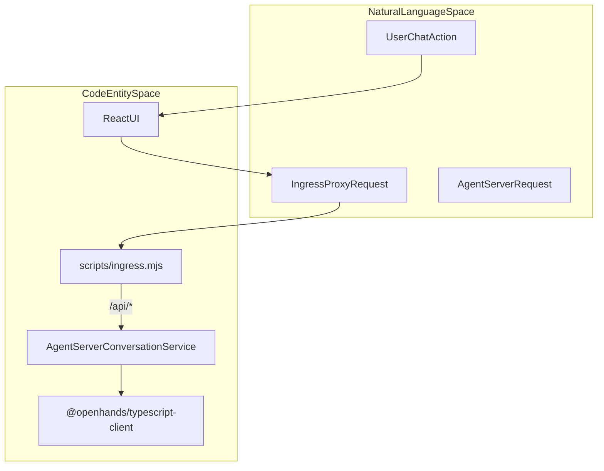
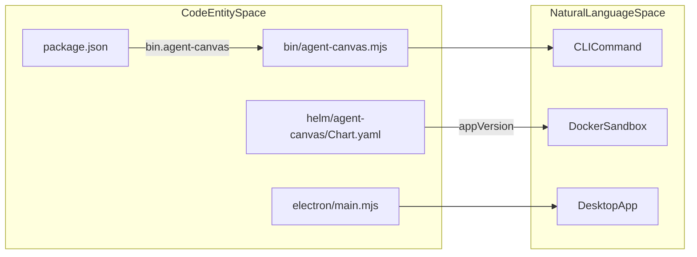

<!-- source: DeepWiki mcp.deepwiki.com · repo All-Hands-AI/OpenHands · page 1 Agent Canvas Overview · fetched 2026-10-26 -->

# Agent Canvas Overview

Relevant source files

The following files were used as context for generating this wiki page:

- [.release-please-manifest.json](.release-please-manifest.json)
- [AGENTS.md](AGENTS.md)
- [README.md](README.md)
- [README.windows.md](README.windows.md)
- [__tests__/scripts/acp-docker-env-sync.test.ts](__tests__/scripts/acp-docker-env-sync.test.ts)
- [__tests__/scripts/dev-safe.test.ts](__tests__/scripts/dev-safe.test.ts)
- [config/defaults.json](config/defaults.json)
- [docs/ACP_AGENTS.md](docs/ACP_AGENTS.md)
- [docs/README.md](docs/README.md)
- [docs/SELF_HOSTING.md](docs/SELF_HOSTING.md)
- [examples/acp-docker/.env.example](examples/acp-docker/.env.example)
- [examples/acp-docker/README.md](examples/acp-docker/README.md)
- [examples/acp-docker/docker-compose.yml](examples/acp-docker/docker-compose.yml)
- [helm/agent-canvas/Chart.yaml](helm/agent-canvas/Chart.yaml)
- [package-lock.json](package-lock.json)
- [package.json](package.json)
- [scripts/check-sdk-version-sync.mjs](scripts/check-sdk-version-sync.mjs)
- [scripts/dev-safe.mjs](scripts/dev-safe.mjs)
- [scripts/gen-acp-docker-env.mjs](scripts/gen-acp-docker-env.mjs)
- [tests/e2e/live-acp/README.md](tests/e2e/live-acp/README.md)
- [tests/e2e/live-acp/acp-docker-e2e.mts](tests/e2e/live-acp/acp-docker-e2e.mts)

Agent Canvas is the React/TypeScript frontend control center for the OpenHands ecosystem [README.md:5-12](). It serves as a self-hosted developer control center where users can interact with AI coding agents, manage long-running automations, and orchestrate complex development workflows across local, remote, and cloud environments [README.md:33-35]().

The project is designed to be highly portable, running as a local CLI tool via npm [README.md:70-73](), a containerized service [README.md:95-100](), or a desktop application [package.json:109](). It bridges high-level natural language instructions and low-level code execution by interfacing with the `agent-server` (`openhands-agent-server`) and the automation backend [README.md:33-35](), [config/defaults.json:35-38]().

## Purpose and Key Capabilities

Agent Canvas provides a unified interface for multiple agentic workflows and capabilities:

*   **Multi-Backend Support**: Connect to agents running locally, in Docker containers, on remote VMs, or via OpenHands Cloud and Enterprise infrastructure [README.md:35-42]().
*   **ACP Agent Integration**: Native support for the Agent-Client Protocol (ACP), allowing users to drive external agents like Claude Code, Codex, and Gemini CLI through the Canvas UI [README.md:46](), [docs/ACP_AGENTS.md:8-16]().
*   **Automations**: A dedicated system for scheduled or event-driven tasks, integrating with services like Slack, GitHub, and Linear [README.md:33-43]().
*   **Integrated Workspace**: A full-featured development environment including file management, terminal tools, and git integration [README.md:33-37]().

Sources: [README.md:5-46](), [config/defaults.json:35-38](), [docs/ACP_AGENTS.md:8-16]()

## High-Level Architecture and SDK Integration

The Agent Canvas architecture follows a frontend-first philosophy where the React UI orchestrates multiple backend services through a centralized ingress proxy [docs/SELF_HOSTING.md:23-46](). Agent Canvas interacts with agent runtimes through the `agent-server` API [docs/ACP_AGENTS.md:20-27](). The frontend leverages `@openhands/typescript-client` to maintain strict type safety across network boundaries [package.json:27]().

Title: "Request Routing and Backend Integration"

Sources: [package.json:27](), [docs/SELF_HOSTING.md:23-46](), [docs/ACP_AGENTS.md:17-27]()

## Deployment Models and Runtime Modes

Agent Canvas supports multiple deployment models to suit different security and operational requirements:
1.  **Local CLI**: Installed via `npm install -g @openhands/agent-canvas`, executing the `agent-canvas` binary [README.md:70-73](), [package.json:16-18]().
2.  **Docker Sandbox**: An all-in-one container image (`ghcr.io/openhands/agent-canvas`) providing full execution isolation [README.md:95-100](), [config/defaults.json:17]().
3.  **Electron Desktop**: Native packaging for desktop workflows [package.json:108-111]().
4.  **Self-Hosted VM**: Secure multi-service topology behind an ingress proxy using `--public` mode and `LOCAL_BACKEND_API_KEY` [docs/SELF_HOSTING.md:13-59]().

Title: "Runtime Deployment to Code Entity Mapping"

Sources: [package.json:16-18](), [helm/agent-canvas/Chart.yaml:10-16](), [README.md:70-100]()

---

## Child Pages

For deeper technical dives into specific areas of Agent Canvas, refer to the following child pages:

*   **[Project Structure and Technology Stack](#1.1)**: For details on the monorepo layout (`src/`, `scripts/`, `bin/`, `docker/`, `electron/`, `helm/`), technology choices (React, TypeScript, Vite, TanStack Query, Zustand, MSW), and library entrypoints, see [Project Structure and Technology Stack](#1.1).
*   **[Runtime Modes and Deployment Models](#1.2)**: For details on runtime modes (`dev`, `dev:minimal`, `dev:static`, `dev:mock`, Docker, Electron, self-hosted VM), ingress proxy topology, and security configurations, see [Runtime Modes and Deployment Models](#1.2).

Sources: [package.json:22-115](), [config/defaults.json:1-45](), [docs/SELF_HOSTING.md:1-59]()

---

