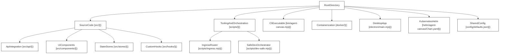
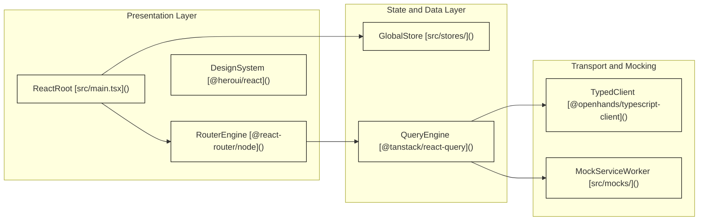
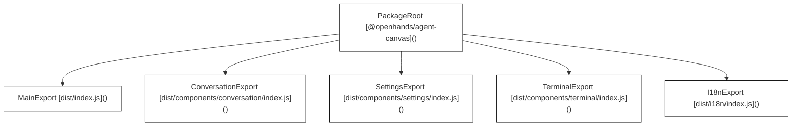
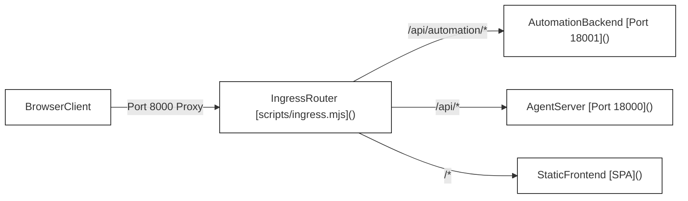

<!-- source: DeepWiki mcp.deepwiki.com · repo All-Hands-AI/OpenHands · page 1.1 Project Structure and Technology Stack · fetched 2026-10-26 -->

# Project Structure and Technology Stack

Relevant source files

The following files were used as context for generating this wiki page:

- [.release-please-manifest.json](.release-please-manifest.json)
- [AGENTS.md](AGENTS.md)
- [README.md](README.md)
- [README.windows.md](README.windows.md)
- [__tests__/package-library.test.ts](__tests__/package-library.test.ts)
- [__tests__/scripts/dev-safe.test.ts](__tests__/scripts/dev-safe.test.ts)
- [config/defaults.json](config/defaults.json)
- [helm/agent-canvas/Chart.yaml](helm/agent-canvas/Chart.yaml)
- [package-lock.json](package-lock.json)
- [package.json](package.json)
- [scripts/check-sdk-version-sync.mjs](scripts/check-sdk-version-sync.mjs)
- [scripts/dev-safe.mjs](scripts/dev-safe.mjs)

## Purpose and Scope

This document details the monorepo layout, technology stack choices, package export structures, and network topology for **Agent Canvas**, the self-hosted developer control center for AI coding agents and autonomous workflows. It serves as a comprehensive architectural reference for developers contributing to or integrating with the `@openhands/agent-canvas` codebase.

Sources: [README.md:1-12](), [package.json:1-11]()

---

## Monorepo Layout

The OpenHands monorepo is organized into specialized directories separating core application source code, CLI orchestration binaries, container definitions, desktop wrappers, and infrastructure deployment helm charts.

### Project Directory Map

Sources: [package.json:16-18](), [config/defaults.json:1-45](), [scripts/dev-safe.mjs:30-66]()

### Key Directories and Files

| Directory / File | Purpose | Key Responsibilities |
|------------------|---------|----------------------|
| `src/` | Core React application source code | Contains views, routers, components, custom hooks, and state stores. |
| `scripts/` | Tooling for development, proxying, and CI/CD | Orchestrates local processes via `scripts/dev-safe.mjs` and ingress routing via `scripts/ingress.mjs`. |
| `bin/` | Executable binaries for npm distribution | Contains `bin/agent-canvas.mjs` [package.json:16-18](), serving as the entrypoint for the global CLI command. |
| `docker/` | Containerization definitions | Houses `docker/Dockerfile` and runtime entrypoint scripts for packaging the all-in-one distribution. |
| `electron/` | Desktop application wrapper | Implements native desktop window management via `electron/main.mjs` and preload scripts. |
| `helm/` | Kubernetes deployment artifacts | Defines the Helm chart structure in `helm/agent-canvas/Chart.yaml` [helm/agent-canvas/Chart.yaml:1-16]() for stateful cluster deployments. |
| `config/` | Shared configuration constants | Houses `config/defaults.json` [config/defaults.json:1-45](), acting as the single source of truth for version pins, ports, and paths. |

Sources: [package.json:1-18](), [config/defaults.json:1-45](), [scripts/dev-safe.mjs:1-66](), [helm/agent-canvas/Chart.yaml:1-16]()

---

## Technology Stack and Architecture

Agent Canvas is built on a modern React 19 stack emphasizing type safety, asynchronous state caching, and reactive UI updates.

### System Entity Relationship

Sources: [package.json:22-72](), [AGENTS.md:6-9]()

#### Core Technology Choices

*   **React 19 & TypeScript**: Provides component encapsulation and static type validation (`react` `19.2.8`, `typescript` `6.0.3`) [package.json:49, 112](), [package-lock.json:39, 112]().
*   **React Router 7**: Manages SPA routing (`@react-router/node` `7.18.2`) [package.json:28](), [package-lock.json:18]().
*   **TanStack Query (v5)**: Handles server-state caching, automatic background refetching, and synchronization (`@tanstack/react-query` `5.101.4`) [package.json:31](), [package-lock.json:21]().
*   **Zustand**: Manages lightweight client-side global states such as event logs and conversation filters (`zustand` `5.0.14`) [package.json:72](), [package-lock.json:62]().
*   **HeroUI & Tailwind CSS**: Supplies the underlying design system components (`@heroui/react` `2.8.10`) [package.json:23](), [package-lock.json:13]() and styling utilities (`tailwindcss` `4.3.3`) [package.json:69](), [package-lock.json:111]().
*   **MSW (Mock Service Worker)**: Intercepts network layer interactions during mock development (`npm run dev:mock`) and E2E testing (`msw` `2.15.0`) [package.json:80](), [package-lock.json:107]().

Sources: [package.json:22-72](), [package-lock.json:7-62]()

---

## Library Entrypoints and Package Exports

The `@openhands/agent-canvas` package functions both as a standalone executable control center and as a modular library exportable to external React hosts.

### Package Exports Mapping

Sources: [__tests__/package-library.test.ts:29-61]()

### Library Build and Consumption
*   **Build Command**: Executed via `npm run build:lib`, which invokes `tsc -p tsconfig.lib.json` and bundles entrypoints in library mode [package.json:105]().
*   **Scope Isolation**: Style encapsulation is enforced by `AgentServerUIRoot`, which injects scoped CSS custom properties (`var(--oh-*)`) into the React component subtree to prevent CSS collision with host applications [src/components/providers/agent-server-ui-root.tsx:21-56]().

Sources: [package.json:105](), [__tests__/package-library.test.ts:29-61](), [src/components/providers/agent-server-ui-root.tsx:21-56]()

---

## Network Topology and Ingress Proxy

Agent Canvas runs an integrated ingress proxy (`scripts/ingress.mjs`) that routes traffic between the frontend single-page application and backend orchestration services.

### Ingress Routing Architecture

Sources: [config/defaults.json:19-23](), [scripts/dev-safe.mjs:39-42]()

### Proxy Rules
*   **Ingress Port**: Binds to port `8000` by default [config/defaults.json:22]().
*   **`/api/automation/*`**: Proxies requests to the automation service running on port `18001` [config/defaults.json:21]().
*   **`/api/*`**: Proxies requests to the Python agent server running on port `18000` [config/defaults.json:20]().
*   **Root `/*`**: Serves the React frontend assets [package.json:83]().

Sources: [config/defaults.json:19-23](), [package.json:83]()

---

## Configuration Management

Configuration defaults are centralized in `config/defaults.json`, providing version pins and port assignments consumed across npm launchers, Docker entrypoints, and CI workflows [config/defaults.json:1-45]().

| Configuration Key | Value | Description |
|-------------------|-------|-------------|
| `versions.agentServer` | `1.46.0` | Pinned Python agent server version [config/defaults.json:4](). |
| `versions.agentCanvas` | `1.18.0` | Current frontend package version [config/defaults.json:5](). |
| `ports.proxy` | `8000` | Default ingress proxy port [config/defaults.json:22](). |
| `paths.stateSubdir` | `agent-canvas` | Local filesystem state storage subdirectory under `~/.openhands` [config/defaults.json:27](). |
| `compatibility.minimumAgentServer` | `1.28.0` | Minimum agent server version required for API compatibility [config/defaults.json:9](). |

Sources: [config/defaults.json:1-45](), [scripts/dev-safe.mjs:30-37]()

---

