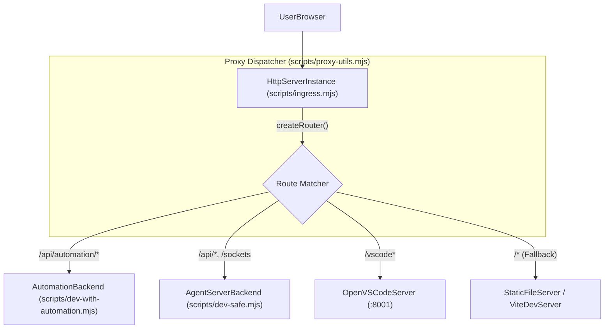
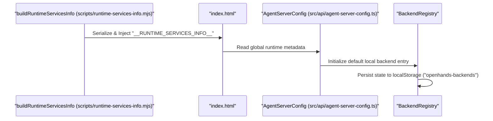

<!-- source: DeepWiki mcp.deepwiki.com · repo All-Hands-AI/OpenHands · page 1.2 Runtime Modes and Deployment Models · fetched 2026-10-26 -->

# Runtime Modes and Deployment Models

Relevant source files

The following files were used as context for generating this wiki page:

- [.dockerignore](.dockerignore)
- [.github/ISSUE_TEMPLATE/bug_report.yml](.github/ISSUE_TEMPLATE/bug_report.yml)
- [.github/ISSUE_TEMPLATE/feature_request.yml](.github/ISSUE_TEMPLATE/feature_request.yml)
- [.github/dependabot.yml](.github/dependabot.yml)
- [.github/pr-assets/pr-16605-test-results.png](.github/pr-assets/pr-16605-test-results.png)
- [.github/pull_request_template.md](.github/pull_request_template.md)
- [.github/scripts/check_issue_readiness.py](.github/scripts/check_issue_readiness.py)
- [.github/scripts/check_pr_description.py](.github/scripts/check_pr_description.py)
- [.github/scripts/markdown_sections.py](.github/scripts/markdown_sections.py)
- [.github/scripts/post-readiness-comment.mjs](.github/scripts/post-readiness-comment.mjs)
- [.github/scripts/tests/__init__.py](.github/scripts/tests/__init__.py)
- [.github/scripts/tests/test_issue_readiness.py](.github/scripts/tests/test_issue_readiness.py)
- [.github/scripts/tests/test_markdown_sections.py](.github/scripts/tests/test_markdown_sections.py)
- [.github/scripts/tests/test_pr_description.py](.github/scripts/tests/test_pr_description.py)
- [.github/workflows/ci-script-tests.yml](.github/workflows/ci-script-tests.yml)
- [.github/workflows/issue-readiness-check.yml](.github/workflows/issue-readiness-check.yml)
- [.github/workflows/pr-artifacts.yml](.github/workflows/pr-artifacts.yml)
- [.github/workflows/pr-description-check.yml](.github/workflows/pr-description-check.yml)
- [__tests__/bin/agent-canvas.test.ts](__tests__/bin/agent-canvas.test.ts)
- [__tests__/scripts/dev-static.test.ts](__tests__/scripts/dev-static.test.ts)
- [__tests__/scripts/dev-with-automation.test.ts](__tests__/scripts/dev-with-automation.test.ts)
- [__tests__/scripts/static-server.test.ts](__tests__/scripts/static-server.test.ts)
- [bin/agent-canvas.mjs](bin/agent-canvas.mjs)
- [docker/entrypoint.sh](docker/entrypoint.sh)
- [scripts/dev-static.mjs](scripts/dev-static.mjs)
- [scripts/dev-with-automation.mjs](scripts/dev-with-automation.mjs)
- [scripts/runtime-services-info.mjs](scripts/runtime-services-info.mjs)
- [scripts/static-server.mjs](scripts/static-server.mjs)
- [vite.config.ts](vite.config.ts)

## Purpose and Scope
This document details the runtime modes, ingress proxy topologies, service orchestration scripts, connection initialization flows, and security architectures supported by Agent Canvas (`OpenHands/OpenHands`). It targets a technical audience implementing or operating local development stacks, containerized Docker deployments, or desktop Electron shells.

---

## 1. Overview of Runtime Modes

Agent Canvas provides multiple execution entrypoints defined via `npm` scripts and orchestrator modules.

| Runtime Mode | Command | Orchestrator / Entrypoint | Description |
| :--- | :--- | :--- | :--- |
| **Full Dev** | `npm run dev` | `scripts/dev-with-automation.mjs` | Runs the Vite dev server (`:3001`), Agent Server (`:18000`), Automation Backend (`:18001`), and Ingress Proxy (`:8000`) [scripts/dev-with-automation.mjs:1-45](). |
| **Minimal** | `npm run dev:minimal` | `scripts/dev-safe.mjs` | Runs an isolated development stack without the automation backend [scripts/dev-safe.mjs:1-182](). |
| **Static** | `npm run dev:static` | `scripts/dev-static.mjs` | Serves a pre-built production frontend via `scripts/static-server.mjs` alongside local backends [scripts/static-server.mjs:1-28](). |
| **Mock** | `npm run dev:mock` | Vite + MSW | Frontend-only mode using Mock Service Worker handlers to simulate agent-server and automation APIs without local Python processes. |
| **Docker** | `docker run` | `docker/entrypoint.sh` | Containerized all-in-one deployment binding services behind an ingress proxy and mounting projects at `/projects` [docker/entrypoint.sh:1-57](). |
| **Electron** | Desktop App | `electron/main.mjs` | Desktop application packaging the frontend and managing embedded Python runtimes and local child processes. |

Sources: [scripts/dev-with-automation.mjs:1-45](), [scripts/dev-safe.mjs:1-182](), [scripts/static-server.mjs:1-28](), [docker/entrypoint.sh:1-57]()

---

## 2. Ingress Proxy Topology and Network Routing

Except for `dev:mock`, Agent Canvas routes all traffic through an ingress proxy layer implemented by `scripts/ingress.mjs` (using `polka` and `httpxy`) or `scripts/static-server.mjs` [scripts/ingress.mjs:1-28](), [scripts/static-server.mjs:1-28](). The proxy shares route parsing logic with `scripts/proxy-utils.mjs`.

### Diagram: Ingress Routing Topology (Code Entity Space)

Sources: [scripts/ingress.mjs:1-28](), [scripts/static-server.mjs:1-28](), [scripts/proxy-utils.mjs:1-50](), [scripts/dev-with-automation.mjs:9-22]()

---

## 3. Implementation Details: `dev-safe.mjs` and Service Orchestration

The `scripts/dev-safe.mjs` module coordinates local process lifecycles, port allocation, and credential persistence.

Key functions and classes:
*   `findFreePort` / `findFreePorts`: Dynamically allocate TCP ports to avoid collisions across development runs [__tests__/scripts/dev-safe.test.ts:51-174]().
*   `getOrCreatePersistedApiKey(filePath, label)`: Reads or generates a 256-bit hex session API key stored at `DEFAULT_API_KEY_PATH` (`~/.openhands/agent-canvas/api-key.txt`) [scripts/dev-safe.mjs:72-180]().
*   `buildAgentServerCommand`: Constructs the `uvx` execution command for `openhands-agent-server` pinned to `DEFAULT_AGENT_SERVER_VERSION` from `config/defaults.json` [scripts/dev-safe.mjs:30-65]().

Sources: [scripts/dev-safe.mjs:30-180](), [__tests__/scripts/dev-safe.test.ts:51-174](), [config/defaults.json:1-45]()

---

## 4. Canvas-to-Agent-Server Connection and Service Injection

Canvas connects to backend instances through the `Backend Registry`. Runtime configuration metadata is injected into `index.html` at startup by `scripts/runtime-services-info.mjs`.

### Diagram: Runtime Services Data Flow (Code Entity Space)

Sources: [scripts/runtime-services-info.mjs:1-25](), [src/api/agent-server-config.ts:1-40]()

---

## 5. Security Posture, `--public` Flag, and Secret Encryption

### Session Authentication
By default, backends validate incoming requests using the `X-Session-API-Key` header. This key is automatically generated and persisted via `getOrCreatePersistedApiKey` [scripts/dev-safe.mjs:123-180]().

### The `--public` Flag and `--auth-required`
When launching via `bin/agent-canvas.mjs` or Docker with `--public` (`OH_CANVAS_PUBLIC=true`):
1.  **Network Binding**: Services bind to `0.0.0.0` instead of `127.0.0.1` [scripts/dev-with-automation.mjs:176-179]().
2.  **Omission of Key Injection**: The session key is **not** baked into the frontend bundle. Users must manually provide the key through the UI login prompt.
3.  **Static Server Gate**: `scripts/static-server.mjs` supports `--auth-required`, which is semantically equivalent for static deployments [scripts/static-server.mjs:157-159]().

### Secrets Encryption
Sensitive settings (such as LLM credentials) are encrypted using `OH_SECRET_KEY` prior to persistence at `DEFAULT_SECRET_KEY_PATH` (`~/.openhands/agent-canvas/secret-key.txt`) [scripts/dev-safe.mjs:101-106]().

Sources: [scripts/dev-safe.mjs:84-180](), [scripts/dev-with-automation.mjs:176-179](), [scripts/static-server.mjs:157-159](), [bin/agent-canvas.mjs:71-75]()

---

## 6. Containerized and Desktop Deployments (Docker & Electron)

*   **Docker (`docker/entrypoint.sh`)**: Orchestrates the agent server, automation service, and static server inside a single container. It normalizes paths via `normalize_base_path` and coordinates `VSCODE_BASE_PATH` settings with `openvscode-server` [docker/entrypoint.sh:87-117](). Host project directories are mounted into `/projects`.
*   **Electron (`electron/main.mjs`)**: Packages the frontend SPA with an embedded Python execution environment (`uv`), managing local child processes and enforcing strict navigation policies via `electron-builder.config.mjs`.

Sources: [docker/entrypoint.sh:1-117](), [config/defaults.json:1-45]()

---

