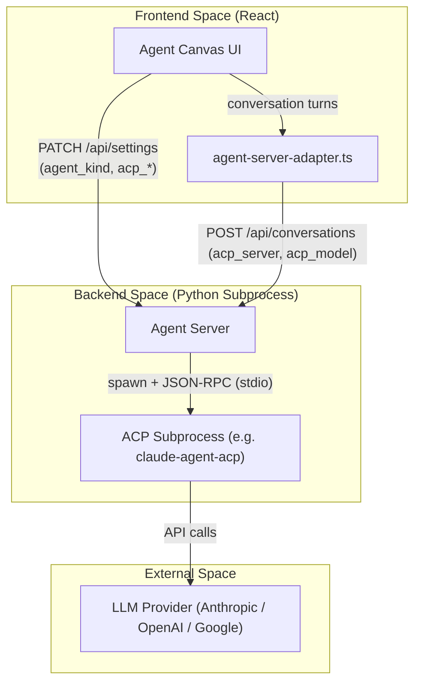
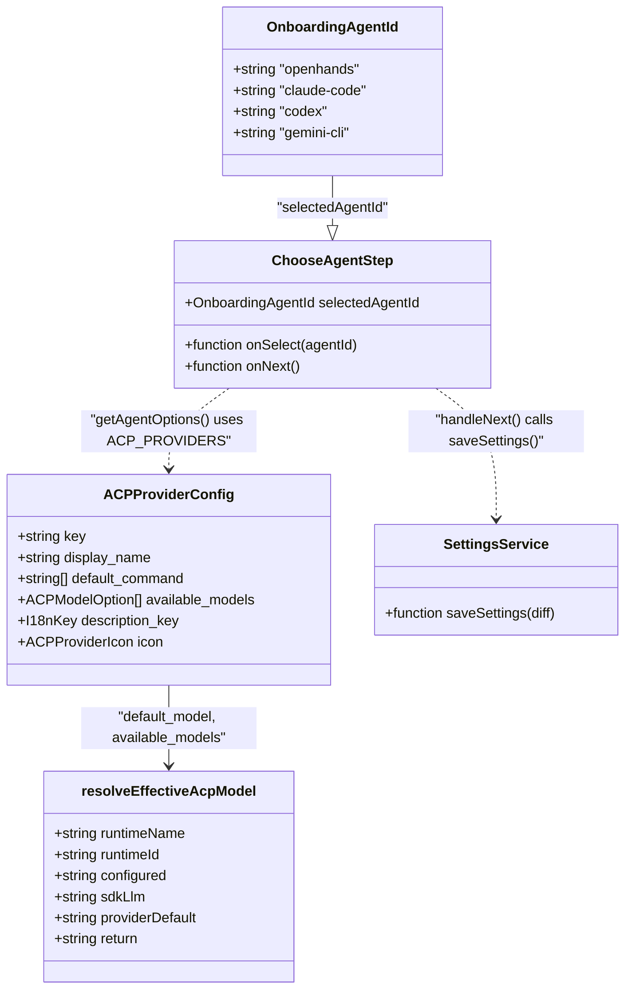

<!-- source: DeepWiki mcp.deepwiki.com · repo All-Hands-AI/OpenHands · page 10 ACP Agent Integration · fetched 2026-10-26 -->

# ACP Agent Integration

Relevant source files

The following files were used as context for generating this wiki page:

- [.github/workflows/sdk-version-sync.yml](.github/workflows/sdk-version-sync.yml)
- [__tests__/constants/acp-providers.test.ts](__tests__/constants/acp-providers.test.ts)
- [__tests__/scripts/check-sdk-version-sync.test.ts](__tests__/scripts/check-sdk-version-sync.test.ts)
- [src/constants/acp-providers.test.ts](src/constants/acp-providers.test.ts)
- [src/constants/acp-providers.ts](src/constants/acp-providers.ts)

The Agent Client Protocol (ACP) integration allows Agent Canvas to drive external coding agents—such as **Claude Code**, **Codex**, and **Gemini CLI**—instead of the default OpenHands agent. This is achieved via a subprocess model where the `agent-server` spawns the agent's CLI and communicates using JSON-RPC over stdio [docs/ACP_AGENTS.md:8-15]().

## Architectural Overview

In the ACP model, the `agent-server` acts as a relay. Agent Canvas sends conversation turns to the server, which in turn manages the lifecycle of the ACP subprocess [docs/ACP_AGENTS.md:17-27]().

### ACP Subprocess Model

Sources: [docs/ACP_AGENTS.md:17-27]()

## Provider Registry and Discovery

The list of supported ACP providers is defined upstream in the OpenHands SDK and mirrored in the frontend via `@openhands/typescript-client` [src/constants/acp-providers.ts:1-1](). Agent Canvas enriches this registry with UI-specific metadata, such as brand icons and internationalized descriptions [src/constants/acp-providers.ts:123-145](). The `ACP_PROVIDERS` constant holds the enriched configuration for each provider [__tests__/constants/acp-providers.test.ts:50-74]().

### Built-in Providers
| Provider | Default Command | SDK Key |
| :--- | :--- | :--- |
| **Claude Code** | `npx -y @agentclientprotocol/claude-agent-acp` | `claude-code` |
| **Codex** | `npx -y @agentclientprotocol/codex-acp` | `codex` |
| **Gemini CLI** | `npx -y @google/gemini-cli --acp` | `gemini-cli` |

Sources: [src/constants/acp-providers.ts:76-114](), [docs/ACP_AGENTS.md:41-45]()

## Conversation and Settings Integration

ACP agents are integrated into the standard conversation flow. The `ChooseAgentStep` component handles the selection of an ACP agent during onboarding, which then persists the `agent_kind` and `acp_server` settings. The `ACP_PROVIDERS` constant [__tests__/constants/acp-providers.test.ts:50-74]() defines the available ACP agents and their associated metadata.

The `resolveEffectiveAcpModel` function [src/constants/acp-providers.ts:48-65]() is crucial for determining the model string to display for an ACP conversation or settings context. It prioritizes runtime fields, user-configured `acp_model`, and legacy `agent.llm.model`, falling back to a provider default if no concrete model is found [src/constants/acp-providers.ts:48-65](). This function also handles the `ACP_MANAGED_SENTINEL` placeholder, which is suppressed to ensure only real model strings are surfaced [src/constants/acp-providers.ts:20-33]().

### Data Mapping to Code Entities
The following diagram bridges the natural language concepts of "ACP Agents" to the specific fields and classes used in the configuration and communication layer.

Sources: [src/constants/acp-providers.ts:76-114](), [src/constants/acp-providers.ts:48-65]()

## Configuration and Credentials

ACP agents require authentication, which can be handled via:
1.  **Subscription/OAuth Login:** Reusing existing host credentials (e.g., macOS Keychain for Claude Code or `~/.codex/auth.json` for Codex) [docs/ACP_AGENTS.md:60-72]().
2.  **API Keys:** Configured as environment variables (e.g., `ANTHROPIC_API_KEY`, `OPENAI_API_KEY`) exported to the subprocess via the `ACPProviderSecretField` definition [__tests__/constants/acp-providers.test.ts:164-169](), [docs/ACP_AGENTS.md:126-131]().

The onboarding flow includes a "Set up credentials" step where users can provide these secrets [docs/ACP_AGENTS.md:103-111](). These credentials are saved as global secrets, whose names directly correspond to the environment variables the Agent Server exports to the ACP subprocess [docs/ACP_AGENTS.md:126-131](). The `getAcpProviderSecrets` function [__tests__/constants/acp-providers.test.ts:120-153]() defines the specific credential fields required for each provider, ensuring that the correct environment variables are collected and rendered in the UI.

For detailed information on configuring these providers, including the OAuth device flow, see [ACP Provider Configuration](#10.1).

## Containerized Execution (Docker)

Running ACP agents inside Docker containers requires explicit credential injection because the container lacks access to the host's interactive login sessions [docs/ACP_AGENTS.md:133-139]().

The codebase provides a reference implementation in `examples/acp-docker/` that demonstrates how to:
*   Inject `CODEX_AUTH_JSON` or `CLAUDE_CODE_OAUTH_TOKEN` via the UI [docs/ACP_AGENTS.md:105-108]().
*   Pin versions using `gen-acp-docker-env.mjs` [scripts/gen-acp-docker-env.mjs:1-21]().
*   Persist data and credentials using volumes in the `docker-compose.yml` [examples/acp-docker/docker-compose.yml:65-67]().

For a step-by-step guide on setting up a containerized ACP environment, see [ACP Docker Example](#10.2).

## Child Pages
- [ACP Provider Configuration](#10.1) — Detailed breakdown of `acp-providers.ts` constants, the ACP discriminator in `agent-server-adapter`, `acp-credentials-section`, `setup-acp-secrets-step`, `use-acp-auth-status`, ACP model switching, and device-verify OAuth.
- [ACP Docker Example](#10.2) — Documentation for the `examples/acp-docker` setup, `docker-compose.yml`, `.env.example`, running a containerized `agent-server` with ACP agents, credential injection, and version-pinned env generation scripts.

Sources: [docs/README.md:6]()

---

