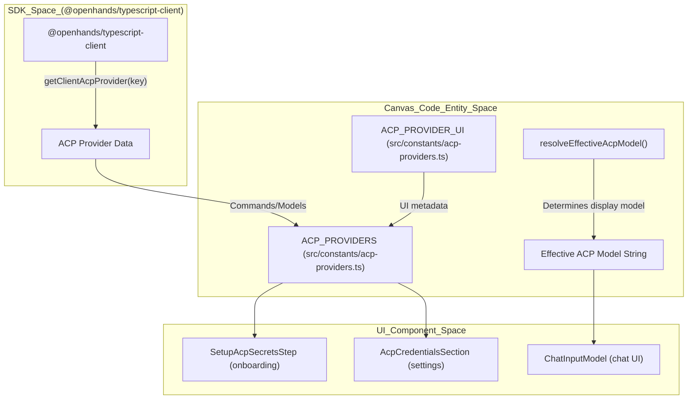
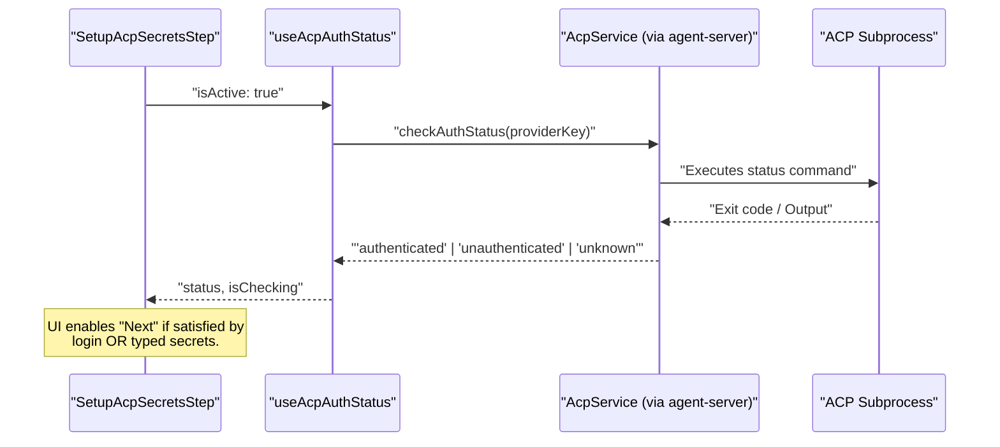
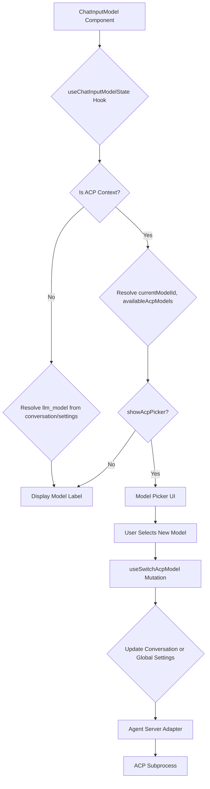
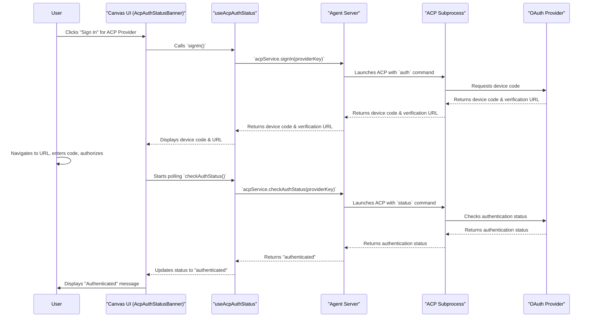

<!-- source: DeepWiki mcp.deepwiki.com · repo All-Hands-AI/OpenHands · page 10.1 ACP Provider Configuration · fetched 2026-10-26 -->

# ACP Provider Configuration

Relevant source files

The following files were used as context for generating this wiki page:

- [.github/workflows/sdk-version-sync.yml](.github/workflows/sdk-version-sync.yml)
- [__tests__/components/onboarding/setup-acp-secrets-step.test.tsx](__tests__/components/onboarding/setup-acp-secrets-step.test.tsx)
- [__tests__/components/settings/acp-auth-status-banner.test.tsx](__tests__/components/settings/acp-auth-status-banner.test.tsx)
- [__tests__/components/settings/acp-credentials-section-cloud.test.tsx](__tests__/components/settings/acp-credentials-section-cloud.test.tsx)
- [__tests__/components/settings/acp-credentials-section.test.tsx](__tests__/components/settings/acp-credentials-section.test.tsx)
- [__tests__/constants/acp-providers.test.ts](__tests__/constants/acp-providers.test.ts)
- [__tests__/hooks/query/use-acp-auth-status.test.tsx](__tests__/hooks/query/use-acp-auth-status.test.tsx)
- [__tests__/scripts/check-sdk-version-sync.test.ts](__tests__/scripts/check-sdk-version-sync.test.ts)
- [__tests__/utils/acp-auth-display.test.ts](__tests__/utils/acp-auth-display.test.ts)
- [src/components/features/onboarding/steps/setup-acp-secrets-step.tsx](src/components/features/onboarding/steps/setup-acp-secrets-step.tsx)
- [src/components/features/settings/acp-auth-status-banner.tsx](src/components/features/settings/acp-auth-status-banner.tsx)
- [src/components/features/settings/acp-credentials-section.tsx](src/components/features/settings/acp-credentials-section.tsx)
- [src/constants/acp-providers.test.ts](src/constants/acp-providers.test.ts)
- [src/constants/acp-providers.ts](src/constants/acp-providers.ts)
- [src/hooks/use-acp-credential-form.ts](src/hooks/use-acp-credential-form.ts)

The Agent Client Protocol (ACP) integration allows Agent Canvas to drive external coding agents—such as **Claude Code**, **Codex**, and **Gemini CLI**—via the `agent-server` subprocess model. This architecture enables OpenHands to act as a sophisticated frontend for specialized CLI-based agents while providing a unified interface for credential management and session control.

## ACP Provider Registry

The configuration for ACP providers is centralized in `acp-providers.ts`. This module serves as the bridge between the Python SDK's source of truth and the Canvas UI requirements.

### Data Sourcing and Constants
Canvas consumes built-in provider data (display names, launch commands, and model pickers) from the `@openhands/typescript-client` registry, which is a generated mirror of the Python `openhands.sdk.settings.acp_providers` [src/constants/acp-providers.ts:68-74]().

Key constants include:
*   **`ACP_PROVIDERS`**: An array of `ACPProviderConfig` objects enriched with Canvas-specific UI metadata like brand icons and onboarding descriptions [src/constants/acp-providers.ts:166-174]().
*   **`ACP_MANAGED_SENTINEL`**: A value (`"acp-managed"`) used by older SDKs to indicate the agent is managing its own model, suppressed in favor of real model IDs [src/constants/acp-providers.ts:20-33]().
*   **`ACP_CUSTOM_PRESET_KEY`**: A sentinel value (`"custom"`) allowing users to provide arbitrary shell commands for unlisted ACP servers [__tests__/constants/acp-providers.test.ts:5]().

### Model Resolution
The `resolveEffectiveAcpModel` function determines the display string for the active model by following a strict precedence:
1.  SDK runtime fields (provided by the active subprocess).
2.  User-configured `acp_model` in settings.
3.  Legacy `agent.llm.model` sentinel.
4.  Provider default (fallback).
[src/constants/acp-providers.ts:48-65]()

### Entity Relationship Diagram: Provider Registry
This diagram illustrates how the frontend `ACP_PROVIDERS` registry maps to the SDK and UI entities.

Sources: [src/constants/acp-providers.ts:166-174](), [src/constants/acp-providers.ts:48-65](), [src/components/features/settings/acp-credentials-section.tsx:19-25]()

## ACP Credentials Management

ACP agents often require specific environment variables (API keys, OAuth tokens, or Service Account JSONs) to function within the `agent-server` subprocess.

### Credential Field Definitions
Credential fields are defined for each provider to ensure they can function in isolated environments like Docker containers [__tests__/constants/acp-providers.test.ts:120-124]().

| Provider | Secret Names (Env Vars) | Type |
| :--- | :--- | :--- |
| **Claude Code** | `CLAUDE_CODE_OAUTH_TOKEN`, `ANTHROPIC_API_KEY`, `ANTHROPIC_BASE_URL` | Text / Password |
| **Codex** | `CODEX_AUTH_JSON`, `OPENAI_API_KEY`, `OPENAI_BASE_URL` | Multiline (JSON) / Password |
| **Gemini CLI** | `GOOGLE_APPLICATION_CREDENTIALS_JSON`, `GOOGLE_CLOUD_PROJECT`, `GOOGLE_CLOUD_LOCATION`, `GOOGLE_GENAI_USE_VERTEXAI`, `GEMINI_API_KEY`, `GEMINI_BASE_URL` | Multiline (JSON) / Text |

Sources: [__tests__/constants/acp-providers.test.ts:125-131](), [__tests__/constants/acp-providers.test.ts:133-137](), [__tests__/constants/acp-providers.test.ts:139-145]()

### Form State and Validation
The `useAcpCredentialForm` hook manages the shared state for ACP credential forms, consumed by both the onboarding flow and the settings page [src/hooks/use-acp-credential-form.ts:49-51]().
*   **Conflict Detection**: `getAcpCredentialConflicts` identifies mutually exclusive credentials, such as an OAuth token and a Base URL for Claude [src/hooks/use-acp-credential-form.ts:100](), [__tests__/components/settings/acp-credentials-section.test.tsx:80-98]().
*   **File Materialization**: The hook tracks `consumesFileCredentials` to determine if the backend can handle `multiline` JSON blobs [src/hooks/use-acp-credential-form.ts:65-69]().
*   **Existing Secret Lookup**: It uses `useSearchSecrets` to detect if a field is already populated on the backend, displaying a placeholder in the UI instead of the raw value [src/hooks/use-acp-credential-form.ts:75-84]().
Sources: [src/hooks/use-acp-credential-form.ts:49-114](), [src/constants/acp-providers.ts:8]()

## UI Components and Integration

### ACP Credentials Section
The `AcpCredentialsSection` component renders the credential fields within the Agent Settings route [src/components/features/settings/acp-credentials-section.tsx:19-25]().
*   **Auth Status Banner**: Renders the `AcpAuthStatusBanner` to show real-time login status [src/components/features/settings/acp-credentials-section.tsx:51-57]().
*   **Dynamic Fields**: Maps over `form.fields` to render `AcpSecretField` components (textareas for multiline, password inputs for keys) [src/components/features/settings/acp-credentials-section.tsx:60-71]().
Sources: [src/components/features/settings/acp-credentials-section.tsx:35-76]()

### Onboarding Step: SetupAcpSecretsStep
During onboarding, the `SetupAcpSecretsStep` is shown if an ACP agent is selected [src/components/features/onboarding/steps/setup-acp-secrets-step.tsx:58-63]().
*   **Login Probing**: Uses `useAcpAuthStatus` to check if the user is already authenticated (e.g., via a host-level login) [src/components/features/onboarding/steps/setup-acp-secrets-step.tsx:68-71]().
*   **Requirement Logic**: `backendRequiresAcpCredentials` determines if the step is mandatory based on backend kind and auth status [src/components/features/onboarding/steps/setup-acp-secrets-step.tsx:93-97]().
*   **Profile Application**: On success, `useApplyOnboardingAgentProfile` updates the active agent profile with the selected ACP server and preferred default model [src/components/features/onboarding/steps/setup-acp-secrets-step.tsx:126-132]().
Sources: [src/components/features/onboarding/steps/setup-acp-secrets-step.tsx:58-135]()

### Authentication Flow: Data and Logic

Sources: [src/components/features/onboarding/steps/setup-acp-secrets-step.tsx:68-117](), [src/hooks/use-acp-credential-form.ts:105-107]()

## ACP Model Switching

Agent Canvas provides a mechanism to switch ACP models dynamically within a conversation or when starting a new one.

### `useChatInputModelState` Hook
The `useChatInputModelState` hook determines the current model, available models for switching, and whether the model picker should be shown [src/hooks/use-chat-input-model-state.ts:30-121]().
*   **Contextual Model Resolution**: It resolves the `currentModelId` based on whether the context is an active ACP conversation, the home page with an ACP agent selected, or a non-ACP context [src/hooks/use-chat-input-model-state.ts:74-93]().
*   **Display Label**: The `displayModel` is a human-readable label, resolved using `labelForAcpModel` from the ACP provider registry [src/constants/acp-providers.ts:14](), [src/hooks/use-chat-input-model-state.ts:95-97]().
*   **Model Picker Visibility**: The `showAcpPicker` flag is set if the context is ACP, there are available models, and the user has permission to persist changes (especially for organization-owned profiles in cloud environments) [src/hooks/use-chat-input-model-state.ts:100-104]().

### Model Switching Logic
The `useSwitchAcpModel` mutation hook handles the actual model change [src/hooks/mutation/use-switch-acp-model.ts:12-20]().
*   **Conversation-scoped Switch**: If `conversationId` is provided, the model change applies to the specific conversation by calling `AgentServerConversationService.switchAcpModel` [src/hooks/mutation/use-switch-acp-model.ts:54-58]().
*   **Global Settings Switch**: If no conversation ID is provided (e.g., on the home page), the model change updates the global agent settings. This involves either updating the active ACP `AgentProfile` or, as a fallback, modifying `agent_settings_diff` in the user's settings [src/hooks/mutation/use-switch-acp-model.ts:61-110]().

### ACP Model Switching Flow

Sources: [src/hooks/use-chat-input-model-state.ts:30-121](), [src/hooks/mutation/use-switch-acp-model.ts:12-20](), [__tests__/components/features/chat/components/chat-input-model.test.tsx:86-107]()

## ACP Discriminator in `agent-server-adapter`

The `agent-server-adapter` acts as a translation layer between the Canvas frontend and the `agent-server` backend. For ACP agents, it plays a crucial role in distinguishing ACP conversations and routing requests appropriately.

*   **`agent_kind: "acp"`**: When an ACP agent is selected, the `agent_kind` field in the conversation metadata is set to `"acp"` [__tests__/components/features/chat/components/chat-input-model.test.tsx:90](). This discriminator is used throughout the system to identify ACP-driven conversations.
*   **`acp_server`**: The `acp_server` field stores the key of the specific ACP provider (e.g., `"claude-code"`) [__tests__/components/features/chat/components/chat-input-model.test.tsx:91](). This allows the `agent-server` to launch the correct ACP subprocess.
*   **`acp_model`**: The `acp_model` field stores the specific model ID chosen for the ACP agent, which is then passed to the ACP subprocess [__tests__/components/onboarding/setup-acp-secrets-step.test.tsx:130]().

This clear distinction ensures that ACP-specific logic, such as credential injection and model selection, is applied only when relevant, while standard OpenHands agent logic is used otherwise.

Sources: [__tests__/components/features/chat/components/chat-input-model.test.tsx:90-93](), [src/components/features/onboarding/steps/setup-acp-secrets-step.tsx:130]()

## Device-Verify OAuth Flow

For certain ACP providers, such as Claude Code, authentication involves an OAuth device flow. This is handled by the `useAcpAuthStatus` hook and the `AcpAuthStatusBanner` component.

*   **`useAcpAuthStatus`**: This hook initiates a check for the authentication status of a given ACP provider. If the provider supports OAuth and is not authenticated, it can trigger the device flow [src/hooks/query/use-acp-auth-status.test.tsx:48-56]().
*   **`AcpAuthStatusBanner`**: This component displays the current authentication status and provides UI elements for the user to interact with the OAuth flow.
    *   **`status: "unauthenticated"`**: If the user is not authenticated, a "Sign In" button is displayed. Clicking this button initiates the device flow [src/components/features/settings/acp-auth-status-banner.tsx:100-104]().
    *   **Device Code Display**: The banner will display the device code and verification URL, prompting the user to complete the authentication on an external device [src/components/features/settings/acp-auth-status-banner.tsx:109]().
    *   **Polling**: The system polls the `agent-server` to detect when the user has successfully completed the OAuth flow [src/hooks/query/use-acp-auth-status.test.tsx:48-56]().
    *   **`status: "authenticated"`**: Once authenticated, a success message is displayed, and the "Sign Out" option becomes available [src/components/features/settings/acp-auth-status-banner.tsx:109]().

### Device-Verify OAuth Flow Diagram

Sources: [src/hooks/query/use-acp-auth-status.test.tsx:48-56](), [src/components/features/settings/acp-auth-status-banner.tsx:100-109]()

---

