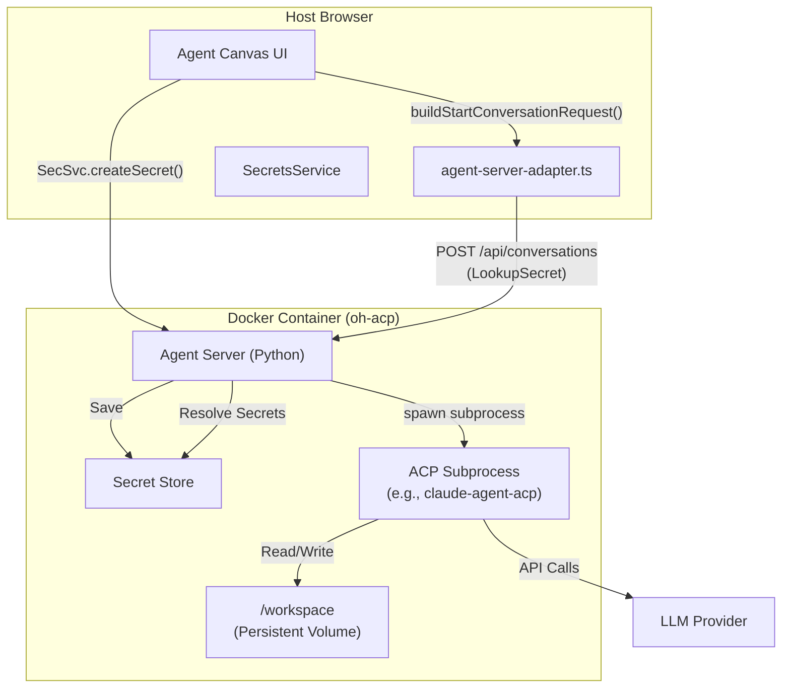
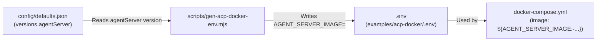

<!-- source: DeepWiki mcp.deepwiki.com · repo All-Hands-AI/OpenHands · page 10.2 ACP Docker Example · fetched 2026-10-26 -->

# ACP Docker Example

<details>
<summary>Relevant source files</summary>

The following files were used as context for generating this wiki page:

- [__tests__/scripts/acp-docker-env-sync.test.ts](__tests__/scripts/acp-docker-env-sync.test.ts)
- [docs/ACP_AGENTS.md](docs/ACP_AGENTS.md)
- [docs/README.md](docs/README.md)
- [docs/SELF_HOSTING.md](docs/SELF_HOSTING.md)
- [examples/acp-docker/.env.example](examples/acp-docker/.env.example)
- [examples/acp-docker/README.md](examples/acp-docker/README.md)
- [examples/acp-docker/docker-compose.yml](examples/acp-docker/docker-compose.yml)
- [scripts/gen-acp-docker-env.mjs](scripts/gen-acp-docker-env.mjs)
- [tests/e2e/live-acp/README.md](tests/e2e/live-acp/README.md)
- [tests/e2e/live-acp/acp-docker-e2e.mts](tests/e2e/live-acp/acp-docker-e2e.mts)

</details>


The `examples/acp-docker` setup provides a containerized environment for running the **OpenHands Agent Server** alongside external **Agent Client Protocol (ACP)** agents like Claude Code, Codex, and Gemini CLI [docs/ACP_AGENTS.md:2-3](). This configuration serves as a local-Docker counterpart to cloud sandboxes, where credentials must be explicitly provided because the container lacks the host's CLI login sessions [docs/ACP_AGENTS.md:133-139]().

## System Architecture and Data Flow

In this setup, Agent Canvas (the UI) communicates with a containerized Agent Server. The server manages the lifecycle of ACP agents as subprocesses, while the UI handles credential injection and session monitoring [docs/ACP_AGENTS.md:17-27]().

### ACP Container Interaction
The following diagram illustrates how the UI drives an ACP agent within the Docker context, utilizing the `SecretsService` for credential delivery and the `buildStartConversationRequest` for session initialization.

**ACP Container Interaction**

Sources: [docs/ACP_AGENTS.md:17-27]()

## Docker Configuration

The environment is defined by a `docker-compose.yml` file that pulls the `agent-server` image and configures the necessary runtime parameters [examples/acp-docker/docker-compose.yml:1-73]().

### Service Specification
*   **Image**: Uses `ghcr.io/openhands/agent-server:latest-python` by default, which includes pre-installed ACP CLI wrappers. The image can be pinned to a specific version using the `AGENT_SERVER_IMAGE` environment variable [examples/acp-docker/docker-compose.yml:27-28]().
*   **Ports**: Maps host port `8010` to container port `8000`. Agent Canvas must be pointed at `http://localhost:8010` [examples/acp-docker/docker-compose.yml:30-31]().
*   **Volumes**:
    *   `acp-data`: Persists conversations and materialized credential files (e.g., `auth.json` for Codex, ADC/SA JSON for Gemini) across restarts [examples/acp-docker/docker-compose.yml:67-68]().
    *   `/canvas-tools`: Mounts the `tools` directory from the host, which contains the legacy `canvas_ui` module. This is used only when restoring pre-`client_tools` conversation states [examples/acp-docker/docker-compose.yml:69-70]().
*   **Environment Variables**:
    *   `OH_EXTRA_PYTHON_PATH`: Set to `/canvas-tools` to ensure the Python interpreter can find the `canvas_ui` module for event restoration [examples/acp-docker/docker-compose.yml:34-37]().
    *   `ANTHROPIC_API_KEY`, `OPENAI_API_KEY`, etc.: These are optional variables that can be passed through from the host's `.env` file to bake credentials directly into the container [examples/acp-docker/docker-compose.yml:54-60]().
    *   `OH_SECRET_KEY`: An optional cipher key for persisting saved secrets and enabling encrypted settings for non-ACP conversations [examples/acp-docker/docker-compose.yml:38-45]().
    *   `SESSION_API_KEY`: An optional session key to require authentication, which can be mirrored into Canvas via `VITE_SESSION_API_KEY` [examples/acp-docker/docker-compose.yml:61-63]().

Sources: [examples/acp-docker/docker-compose.yml:1-73]()

## Credential Injection and Secrets

Because a fresh container has no host login (e.g., no macOS Keychain access), credentials must be supplied through the Canvas UI [docs/ACP_AGENTS.md:133-139]().

### Credential Types by Provider
| Provider | UI Field / Secret Name | Description |
| :--- | :--- | :--- |
| **Claude Code** | `CLAUDE_CODE_OAUTH_TOKEN` | Your Pro/Max OAuth token. |
| **Codex** | `CODEX_AUTH_JSON` | The full contents of `~/.codex/auth.json`. |
| **Gemini CLI** | `GOOGLE_APPLICATION_CREDENTIALS_JSON` | Vertex Service Account (SA) or Application Default Credentials (ADC) JSON. |
| | `GOOGLE_CLOUD_PROJECT` | The Google Cloud project ID. |
| | `GOOGLE_CLOUD_LOCATION` | The Google Cloud region, e.g., `us-central1`. |
| | `GOOGLE_GENAI_USE_VERTEXAI` | Set to `true` to use Vertex AI. |

### Data Flow for Secrets
1.  **UI Entry**: User enters credentials in the "Set up credentials" onboarding step [docs/ACP_AGENTS.md:102-111]().
2.  **Storage**: The frontend calls `SecretsService.createSecret` [tests/e2e/live-acp/acp-docker-e2e.mts:99]() to save them to the agent-server's persistent secret store.
3.  **Conversation Start**: The `buildStartConversationRequest` function [tests/e2e/live-acp/acp-docker-e2e.mts:31]() generates a payload where secrets are referenced as `LookupSecret` objects [tests/e2e/live-acp/acp-docker-e2e.mts:105-106]().
4.  **Resolution**: At spawn time, the Agent Server resolves these `LookupSecret` names to their stored values. It then materializes JSON blobs (like `CODEX_AUTH_JSON` or `GOOGLE_APPLICATION_CREDENTIALS_JSON`) to disk within the container's workspace and sets the appropriate environment variables for the ACP subprocess [tests/e2e/live-acp/README.md:49-52]().

Sources: [docs/ACP_AGENTS.md:102-132](), [tests/e2e/live-acp/acp-docker-e2e.mts:31](), [tests/e2e/live-acp/acp-docker-e2e.mts:99](), [tests/e2e/live-acp/acp-docker-e2e.mts:105-106](), [tests/e2e/live-acp/README.md:49-52]()

## Version Pinning with `gen-acp-docker-env.mjs`

To prevent version drift between Agent Canvas and the Agent Server, the project includes a utility script to pin the Docker image version. This ensures that the `examples/acp-docker` setup uses an `agent-server` image that is compatible with the current Agent Canvas build, avoiding "Disconnected" states due to version mismatches [scripts/gen-acp-docker-env.mjs:3-10]().

### Version Synchronization Flow
The script `scripts/gen-acp-docker-env.mjs` reads the single source of truth for version pins from `config/defaults.json` and generates or updates the `AGENT_SERVER_IMAGE` line in the `examples/acp-docker/.env` file [scripts/gen-acp-docker-env.mjs:3-10]().

**ACP Docker Environment Synchronization**

Sources: [scripts/gen-acp-docker-env.mjs:3-10]()

### Key Functions
*   `computeAgentServerImage(config)`: Constructs the full Docker image tag by combining `config.images.agentServer` with `config.versions.agentServer` and appending `-python` [scripts/gen-acp-docker-env.mjs:33-35]().
*   `renderEnvLine(config)`: Formats the output of `computeAgentServerImage` into an environment variable assignment string, such as `AGENT_SERVER_IMAGE=ghcr.io/openhands/agent-server:1.28.1-python` [scripts/gen-acp-docker-env.mjs:41-43]().
*   `upsertEnvLine(existing, line)`: An idempotent utility function that updates or appends a specific environment variable line within a given `.env` file content. It ensures that if `AGENT_SERVER_IMAGE` already exists, its value is updated; otherwise, the new line is added [scripts/gen-acp-docker-env.mjs:51-73]().

Sources: [scripts/gen-acp-docker-env.mjs:33-35](), [scripts/gen-acp-docker-env.mjs:41-43](), [scripts/gen-acp-docker-env.mjs:51-73]()

## Running the Example

### 1. Initialize Environment
To ensure a reproducible and version-pinned environment, run the `gen-acp-docker-env.mjs` script from the repository root.
```bash
npm run example:acp-docker:env
```
Sources: [examples/acp-docker/README.md:29]()

### 2. Start the Server
Navigate to the `examples/acp-docker` directory and bring up the Docker Compose services.
```bash
cd examples/acp-docker
docker compose up
```
Sources: [examples/acp-docker/README.md:14-15]()

### 3. Launch Canvas
From the repository root, launch Agent Canvas, pointing its `VITE_BACKEND_BASE_URL` to the running Docker container.
```bash
cd ../..                      # repo root
VITE_BACKEND_BASE_URL=http://localhost:8010 npm run dev:frontend
```
Sources: [examples/acp-docker/README.md:52-54]()

### 4. Onboard with Credentials
Once Agent Canvas is running, select an ACP provider during the onboarding process and provide the necessary credentials in the "Set up credentials" step [docs/ACP_AGENTS.md:102-111]().

### Tear Down
To stop the Docker container and optionally remove its persistent data:
```bash
docker compose down           # keeps the volume
docker compose down -v        # also drops credentials/conversations
```
Sources: [examples/acp-docker/README.md:96-98]()

---

