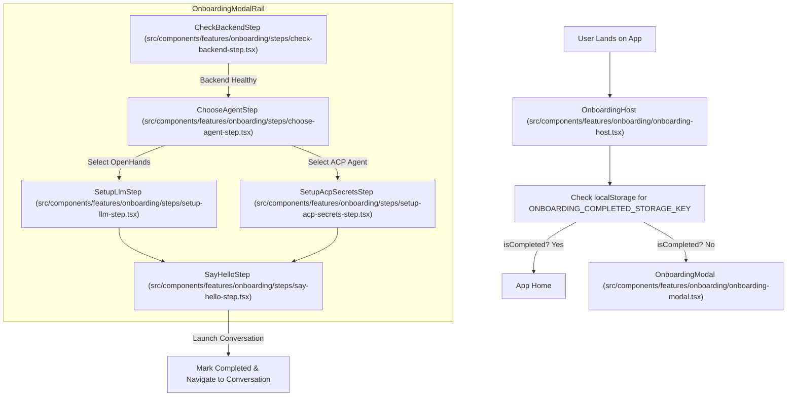
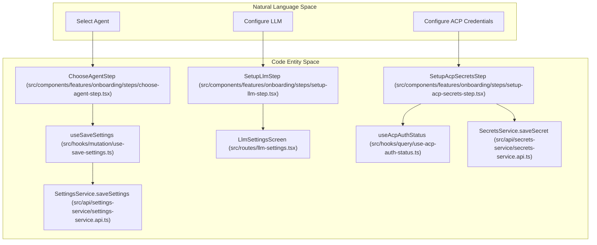

<!-- source: DeepWiki mcp.deepwiki.com · repo All-Hands-AI/OpenHands · page 11 Onboarding Flow · fetched 2026-10-26 -->

# Onboarding Flow

Relevant source files

The following files were used as context for generating this wiki page:

- [__tests__/components/onboarding/choose-agent-step.test.tsx](__tests__/components/onboarding/choose-agent-step.test.tsx)
- [__tests__/components/onboarding/onboarding-host.test.tsx](__tests__/components/onboarding/onboarding-host.test.tsx)
- [__tests__/components/onboarding/onboarding-modal.test.tsx](__tests__/components/onboarding/onboarding-modal.test.tsx)
- [__tests__/components/onboarding/onboarding-progress-bar.test.tsx](__tests__/components/onboarding/onboarding-progress-bar.test.tsx)
- [__tests__/components/onboarding/use-onboarding-completion.test.tsx](__tests__/components/onboarding/use-onboarding-completion.test.tsx)
- [src/components/features/onboarding/onboarding-host.tsx](src/components/features/onboarding/onboarding-host.tsx)
- [src/components/features/onboarding/onboarding-modal.tsx](src/components/features/onboarding/onboarding-modal.tsx)
- [src/components/features/onboarding/onboarding-progress-bar.tsx](src/components/features/onboarding/onboarding-progress-bar.tsx)
- [src/components/features/onboarding/steps/check-backend-step.tsx](src/components/features/onboarding/steps/check-backend-step.tsx)
- [src/components/features/onboarding/steps/choose-agent-step.tsx](src/components/features/onboarding/steps/choose-agent-step.tsx)
- [src/components/features/onboarding/steps/say-hello-step.tsx](src/components/features/onboarding/steps/say-hello-step.tsx)

The **Onboarding Flow** is a multi-step guided experience designed to ensure new users have a functional environment before starting their first conversation. It manages backend connectivity, agent selection (OpenHands vs. ACP), LLM configuration, and credential setup.

The entry point for this flow is the `OnboardingHost`, which automatically mounts the `OnboardingModal` when a user lacks a completion marker in `localStorage` [src/components/features/onboarding/onboarding-host.tsx:43-44]().

## System Architecture

The onboarding system is built as a state-driven carousel. Instead of numeric indices, it uses logical `OnboardingPhase` keys (`backend`, `agent`, `setup`, `hello`) to manage step sequencing [src/components/features/onboarding/onboarding-modal.tsx:36-40](). This prevents navigation errors if steps (like the backend check) are dynamically skipped when a healthy backend is already present [src/components/features/onboarding/onboarding-modal.tsx:172-175]().

### Onboarding Flow Logic

Sources: [src/components/features/onboarding/onboarding-host.tsx:39-72](), [src/components/features/onboarding/onboarding-modal.tsx:135-181]()

## Key Components

| Component | Responsibility |
| :--- | :--- |
| `OnboardingHost` | Logic gate that decides whether to show the modal based on `localStorage` and backend state [src/components/features/onboarding/onboarding-host.tsx:39-72](). |
| `OnboardingModal` | The container providing the slide-rail animation and phase management [src/components/features/onboarding/onboarding-modal.tsx:135-181](). |
| `OnboardingProgressBar` | Visual indicator of progress through the `OnboardingPhase` sequence [src/components/features/onboarding/onboarding-progress-bar.tsx:16-20](). |
| `Slide` | A wrapper for step panels that handles horizontal translation and visibility [src/components/features/onboarding/onboarding-modal.tsx:83-104](). |

Sources: [src/components/features/onboarding/onboarding-host.tsx](), [src/components/features/onboarding/onboarding-modal.tsx](), [src/components/features/onboarding/onboarding-progress-bar.tsx]()

## Step Definitions

For detailed technical implementation of each step, see [Onboarding Modal and Steps](#11.1).

### 1. Backend Connectivity (`CheckBackendStep`)
Ensures the frontend can communicate with an `agent-server`. If the default backend is unreachable, it prompts the user to configure a local or cloud connection [src/components/features/onboarding/steps/check-backend-step.tsx:116-120](). It uses `useBackendsHealth` to monitor connection status in real-time [src/components/features/onboarding/steps/check-backend-step.tsx:154-156](). The `useBackendsHealth` hook probes the backend, retrying transient failures before reporting a disconnected state [src/components/features/onboarding/onboarding-modal.tsx:150-154]().

Sources: [src/components/features/onboarding/steps/check-backend-step.tsx](), [src/components/features/onboarding/onboarding-modal.tsx:150-154]()

### 2. Agent Selection (`ChooseAgentStep`)
Allows users to choose between the native **OpenHands** agent or **ACP (Agent Client Protocol)** agents like Claude Code, Codex, or Gemini CLI [src/components/features/onboarding/steps/choose-agent-step.tsx:24-28](). Selecting an agent updates the `agent_settings` via `useSaveSettings` [src/components/features/onboarding/steps/choose-agent-step.tsx:105-132](). The available ACP providers are enriched from the SDK registry [src/components/features/onboarding/steps/choose-agent-step.tsx:83-87]().

Sources: [src/components/features/onboarding/steps/choose-agent-step.tsx]()

### 3. LLM Configuration (`SetupLlmStep`)
This step presents an embedded view of the `LlmSettingsScreen`. It pre-fills default LLM models and ensures the active agent profile is configured with the selected LLM [src/components/features/onboarding/onboarding-modal.tsx:26]().

For details on how the system detects missing LLMs outside of onboarding, see [LLM Configuration Check](#11.2).

Sources: [src/components/features/onboarding/onboarding-modal.tsx:26]()

### 4. ACP Secrets (`SetupAcpSecretsStep`)
This step is conditionally displayed if an ACP agent was selected. It configures credentials (API keys, base URLs, or service account JSONs) required for ACP agents [src/components/features/onboarding/onboarding-modal.tsx:27](). It performs a "login probe" using `useAcpAuthStatus` to check if the agent is already authenticated on the host [__tests__/components/onboarding/onboarding-modal.test.tsx:141-146]().

Sources: [src/components/features/onboarding/onboarding-modal.tsx:27](), [__tests__/components/onboarding/onboarding-modal.test.tsx:141-146]()

### 5. Finalization (`SayHelloStep`)
The final slide where users can send their first message. It calls `useCreateConversation` with the `onboarding_say_hello` entry point and navigates the user to the chat interface [src/components/features/onboarding/steps/say-hello-step.tsx:50-68](). For local backends, it also offers recommended automations [src/components/features/onboarding/steps/say-hello-step.tsx:123-146]().

Sources: [src/components/features/onboarding/steps/say-hello-step.tsx]()

## Code Mapping: Onboarding Logic

This diagram maps the natural language steps to the React hooks and API services that execute them.

Sources: [src/components/features/onboarding/steps/choose-agent-step.tsx:105-132](), [src/components/features/onboarding/onboarding-modal.tsx:26-27](), [__tests__/components/onboarding/onboarding-modal.test.tsx:141-146]()

## Testing Infrastructure

The onboarding flow is heavily tested using:
*   **Vitest**: Unit tests for slide transitions and phase logic (e.g., `onboarding-modal.test.tsx` [__tests__/components/onboarding/onboarding-modal.test.tsx:1]()).
*   **Playwright**: E2E tests that simulate first-run scenarios, verifying backend health checks and step skipping [__tests__/components/onboarding/onboarding-modal.test.tsx:149-164]().

Sources: [__tests__/components/onboarding/onboarding-modal.test.tsx]()

---

