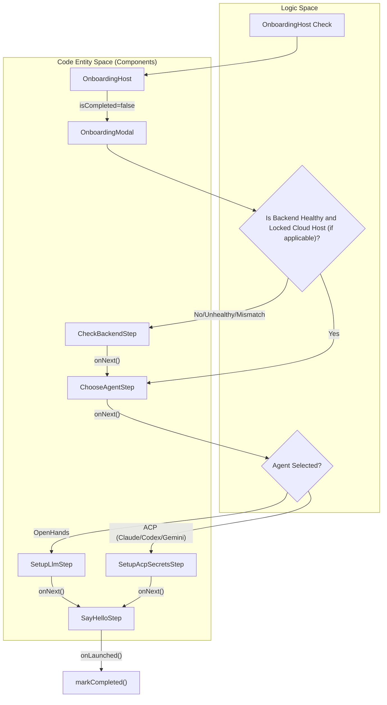
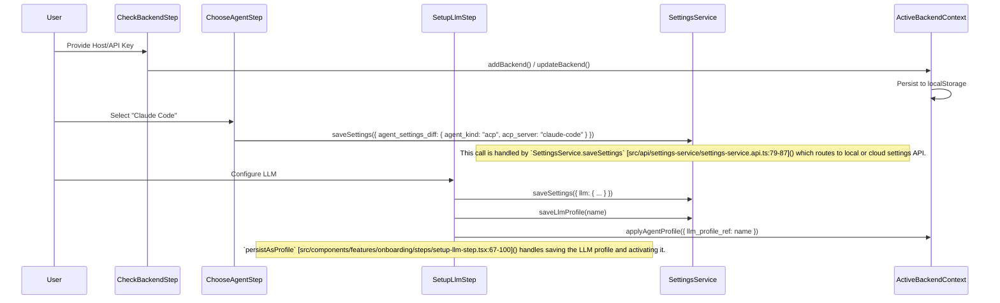

<!-- source: DeepWiki mcp.deepwiki.com · repo All-Hands-AI/OpenHands · page 11.1 Onboarding Modal and Steps · fetched 2026-10-26 -->

# Onboarding Modal and Steps

Relevant source files

The following files were used as context for generating this wiki page:

- [__tests__/api/cloud/settings-service.test.ts](__tests__/api/cloud/settings-service.test.ts)
- [__tests__/api/settings-service.test.ts](__tests__/api/settings-service.test.ts)
- [__tests__/components/onboarding/choose-agent-step.test.tsx](__tests__/components/onboarding/choose-agent-step.test.tsx)
- [__tests__/components/onboarding/onboarding-host.test.tsx](__tests__/components/onboarding/onboarding-host.test.tsx)
- [__tests__/components/onboarding/onboarding-modal.test.tsx](__tests__/components/onboarding/onboarding-modal.test.tsx)
- [__tests__/components/onboarding/onboarding-progress-bar.test.tsx](__tests__/components/onboarding/onboarding-progress-bar.test.tsx)
- [__tests__/components/onboarding/use-onboarding-completion.test.tsx](__tests__/components/onboarding/use-onboarding-completion.test.tsx)
- [specs/llm-defaults.md](specs/llm-defaults.md)
- [src/api/cloud/settings-service.api.ts](src/api/cloud/settings-service.api.ts)
- [src/api/settings-service/settings-service.api.ts](src/api/settings-service/settings-service.api.ts)
- [src/components/features/onboarding/onboarding-host.tsx](src/components/features/onboarding/onboarding-host.tsx)
- [src/components/features/onboarding/onboarding-modal.tsx](src/components/features/onboarding/onboarding-modal.tsx)
- [src/components/features/onboarding/onboarding-progress-bar.tsx](src/components/features/onboarding/onboarding-progress-bar.tsx)
- [src/components/features/onboarding/steps/check-backend-step.tsx](src/components/features/onboarding/steps/check-backend-step.tsx)
- [src/components/features/onboarding/steps/choose-agent-step.tsx](src/components/features/onboarding/steps/choose-agent-step.tsx)
- [src/components/features/onboarding/steps/say-hello-step.tsx](src/components/features/onboarding/steps/say-hello-step.tsx)
- [src/components/features/onboarding/steps/setup-llm-step.tsx](src/components/features/onboarding/steps/setup-llm-step.tsx)
- [src/mocks/settings-handlers.ts](src/mocks/settings-handlers.ts)
- [src/services/settings.ts](src/services/settings.ts)
- [tests/e2e/mock-llm/onboarding/mock-llm-onboarding-regressions.spec.ts](tests/e2e/mock-llm/onboarding/mock-llm-onboarding-regressions.spec.ts)
- [tests/e2e/support/onboarding-helpers.ts](tests/e2e/support/onboarding-helpers.ts)

The Onboarding Flow is a multi-step guided experience designed to ensure new users have a functional connection to an agent-server backend, a selected agent, and valid LLM or ACP credentials before their first conversation. It utilizes a carousel-style modal with dynamic step sequencing based on the health and configuration of the active backend.

## Architecture Overview

The onboarding system is hosted by the `OnboardingHost`, which manages the visibility of the `OnboardingModal` based on the user's completion status and the presence of usable credentials.

### Key Components

| Component | Responsibility |
| :--- | :--- |
| `OnboardingHost` | Mounts the modal if onboarding is not completed and no usable LLM/ACP config is detected [src/components/features/onboarding/onboarding-host.tsx:39-68](). |
| `OnboardingModal` | The top-level container managing the slide rail, phase transitions, and analytics [src/components/features/onboarding/onboarding-modal.tsx:135-139](). |
| `OnboardingProgressBar` | Visual indicator of progress through the logical phases [src/components/features/onboarding/onboarding-progress-bar.tsx:1-30](). |
| `Slide` | A wrapper for individual steps that handles horizontal translation animations and accessibility [src/components/features/onboarding/onboarding-modal.tsx:83-104]().

### Logical Phases vs. Numeric Steps
The system tracks progress using an `OnboardingPhase` type (`backend`, `agent`, `setup`, `hello`) rather than raw numeric indices [src/components/features/onboarding/onboarding-modal.tsx:40-40](). This prevents state synchronization issues when the `CheckBackendStep` is skipped, which would otherwise shift the numeric index of subsequent steps [src/components/features/onboarding/onboarding-modal.tsx:30-39]().

Sources: [src/components/features/onboarding/onboarding-host.tsx:1-68](), [src/components/features/onboarding/onboarding-modal.tsx:1-139](), [src/components/features/onboarding/onboarding-progress-bar.tsx:1-30]()

## Step Sequencing Logic

The sequence of steps is determined at runtime based on the `ActiveBackendContext` and the health of the current connection.

### Onboarding Flow Diagram
This diagram illustrates the transition logic between system states and the React components managing them.

Sources: [src/components/features/onboarding/onboarding-modal.tsx:151-181](), [src/components/features/onboarding/onboarding-host.tsx:39-68]()

## Step Implementation Details

### 1. CheckBackendStep
This step ensures the frontend can communicate with an agent-server.
- **Health Checks:** Uses `useBackendsHealth` to probe the current backend [src/components/features/onboarding/onboarding-modal.tsx:152-154](). The `probeBackendWithQuickRetry` function handles transient network issues by retrying failed probes a few times before reporting a definitive failure [src/hooks/query/use-backends-health.ts:153-166]().
- **Auto-Skip:** If the backend is healthy and matches requirements (e.g., `VITE_LOCK_TO_CLOUD`), the `OnboardingModal` skips this slide [src/components/features/onboarding/onboarding-modal.tsx:167-170]().
- **Backend Switching:** Allows users to log into OpenHands Cloud or configure a local host via `BackendConnectionOptions`.
- **Locked Cloud Host Handling:** In locked-to-Cloud mode, if the active backend is not the configured locked Cloud host, the backend slide remains visible so the user can log into Cloud [src/components/features/onboarding/onboarding-modal.tsx:155-166]().

Sources: [src/components/features/onboarding/onboarding-modal.tsx:152-170](), [src/components/features/onboarding/steps/check-backend-step.tsx:1-193](), [src/hooks/query/use-backends-health.ts:153-166]()

### 2. ChooseAgentStep
Users select their primary agent interface.
- **Options:** Derived from `ACP_PROVIDERS` registry plus a synthetic "OpenHands" option [src/components/features/onboarding/steps/choose-agent-step.tsx:76-89](). ACP provider icons and descriptions are sourced from the `ACP_PROVIDERS` configuration [src/constants/acp-providers.ts:151-167]().
- **Persistence:** Selecting an agent and clicking "Next" triggers settings updates. For ACP agents, it configures the specific provider key and default command [src/components/features/onboarding/steps/choose-agent-step.tsx:107-132]().

Sources: [src/components/features/onboarding/steps/choose-agent-step.tsx:76-132](), [src/constants/acp-providers.ts:151-167]()

### 3. SetupLlmStep (OpenHands Agent)
Configures the LLM for the native OpenHands agent.
- **Embedded Form:** Renders `LlmSettingsScreen` in `embedded` mode, hiding the default save bar [src/components/features/onboarding/steps/setup-llm-step.tsx:151-161]().
- **Profile Creation:** On local backends, saving the LLM config also creates and activates a named LLM profile via `useSaveLlmProfile` and `useActivateLlmProfile` [src/components/features/onboarding/steps/setup-llm-step.tsx:54-93]().
- **Defaults:** Pre-fills `openai/gpt-5.6-sol` as the suggested model [src/components/features/onboarding/steps/setup-llm-step.tsx:24-24](), matching `DEFAULT_SETTINGS.llm_model` [src/services/settings.ts:6-6]().

Sources: [src/components/features/onboarding/steps/setup-llm-step.tsx:24-161](), [src/services/settings.ts:6-6](), [specs/llm-defaults.md:5-10]()

### 4. SetupAcpSecretsStep (ACP Agents)
Collects credentials for subprocess-based agents (Claude Code, Codex, Gemini CLI).
- **Subprocess Probing:** Uses `useAcpAuthStatus` to run a login check via the agent-server to see if the user is already authenticated on the host machine.
- **Secret Persistence:** Maps input fields to global secrets. Built-in ACP providers define their required secret fields in the `ACP_PROVIDERS` registry [src/constants/acp-providers.ts:178-183]().

Sources: [src/components/features/onboarding/steps/setup-acp-secrets-step.tsx:1-170](), [src/constants/acp-providers.ts:178-183]()

### 5. SayHelloStep
The final step to verify the end-to-end configuration.
- **Conversation Creation:** Calls `useCreateConversation` with a "hello" message [src/components/features/onboarding/steps/say-hello-step.tsx:50-68]().
- **Navigation:** On success, navigates the user to the new conversation and closes the modal [src/components/features/onboarding/steps/say-hello-step.tsx:60-62]().
- **Recommended Automations:** For local backends, provides a launcher for suggested automations [src/components/features/onboarding/steps/say-hello-step.tsx:123-146]().

Sources: [src/components/features/onboarding/steps/say-hello-step.tsx:50-146]()

## Data Flow: Onboarding to Settings

This diagram shows how user input in the onboarding steps propagates to the `SettingsService` and `ActiveBackendContext`.

Sources: [src/components/features/onboarding/steps/setup-llm-step.tsx:95-122](), [src/api/settings-service/settings-service.api.ts:79-87](), [src/api/backend-registry/active-store.ts:1-100](), [src/components/features/onboarding/steps/setup-llm-step.tsx:67-100]()

## E2E Testing Helpers

The `onboarding-helpers.ts` file provides utilities for Playwright tests to navigate and validate the onboarding flow.

- `showOnboarding(page, options)`: Seeds `localStorage` to ensure the modal appears and mocks the LLM catalog [tests/e2e/support/onboarding-helpers.ts:62-99]().
- `waitForOnboardingStep(page, step)`: Asserts the slide rail is at the expected index [tests/e2e/support/onboarding-helpers.ts:101-106]().
- `getOnboardingStepLayout(page)`: Determines if the backend step is present or skipped based on connection health [tests/e2e/support/onboarding-helpers.ts:135-173]().
- `advanceOnboardingToLlmStep(page)`: Automates the flow through backend and agent selection to reach LLM setup [tests/e2e/support/onboarding-helpers.ts:175-196]().

Sources: [tests/e2e/support/onboarding-helpers.ts:1-196](), [__tests__/components/onboarding/onboarding-modal.test.tsx:136-164]()

---

