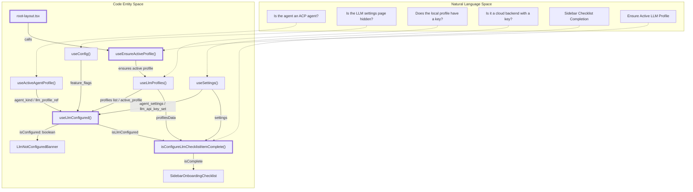
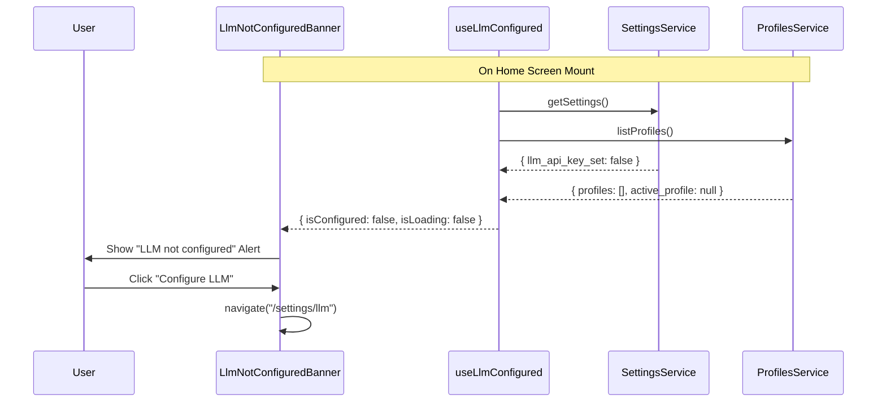

<!-- source: DeepWiki mcp.deepwiki.com · repo All-Hands-AI/OpenHands · page 11.2 LLM Configuration Check · fetched 2026-10-26 -->

# LLM Configuration Check

Relevant source files

The following files were used as context for generating this wiki page:

- [__tests__/components/backends/environment-switch-overlay.test.tsx](__tests__/components/backends/environment-switch-overlay.test.tsx)
- [__tests__/components/features/conversation/conversation-main.test.tsx](__tests__/components/features/conversation/conversation-main.test.tsx)
- [__tests__/hooks/use-llm-configured.test.tsx](__tests__/hooks/use-llm-configured.test.tsx)
- [__tests__/hooks/use-resizable-panels.test.ts](__tests__/hooks/use-resizable-panels.test.ts)
- [__tests__/routes/root-layout.test.tsx](__tests__/routes/root-layout.test.tsx)
- [src/components/features/backends/environment-switch-overlay.tsx](src/components/features/backends/environment-switch-overlay.tsx)
- [src/components/features/backends/environment-switch-store.ts](src/components/features/backends/environment-switch-store.ts)
- [src/hooks/use-filtered-events.ts](src/hooks/use-filtered-events.ts)
- [src/hooks/use-llm-configured.test.tsx](src/hooks/use-llm-configured.test.tsx)
- [src/hooks/use-llm-configured.ts](src/hooks/use-llm-configured.ts)
- [src/hooks/use-resizable-panels.ts](src/hooks/use-resizable-panels.ts)
- [src/index.css](src/index.css)
- [src/routes/root-layout.tsx](src/routes/root-layout.tsx)
- [src/routes/shared-conversation.tsx](src/routes/shared-conversation.tsx)

The LLM Configuration Check system ensures that an agent session is never initiated without a valid, authenticated Large Language Model (LLM). It acts as a safety gate for the "Skip for now" onboarding path, preventing users from reaching a broken state where the agent fails silently or with cryptic errors due to missing credentials.

## Overview and Purpose

OpenHands supports multiple agent types and backend configurations, each with different LLM requirements. The configuration check system abstracts this complexity into a unified "configured" signal used to toggle UI elements like the chat composer, the `LlmNotConfiguredBanner`, and the **Sidebar Onboarding Checklist**.

### Key Logic Gates
*   **ACP Agents:** Agents using the Agent Client Protocol (e.g., Claude Code) manage their own LLM via a subprocess and are always considered "configured" [src/hooks/use-llm-configured.ts:67-68]().
*   **OpenHands Agents (Local):** Require a valid LLM Profile. This profile must either have an API key set or be a valid subscription-based profile [src/hooks/use-llm-configured.ts:139-141]().
*   **OpenHands Agents (Cloud):** Rely on the global `llm_api_key_set` flag from settings [src/hooks/use-llm-configured.ts:141]().
*   **Feature Flags:** If the LLM settings page is hidden via feature flags, the system treats the LLM as configured to avoid showing an unresolvable warning [src/hooks/use-llm-configured.ts:127-130]().
*   **Onboarding Checklist Integration:** The `isConfigureLlmChecklistItemComplete` function determines if the "Configure LLM" step in the sidebar checklist should be marked as done, checking both `useLlmConfigured` state and raw settings/profiles data [src/components/features/sidebar/sidebar-onboarding-checklist-llm-complete.ts:26-50]().

## System Architecture and Data Flow

The system relies on the `useLlmConfigured` hook, which orchestrates data from settings, client configuration, and LLM profiles to determine readiness.

### Data Flow Diagram
"Natural Language Space" (Requirements) to "Code Entity Space" (Implementation)

Sources: [src/hooks/use-llm-configured.ts:40-160](), [src/components/features/sidebar/sidebar-onboarding-checklist-llm-complete.ts:26-50](), [src/routes/root-layout.tsx:87]()

## Implementation Details

### `useLlmConfigured` Hook
The core logic resides in `useLlmConfigured`. It handles complex fallback logic to match the behavior of `useCreateConversation`, ensuring the UI (banner/composer) and the action (launching a conversation) are always in sync [src/hooks/use-llm-configured.ts:90-96]().

| Logic Step | Implementation | Source |
| :--- | :--- | :--- |
| **ACP Check** | Checks if `activeAgentKind` or `settings.agent_settings.agent_kind` is `"acp"`. | [src/hooks/use-llm-configured.ts:66-68]() |
| **Profile Fallback** | If an agent profile references a stale or missing LLM profile, it falls back to the globally active LLM profile. | [src/hooks/use-llm-configured.ts:97-101]() |
| **Subscription Check** | For subscription-based models, it fetches profile details to verify the `auth_type`. | [src/hooks/use-llm-configured.ts:122-126]() |
| **Indeterminate State** | Returns `isLoading: true` while any dependent query is loading to prevent UI flickering. | [src/hooks/use-llm-configured.ts:150-151]() |

Sources: [src/hooks/use-llm-configured.ts:40-160]()

### `useEnsureActiveProfile` Enforcement
The `useEnsureActiveProfile` hook is called in the `MainApp` component, which serves as the root layout for the application [src/routes/root-layout.tsx:76, 87](). This hook is crucial for local-mode policy, ensuring that a usable LLM is always selected. It prevents scenarios where a user might inadvertently end up without an active LLM profile, which would hinder agent functionality.

The hook's primary responsibility is to check if an active LLM profile exists and, if not, to activate a default or suitable profile. This ensures a consistent user experience, especially for new users or after profile deletions.

Sources: [src/routes/root-layout.tsx:87](), [src/hooks/use-ensure-active-profile.ts:1-40]()

### Sidebar Onboarding Checklist
The `SidebarOnboardingChecklist` component provides a persistent visual indicator of setup progress in the sidebar [src/components/features/sidebar/sidebar-onboarding-checklist.tsx:141-152](). The "Configure LLM" item relies on `isConfigureLlmChecklistItemComplete` to determine its completion status, which is indicated by a `ChecklistStatusIcon` and a line-through style on the label [src/components/features/sidebar/sidebar-onboarding-checklist.tsx:31-45](), [src/components/features/sidebar/sidebar-onboarding-checklist.tsx:84-97]().

Users can toggle the visibility of this checklist in the App Settings via the `GettingStartedChecklistSwitch`, which persists the dismissed state to `localStorage` [src/components/features/settings/app-settings/getting-started-checklist-switch.tsx:7-24]().

### `LlmNotConfiguredBanner` Logic
This component renders a warning on the home screen when `isConfigured` is false.

Sources: [src/hooks/use-llm-configured.ts:40-60](), [src/components/features/sidebar/sidebar-onboarding-checklist.constants.ts:45-54](), [__tests__/components/home/llm-not-configured-banner.test.tsx:92-105]()

## Profile and Agent Resolution
The system distinguishes between the **Active LLM Profile** (the one selected in settings) and the **Active Agent Profile** (the persona/agent currently selected).

1.  **Reference Logic:** If an Agent Profile has a `llm_profile_ref`, that specific LLM profile is checked for configuration [src/hooks/use-llm-configured.ts:84-88]().
2.  **Default Exception:** The local seeded `default` agent profile is an exception; it launches using the active LLM profile regardless of its reference to avoid blocking valid configurations [src/hooks/use-llm-configured.ts:76-81]().
3.  **Stale References:** If a reference exists but the target profile was deleted, the check falls back to the globally active LLM profile to match the conversation launch behavior [src/hooks/use-llm-configured.ts:97-101]().

Sources: [src/hooks/use-llm-configured.ts:70-101](), [__tests__/hooks/use-llm-configured.test.tsx:107-127]()

## Error Handling and Loading States
To avoid "flashing" warnings during transitions or transient network errors:
*   **Indeterminate States:** If settings or config queries fail without returning cached data, `isLoading` remains true [src/hooks/use-llm-configured.ts:150-151]().
*   **Settings 404:** A 404 error from the settings service is explicitly treated as "unconfigured" rather than "loading," as this represents the genuine state of a new user who has skipped onboarding [src/hooks/use-llm-configured.ts:146-149]().
*   **Checklist Loading:** The checklist completion check returns `false` while readiness is indeterminate to avoid marking items as complete prematurely [src/components/features/sidebar/sidebar-onboarding-checklist-llm-complete.ts:45-49]().

Sources: [src/hooks/use-llm-configured.ts:143-160](), [src/components/features/sidebar/sidebar-onboarding-checklist-llm-complete.ts:45-49]()

---

