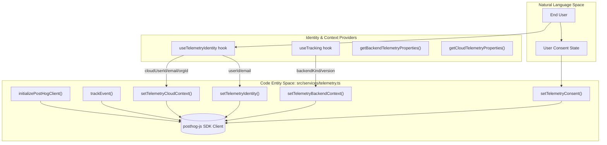
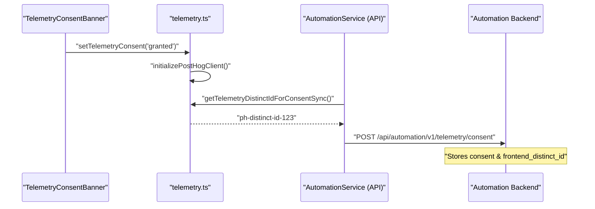

<!-- source: DeepWiki mcp.deepwiki.com · repo All-Hands-AI/OpenHands · page 12 Telemetry and Analytics · fetched 2026-10-26 -->

# Telemetry and Analytics

Relevant source files

The following files were used as context for generating this wiki page:

- [__tests__/hooks/use-sync-automation-telemetry-consent.test.ts](__tests__/hooks/use-sync-automation-telemetry-consent.test.ts)
- [__tests__/hooks/use-telemetry-identity.test.ts](__tests__/hooks/use-telemetry-identity.test.ts)
- [__tests__/services/telemetry-bootstrap.test.ts](__tests__/services/telemetry-bootstrap.test.ts)
- [__tests__/services/telemetry.test.ts](__tests__/services/telemetry.test.ts)
- [src/api/automation-service/automation-service.api.test.ts](src/api/automation-service/automation-service.api.test.ts)
- [src/hooks/use-sync-automation-telemetry-consent.ts](src/hooks/use-sync-automation-telemetry-consent.ts)
- [src/hooks/use-telemetry-identity.ts](src/hooks/use-telemetry-identity.ts)
- [src/services/telemetry-context.ts](src/services/telemetry-context.ts)
- [src/services/telemetry.ts](src/services/telemetry.ts)

The telemetry system in OpenHands Agent Canvas provides anonymous usage tracking and analytics to improve the platform. It is built on **PostHog** and designed with a "consent-first" philosophy, ensuring that no personally identifiable information (PII) or session data is collected without explicit user permission [src/services/telemetry.ts:8-13]().

The system is partitioned into a core service layer for event delivery, a consent management framework, and a set of hooks for capturing high-level application lifecycle events.

## System Architecture

The telemetry architecture bridges the frontend application with both the OpenHands analytics infrastructure and the local/cloud automation backends.

### Telemetry Identity Flow
The following diagram illustrates how user identity and backend context are resolved and injected into the PostHog event stream.

**Sources:** [src/services/telemetry.ts:1-27](), [src/hooks/use-telemetry-identity.ts:54-110](), [src/services/telemetry.ts:151-165](), [src/services/telemetry.ts:139-149]()

## Core Service and Consent Management

The core of the system is `telemetry.ts`, which manages the `posthog-js` instance. It handles:
- **Initialization:** Configuring the client with API keys and hosts [src/services/telemetry.ts:78-85](). It supports runtime configuration via `configureTelemetry` for library consumers [__tests__/services/telemetry.test.ts:103-107]().
- **Ad-Blocker Bypass:** By default, telemetry is routed through a reverse proxy at `z.openhands.dev` to ensure delivery [src/services/telemetry.ts:70-71]().
- **Consent Lifecycle:** Managing the state machine between `pending`, `granted`, and `denied`. Consent is persisted in `localStorage` via `TELEMETRY_CONSENT_KEY` [src/services/telemetry.ts:50-55]().
- **Install Tracking:** An anonymous `canvas_install` event is sent immediately on first use to track reach, regardless of general analytics consent, provided `VITE_DO_NOT_TRACK` is not set [src/services/telemetry.ts:9-10]().

For details on the service implementation and the consent banner UI, see [Telemetry Service and Consent](#12.1).

**Sources:** [src/services/telemetry.ts:50-115](), [__tests__/services/telemetry.test.ts:103-107](), [src/services/telemetry.ts:375-395]()

## Tracking Hooks and Identity

Higher-level components interact with telemetry through specialized hooks that automatically inject context:
- **`useTracking`**: Provides methods like `trackConversationCreated`, `trackAutomationSetupCreated`, and `trackSettingsSaved`. It automatically attaches backend metadata (e.g., `agentServerVersion`) using `setTelemetryBackendContext` [src/services/telemetry.ts:139-142]().
- **`useTelemetryIdentity`**: Manages the identity lifecycle, particularly for Cloud users. It resolves the `userId` and `email` from `useCloudCurrentUserId` and `useSettings` and ensures the PostHog client is correctly identified via `setTelemetryIdentity` [src/hooks/use-telemetry-identity.ts:54-110](), [__tests__/services/telemetry.test.ts:183-207]().

For details on specific tracking events and identity resolution, see [Tracking Hooks and Identity](#12.2).

**Sources:** [src/hooks/use-telemetry-identity.ts:54-110](), [__tests__/services/telemetry.test.ts:183-207]()

## Automation Telemetry Sync

When using the Automations system, the frontend acts as a bridge to sync the user's telemetry preferences to the automation sidecar. This ensures that background tasks respect the same privacy settings configured in the UI. The `useSyncAutomationTelemetryConsent` hook is responsible for this synchronization, listening to changes in telemetry consent and pushing them to the active local backend [src/hooks/use-sync-automation-telemetry-consent.ts:10-38]().

### Consent Sync Pipeline
The diagram below shows how `AutomationService` synchronizes the `frontend_distinct_id` to the backend for unified tracking.

**Sources:** [src/api/automation-service/automation-service.api.test.ts:157-167](), [src/services/telemetry.ts:314-325]()

## Telemetry Context Schema

The system uses a standardized context schema defined in `telemetry-context.ts` to ensure consistency across events. These properties are injected into every event via the `addCanvasEventProperties` helper [src/services/telemetry.ts:151-165]().

| Property | Code Reference | Description |
| :--- | :--- | :--- |
| `backend_kind` | `BackendTelemetryContextInput` | Indicates if the backend is `local` or `cloud` [src/services/telemetry-context.ts:50](). |
| `agent_server_version` | `getBackendTelemetryProperties` | The version of the connected agent-server [src/services/telemetry-context.ts:51](). |
| `automation_sdk_version` | `getBackendTelemetryProperties` | The version of the automation sidecar SDK [src/services/telemetry-context.ts:52](). |
| `cloud_user_id` | `CloudTelemetryContextInput` | The obfuscated ID of the user (Cloud only) [src/services/telemetry-context.ts:62](). |
| `client_source` | `CANVAS_EVENT_PROPERTIES` | Fixed value from `AGENT_CANVAS_CLIENT_SOURCE` [src/services/telemetry.ts:130](). |

**Sources:** [src/services/telemetry-context.ts:7-19](), [src/services/telemetry.ts:129-134](), [src/services/telemetry-context.ts:33-56]()

---

