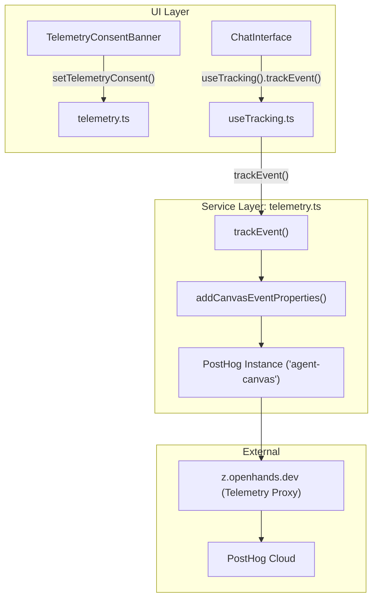
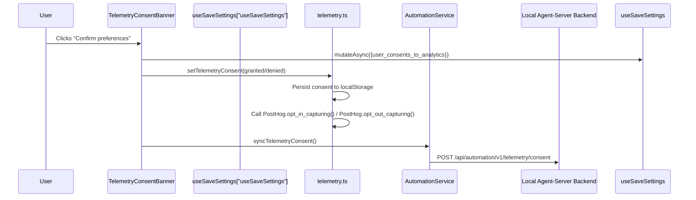

<!-- source: DeepWiki mcp.deepwiki.com · repo All-Hands-AI/OpenHands · page 12.1 Telemetry Service and Consent · fetched 2026-10-26 -->

# Telemetry Service and Consent

Relevant source files

The following files were used as context for generating this wiki page:

- [__tests__/components/analytics/telemetry-consent-banner.test.tsx](__tests__/components/analytics/telemetry-consent-banner.test.tsx)
- [__tests__/components/onboarding/onboarding-preview.test.ts](__tests__/components/onboarding/onboarding-preview.test.ts)
- [__tests__/components/shared/modals/modal-backdrop.test.tsx](__tests__/components/shared/modals/modal-backdrop.test.tsx)
- [__tests__/hooks/use-sync-automation-telemetry-consent.test.ts](__tests__/hooks/use-sync-automation-telemetry-consent.test.ts)
- [__tests__/hooks/use-sync-telemetry-consent.test.ts](__tests__/hooks/use-sync-telemetry-consent.test.ts)
- [__tests__/hooks/use-telemetry-identity.test.ts](__tests__/hooks/use-telemetry-identity.test.ts)
- [__tests__/hooks/use-telemetry.test.tsx](__tests__/hooks/use-telemetry.test.tsx)
- [__tests__/services/telemetry-bootstrap.test.ts](__tests__/services/telemetry-bootstrap.test.ts)
- [__tests__/services/telemetry.test.ts](__tests__/services/telemetry.test.ts)
- [src/api/automation-service/automation-service.api.test.ts](src/api/automation-service/automation-service.api.test.ts)
- [src/components/features/analytics/telemetry-consent-banner.tsx](src/components/features/analytics/telemetry-consent-banner.tsx)
- [src/components/features/onboarding/onboarding-preview.ts](src/components/features/onboarding/onboarding-preview.ts)
- [src/components/shared/modals/modal-backdrop.tsx](src/components/shared/modals/modal-backdrop.tsx)
- [src/hooks/use-sync-automation-telemetry-consent.ts](src/hooks/use-sync-automation-telemetry-consent.ts)
- [src/hooks/use-sync-telemetry-consent.ts](src/hooks/use-sync-telemetry-consent.ts)
- [src/hooks/use-telemetry-identity.ts](src/hooks/use-telemetry-identity.ts)
- [src/hooks/use-telemetry.ts](src/hooks/use-telemetry.ts)
- [src/lib/index.ts](src/lib/index.ts)
- [src/services/telemetry-context.ts](src/services/telemetry-context.ts)
- [src/services/telemetry.ts](src/services/telemetry.ts)
- [tests/e2e/live/utils/agent-server-conversation.ts](tests/e2e/live/utils/agent-server-conversation.ts)
- [tests/e2e/mock-llm/backends/mock-llm-auth-modes.spec.ts](tests/e2e/mock-llm/backends/mock-llm-auth-modes.spec.ts)
- [tests/e2e/mock-llm/backends/mock-llm-cross-connect.spec.ts](tests/e2e/mock-llm/backends/mock-llm-cross-connect.spec.ts)

The telemetry system in OpenHands Agent Canvas provides anonymous usage insights while strictly adhering to user privacy and consent. It utilizes the PostHog SDK for reliable event delivery with batching, retry logic, and offline support [src/services/telemetry.ts:4-7]().

## Telemetry Philosophy and Scope

The system operates under a multi-tiered tracking philosophy:
1.  **Install Tracking**: A `canvas_install` event is sent immediately upon first use to track unique installations anonymously [src/services/telemetry.ts:9-11](). This is anonymous and contains no PII - just basic browser info and a random ID.
2.  **Consent-Gated Events**: Session and custom events (e.g., conversation creation, settings updates) are only transmitted after a user explicitly grants consent via the UI [src/services/telemetry.ts:11-12]().
3.  **Ad-Blocker Bypass**: By default, telemetry is routed through the `z.openhands.dev` reverse proxy to prevent blocking by browser extensions [src/services/telemetry.ts:15-18](), [src/services/telemetry.ts:70-71]().

### Telemetry Configuration State Machine

The telemetry state is managed via a combination of local storage keys and a runtime `posthogInstance`.

| State | Description | Persistence Key |
| :--- | :--- | :--- |
| `pending` | Initial state; user has not seen the consent banner. | `openhands-telemetry-consent` [src/services/telemetry.ts:50]() |
| `granted` | User opted-in; PostHog captures events. | `openhands-telemetry-consent` [src/services/telemetry.ts:50]() |
| `denied` | User opted-out; PostHog `opt_out_capturing` is called. | `openhands-telemetry-consent` [src/services/telemetry.ts:50]()

**Sources:** [src/services/telemetry.ts:50-89](), [src/services/telemetry.ts:167-173]()

## Core Service Implementation

The `telemetry.ts` service acts as the central orchestrator for the PostHog client lifecycle.

### Key Functions

*   `configureTelemetry(config)`: Allows library consumers to override the default API key and host at runtime [src/services/telemetry.ts:78-85]().
*   `initializePostHogClient()`: Lazily initializes the PostHog instance. It enforces a single named instance `agent-canvas` to avoid collisions with host applications [src/services/telemetry.ts:258-301](), [src/services/telemetry.ts:58]().
*   `setTelemetryConsent(consent)`: Updates the canonical consent state, persists it to `localStorage`, and triggers the PostHog `opt_in_capturing()` or `opt_out_capturing()` methods [src/services/telemetry.ts:456-493]().
*   `trackEvent(event, properties)`: The primary interface for recording actions. It automatically injects `CANVAS_EVENT_PROPERTIES` (versioning) and backend/cloud context [src/services/telemetry.ts:554-568]().
*   `trackInstall()`: Records the one-time installation event using a persistent `openhands-telemetry-first-use` flag to ensure it only fires once per device [src/services/telemetry.ts:523-545]().

### Context Injection

The service maintains global context objects that are merged into every event via the `addCanvasEventProperties` helper [src/services/telemetry.ts:151-165]():
1.  **Backend Context**: Includes `backend_kind`, `agent_server_version`, and `automation_sdk_version` [src/services/telemetry-context.ts:33-56]().
2.  **Cloud Context**: Includes `cloud_user_id`, `cloud_user_email`, and `cloud_org_id` when connected to a cloud provider [src/services/telemetry-context.ts:58-66]().

**Sources:** [src/services/telemetry.ts:139-165](), [src/services/telemetry-context.ts:1-66]()

## Data Flow and Code Entity Mapping

The following diagrams illustrate how user actions trigger telemetry events through the service layers and how consent is synchronized.

### Telemetry Event Flow

**Sources:** [src/services/telemetry.ts:151-165](), [src/hooks/use-telemetry.ts:48-81](), [src/components/features/analytics/telemetry-consent-banner.tsx:70-71]()

### Consent Synchronization Logic

**Sources:** [src/components/features/analytics/telemetry-consent-banner.tsx:58-72](), [src/api/automation-service/automation-service.api.test.ts:157-167]()

## Consent Management

### TelemetryConsentBanner
The `TelemetryConsentBanner` component is responsible for collecting user permission. It only displays if:
1.  The active backend is `local` [src/components/features/analytics/telemetry-consent-banner.tsx:125]().
2.  The `user_consents_to_analytics` setting in `SettingsService` is `null` (unanswered) [src/components/features/analytics/telemetry-consent-banner.tsx:46]().
3.  The backend is connected and settings have successfully loaded [src/components/features/analytics/telemetry-consent-banner.tsx:44-45]().

**Sources:** [src/components/features/analytics/telemetry-consent-banner.tsx:24-74]()

### useSyncTelemetryConsent
The `useSyncTelemetryConsent` hook ensures that the frontend's telemetry state is synchronized with the backend settings. If the backend reports a consent value that differs from the frontend's `localStorage`, the hook updates the local service to match the user's remote preference [src/hooks/use-sync-telemetry-consent.ts:25-36](). This ensures consistency across different browser sessions connecting to the same backend.

**Sources:** [src/hooks/use-sync-telemetry-consent.ts:1-40]()

### Automation Telemetry Sync
Because OpenHands often runs an automation sidecar, consent must be propagated to the automation backend. `AutomationService.syncTelemetryConsent` sends the `consent_granted` boolean and the `frontend_distinct_id` to the local automation server to ensure tracking consistency across the stack [src/api/automation-service/automation-service.api.test.ts:157-167]().

**Sources:** [src/api/automation-service/automation-service.api.test.ts:157-167](), [src/components/features/analytics/telemetry-consent-banner.tsx:70-71]()

## Tracking Hooks

### useTracking
A high-level hook that provides semantic tracking functions. It automatically captures the `current_url` and updates the `telemetryBackendContext` before every event [src/hooks/use-telemetry.ts:48-81]().

Key tracking methods:
*   `trackConversationCreated`: Captures metadata about new sessions, including repository status, agent type, and entry point [src/hooks/use-telemetry.ts:87-114]().
*   `trackAutomationSetupCreated`: Records the successful configuration of an automation [src/hooks/use-telemetry.ts:114]().
*   `trackSettingsSaved`: Logs which settings were updated, anonymizing sensitive keys by tracking only their presence (`SET`/`UNSET`) [src/hooks/use-telemetry.ts:114]().

**Sources:** [src/hooks/use-telemetry.ts:48-114]()

### useTelemetryIdentity
This hook manages the PostHog identity lifecycle for Cloud users. It monitors the active backend and:
1.  Resolves the `userId` for the current cloud session using `useCloudCurrentUserId` [src/hooks/use-telemetry-identity.ts:59-62]().
2.  Calls `setTelemetryIdentity(userId, { email })` to link events to a specific user [src/hooks/use-telemetry-identity.ts:85]().
3.  Resets the identity on logout or backend switch to prevent data cross-contamination [src/hooks/use-telemetry-identity.ts:71-81]().
4.  Tracks the addition of cookie-authenticated cloud backends, ensuring this event is only tracked once per session [src/hooks/use-telemetry-identity.ts:87-99]().

**Sources:** [src/hooks/use-telemetry-identity.ts:54-110]()

---

