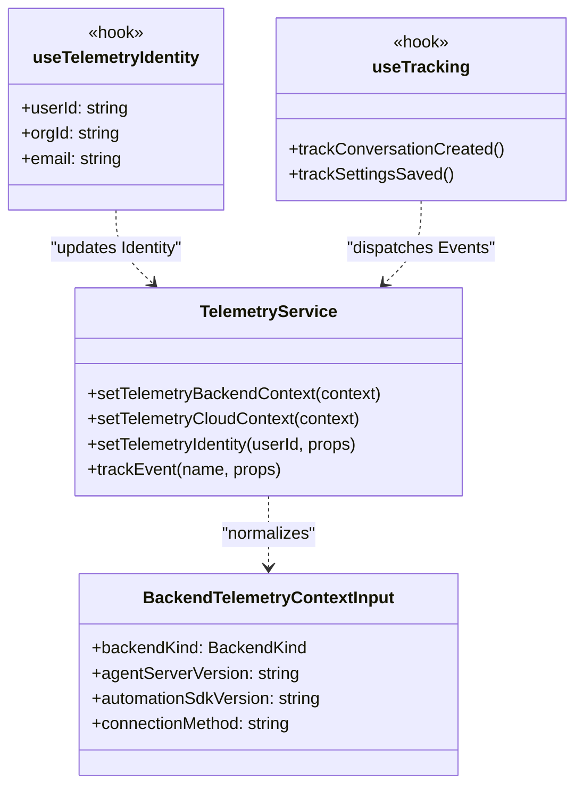

<!-- source: DeepWiki mcp.deepwiki.com · repo All-Hands-AI/OpenHands · page 12.2 Tracking Hooks and Identity · fetched 2026-10-26 -->

# Tracking Hooks and Identity

<details>
<summary>Relevant source files</summary>

The following files were used as context for generating this wiki page:

- [__tests__/api/cloud/conversation-create.test.ts](__tests__/api/cloud/conversation-create.test.ts)
- [__tests__/components/automations/detail/debug-automation-button.test.tsx](__tests__/components/automations/detail/debug-automation-button.test.tsx)
- [__tests__/components/features/conversation-panel/local-new-conversation-menu.test.tsx](__tests__/components/features/conversation-panel/local-new-conversation-menu.test.tsx)
- [__tests__/hooks/mutation/use-new-conversation-command.test.tsx](__tests__/hooks/mutation/use-new-conversation-command.test.tsx)
- [__tests__/hooks/use-sync-automation-telemetry-consent.test.ts](__tests__/hooks/use-sync-automation-telemetry-consent.test.ts)
- [__tests__/hooks/use-telemetry-identity.test.ts](__tests__/hooks/use-telemetry-identity.test.ts)
- [__tests__/hooks/use-tracking.test.ts](__tests__/hooks/use-tracking.test.ts)
- [__tests__/services/child-conversation-launch.test.ts](__tests__/services/child-conversation-launch.test.ts)
- [__tests__/services/telemetry-bootstrap.test.ts](__tests__/services/telemetry-bootstrap.test.ts)
- [__tests__/services/telemetry.test.ts](__tests__/services/telemetry.test.ts)
- [src/api/automation-service/automation-service.api.test.ts](src/api/automation-service/automation-service.api.test.ts)
- [src/hooks/mutation/use-new-conversation-command.ts](src/hooks/mutation/use-new-conversation-command.ts)
- [src/hooks/use-sync-automation-telemetry-consent.ts](src/hooks/use-sync-automation-telemetry-consent.ts)
- [src/hooks/use-telemetry-identity.ts](src/hooks/use-telemetry-identity.ts)
- [src/hooks/use-tracking.ts](src/hooks/use-tracking.ts)
- [src/services/child-conversation-launch.ts](src/services/child-conversation-launch.ts)
- [src/services/telemetry-context.ts](src/services/telemetry-context.ts)
- [src/services/telemetry.ts](src/services/telemetry.ts)

</details>


The tracking system in Agent Canvas provides a high-level abstraction for capturing user interactions and system events while maintaining strict identity resolution across local and cloud backends. It integrates with the core `telemetry.ts` service to ensure that data collection only occurs after explicit user consent, while automatically enriching events with backend-specific metadata and cloud user identities.

## Tracking Architecture

The tracking lifecycle is managed through a combination of React hooks and service-layer context injectors. This architecture ensures that telemetry events are consistent regardless of whether the user is interacting with a local agent-server or a cloud-hosted environment.

### Data Flow Diagram

The following diagram illustrates how telemetry data flows from UI components through the tracking hooks and into the PostHog-backed telemetry service.

Title: Telemetry Data Flow and Context Injection
```mermaid
graph TD
    subgraph "UI Layer"
        [Component] -- "calls" --> [useTracking]
        [AppRoot] -- "mounts" --> [useTelemetryIdentity]
    end

    subgraph "Hooks & Logic"
        [useTracking] -- "trackEvent(name, props)" --> [telemetry.ts]
        [useTelemetryIdentity] -- "setTelemetryIdentity(userId)" --> [telemetry.ts]
        [useTelemetryIdentity] -- "setTelemetryCloudContext(context)" --> [telemetry.ts]
        [useActiveBackend] -- "provides host/kind" --> [useTracking]
    end

    subgraph "Service Layer"
        [telemetry.ts] -- "enrich with" --> [telemetry-context.ts]
        [telemetry-context.ts] -- "getBackendTelemetryProperties" --> [telemetry.ts]
        [telemetry.ts] -- "capture" --> [PostHog_SDK]
    end

    subgraph "External Systems"
        [PostHog_SDK] -- "HTTPS POST" --> [z.openhands.dev_Proxy]
        [z.openhands.dev_Proxy] -- "forward" --> [PostHog_Cloud]
    end
```
Sources: [src/hooks/use-tracking.ts:48-81](), [src/services/telemetry.ts:139-165](), [src/hooks/use-telemetry-identity.ts:54-110]().

## useTracking Hook

The `useTracking` hook is the primary interface for functional components to record analytics. It automatically injects "Common Properties" such as the current URL and backend-specific versions into every event.

### Key Tracking Functions

| Function | Purpose | Data Captured |
| :--- | :--- | :--- |
| `trackConversationCreated` | Logs the start of a new agent session. | `conversation_id`, `task_id`, `has_repository`, `agent_type`, `workspace_mode`. |
| `trackAutomationSetupCreated` | Records successful completion of an automation manifest. | `automation_id`, `setup_mode`. |
| `trackBackendAdded` | Tracks when a user connects a new agent-server. | `backendKind`, `connectionMethod`, `source`. |
| `trackSettingsSaved` | Logs changes to LLM or Search configurations. | `llmModel`, `llmApiKeySet`, `searchApiKeySet`. |
| `trackUserMessageSent` | Monitors chat engagement levels. | `session_message_count`, `current_message_length`. |

### Backend Context Injection
The hook uses `setTelemetryBackendContext` to ensure the telemetry service has the latest backend metadata before any event is dispatched. This includes the `backendKind`, `agentServerVersion` (retrieved via `getCachedAgentServerVersion`), and the `automationSdkVersion` [src/hooks/use-tracking.ts:52-66](). The `track` function within `useTracking` explicitly calls `setTelemetryBackendContext` before `trackEvent` to ensure the context is always up-to-date [src/hooks/use-tracking.ts:78-80]().

Sources: [src/hooks/use-tracking.ts:87-240](), [src/hooks/use-tracking.ts:52-66](), [src/hooks/use-tracking.ts:78-80](), [__tests__/hooks/use-tracking.test.ts:151-193]().

## Telemetry Identity and Cloud Lifecycle

The `useTelemetryIdentity` hook manages the lifecycle of user identification, particularly in Cloud environments. It ensures that the PostHog `distinct_id` is aligned with the authenticated Cloud user ID.

### Identity Resolution Logic
1.  **Cloud Detection**: If the active backend is `cloud`, it fetches the `userId` from the `useCloudCurrentUserId` hook [src/hooks/use-telemetry-identity.ts:60-62]().
2.  **Context Alignment**: It calls `setTelemetryCloudContext` to store the `userId`, `email`, and `orgId` in the service-level context [src/hooks/use-telemetry-identity.ts:84-85](). The email is derived from `useSettings` data, falling back to `git_user_email` if `email` is not present [src/hooks/use-telemetry-identity.ts:63-64](), [__tests__/hooks/use-telemetry-identity.test.ts:73-91]().
3.  **PostHog Identification**: It invokes `setTelemetryIdentity(userId, email ? { email } : {})` to link the anonymous session to a specific user [src/hooks/use-telemetry-identity.ts:85](). This identification is deferred until the identity query settles to avoid premature identification or resets [__tests__/hooks/use-telemetry-identity.test.ts:93-112]().
4.  **Local Fallback**: If the backend is `local`, it clears the cloud context by calling `setTelemetryCloudContext(null)` [src/hooks/use-telemetry-identity.ts:71-74]().

### Automatic Cloud Connection Tracking
When a user is automatically connected via `cloud_cookie`, the hook detects if this is the first time the backend was added in the current session using `sessionStorage` and `trackedCloudCookieBackendAddedSessionKeys` (a local `Set` fallback) to trigger `trackBackendAdded` [src/hooks/use-telemetry-identity.ts:87-99](). This tracking is also deferred until an email address is resolved for the user [__tests__/hooks/use-telemetry-identity.test.ts:187-205]().

Sources: [src/hooks/use-telemetry-identity.ts:11-51](), [src/hooks/use-telemetry-identity.ts:54-110](), [src/services/telemetry.ts:175-188](), [__tests__/hooks/use-telemetry-identity.test.ts:60-141]().

## Telemetry Context and Funnel Analytics

The `telemetry-context.ts` module defines the schema for metadata enrichment, while `cloud-funnel-analytics.ts` provides specialized tracking for the cloud onboarding flow.

### Context Normalization
`getBackendTelemetryProperties` and `getCloudTelemetryProperties` transform raw inputs into standardized properties. Version strings are normalized using `normalizeTelemetryVersion`, which defaults to `"unknown"` if the value is missing [src/services/telemetry-context.ts:21-66](). These functions ensure that telemetry events consistently include `client_source`, `client_version`, `package_name`, and `package_version` [src/services/telemetry.ts:129-134](), and dynamically inject backend and cloud-specific properties [src/services/telemetry.ts:159-163]().

### Cloud Funnel Events
The system tracks the "Device Authorization" flow used for cloud logins:
*   `trackCloudDeviceAuthorizationStarted`: Triggered when the OAuth flow begins [src/services/cloud-funnel-analytics.ts:33-41]().
*   `trackCloudDeviceAuthorizationSucceeded`: Triggered upon successful token exchange [src/services/cloud-funnel-analytics.ts:43-51]().
*   `trackCloudConversationReady`: Triggered when a cloud sandbox is fully provisioned, using a unique `$insert_id` to prevent deduplication of the ready state [src/services/cloud-funnel-analytics.ts:53-63]().

Title: Identity and Context Association

Sources: [src/services/telemetry-context.ts:7-19](), [src/services/cloud-funnel-analytics.ts:13-63](), [src/services/telemetry.ts:139-150](), [src/services/telemetry.ts:159-163]().

## Automation Telemetry Sync

For local backends, Agent Canvas synchronizes the user's telemetry consent with the automation sidecar backend.

### syncTelemetryConsent
The `AutomationService.syncTelemetryConsent` function posts the frontend's PostHog `distinct_id` and the current consent status to the `/api/automation/v1/telemetry/consent` endpoint [src/api/automation-service/automation-service.api.test.ts:157-168](). This ensures the automation sidecar respects the user's privacy choices made in the UI. This synchronization is skipped for cloud backends, as cloud consent is handled through authentication mechanisms [src/api/automation-service/automation-service.api.test.ts:188-195]().

### Local Revocation
If a user revokes consent, the system identifies the distinct ID associated with the revocation via `getPendingLocalTelemetryRevocationId()` and ensures the backend is updated accordingly [src/api/automation-service/automation-service.api.test.ts:170-186]().

Sources: [src/api/automation-service/automation-service.api.test.ts:142-196](), [src/services/telemetry.ts:41-55]().

---

