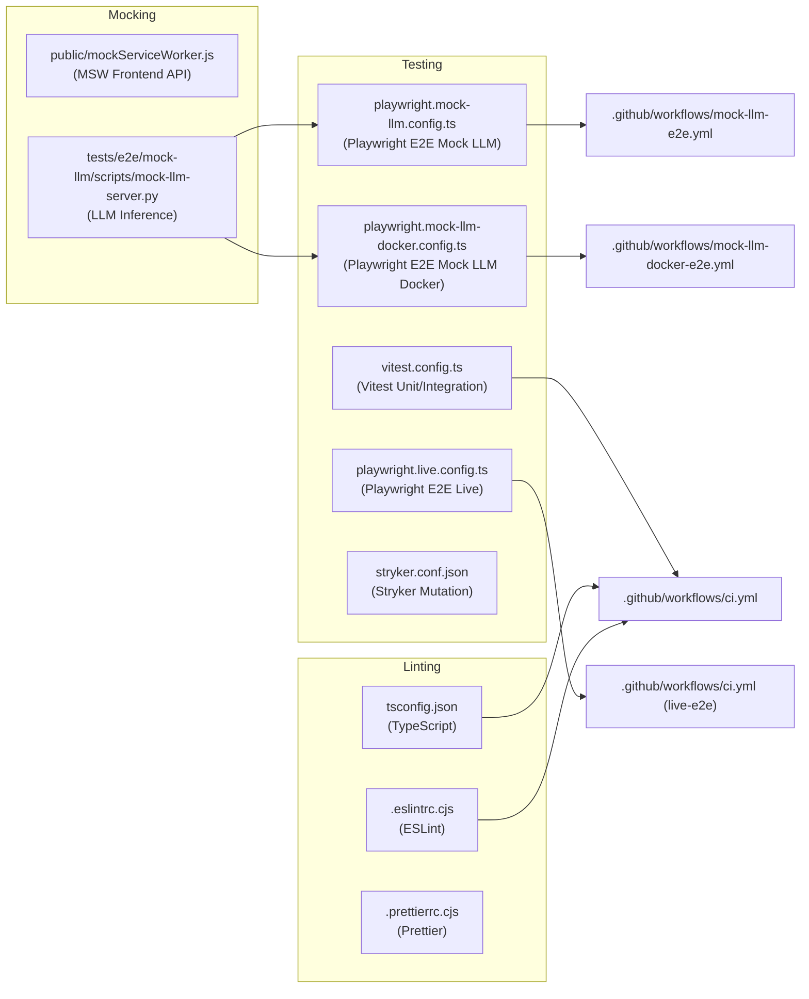
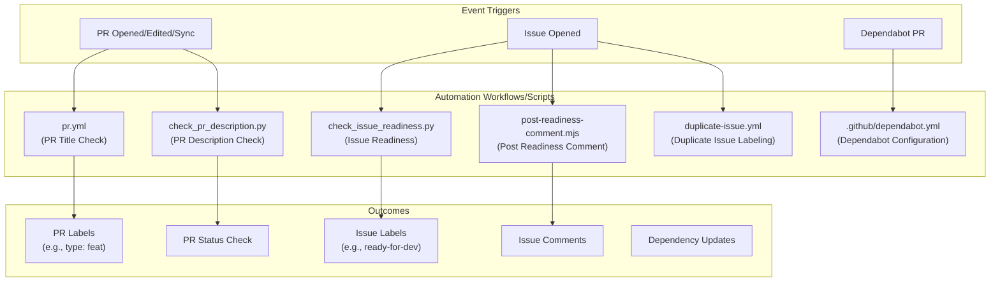

<!-- source: DeepWiki mcp.deepwiki.com · repo All-Hands-AI/OpenHands · page 13 Build System and CI/CD · fetched 2026-10-26 -->

# Build System and CI/CD

Relevant source files

The following files were used as context for generating this wiki page:

- [.github/pr-assets/pr-16970-terminal-verification.svg](.github/pr-assets/pr-16970-terminal-verification.svg)
- [.github/workflows/ci.yml](.github/workflows/ci.yml)
- [.github/workflows/docker.yml](.github/workflows/docker.yml)
- [.github/workflows/mock-llm-docker-e2e.yml](.github/workflows/mock-llm-docker-e2e.yml)
- [.github/workflows/mock-llm-e2e.yml](.github/workflows/mock-llm-e2e.yml)
- [.github/workflows/npm-publish.yml](.github/workflows/npm-publish.yml)
- [docker/Dockerfile](docker/Dockerfile)
- [playwright.mock-llm-docker.config.ts](playwright.mock-llm-docker.config.ts)
- [playwright.mock-llm.config.ts](playwright.mock-llm.config.ts)
- [scripts/docker-build.mjs](scripts/docker-build.mjs)
- [tests/e2e/mock-llm/automations/mock-llm-automation.spec.ts](tests/e2e/mock-llm/automations/mock-llm-automation.spec.ts)
- [tests/e2e/mock-llm/reporters/done-marker-reporter.ts](tests/e2e/mock-llm/reporters/done-marker-reporter.ts)
- [tests/e2e/mock-llm/scripts/mock-llm-server.py](tests/e2e/mock-llm/scripts/mock-llm-server.py)
- [tests/e2e/mock-llm/scripts/render-mock-llm-report.mjs](tests/e2e/mock-llm/scripts/render-mock-llm-report.mjs)
- [tests/e2e/mock-llm/settings/mock-llm-profile-management.spec.ts](tests/e2e/mock-llm/settings/mock-llm-profile-management.spec.ts)
- [tests/e2e/mock-llm/utils/mock-llm-helpers.ts](tests/e2e/mock-llm/utils/mock-llm-helpers.ts)

This page provides an overview of the OpenHands build pipeline, continuous integration (CI) workflows, release process, and code quality tooling. The system is designed to support a multi-platform React/TypeScript frontend, a Python-based agent-server SDK, and containerized deployments.

---

## Overview

The OpenHands build system is centered around `npm` for the frontend and `uv` for Python backend components. It automates the lifecycle from local development to multi-arch Docker images and npm package distribution.

*   **Frontend**: Built with Vite and React Router, targeting both a standalone SPA and an Electron desktop application [electron/electron-builder.config.mjs:1-10]().
*   **Docker**: Produces all-in-one images combining the frontend, agent-server, and automation sidecar [docker/Dockerfile:4-16]().
*   **CI/CD**: Powered by GitHub Actions, featuring automated testing, trunk-based releases via `release-please`, and OIDC-trusted publishing to npm [.github/workflows/npm-publish.yml:1-148]().

---

## CI/CD Workflow Architecture

The following diagram maps the CI/CD pipeline from code commit to artifact distribution, highlighting the specific GitHub Action workflows and their outputs.

### Pipeline Entity Mapping

```mermaid
graph TB
    subgraph "Triggers"
        PR["Pull Request"]
        PushMain["Push to main"]
        TagPush["Tag v*"]
        RepoDispatch["repository_dispatch<br/>(sdk-version-check)"]
        WorkflowDispatch["workflow_dispatch<br/>(manual trigger)"]
        Schedule["schedule<br/>(cron)"]
        WorkflowRun["workflow_run<br/>(Docker workflow completed)"]
    end

    subgraph "CI Workflows"
        CI_YML[".github/workflows/ci.yml<br/>(Lint/Test/Build)"]
        MOCK_E2E[".github/workflows/mock-llm-e2e.yml<br/>(Playwright + Mock LLM)"]
        DOCKER_E2E[".github/workflows/mock-llm-docker-e2e.yml<br/>(Image Validation)"]
        SDK_SYNC[".github/workflows/sdk-version-sync.yml<br/>(SDK Consistency)"]
        PR_ARTIFACTS[".github/workflows/pr-artifacts.yml<br/>(PR Artifacts)"]
        LIVE_E2E["ci.yml (live-e2e)<br/>(Live E2E Tests)"]
    end

    subgraph "Release & Publish"
        RELEASE_YML[".github/workflows/release.yml<br/>(release-please)"]
        NPM_PUB[".github/workflows/npm-publish.yml<br/>(OIDC Trusted)"]
        DOCKER_YML[".github/workflows/docker.yml<br/>(Multi-arch GHCR)"]
    end

    subgraph "Artifacts"
        NPM_PKG["@openhands/agent-canvas<br/>(npm)"]
        GHCR_IMG["ghcr.io/openhands/agent-canvas<br/>(Docker)"]
        MAC_DMG["macOS DMG<br/>(Electron)"]
        PR_REPORT["PR E2E Report"]
    end

    PR --> CI_YML
    PR --> MOCK_E2E
    PR --> SDK_SYNC
    PR --> PR_ARTIFACTS
    PushMain --> CI_YML
    PushMain --> RELEASE_YML
    PushMain --> SDK_SYNC
    PushMain --> LIVE_E2E
    TagPush --> NPM_PUB
    TagPush --> DOCKER_YML
    RepoDispatch --> SDK_SYNC
    WorkflowDispatch --> SDK_SYNC
    WorkflowDispatch --> LIVE_E2E
    WorkflowDispatch --> DOCKER_E2E
    Schedule --> SDK_SYNC
    WorkflowRun --> DOCKER_E2E

    CI_YML --> MAC_DMG
    NPM_PUB --> NPM_PKG
    DOCKER_YML --> GHCR_IMG
    PR_ARTIFACTS --> PR_REPORT
    LIVE_E2E --> PR_REPORT
    DOCKER_E2E --> PR_REPORT
    MOCK_E2E --> PR_REPORT
```

**Sources:** [.github/workflows/ci.yml:1-15](), [.github/workflows/npm-publish.yml:1-13](), [.github/workflows/docker.yml:2-13](), [.github/workflows/sdk-version-sync.yml:1-39](), [.github/workflows/release.yml:1-12](), [.github/workflows/mock-llm-e2e.yml:1-7](), [.github/workflows/mock-llm-docker-e2e.yml:1-16]()

For details, see [GitHub Actions CI/CD Workflows](#13.1).

---

## Release Process

OpenHands follows a trunk-based release strategy. The process is driven by **Conventional Commits**, which automatically determine the next version bump (major, minor, or patch) and generate the changelog.

### Release Lifecycle
1.  **Conventional Commits**: PRs are merged with Conventional Commit titles (e.g., `feat:`, `fix:`) which are linted by the `pr.yml` workflow and used by `release-please` to determine version bumps and release notes [.agents/skills/release.md:18-20](), [.github/workflows/pr.yml:1-12]().
2.  **Draft Release PR**: The `release.yml` workflow, powered by `release-please`, maintains a draft release PR on `main` that accumulates changes since the last release [.agents/skills/release.md:21-22](), [.github/workflows/release.yml:1-12]().
3.  **Version Surfaces**: The release PR automatically updates version strings in `package.json`, `package-lock.json`, `config/defaults.json` (`versions.agentCanvas`), `README.md`, and `README.windows.md` [.agents/skills/release.md:23-24](), [release-please-config.json:11-24]().
4.  **Release-Ready Gate**: Marking the draft release PR as "Ready for review" triggers the `release-ready.yml` workflow, which labels the PR `release: ready` and sends a Slack notification, signaling the intent to cut a release [.agents/skills/release.md:25-26]().
5.  **Publishing**: Merging the release PR causes `release-please` to push a `vX.Y.Z` tag. This tag push then triggers `npm-publish.yml` for npm package publication and `docker.yml` for multi-architecture Docker image builds and pushes to GHCR [.agents/skills/release.md:27-28](), [.github/workflows/npm-publish.yml:4-6](), [.github/workflows/docker.yml:4-8]().

**Sources:** [.agents/skills/release.md:15-28](), [release-please-config.json:1-27](), [.github/workflows/release.yml:1-12](), [.github/workflows/npm-publish.yml:90-114](), [.github/workflows/docker.yml:86-100](), [.github/workflows/pr.yml:1-12]()

For details, see [Release Process](#13.2).

---

## Electron and Desktop Packaging

The application is packaged for desktop use using Electron. The build process involves bundling the static frontend assets and managing child processes for the backends.

*   **Packaging**: The CI pipeline handles building the app and library targets [.github/workflows/ci.yml:72-78](). The `dist-electron/` directory is ignored from version control, indicating it's a build output.
*   **Dependency Management**: `uv` is used to manage the Python environment for the backends [.github/workflows/mock-llm-e2e.yml:70-73](). The `resources/bin/` and `resources/node/` directories are ignored, suggesting they contain downloaded binaries for the Electron app.
*   **Process Management**: The system uses specialized utilities to ensure child processes (like the agent-server) are correctly managed and terminated during the app lifecycle.

For details, see [Electron Desktop App](#13.3).

---

## Code Quality and Testing Infrastructure

The codebase maintains high standards through a multi-layered testing and linting strategy.

### Code Quality Entity Mapping

*   **Unit Testing**: Vitest is used for fast, isolated tests of frontend logic and stores [.github/workflows/ci.yml:68-70]().
*   **E2E Testing**: Playwright runs against a specialized `mock-llm-server.py` to simulate agent interactions without incurring LLM costs or latency [.github/workflows/mock-llm-e2e.yml:130-148](). Test results and reports are ignored from version control.
*   **Docker Validation**: The `mock-llm-docker-e2e.yml` workflow validates the all-in-one image by running the full E2E suite against the containerized stack [.github/workflows/mock-llm-docker-e2e.yml:3-15]().
*   **Live E2E Testing**: The `ci.yml` workflow includes a `live-e2e` job that runs Playwright tests against a live LLM backend, triggered on `main` pushes or manually via `workflow_dispatch` [.github/workflows/ci.yml:83-104]().
*   **SDK Sync**: A dedicated `sdk-version-sync.yml` workflow ensures consistency between the frontend's expected SDK version and upstream releases. It triggers on changes to version-related files, repository dispatches, or a schedule [.github/workflows/sdk-version-sync.yml:1-39]().
*   **PR Quality**: Automated checks validate PR descriptions and ensure that frontend changes are accompanied by visual evidence.

**Sources:** [.github/workflows/ci.yml:64-70](), [.github/workflows/mock-llm-e2e.yml:130-148](), [.github/workflows/mock-llm-docker-e2e.yml:1-42](), [.github/workflows/sdk-version-sync.yml:1-39](), [.github/workflows/ci.yml:83-104](), [playwright.mock-llm.config.ts:1-198](), [playwright.mock-llm-docker.config.ts:1-146](), [tests/e2e/mock-llm/scripts/mock-llm-server.py:1-173]()

For details, see [Code Quality and Testing Infrastructure](#13.4).

---

## Repository Governance Automation

The repository leverages GitHub Actions and custom scripts to automate various governance tasks, ensuring consistency, quality, and maintainability.

### Governance Automation Flow

*   **PR Title Validation**: The `pr.yml` workflow uses `OpenHands/release-actions/.github/workflows/pr-title.yml` to lint PR titles against Conventional Commit standards and apply corresponding `type:` labels [.github/workflows/pr.yml:1-12]().
*   **PR Description Enforcement**: The `check_pr_description.py` script ensures PRs include mandatory sections like "Why", "Summary", and "How to Test" [.github/pr-assets/pr-16970-terminal-verification.svg]().
*   **Issue Readiness**: The `check_issue_readiness.py` script and `post-readiness-comment.mjs` work together to evaluate if an issue is ready for development and add appropriate labels and comments.
*   **Duplicate Issue Management**: Workflows are in place to automatically identify and label duplicate issues.
*   **Dependabot Configuration**: The `.github/dependabot.yml` file configures Dependabot to automate dependency updates, ensuring the project stays secure and up-to-date.

**Sources:** [.github/workflows/pr.yml:1-12](), [.github/pr-assets/pr-16970-terminal-verification.svg](), [.github/dependabot.yml]()

For details, see [Repository Governance Automation](#13.5).

---

