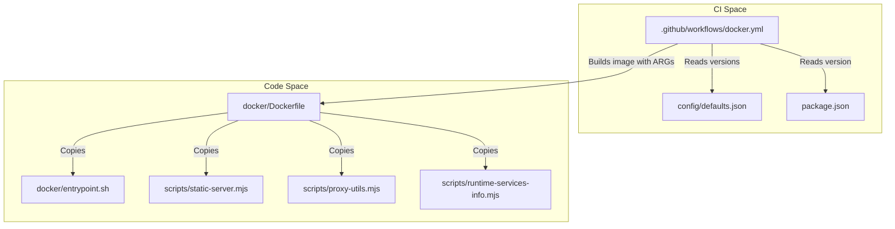
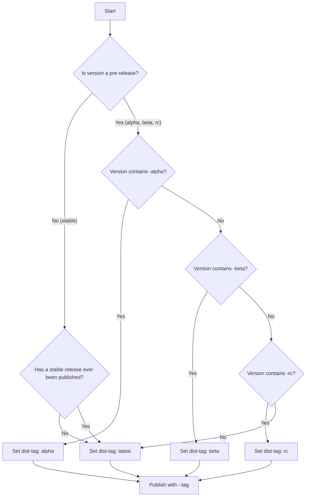

<!-- source: DeepWiki mcp.deepwiki.com · repo All-Hands-AI/OpenHands · page 13.1 GitHub Actions CI/CD Workflows · fetched 2026-10-26 -->

# GitHub Actions CI/CD Workflows

<details>
<summary>Relevant source files</summary>

The following files were used as context for generating this wiki page:

- [.github/pr-assets/pr-16970-terminal-verification.svg](.github/pr-assets/pr-16970-terminal-verification.svg)
- [.github/workflows/ci.yml](.github/workflows/ci.yml)
- [.github/workflows/docker.yml](.github/workflows/docker.yml)
- [.github/workflows/mock-llm-docker-e2e.yml](.github/workflows/mock-llm-docker-e2e.yml)
- [.github/workflows/mock-llm-e2e.yml](.github/workflows/mock-llm-e2e.yml)
- [.github/workflows/npm-publish.yml](.github/workflows/npm-publish.yml)
- [.github/workflows/sdk-version-sync.yml](.github/workflows/sdk-version-sync.yml)
- [__tests__/constants/acp-providers.test.ts](__tests__/constants/acp-providers.test.ts)
- [__tests__/scripts/check-sdk-version-sync.test.ts](__tests__/scripts/check-sdk-version-sync.test.ts)
- [docker/Dockerfile](docker/Dockerfile)
- [playwright.mock-llm-docker.config.ts](playwright.mock-llm-docker.config.ts)
- [playwright.mock-llm.config.ts](playwright.mock-llm.config.ts)
- [scripts/docker-build.mjs](scripts/docker-build.mjs)
- [src/constants/acp-providers.test.ts](src/constants/acp-providers.test.ts)
- [src/constants/acp-providers.ts](src/constants/acp-providers.ts)
- [tests/e2e/mock-llm/automations/mock-llm-automation.spec.ts](tests/e2e/mock-llm/automations/mock-llm-automation.spec.ts)
- [tests/e2e/mock-llm/reporters/done-marker-reporter.ts](tests/e2e/mock-llm/reporters/done-marker-reporter.ts)
- [tests/e2e/mock-llm/scripts/mock-llm-server.py](tests/e2e/mock-llm/scripts/mock-llm-server.py)
- [tests/e2e/mock-llm/scripts/render-mock-llm-report.mjs](tests/e2e/mock-llm/scripts/render-mock-llm-report.mjs)
- [tests/e2e/mock-llm/settings/mock-llm-profile-management.spec.ts](tests/e2e/mock-llm/settings/mock-llm-profile-management.spec.ts)
- [tests/e2e/mock-llm/utils/mock-llm-helpers.ts](tests/e2e/mock-llm/utils/mock-llm-helpers.ts)

</details>


This document describes the GitHub Actions-based continuous integration and deployment system for Agent Canvas. The workflows automatically build Docker images, run linting checks, execute unit and end-to-end tests, and publish artifacts to GitHub Container Registry (GHCR) and npm.

## Workflow Overview

Agent Canvas uses several primary GitHub Actions workflows to maintain code quality and automate deployments:

| Workflow | File | Purpose | Trigger Events |
|----------|------|---------|----------------|
| CI | [.github/workflows/ci.yml]() | Main lint/test/build pipeline for app and library | PR, Push to main, Manual |
| Docker | [.github/workflows/docker.yml]() | Build multi-arch GHCR images (All-in-one stack) | Push to main/tags, PR, Manual |
| Publish to npm | [.github/workflows/npm-publish.yml]() | Trusted publishing to npm registry with OIDC | Tag push (v*), Manual |
| Mock-LLM E2E | [.github/workflows/mock-llm-e2e.yml]() | Browser-based E2E tests against mock LLM | Push to main, Manual |
| Mock-LLM Docker E2E | [.github/workflows/mock-llm-docker-e2e.yml]() | E2E tests against the built Docker image | Workflow run (Docker), Manual |
| PR Artifacts | [.github/workflows/pr-artifacts.yml]() | Manages and cleans up PR-specific commit artifacts | PR Review, PR Close |
| SDK Version Sync | [.github/workflows/sdk-version-sync.yml]() | Validates SDK version pins across the repo | Schedule, Repo Dispatch, PR |

**Sources:** [.github/workflows/ci.yml:1-10](), [.github/workflows/docker.yml:2-11](), [.github/workflows/npm-publish.yml:1-12](), [.github/workflows/mock-llm-e2e.yml:1-7](), [.github/workflows/mock-llm-docker-e2e.yml:17-29](), [.github/workflows/sdk-version-sync.yml:1-39]()

## Main CI Pipeline (ci.yml)

The `CI` workflow is the primary gatekeeper for code quality. It utilizes a matrix strategy to ensure compatibility across different operating systems.

### Build and Test Matrix
The workflow dynamically prepares a test matrix via the `prepare-test-matrix` job, typically targeting `ubuntu-24.04` for full checks and `windows-latest` for basic build verification [[.github/workflows/ci.yml:28-37]]().

1.  **Linting**: Executes `npm run lint` on the Ubuntu runner if `full_checks` is enabled [[.github/workflows/ci.yml:64-66]]().
2.  **Unit Testing**: Runs `npm test` [[.github/workflows/ci.yml:68-70]]().
3.  **App Build**: Builds the production SPA via `npm run build` [[.github/workflows/ci.yml:72-73]]().
4.  **Library Build**: Builds the `@openhands/agent-canvas` library package via `npm run build:lib` [[.github/workflows/ci.yml:75-77]]().
5.  **Package Verification**: Runs `npm pack --dry-run` to ensure the package structure is valid [[.github/workflows/ci.yml:79-81]]().

**Title: CI Job Concurrency and Permissions**
```mermaid
graph TD
    "CI_Trigger"["Push / PR Event"] --> "Concurrency_Group"["ci-workflow-ref"]
    "Concurrency_Group" --> "Cancel_In_Progress"["Cancel if PR, Keep if Push"]
    "Cancel_In_Progress" --> "Prepare_Matrix"["prepare-test-matrix"]
    "Prepare_Matrix" --> "Test_Build"["test-and-build (ubuntu/windows)"]
    "Test_Build" --> "Live_E2E"["live-e2e (Manual/Main Push)"]
```
**Sources:** [.github/workflows/ci.yml:16-22](), [.github/workflows/ci.yml:28-46](), [.github/workflows/ci.yml:64-81]()

### Live E2E Testing
For high-confidence QA, the `live-e2e` job runs against real LLM providers. It is triggered manually via `workflow_dispatch` or on `push` to `main` [[.github/workflows/ci.yml:83-88]](). To protect secrets, this job is automatically skipped for fork PRs [[.github/workflows/ci.yml:149-151]](). It uses `LIVE_E2E_LLM_BASE_URL` and `LIVE_E2E_LLM_MODEL` variables to configure the agent's environment [[.github/workflows/ci.yml:97-98]](). The workflow resolves the source context (PR number, head SHA, etc.) to check out the correct commit for testing [[.github/workflows/ci.yml:106-147]]().

**Sources:** [.github/workflows/ci.yml:83-88](), [.github/workflows/ci.yml:97-98](), [.github/workflows/ci.yml:106-147](), [.github/workflows/ci.yml:149-151]()

## Docker Image Pipeline (docker.yml)

The Docker workflow builds the "all-in-one" image defined in `docker/Dockerfile`.

### Multi-Architecture Builds
The workflow uses native runners (`ubuntu-24.04` for amd64 and `ubuntu-24.04-arm` for arm64) to build and push arch-suffixed tags to GHCR [[.github/workflows/docker.yml:53-63]]().

1.  **Version Resolution**: It reads version pins for `agent-server` and `automation` directly from `config/defaults.json` and the package version from `package.json` [[.github/workflows/docker.yml:87-99]]().
2.  **PostHog Configuration**: Injects `POSTHOG_PROD_KEY` for tagged releases (v*) and `POSTHOG_STAGING_KEY` for other builds [[.github/workflows/docker.yml:108-109](), [.github/workflows/docker.yml:174-175]]().
3.  **Manifest Creation**: A final `merge-manifests` job creates a single multi-arch manifest for the target tag (e.g., `latest` or a version number) [[.github/workflows/docker.yml:267-270]]().

**Title: Docker Build Entity Mapping**

**Sources:** [.github/workflows/docker.yml:87-99](), [.github/workflows/docker.yml:108-109](), [.github/workflows/docker.yml:174-175](), [.github/workflows/docker.yml:267-270](), [docker/Dockerfile:1-16](), [docker/Dockerfile:122-144]()

## Trusted npm Publishing (npm-publish.yml)

Agent Canvas uses **OIDC Trusted Publishing** to eliminate the need for long-lived npm tokens.

1.  **OIDC Authentication**: The job requests `id-token: write` permissions to authenticate with the npm registry via GitHub [[.github/workflows/npm-publish.yml:18-20]]().
2.  **Version Validation**: Ensures the `package.json` version matches the Git release tag or manual input [[.github/workflows/npm-publish.yml:93-112]]().
3.  **Dist-tag Resolution**: Automatically determines if the package should be tagged as `latest`, `alpha`, `beta`, or `rc` based on the version string and whether a stable release already exists [[.github/workflows/npm-publish.yml:123-145]]().
    -   If no stable release has been published, all releases use the `latest` dist-tag.
    -   Once a stable version exists, pre-release versions (e.g., `-alpha`, `-beta`, `-rc`) use their respective dist-tags, while stable versions continue to use `latest`.
    -   This logic is implemented in the `Resolve npm dist-tag` step [[.github/workflows/npm-publish.yml:123-145]]().
4.  **Provenance**: Publishes with the `--provenance` flag to provide a verifiable link back to the source code and build process [[.github/workflows/npm-publish.yml:147-148]]().

**Title: npm Dist-Tag Resolution Logic**

**Sources:** [.github/workflows/npm-publish.yml:18-20](), [.github/workflows/npm-publish.yml:123-148]()

## End-to-End Testing Infrastructure

### Mock-LLM E2E (mock-llm-e2e.yml)
This workflow runs browser tests against a simulated environment.
-   **Mock LLM Server**: Starts `tests/e2e/mock-llm/scripts/mock-llm-server.py` [[.github/workflows/mock-llm-e2e.yml:97-114]](). The Python binary used for the mock server can be configured via `MOCK_LLM_PYTHON` environment variable, defaulting to `python3` [[playwright.mock-llm.config.ts:62]]().
-   **Dependency Isolation**: Installs `openhands-sdk` and `acp` into a private venv `.mock-llm-venv` [[.github/workflows/mock-llm-e2e.yml:83-85]](). The `acp_constraint` is read from `config/defaults.json` to ensure compatibility [[.github/workflows/mock-llm-e2e.yml:37]]().
-   **Pre-warm Automation Backend**: Pre-installs `openhands-automation` into the `uvx` cache to prevent timeouts during Playwright's `webServer` startup [[.github/workflows/mock-llm-e2e.yml:87-94]]().
-   **Playwright Configuration**: The `playwright.mock-llm.config.ts` file defines the test environment, including port allocation, session API key generation, and state directory management [[playwright.mock-llm.config.ts:25-52]](). It also sets up two `webServer` instances: one for the mock LLM and another for the full `agent-canvas` stack via `bin/agent-canvas.mjs` [[playwright.mock-llm.config.ts:116-155]]().

**Sources:** [.github/workflows/mock-llm-e2e.yml:37](), [.github/workflows/mock-llm-e2e.yml:83-85](), [.github/workflows/mock-llm-e2e.yml:87-94](), [.github/workflows/mock-llm-e2e.yml:97-114](), [playwright.mock-llm.config.ts:25-52](), [playwright.mock-llm.config.ts:62](), [playwright.mock-llm.config.ts:116-155]()

### Mock-LLM Docker E2E (mock-llm-docker-e2e.yml)
Validates the Docker image by running the same test suite against the containerized stack.
-   **Docker Image**: The `docker_image` input can specify the Docker image to test, otherwise it defaults to `ghcr.io/openhands/agent-canvas:sha-<short-sha>-amd64` based on the commit SHA [[.github/workflows/mock-llm-docker-e2e.yml:84-94]]().
-   **Networking**: Uses `--network host` on Linux for the Docker container to share the host's network stack, allowing the agent-server inside Docker to reach the host-side mock LLM server at `127.0.0.1:<port>` [[playwright.mock-llm-docker.config.ts:16-18]](). For macOS/Windows, `MOCK_LLM_AGENT_URL` can be set to `http://host.docker.internal:<port>` [[tests/e2e/mock-llm/utils/mock-llm-helpers.ts:39-41]]().
-   **Volume Mounts**: For skill and folder-workspace tests, host directories are volume-mounted into the container to allow the agent-server to access test-generated files [[playwright.mock-llm-docker.config.ts:90-117]]().
-   **Mock ACP Server**: The mock ACP server script is also volume-mounted into the container for ACP integration tests [[playwright.mock-llm-docker.config.ts:119-130]]().

**Title: E2E Test Data Flow**
```mermaid
graph LR
    subgraph "Test Runner"
        Playwright[Playwright]
        Mock_LLM_Server[mock-llm-server.py]
    end

    subgraph "Target Environment"
        Agent_Canvas[agent-canvas (Binary/Docker)]
        Mock_LLM_Helpers[mock-llm-helpers.ts]
    end

    Playwright -- "Simulate Interaction" --> Agent_Canvas
    Agent_Canvas -- "X-Session-API-Key" --> Mock_LLM_Helpers
    Mock_LLM_Helpers -- "Seed State" --> Agent_Canvas
    Agent_Canvas -- "Inference Request" --> Mock_LLM_Server
```
**Sources:** [.github/workflows/mock-llm-e2e.yml:97-114](), [.github/workflows/mock-llm-docker-e2e.yml:1-29](), [.github/workflows/mock-llm-docker-e2e.yml:84-94](), [playwright.mock-llm.config.ts:116-155](), [playwright.mock-llm-docker.config.ts:16-18](), [playwright.mock-llm-docker.config.ts:90-117](), [playwright.mock-llm-docker.config.ts:119-130](), [tests/e2e/mock-llm/utils/mock-llm-helpers.ts:39-41]()

## PR Maintenance and Quality Gates

### PR Artifact Cleanup (pr-artifacts.yml)
Manages the `.pr/` directory used for automated commit artifacts (like E2E reports).
-   **Cleanup on Approval**: Automatically removes the `.pr/` directory when a PR is approved to ensure it is not merged into `main` [[.github/workflows/ci.yml:400-409]]().
-   **Notice**: Posts a comment on PRs containing a `.pr/` directory to notify contributors of the automatic cleanup behavior [[.github/workflows/ci.yml:411-421]]().

**Sources:** [.github/workflows/ci.yml:400-409](), [.github/workflows/ci.yml:411-421]()

### SDK Version Sync (sdk-version-sync.yml)
Ensures the repository is pinned to the correct `agent-server` version.
-   **Trigger Conditions**: This workflow is triggered by changes to version-related files (`config/defaults.json`, `scripts/dev-safe.mjs`, etc.), pushes to `main`, `repository_dispatch` events (e.g., from `OpenHands/automation`), `workflow_dispatch` (manual trigger), and a daily schedule [[.github/workflows/sdk-version-sync.yml:4-39]]().
-   **Validation**: The `check-sdk-versions` job executes `node scripts/check-sdk-version-sync.mjs` to validate `config/defaults.json` version pins against upstream requirements or an `EXPECTED_SDK_VERSION` provided by the trigger [[.github/workflows/sdk-version-sync.yml:48-84]]().
-   **Automated Updates**: Can be triggered by `repository_dispatch` to sync versions across the OpenHands ecosystem [[.github/workflows/sdk-version-sync.yml:22-26]]().

**Sources:** [.github/workflows/sdk-version-sync.yml:4-39](), [.github/workflows/sdk-version-sync.yml:48-83]()

## Release Process Automation

Releases are trunk-based and managed by `release-please`.

1.  **Conventional Commits**: PRs must use conventional commit titles (e.g., `feat:`, `fix:`) [[.agents/skills/custom-codereview-guide.md:19]]().
2.  **Draft Release PR**: On every push to `main`, a draft PR is maintained containing version bumps for `package.json`, `config/defaults.json` (`versions.agentCanvas`), and `README.md` / `README.windows.md` (Docker image pins) [[.agents/skills/custom-codereview-guide.md:20-21]](), configured via `release-please-config.json` [[release-please-config.json:11-24]]().
3.  **Release Gate**: Marking the PR "Ready for review" triggers Slack notifications and labels [[.agents/skills/custom-codereview-guide.md:22]]().
4.  **Publishing**: Merging the release PR pushes a `v*` tag, which triggers `npm-publish.yml` and `docker.yml` [[.agents/skills/custom-codereview-guide.md:23]]().

**Sources:** [.agents/skills/custom-codereview-guide.md:19](), [.agents/skills/custom-codereview-guide.md:20-21](), [.agents/skills/custom-codereview-guide.md:22](), [.agents/skills/custom-codereview-guide.md:23](), [release-please-config.json:11-24]()

---

