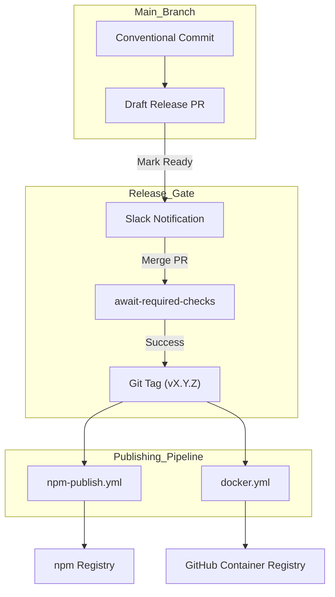
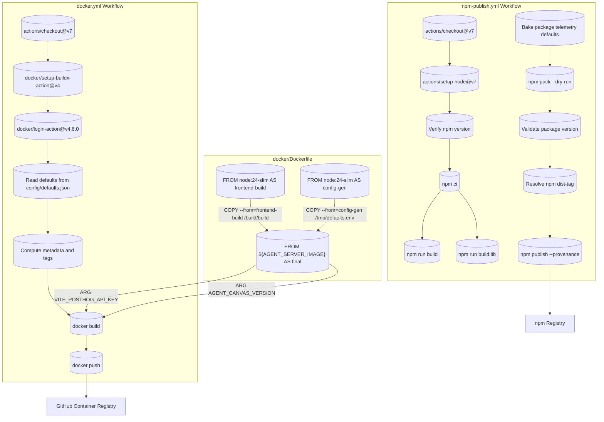

<!-- source: DeepWiki mcp.deepwiki.com · repo All-Hands-AI/OpenHands · page 13.2 Release Process · fetched 2026-10-26 -->

# Release Process

Relevant source files

The following files were used as context for generating this wiki page:

- [.agents/skills/release.md](.agents/skills/release.md)
- [.github/release.yml](.github/release.yml)
- [.github/workflows/pr.yml](.github/workflows/pr.yml)
- [.github/workflows/release.yml](.github/workflows/release.yml)
- [release-please-config.json](release-please-config.json)
- [scripts/check-translation-completeness.cjs](scripts/check-translation-completeness.cjs)
- [src/api/agent-canvas-updates.test.ts](src/api/agent-canvas-updates.test.ts)
- [src/components/features/settings/agent-canvas-update-card.test.tsx](src/components/features/settings/agent-canvas-update-card.test.tsx)
- [src/components/features/settings/agent-canvas-update-card.tsx](src/components/features/settings/agent-canvas-update-card.tsx)
- [src/components/features/settings/agent-canvas-version-modal.tsx](src/components/features/settings/agent-canvas-version-modal.tsx)
- [src/components/features/settings/agent-canvas-version-tile.tsx](src/components/features/settings/agent-canvas-version-tile.tsx)
- [src/components/features/settings/settings-desktop-sidebar.tsx](src/components/features/settings/settings-desktop-sidebar.tsx)
- [src/components/features/settings/settings-mobile-drawer.tsx](src/components/features/settings/settings-mobile-drawer.tsx)
- [src/components/features/settings/settings-mobile-hub.tsx](src/components/features/settings/settings-mobile-hub.tsx)
- [src/hooks/query/use-latest-agent-canvas-version.ts](src/hooks/query/use-latest-agent-canvas-version.ts)
- [src/icons/docker.svg](src/icons/docker.svg)

The OpenHands Agent Canvas follows a **trunk-based release-please automation** strategy. This process automates versioning, changelog generation, and multi-platform publishing (npm and Docker) based on Conventional Commits merged into the `main` branch.

## Trunk-Based Automation Lifecycle

The release lifecycle is managed by `release-please` and orchestrated via GitHub Actions. It transitions from individual feature/fix PRs to a unified draft release PR, and finally to a tagged release that triggers the publishing pipeline.

### 1. Conventional Commits
All changes merged into `main` must use **Conventional Commit** titles (e.g., `feat:`, `fix:`, `perf:`, `docs:`, `chore:`, `build:`, `ci:`, `refactor:`, `style:`, `test:`, `revert:`). The PR title is linted by `.github/workflows/pr.yml` [`.github/workflows/pr.yml:1-21`]() and is used as the commit message upon squash-merging [`.agents/skills/release.md:19-19`]().

### 2. The Draft Release PR
On every push to `main` (or maintenance `release/**` branches), `.github/workflows/release.yml` triggers `release-please` to maintain a persistent **draft release PR** titled `chore(main): release X.Y.Z` [`.agents/skills/release.md:20-20`](). This PR:
*   Accumulates all changes merged since the last release.
*   Calculates the next version: `fix` triggers a patch, `feat` a minor, and any `!` suffix or `BREAKING CHANGE` footer triggers a major version bump [`.agents/skills/release.md:25-25`]().
*   Stages version updates across multiple files defined in `release-please-config.json` [`release-please-config.json:6-27`]().

### 3. Release-Ready Gate
The release process includes an explicit human gate. When the draft PR is marked **"Ready for review"**, a release-ready workflow executes:
*   Sends a notification to the `#proj-agent-canvas` Slack channel [`.agents/skills/release.md:22-22`]().
*   Applies the `release: ready` label to the PR [`.agents/skills/release.md:22-22`]().

### 4. Tagging and Publishing
Merging the release PR triggers the final stage. The workflow `release.yml` includes a job `await-required-checks` that waits for the `test-and-build (ubuntu)` check to pass on the release commit to avoid racing CI rulesets [`.github/workflows/release.yml:21-77`](). Once checks pass:
*   `release-please` creates a GitHub Release and pushes a git tag (e.g., `v1.2.3`) [`.agents/skills/release.md:23-23`]().
*   The tag push triggers the **npm-publish** and **Docker** workflows [`.agents/skills/release.md:23-23`]().

### Release Data Flow
The following diagram illustrates how a commit leads to a multi-platform release.

**Release Pipeline Data Flow**

Sources: [`.agents/skills/release.md:16-25`](), [`.github/workflows/release.yml:21-77`](), [`.github/workflows/pr.yml:1-21`]()

---

## Version Bump Surfaces

Version consistency is maintained by `release-please` across the following surfaces, ensuring the frontend, library, and deployment manifests remain in sync:

| File Path | Target Field / Annotation | Purpose |
| :--- | :--- | :--- |
| `package.json` | `version` | Primary npm package version. |
| `config/defaults.json` | `$.versions.agentCanvas` | Runtime version reported by the app. |
| `helm/agent-canvas/Chart.yaml` | `appVersion` | Kubernetes Helm chart application version (generic updater). |
| `README.md` | `# x-release-please-version` | Docker image tags in documentation. |
| `README.windows.md` | `# x-release-please-version` | Windows-specific deployment docs. |

Sources: [`release-please-config.json:6-27`]()

---

## Publishing Pipelines

### npm Publish Pipeline
The `npm-publish.yml` workflow handles the distribution of the `@openhands/agent-canvas` package.

*   **Telemetry Baking:** It injects the production PostHog API key (`POSTHOG_PROD_KEY`) from GitHub variables into `config/defaults.json` for the CLI launcher and `VITE_POSTHOG_API_KEY` for the app and library builds.
*   **Verification:** It ensures the package metadata points to the canonical repository `https://github.com/OpenHands/OpenHands`.
*   **Dist-tag Resolution:** It determines the appropriate npm `dist-tag` (`latest`, `alpha`, `beta`, `rc`) based on the version and whether a stable release has ever been published, ensuring `npm install @openhands/agent-canvas` resolves correctly.
*   **Provenance:** The publish step includes `--provenance` for supply chain security.

### Docker Pipeline
The `docker.yml` workflow builds multi-architecture images for the GitHub Container Registry (GHCR).

*   **Build Arguments:** It passes `AGENT_SERVER_IMAGE`, `AUTOMATION_VERSION`, `VITE_POSTHOG_API_KEY`, and `VITE_BASE_PATH` as build arguments to `docker/Dockerfile`.
*   **Dockerfile Stages:** The `docker/Dockerfile` uses a multi-stage build: `frontend-build` for the React app, `config-gen` to extract `config/defaults.json` values into a shell-sourceable `.env` file, and `final` to combine the agent-server base image with the built frontend and automation server.
*   **Image Metadata:** The final Docker image includes Open Container Initiative (OCI) labels for title, description, source, version, and revision.

**Code Entity Mapping: Publish Logic**

Sources: [`src/components/features/settings/agent-canvas-update-card.tsx:1-363`](), [`src/components/features/settings/agent-canvas-update-card.test.tsx:1-195`](), [`src/components/features/settings/settings-desktop-sidebar.tsx:1-64`](), [`src/components/features/settings/settings-mobile-drawer.tsx:1-106`](), [`src/components/features/settings/settings-mobile-hub.tsx:1-50`]()

---

## Maintenance and Overrides

### Forcing a Version
If the calculated version is incorrect (e.g., a breaking change was missed in a commit title), developers can force a specific version by merging a commit to `main` with a `Release-As: X.Y.Z` footer [`.agents/skills/release.md:51-51`]().

### Maintenance Branches
Releases for older major/minor versions are handled via `release/**` branches. The `release.yml` workflow is configured to trigger on these branches to maintain separate release PRs [`.github/workflows/release.yml:8-9`]().

### Helm Chart Updates
The Helm chart `appVersion` in `helm/agent-canvas/Chart.yaml` is updated automatically by `release-please` using a `generic` updater to preserve comments in the YAML file [`release-please-config.json:18-21`](). The chart's own `version` is managed by a separate workflow, `bump-chart.yml`, which triggers on changes to the `helm/agent-canvas` directory.
Sources: [`.agents/skills/release.md:51-51`](), [`.github/workflows/release.yml:8-9`](), [`release-please-config.json:18-21`]()

---

