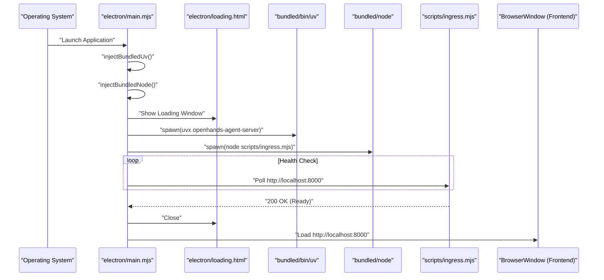
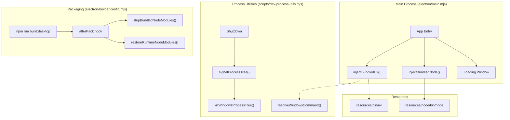

<!-- source: DeepWiki mcp.deepwiki.com · repo All-Hands-AI/OpenHands · page 13.3 Electron Desktop App · fetched 2026-10-26 -->

# Electron Desktop App

<details>
<summary>Relevant source files</summary>

The following files were used as context for generating this wiki page:

- [.github/workflows/desktop-linux.yml](.github/workflows/desktop-linux.yml)
- [.github/workflows/desktop-macos.yml](.github/workflows/desktop-macos.yml)
- [.github/workflows/desktop-windows.yml](.github/workflows/desktop-windows.yml)
- [.github/workflows/release-ready.yml](.github/workflows/release-ready.yml)
- [__tests__/scripts/dev-extra-backend.test.ts](__tests__/scripts/dev-extra-backend.test.ts)
- [__tests__/scripts/dev-process-utils.test.ts](__tests__/scripts/dev-process-utils.test.ts)
- [__tests__/scripts/electron-builder-config.test.ts](__tests__/scripts/electron-builder-config.test.ts)
- [electron-builder.config.mjs](electron-builder.config.mjs)
- [electron/lib/window-url-policy.mjs](electron/lib/window-url-policy.mjs)
- [electron/lib/window-url-policy.test.mjs](electron/lib/window-url-policy.test.mjs)
- [electron/loading.html](electron/loading.html)
- [electron/main.mjs](electron/main.mjs)
- [electron/package.json](electron/package.json)
- [electron/preload.cjs](electron/preload.cjs)
- [scripts/brand-dev-electron.mjs](scripts/brand-dev-electron.mjs)
- [scripts/dev-extra-backend.mjs](scripts/dev-extra-backend.mjs)
- [scripts/dev-process-utils.mjs](scripts/dev-process-utils.mjs)
- [scripts/download-uv.mjs](scripts/download-uv.mjs)
- [tests/e2e/mock-llm/conversations/mock-llm-conversation.spec.ts](tests/e2e/mock-llm/conversations/mock-llm-conversation.spec.ts)

</details>


The Agent Canvas desktop application is a cross-platform Electron-based wrapper that bundles the full OpenHands stack into a single executable. It packages the React frontend, the `agent-server` (via Python/uv), the automation sidecar, and a specialized ingress proxy to provide a native-like experience without requiring users to manually manage Docker or Python environments [electron/main.mjs:1-7]().

## System Architecture

The desktop application operates by launching several background services and coordinating them through a central Electron main process.

### Process Topology

When the application starts, the `main.mjs` process initializes a "loading" window and then spawns the following stack:
1.  **Ingress Proxy**: Orchestrated via `scripts/ingress.mjs`, it routes traffic between the frontend and backends [electron/main.mjs:4-6]().
2.  **Static Frontend Server**: Spawns `scripts/static-server.mjs` to serve compiled React assets [electron/main.mjs:144-145]().
3.  **Python Backends**: Runs `openhands-agent-server` and the automation backend using a bundled `uv` binary [electron/main.mjs:89-91]().

### Data Flow and Initialization

The startup sequence is managed by `electron/main.mjs`, which utilizes a specialized loading splash screen (`electron/loading.html`) to provide real-time feedback during backend initialization [electron/main.mjs:6-7]().

#### Startup Sequence Diagram
Title: Desktop App Startup and Process Management

**Sources:** [electron/main.mjs:94-124](), [electron/main.mjs:137-162](), [electron/main.mjs:4-7]()

## Implementation Details

### Bundled Binaries and PATH Injection
To ensure the app is self-contained, it bundles specific runtimes that are typically absent or version-mismatched on user machines:

*   **uv/uvx**: Downloaded via `scripts/download-uv.mjs` into `resources/bin/`. The script detects the platform and architecture to fetch the correct binary from GitHub [scripts/download-uv.mjs:38-66](). On startup, `injectBundledUv` prepends this directory to `process.env.PATH` and ensures the execute bit is set on Unix platforms [electron/main.mjs:94-124]().
*   **Node.js**: Bundled into `resources/node/`. This ensures that `npx` (used for MCP servers) and internal scripts like `ingress.mjs` have a reliable runtime regardless of the user's system PATH [electron/main.mjs:137-162]().

### Child Process Management
The application uses `scripts/dev-process-utils.mjs` to handle the lifecycle of background services. Key utilities include:
*   **`signalProcessTree`**: On POSIX, it uses process groups (`-pid`) to ensure that if a wrapper (like `uvx`) is killed, its children (the Python server) are also terminated [scripts/dev-process-utils.mjs:85-98]().
*   **`killWindowsProcessTree`**: On Windows, it utilizes `taskkill /pid [pid] /t /f` to walk the process tree, as Windows lacks POSIX process groups. This is invoked via `spawnSync` with `windowsHide: true` to avoid console flashes [scripts/dev-process-utils.mjs:118-125]().
*   **`resolveWindowsCommand`**: Resolves bare commands (like `uvx`) to absolute paths using `where.exe` to avoid shell parsing issues with special characters (e.g., `<` in version constraints) [scripts/dev-process-utils.mjs:54-66]().

**Sources:** [scripts/dev-process-utils.mjs:13-15](), [scripts/dev-process-utils.mjs:85-105](), [scripts/dev-process-utils.mjs:118-129]()

## Packaging and Build Pipeline

Packaging is handled by `electron-builder` with a custom configuration in `electron-builder.config.mjs`.

### The `afterPack` Hook and Node Modules
A significant optimization in the build process is the `stripBundledNodeModules` function. Electron-builder by default copies the entire hoisted `node_modules` tree (approx. 600MB). The `afterPack` hook:
1.  Deletes the massive `node_modules` directory [electron-builder.config.mjs:116-136]().
2.  Restores only the `RUNTIME_PACKAGES` (`sirv`, `httpxy`) and their dependency closure [electron-builder.config.mjs:72-72](), [electron-builder.config.mjs:152-162]().
3.  Reduces the final artifact size significantly [electron-builder.config.mjs:30-34]().

### Platform Workflows
| Platform | Workflow File | Key Artifact | Tooling |
| :--- | :--- | :--- | :--- |
| **macOS** | `.github/workflows/desktop-macos.yml` | `.dmg` | electron-builder (Apple Silicon) [ .github/workflows/desktop-macos.yml:55-65]() |
| **Windows** | `.github/workflows/desktop-windows.yml` | `.exe` (NSIS) | electron-builder + `taskkill` [ .github/workflows/desktop-windows.yml:53-64]() |
| **Linux** | `.github/workflows/desktop-linux.yml` | `.AppImage` / `.deb` | electron-builder |

**Sources:** [electron-builder.config.mjs:8-34](), [electron-builder.config.mjs:105-108](), [.github/workflows/desktop-windows.yml:1-12](), [.github/workflows/desktop-macos.yml:1-12]()

## Code Entity Mapping

The following diagram maps high-level desktop functionality to the specific code entities responsible for implementation.

Title: Desktop Feature to Code Entity Mapping

**Sources:** [electron/main.mjs:94-124](), [electron/main.mjs:137-162](), [scripts/dev-process-utils.mjs:54-58](), [electron-builder.config.mjs:105-108]()

## UI Communication (Preload)
The `electron/preload.cjs` script bridges the isolated renderer process of the loading screen to the main process. It exposes a `desktopBoot` API to the `window` object, allowing the loading HTML to:
*   Receive batched log lines via `onLogBatch` [electron/preload.cjs:15-18]().
*   Handle fatal errors via `onFatal` [electron/preload.cjs:20-23]().
*   Trigger window expansions (`setDetailsExpanded`) or app quitting [electron/preload.cjs:25-30]().

**Sources:** [electron/preload.cjs:1-11](), [electron/preload.cjs:13-31]()

## Window URL Policy
The `electron/lib/window-url-policy.mjs` module defines rules for how URLs are handled within the Electron application, particularly for `window.open()` and popup navigation. This is crucial for security, preventing untrusted content from being opened in native windows or being passed to OS protocol handlers inappropriately.

*   **`isLoopbackAppUrl(rawUrl)`**: This function determines if a given URL is a safe loopback application URL. It checks if the protocol is `http:` or `https:` and if the hostname is one of the allowed loopback hostnames (`localhost`, `127.0.0.1`, `::1`, `[::1]`). Only URLs satisfying this condition are allowed to open inside an Electron window [electron/lib/window-url-policy.mjs:32-42]().
*   **`isExternalBrowsableUrl(rawUrl)`**: This function identifies URLs that are safe to be opened externally by the operating system via `shell.openExternal`. It checks if the URL's protocol is within a predefined allowlist (`http:`, `https:`, `mailto:`, `tel:`). Other schemes (like `file:`, `smb:`, or custom schemes) are denied to prevent potential security vulnerabilities [electron/lib/window-url-policy.mjs:49-55]().

This policy is essential because the renderer process can display untrusted links (e.g., from chat or agent markdown). Without proper validation, an attacker could craft a URL that appears to be an internal application link but actually points to malicious external content, which could then be opened in a chromeless native window, making it appear as part of the application [electron/lib/window-url-policy.mjs:7-15]().

Title: Window URL Policy Flow
```mermaid
graph TD
    A[Untrusted URL from Renderer] --> B{Parse URL};
    B --> C{Is Loopback App URL?};
    C -- Yes --> D[Open in Electron Window];
    C -- No --> E{Is External Browsable URL?};
    E -- Yes --> F[Open via shell.openExternal (OS)];
    E -- No --> G[Deny/Block URL];

    style A fill:#f9f,stroke:#333,stroke-width:2px
    style D fill:#afa,stroke:#333,stroke-width:2px
    style F fill:#afa,stroke:#333,stroke-width:2px
    style G fill:#faa,stroke:#333,stroke-width:2px
```
**Sources:** [electron/lib/window-url-policy.mjs:1-15](), [electron/lib/window-url-policy.mjs:32-42](), [electron/lib/window-url-policy.mjs:49-55]()

---

