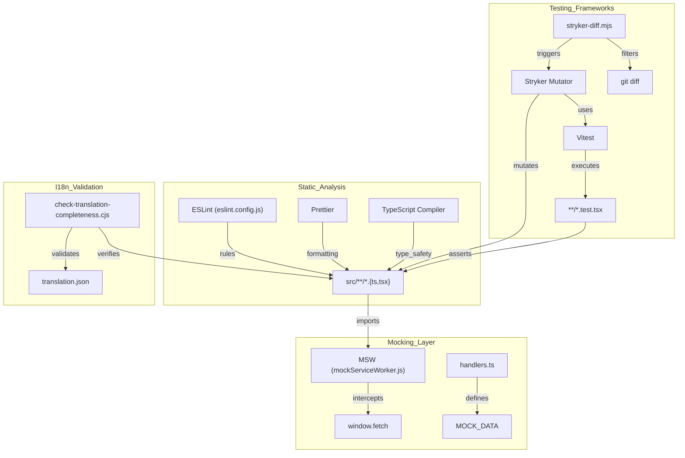
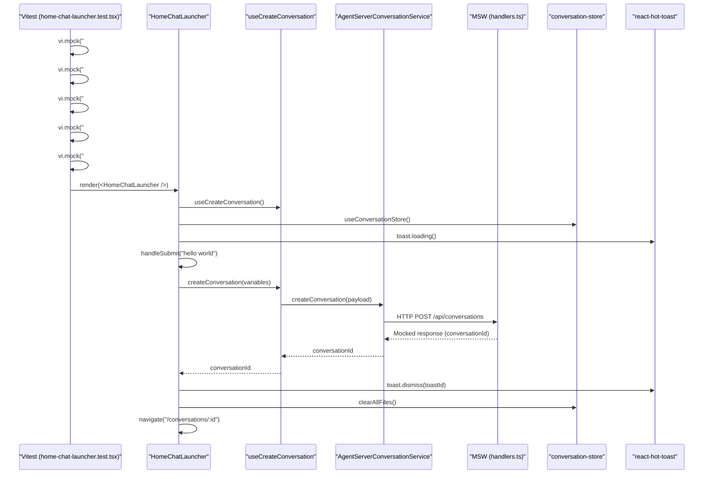

<!-- source: DeepWiki mcp.deepwiki.com · repo All-Hands-AI/OpenHands · page 13.4 Code Quality and Testing Infrastructure · fetched 2026-10-26 -->

# Code Quality and Testing Infrastructure

Relevant source files

The following files were used as context for generating this wiki page:

- [.agents/skills/custom-codereview-guide.md](.agents/skills/custom-codereview-guide.md)
- [.github/pr-assets/issue-17168-oh-git-ref-default-evidence.png](.github/pr-assets/issue-17168-oh-git-ref-default-evidence.png)
- [.screenshots/progress-event-fix.png](.screenshots/progress-event-fix.png)
- [__tests__/api/agent-profiles-service/profile-field-support.test.ts](__tests__/api/agent-profiles-service/profile-field-support.test.ts)
- [__tests__/api/backend-registry/storage.test.ts](__tests__/api/backend-registry/storage.test.ts)
- [__tests__/api/llm-subscription-service.test.ts](__tests__/api/llm-subscription-service.test.ts)
- [__tests__/api/to-app-conversation-session-key.test.ts](__tests__/api/to-app-conversation-session-key.test.ts)
- [__tests__/components/home/llm-not-configured-banner.test.tsx](__tests__/components/home/llm-not-configured-banner.test.tsx)
- [__tests__/components/settings/agent-profiles/merge-agent-profile-save-input.test.ts](__tests__/components/settings/agent-profiles/merge-agent-profile-save-input.test.ts)
- [__tests__/contexts/active-backend-context.test.tsx](__tests__/contexts/active-backend-context.test.tsx)
- [__tests__/e2e/resolve-affected-tests.test.ts](__tests__/e2e/resolve-affected-tests.test.ts)
- [__tests__/hooks/query/use-agent-settings-schema.test.tsx](__tests__/hooks/query/use-agent-settings-schema.test.tsx)
- [__tests__/scripts/stryker-diff.test.ts](__tests__/scripts/stryker-diff.test.ts)
- [__tests__/scripts/stryker-setup.test.ts](__tests__/scripts/stryker-setup.test.ts)
- [__tests__/vite-config.test.ts](__tests__/vite-config.test.ts)
- [__tests__/vitest-setup-progress-event.test.ts](__tests__/vitest-setup-progress-event.test.ts)
- [docs/DEVELOPMENT.md](docs/DEVELOPMENT.md)
- [docs/DefenseClaw.md](docs/DefenseClaw.md)
- [eslint.config.js](eslint.config.js)
- [public/mockServiceWorker.js](public/mockServiceWorker.js)
- [scripts/stryker-diff.mjs](scripts/stryker-diff.mjs)
- [specs/backend-management.md](specs/backend-management.md)
- [src/api/agent-profiles-service/profile-field-support.ts](src/api/agent-profiles-service/profile-field-support.ts)
- [src/api/backend-registry/auth.ts](src/api/backend-registry/auth.ts)
- [src/api/backend-registry/default-backend.ts](src/api/backend-registry/default-backend.ts)
- [src/api/backend-registry/storage.ts](src/api/backend-registry/storage.ts)
- [src/api/backend-registry/types.ts](src/api/backend-registry/types.ts)
- [src/api/llm-balance-service.test.ts](src/api/llm-balance-service.test.ts)
- [src/api/llm-balance-service.ts](src/api/llm-balance-service.ts)
- [src/api/llm-subscription-service.ts](src/api/llm-subscription-service.ts)
- [src/api/no-direct-agent-server-calls.test.ts](src/api/no-direct-agent-server-calls.test.ts)
- [src/contexts/active-backend-context.tsx](src/contexts/active-backend-context.tsx)
- [src/hooks/query/use-cloud-current-user-id.ts](src/hooks/query/use-cloud-current-user-id.ts)
- [src/hooks/query/use-cloud-organizations.ts](src/hooks/query/use-cloud-organizations.ts)
- [src/mocks/agent-profiles-handlers.ts](src/mocks/agent-profiles-handlers.ts)
- [src/mocks/handlers.ts](src/mocks/handlers.ts)
- [src/stores/btw-store.ts](src/stores/btw-store.ts)
- [stryker.config.mjs](stryker.config.mjs)
- [vitest.setup.ts](vitest.setup.ts)

This document describes the code quality enforcement and testing infrastructure for the OpenHands Agent Canvas. It covers linting, unit testing with Vitest, mutation testing with Stryker, network mocking with MSW, and internationalization validation.

---

## Overview

The OpenHands Agent Canvas maintains high code quality through a multi-layered verification pipeline. This includes static analysis (ESLint, TypeScript), dynamic unit testing (Vitest), and resilience verification (Stryker Mutation Testing). The infrastructure is designed to support both standalone development and library-mode embedding.

### System Architecture: Quality & Testing

The following diagram maps quality tools to the code entities they govern.

**Diagram: Testing and Quality Infrastructure Mapping**

**Sources**: [scripts/stryker-diff.mjs:1-20](), [stryker.config.mjs:1-20](), [public/mockServiceWorker.js:91-117](), [scripts/check-translation-completeness.cjs:1-7]()

---

## Static Analysis and Linting

The project uses a modern ESLint flat configuration (ESLint 9+) via `eslint.config.js` [eslint.config.js:1-5](). This configuration drops legacy Airbnb presets in favor of explicit, maintainable rules and native flat-config plugins like `eslint-plugin-import-x` [eslint.config.js:6-15]().

### Key Linting Rules
- **Direct API Call Prevention**: A custom local rule `no-direct-agent-server-fetch` forbids raw `fetch` calls to `/api/...` paths, forcing developers to use the typed `@openhands/typescript-client` [eslint.config.js:56-95]().
- **Unused Directives**: The linter warns on unused `eslint-disable` comments to keep the codebase clean [eslint.config.js:135-137]().
- **PostHog & TanStack**: Specific plugins ensure correct usage of `@tanstack/query` and React hooks [eslint.config.js:152-162]().

### Automated Enforcement
A specialized test `src/api/no-direct-agent-server-calls.test.ts` scans the entire `src/` directory to ensure no files (outside of a small allowlist) use `axios` or `fetch` directly for agent-server communication [src/api/no-direct-agent-server-calls.test.ts:32-80](). The script `collectSourceFiles` recursively walks the source tree while respecting `EXCLUDED_SEGMENTS` like `mocks` and generated route trees [src/api/no-direct-agent-server-calls.test.ts:13-30]().

**Sources**: [eslint.config.js:1-171](), [src/api/no-direct-agent-server-calls.test.ts:1-80]()

---

## Unit Testing with Vitest

Vitest is the primary unit testing runner, configured to handle React components, hooks, and browser APIs.

### Test Implementation Patterns
Tests utilize `QueryClientProvider` to wrap components that rely on TanStack Query hooks, ensuring a clean cache for every test case [__tests__/components/home/llm-not-configured-banner.test.tsx:35-38]().

- **Global Mocks**: `vitest.setup.ts` provides global mocks for browser APIs like `HTMLCanvasElement.prototype.getContext` [vitest.setup.ts:11-13](), `HTMLElement.prototype.scrollTo` [vitest.setup.ts:15-17](), `window.scrollTo` [vitest.setup.ts:25-25](), `localStorage` [vitest.setup.ts:30-50](), and `requestAnimationFrame` [vitest.setup.ts:53-60](). It also includes a fallback for `ProgressEvent` to prevent issues with MSW's XMLHttpRequest interceptor during test teardown [vitest.setup.ts:62-125]().
- **Module Mocks**: Tests use `vi.mock` to isolate UI from network logic. For example, `HomeChatLauncher` tests mock `sendMessageWithAttachments` and `enqueueHomeTaskPendingMessage` [__tests__/components/home/llm-not-configured-banner.test.tsx:12-15]().
- **Environment Variables**: `vitest.setup.ts` stubs `VITE_SESSION_API_KEY` to `test-session-key` before each test to ensure consistent environment variable access [vitest.setup.ts:9-9]().

**Sources**: [vitest.setup.ts:1-184](), [__tests__/components/home/llm-not-configured-banner.test.tsx:1-196]()

---

## Mutation Testing with Stryker

Mutation testing measures test suite effectiveness by introducing "mutants" (bugs) into the source code and checking if tests fail (kill the mutant).

### Incremental and Diff Runs
Because full mutation runs are expensive, the project uses `scripts/stryker-diff.mjs` to target only changed files [docs/DEVELOPMENT.md:136-158]().
- **`stryker-diff.mjs`**: This script calculates a `git diff` against a base branch (defaulting to `main`), filters for production TypeScript files, and passes them to Stryker's `--mutate` flag [scripts/stryker-diff.mjs:66-117]().
- **Exclusion Logic**: The script automatically ignores test files, mocks, fixtures, and generated code to avoid wasting resources on non-production logic [scripts/stryker-diff.mjs:7-18]().
- **Configuration**: `stryker.config.mjs` specifies Vitest as the test runner and enables `related: true` to run only tests affected by the mutated file [stryker.config.mjs:1-22]().

**Sources**: [scripts/stryker-diff.mjs:1-127](), [stryker.config.mjs:1-22](), [docs/DEVELOPMENT.md:136-158]()

---

## API Mocking with MSW

Mock Service Worker (MSW) provides a network-level interceptor for both development and testing.

### Mock Infrastructure
- **Service Worker**: `public/mockServiceWorker.js` intercepts browser `fetch` requests and routes them to defined handlers [public/mockServiceWorker.js:91-117](). It uses a `handleRequest` function to resolve the main client and send response clones for lifecycle events [public/mockServiceWorker.js:124-179]().
- **Client Management**: The worker tracks active client IDs to ensure it only handles requests from windows that have registered the mocking layer [public/mockServiceWorker.js:59-72]().
- **Mock Mode**: `npm run dev:mock` enables these handlers in the browser, allowing the frontend to run without a live backend [docs/DEVELOPMENT.md:114-120]().
- **Centralized Handlers**: `src/mocks/handlers.ts` aggregates all mock handlers from various modules (e.g., `FILE_SERVICE_HANDLERS`, `SECRETS_HANDLERS`, `AGENT_PROFILES_HANDLERS`) into a single array for MSW to use [src/mocks/handlers.ts:1-46]().
- **Agent Profile Handlers**: `src/mocks/agent-profiles-handlers.ts` defines mock HTTP handlers for the agent-server `/api/agent-profiles` endpoints, including listing, fetching, renaming, and activating profiles. It uses an in-memory store (`profiles` Map) and provides `resetMockAgentProfiles` and `seedMockAgentProfiles` functions for test setup [src/mocks/agent-profiles-handlers.ts:1-245]().
- **Test Verification**: Tests like `__tests__/components/home/llm-not-configured-banner.test.tsx` use `vi.spyOn` to mock service API calls (e.g., `OptionService.getConfig`, `ProfilesService.listProfiles`, `AgentProfilesService.listProfiles`) to control the state of the application under test [__tests__/components/home/llm-not-configured-banner.test.tsx:85-89]().

**Sources**: [public/mockServiceWorker.js:1-179](), [docs/DEVELOPMENT.md:114-120](), [src/mocks/handlers.ts:1-60](), [src/mocks/agent-profiles-handlers.ts:1-245](), [__tests__/components/home/llm-not-configured-banner.test.tsx:1-196]()

---

## Translation and i18n Validation

The `scripts/check-translation-completeness.cjs` script ensures internationalization integrity by verifying `translation.json`.

### Validation Logic
- **Completeness**: The `checkTranslations` function ensures all translation keys have entries for all supported languages extracted from the i18n index [scripts/check-translation-completeness.cjs:73-136]().
- **Untranslated Key Detection**: Flags keys where every non-English value is identical to the English value, suggesting a missing translation [scripts/check-translation-completeness.cjs:121-132]().
- **Allowlist**: Brands and technical terms (e.g., `BRANDING$OPENHANDS`, `SETTINGS$MCP_SERVER_TYPE_SSE`, `CONVERSATION$OVERVIEW_GIT`) are exempted via `IDENTICAL_VALUE_ALLOWLIST` [scripts/check-translation-completeness.cjs:15-70]().

**Sources**: [scripts/check-translation-completeness.cjs:1-192]()

---

## Data Flow: Component Testing and Service Mocking

**Diagram: Test Execution and API Interaction**

**Sources**: [__tests__/components/home/llm-not-configured-banner.test.tsx:1-196](), [src/components/features/home/home-chat-launcher.tsx:1-149](), [src/mocks/handlers.ts:1-46]()

---

