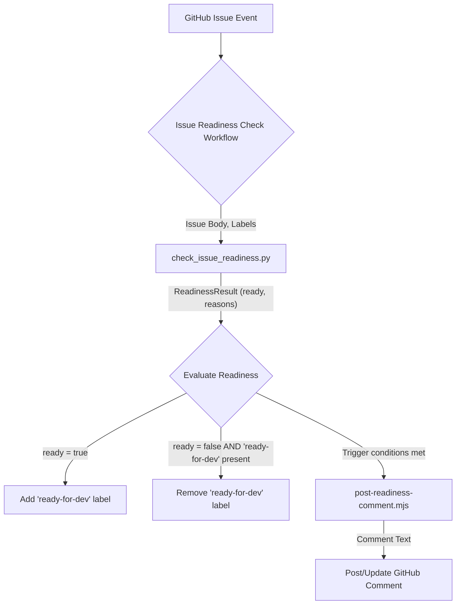

<!-- source: DeepWiki mcp.deepwiki.com · repo All-Hands-AI/OpenHands · page 13.5 Repository Governance Automation · fetched 2026-10-26 -->

# Repository Governance Automation

<details>
<summary>Relevant source files</summary>

The following files were used as context for generating this wiki page:

- [.dockerignore](.dockerignore)
- [.github/ISSUE_TEMPLATE/bug_report.yml](.github/ISSUE_TEMPLATE/bug_report.yml)
- [.github/ISSUE_TEMPLATE/feature_request.yml](.github/ISSUE_TEMPLATE/feature_request.yml)
- [.github/dependabot.yml](.github/dependabot.yml)
- [.github/pull_request_template.md](.github/pull_request_template.md)
- [.github/scripts/check_issue_readiness.py](.github/scripts/check_issue_readiness.py)
- [.github/scripts/check_pr_description.py](.github/scripts/check_pr_description.py)
- [.github/scripts/markdown_sections.py](.github/scripts/markdown_sections.py)
- [.github/scripts/post-readiness-comment.mjs](.github/scripts/post-readiness-comment.mjs)
- [.github/scripts/tests/__init__.py](.github/scripts/tests/__init__.py)
- [.github/scripts/tests/test_issue_readiness.py](.github/scripts/tests/test_issue_readiness.py)
- [.github/scripts/tests/test_markdown_sections.py](.github/scripts/tests/test_markdown_sections.py)
- [.github/scripts/tests/test_pr_description.py](.github/scripts/tests/test_pr_description.py)
- [.github/workflows/ci-script-tests.yml](.github/workflows/ci-script-tests.yml)
- [.github/workflows/issue-duplicate-checker.yml](.github/workflows/issue-duplicate-checker.yml)
- [.github/workflows/issue-readiness-check.yml](.github/workflows/issue-readiness-check.yml)
- [.github/workflows/pr-artifacts.yml](.github/workflows/pr-artifacts.yml)
- [.github/workflows/pr-description-check.yml](.github/workflows/pr-description-check.yml)
- [.github/workflows/remove-duplicate-candidate-label.yml](.github/workflows/remove-duplicate-candidate-label.yml)
- [.gitignore](.gitignore)
- [__tests__/bin/agent-canvas.test.ts](__tests__/bin/agent-canvas.test.ts)
- [bin/agent-canvas.mjs](bin/agent-canvas.mjs)

</details>


This page details the automated governance mechanisms implemented in the OpenHands repository. These mechanisms leverage GitHub Actions and custom Python/JavaScript scripts to enforce quality standards, streamline development workflows, and maintain a consistent contributor experience. The automation covers pull request validation, issue readiness checks, duplicate issue detection, and dependency management.

## Pull Request Description Validation

The `PR Description Check` workflow [.github/workflows/pr-description-check.yml]() ensures that pull requests adhere to a predefined structure and content requirements, especially for human and AI agent contributions. This helps maintain high-quality documentation and provides necessary context for reviewers.

### Workflow Trigger and Permissions

The workflow is triggered on various `pull_request_target` events, including `opened`, `edited`, `reopened`, `ready_for_review`, and `synchronize` [.github/workflows/pr-description-check.yml:8-9](). This ensures that PR descriptions are validated throughout their lifecycle. It runs with `contents: read`, `pull-requests: read`, and `issues: read` permissions [.github/workflows/pr-description-check.yml:11-13]().

### Validation Logic

The core validation is performed by the `check_pr_description.py` script [.github/scripts/check_pr_description.py](). This script checks several criteria:

1.  **Required Template Fields**: Ensures that the "Why", "Summary", and "How to Test" sections are present and contain content [.github/scripts/check_pr_description.py:39-40]().
2.  **Human Note Check**: If a "HUMAN:" section is present, it verifies that a human-written note of at least 20 characters is provided [.github/scripts/check_pr_description.py:39,146-163]().
3.  **Frontend Evidence**: If the PR touches frontend code (determined by file paths or extensions like `.tsx`, `.jsx`, `.css`, etc. [.github/scripts/check_pr_description.py:48-68]()), the description must include a screenshot or video [.github/scripts/check_pr_description.py:8-9]().
4.  **Bug Fix Evidence**: For PRs marked as "Bug fix", a screenshot or video showing reproduction evidence is mandatory, regardless of whether frontend code was touched [.github/scripts/check_pr_description.py:10-12]().
5.  **Linked Issue Readiness**: The PR must reference at least one issue (e.g., `Fixes #123`) [.github/scripts/check_pr_description.py:13-15](). At least one of these linked issues must carry the `ready-for-dev` label [.github/scripts/check_pr_description.py:15-16]().
6.  **PR Type vs. Issue Label Consistency**: The selected PR type (e.g., "Bug fix", "Feature") must align with the labels of the linked issue (e.g., "bug", "enhancement") [.github/scripts/check_pr_description.py:17-19]().

The script uses regular expressions to parse the PR body and extract relevant sections and checkboxes [.github/scripts/check_pr_description.py:42-115](). The `visible_text` function [.github/scripts/check_pr_description.py:118-125]() filters out HTML comments and placeholder text. The `extract_sections` function [.github/scripts/check_pr_description.py:136-143]() uses `markdown_sections.find_headings` to parse the markdown structure.

### Data Flow

```mermaid
graph TD
    A[GitHub PR Event] --> B{PR Description Check Workflow};
    B --> C[Checkout trusted workflow scripts];
    C --> D[Fetch changed file paths];
    D -- pr-files.txt --> E[check_pr_description.py];
    E -- GITHUB_TOKEN, PR Body --> F{Validate PR Description};
    F -- Issue Numbers --> G[Fetch Issue Labels (GitHub API)];
    G -- Issue Labels --> F;
    F -- Validation Results --> H{Workflow Status (Pass/Fail)};
```

**Diagram: PR Description Validation Data Flow**

Sources:
- .github/workflows/pr-description-check.yml
- .github/scripts/check_pr_description.py

## Issue Readiness Automation

The `Issue Readiness Check` workflow [.github/workflows/issue-readiness-check.yml]() automates the management of the `ready-for-dev` label on issues. This label signifies that an issue has met specific criteria, making it ready for development.

### Workflow Trigger and Permissions

This workflow is triggered on `issues` events (`opened`, `edited`, `reopened`, `labeled`, `unlabeled`) [.github/workflows/issue-readiness-check.yml:26-27](). It requires `issues: write` and `contents: read` permissions [.github/workflows/issue-readiness-check.yml:29-30](). The `concurrency` setting ensures that only one check runs per issue at a time [.github/workflows/issue-readiness-check.yml:33-35]().

### Readiness Criteria

The `check_issue_readiness.py` script [.github/scripts/check_issue_readiness.py]() defines the readiness criteria, which are type-specific:

*   **Bug Reports** (inferred from sections like `Steps to Reproduce` or `Actual Behavior`):
    *   `Steps to Reproduce` section must reference a supported run method (`agent-canvas`, `npm run`, or `app.all-hands.dev/canvas`) [.github/scripts/check_issue_readiness.py:5-7,178-191]().
    *   `Actual Behavior` section must embed a screenshot or video [.github/scripts/check_issue_readiness.py:7-8,192-196]().
    *   `Acceptance Criteria` section must be non-empty and contain at least one checklist item [.github/scripts/check_issue_readiness.py:8-9,197-201]().
*   **Enhancements** (inferred from a `Desired Behavior` section):
    *   `Desired Behavior` section must be non-empty [.github/scripts/check_issue_readiness.py:11-12,206-210]().
    *   `Acceptance Criteria` section must be non-empty and contain at least one checklist item [.github/scripts/check_issue_readiness.py:12-13,211-215]().

The script uses `markdown_sections.find_headings` to parse issue sections [.github/scripts/check_issue_readiness.py:117-142]() and helper functions like `has_screenshot_or_video` [.github/scripts/check_issue_readiness.py:153-166](), `references_run_method` [.github/scripts/check_issue_readiness.py:178-179](), and `has_checklist_item` [.github/scripts/check_issue_readiness.py:173]() to evaluate the content.

### Label Management and Feedback

Based on the readiness evaluation, the workflow adds or removes the `ready-for-dev` label [.github/workflows/issue-readiness-check.yml:60-88](). It also posts or updates a feedback comment using `post-readiness-comment.mjs` [.github/scripts/post-readiness-comment.mjs]() in specific scenarios:
*   When an issue is opened or reopened.
*   When the `ready-for-dev` label is added (issue becomes ready).
*   When the `ready-for-dev` label is removed (issue was ready but no longer is) [.github/workflows/issue-readiness-check.yml:90-96]().

This ensures contributors receive clear, automated feedback on their issue's readiness status.

### Issue Readiness Automation Flow



**Diagram: Issue Readiness Automation Flow**

Sources:
- .github/workflows/issue-readiness-check.yml
- .github/scripts/check_issue_readiness.py
- .github/scripts/post-readiness-comment.mjs

## Markdown Section Parsing Utility

The `markdown_sections.py` script [.github/scripts/markdown_sections.py]() is a utility used by both `check_pr_description.py` and `check_issue_readiness.py` to parse markdown content.

### Key Functions

*   `find_headings(text: str, heading_re: re.Pattern) -> list[re.Match]`: This function takes markdown text and a regular expression for headings, returning a list of regex matches for each heading found. It's crucial for breaking down PR descriptions and issue bodies into logical sections.
*   `without_fenced_code_blocks(text: str) -> str`: This function removes content within markdown fenced code blocks (```) from the input text. This is important for validation scripts to ignore code examples or template snippets that might contain keywords or structures that would otherwise trigger false positives in checks. For example, a `## How to Test` heading inside a code block should not be treated as a real section heading [test_pr_description.py:26-35]().

Sources:
- .github/scripts/markdown_sections.py
- .github/scripts/tests/test_pr_description.py

## Duplicate Issue Labeling Workflows

The repository employs workflows to detect and manage duplicate issues, helping to keep the issue tracker clean and focused.

### `Issue Duplicate Check via OpenHands Cloud`

This workflow [.github/workflows/issue-duplicate-checker.yml]() uses an external `OpenHands/extensions/plugins/issue-duplicate-checker` action to identify potential duplicate issues.

*   **Trigger**: It runs when new issues are `opened` [.github/workflows/issue-duplicate-checker.yml:5-6]() and on a `weekly schedule` [.github/workflows/issue-duplicate-checker.yml:8](). It can also be triggered manually via `workflow_dispatch` [.github/workflows/issue-duplicate-checker.yml:9-29]().
*   **Functionality**:
    *   `issue-duplicate-check` job: When an issue is opened or manually triggered, this job runs the duplicate checker plugin. It uses the `OPENHANDS_API_KEY` and `github.token` to interact with the OpenHands Cloud service and GitHub API [.github/workflows/issue-duplicate-checker.yml:57-74]().
    *   `auto-close-duplicates` job: This job runs on a schedule or manual trigger to automatically close issues that have been labeled `duplicate-candidate` for a specified number of days [.github/workflows/issue-duplicate-checker.yml:77-92]().

### `Remove duplicate candidate label on activity`

This workflow [.github/workflows/remove-duplicate-candidate-label.yml]() prevents issues from being automatically closed if there's recent human activity.

*   **Trigger**: It's triggered when a new `issue_comment` is `created` [.github/workflows/remove-duplicate-candidate-label.yml:5-6]().
*   **Functionality**: If an issue has the `duplicate-candidate` label and a non-bot user comments on it (excluding specific bot comments), this workflow removes the `duplicate-candidate` label [.github/workflows/remove-duplicate-candidate-label.yml:17-23,27-31](). This indicates that the issue is still active and should not be automatically closed.

Sources:
- .github/workflows/issue-duplicate-checker.yml
- .github/workflows/remove-duplicate-candidate-label.yml

## Issue and Pull Request Templates

The repository provides standardized templates for issues and pull requests to guide contributors in providing necessary information.

### Pull Request Template

The `.github/pull_request_template.md` file [.github/pull_request_template.md]() defines the structure for all new pull requests. It includes sections for:

*   **HUMAN:** A short note from human contributors about testing [.github/pull_request_template.md:3-6]().
*   **AGENT:** Instructions for AI/LLM agents to summarize changes, link artifacts, and provide evidence of end-to-end testing [.github/pull_request_template.md:9-19]().
*   **Why:** Motivation and problem description [.github/pull_request_template.md:21-23]().
*   **Summary:** 1-3 bullet points describing changes [.github/pull_request_template.md:25-28]().
*   **Issue Number:** Required link to a `ready-for-dev` labeled issue [.github/pull_request_template.md:30-35]().
*   **How to Test:** Required steps for reviewers to test the PR [.github/pull_request_template.md:37-43]().
*   **Video/Screenshots:** Required visual evidence of testing or bug reproduction [.github/pull_request_template.md:45-53]().
*   **Type:** Checkboxes for Bug fix, Feature, Refactor, Breaking change, Docs / chore [.github/pull_request_template.md:55-61]().
*   **Notes:** Optional section for additional context [.github/pull_request_template.md:63-65]().

This template is enforced by the `PR Description Check` workflow.

### Issue Templates

The repository uses GitHub Issue Forms for structured issue reporting.

*   **Bug Report:** The `.github/ISSUE_TEMPLATE/bug_report.yml` file [.github/ISSUE_TEMPLATE/bug_report.yml]() defines the template for bug reports. It collects information such as:
    *   Operating System, Installation Method, Agent Canvas Version [.github/ISSUE_TEMPLATE/bug_report.yml:11-43]().
    *   Bug Description, Steps to Reproduce (with specific requirements for `ready-for-dev` label) [.github/ISSUE_TEMPLATE/bug_report.yml:45-71]().
    *   Actual Behavior (requiring screenshot/video for `ready-for-dev`), Expected Behavior [.github/ISSUE_TEMPLATE/bug_report.yml:73-97]().
    *   Relevant Logs, Acceptance Criteria (required for `ready-for-dev` with checklist items), Screenshots, Additional Context [.github/ISSUE_TEMPLATE/bug_report.yml:99-135]().
*   **Feature Request:** The `.github/ISSUE_TEMPLATE/feature_request.yml` file (not fully shown but implied by context) would define a similar structured form for feature requests, likely including sections for desired behavior and acceptance criteria.

These templates are enforced by the `Issue Readiness Check` workflow.

Sources:
- .github/pull_request_template.md
- .github/ISSUE_TEMPLATE/bug_report.yml
- .github/ISSUE_TEMPLATE/feature_request.yml

## Dependabot Configuration

The `.github/dependabot.yml` file [.github/dependabot.yml]() configures Dependabot to automate dependency updates for `npm` packages and `GitHub Actions`.

### npm Package Updates

*   **Ecosystem**: `npm` [.github/dependabot.yml:3]().
*   **Directory**: Root directory (`/`) [.github/dependabot.yml:4]().
*   **Schedule**: Weekly on Monday at 09:00 UTC [.github/dependabot.yml:5-9]().
*   **Cooldown**: 7 days [.github/dependabot.yml:10-11]().
*   **Versioning Strategy**: `increase` [.github/dependabot.yml:12]().
*   **PR Limit**: 10 open pull requests [.github/dependabot.yml:13]().
*   **Commit Message**: Prefixed with `chore` and includes scope [.github/dependabot.yml:14-16]().
*   **Labels**: `dependencies`, `npm` [.github/dependabot.yml:17-18]().
*   **Grouping**: Related packages are grouped into single PRs (e.g., `tailwind`, `tanstack`, `i18next`, `react`, `react-router`, `testing`, `eslint`, `monaco`, `xterm`, `types`) [.github/dependabot.yml:20-89](). This reduces PR noise for minor updates. High-impact dependencies are not grouped and get their own PRs.

### GitHub Actions Updates

*   **Ecosystem**: `github-actions` [.github/dependabot.yml:91]().
*   **Directory**: Root directory (`/`) [.github/dependabot.yml:92]().
*   **Schedule**: Weekly on Monday at 09:00 UTC [.github/dependabot.yml:93-97]().
*   **Cooldown**: 7 days [.github/dependabot.yml:98-99]().
*   **PR Limit**: 5 open pull requests [.github/dependabot.yml:100]().
*   **Commit Message**: Prefixed with `ci` and includes scope [.github/dependabot.yml:101-103]().
*   **Labels**: `dependencies`, `github-actions` [.github/dependabot.yml:104-106]().
*   **Grouping**: All GitHub Actions are grouped into a single PR labeled `actions` [.github/dependabot.yml:107-110]().

Sources:
- .github/dependabot.yml

## .gitignore Conventions

The `.gitignore` file [.gitignore]() specifies intentionally untracked files that Git should ignore. This is crucial for maintaining a clean repository, preventing sensitive information from being committed, and avoiding unnecessary build artifacts in version control.

Key categories of ignored files include:

*   **Build and Compilation Artifacts**:
    *   `public/locales/**/*`, `src/i18n/declaration.ts`: Generated i18n translation files [.gitignore:1-2]().
    *   `node_modules/`: Directory for npm dependencies [.gitignore:6]().
    *   `build/`, `dist/`: Output directories for compiled code [.gitignore:7,14]().
    *   `__pycache__`: Python bytecode cache files [.gitignore:15]().
    *   `build-fresh/`: Local runtime artifacts [.gitignore:38]().
*   **Local Development and Environment Files**:
    *   `.env`, `.envrc`: Environment variable files, often containing sensitive keys [.gitignore:4-5]().
    *   `logs/`: Log files generated during development or runtime [.gitignore:8]().
    *   `workspace/`: Local runtime artifacts produced by `static-server` / `agent-server` runs [.gitignore:37]().
*   **Testing Artifacts**:
    *   `.tmp/`, `/.tmp/live-e2e-state/`: Scratch space for local E2E runs, including mock-LLM state and unignored `secrets.json` [.gitignore:9-13]().
    *   `/test-results/`, `/test-results-live/`, `/test-results-mock-llm/`, `/test-results-mock-llm-docker/`: Directories for test reports [.gitignore:18-21]().
    *   `/.mock-llm-markers/`: Mock LLM markers [.gitignore:22]().
    *   `/playwright-report/`, `/playwright-report-live/`, `/playwright-report-mock-llm/`, `/playwright-report-mock-llm-docker/`: Playwright test reports [.gitignore:23-26]().
    *   `/blob-report/`: Blob reports [.gitignore:27]().
    *   `/playwright/.cache/`: Playwright cache [.gitignore:28]().
    *   `/.stryker-tmp/`: Stryker mutation testing temporary files [.gitignore:29]().
    *   `/reports/`: General reports directory [.gitignore:30]().
*   **IDE and Tooling Specific Files**:
    *   `.react-router/`: React Router specific files [.gitignore:31]().
    *   `ralph/`: (Context-specific, likely a tool or local setup) [.gitignore:32]().
    *   `.vercel`: Vercel deployment configuration/cache [.gitignore:33]().
*   **Distribution and Packaging**:
    *   `*.tgz`: Tarball archives, typically for npm packages [.gitignore:34]().
    *   `/dist-electron/`: Electron desktop build outputs [.gitignore:41]().
    *   `/resources/bin/`, `/resources/node/`: Downloaded UV binary and Node.js distribution for Electron packaging [.gitignore:43-45]().

These conventions ensure that only relevant source code and configuration files are tracked in the repository, improving collaboration and security.

Sources:
- .gitignore

---

