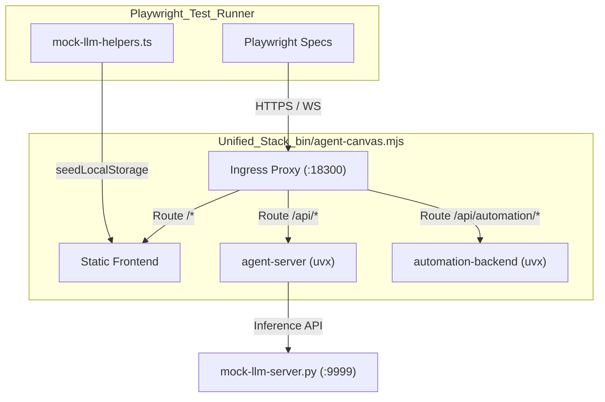
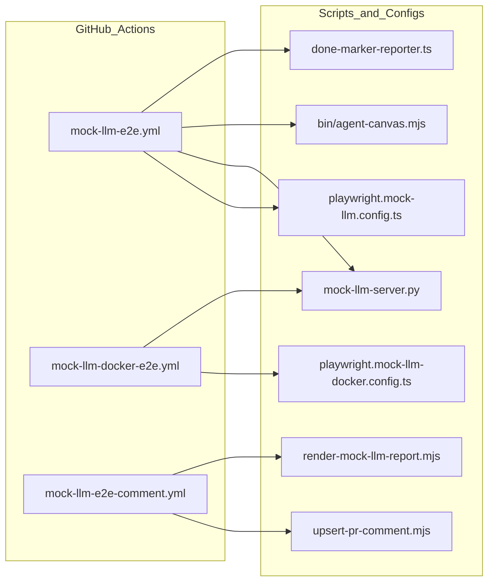

<!-- source: DeepWiki mcp.deepwiki.com · repo All-Hands-AI/OpenHands · page 14 End-to-End Testing · fetched 2026-10-26 -->

# End-to-End Testing

Relevant source files

The following files were used as context for generating this wiki page:

- [.github/pr-assets/pr-16970-terminal-verification.svg](.github/pr-assets/pr-16970-terminal-verification.svg)
- [.github/workflows/ci.yml](.github/workflows/ci.yml)
- [.github/workflows/docker.yml](.github/workflows/docker.yml)
- [.github/workflows/mock-llm-docker-e2e.yml](.github/workflows/mock-llm-docker-e2e.yml)
- [.github/workflows/mock-llm-e2e.yml](.github/workflows/mock-llm-e2e.yml)
- [.github/workflows/npm-publish.yml](.github/workflows/npm-publish.yml)
- [docker/Dockerfile](docker/Dockerfile)
- [playwright.mock-llm-docker.config.ts](playwright.mock-llm-docker.config.ts)
- [playwright.mock-llm.config.ts](playwright.mock-llm.config.ts)
- [scripts/docker-build.mjs](scripts/docker-build.mjs)
- [tests/e2e/mock-llm/automations/mock-llm-automation.spec.ts](tests/e2e/mock-llm/automations/mock-llm-automation.spec.ts)
- [tests/e2e/mock-llm/reporters/done-marker-reporter.ts](tests/e2e/mock-llm/reporters/done-marker-reporter.ts)
- [tests/e2e/mock-llm/scripts/mock-llm-server.py](tests/e2e/mock-llm/scripts/mock-llm-server.py)
- [tests/e2e/mock-llm/scripts/render-mock-llm-report.mjs](tests/e2e/mock-llm/scripts/render-mock-llm-report.mjs)
- [tests/e2e/mock-llm/settings/mock-llm-profile-management.spec.ts](tests/e2e/mock-llm/settings/mock-llm-profile-management.spec.ts)
- [tests/e2e/mock-llm/utils/mock-llm-helpers.ts](tests/e2e/mock-llm/utils/mock-llm-helpers.ts)

OpenHands employs a multi-layered End-to-End (E2E) testing strategy designed to validate the full integration of the Agent Canvas frontend, the `agent-server` backend, and the automation sidecar. The strategy is split between **Mock-LLM tests** for fast, deterministic CI validation and **Live/ACP tests** for verifying real-world agent behavior and external protocol integrations.

## Testing Architecture

The E2E suite utilizes Playwright to drive a headless browser through the Agent Canvas UI. The system supports testing against both the local npm development stack and the containerized Docker distribution.

### Ingress and Process Orchestration
In the E2E environment, the system mirrors the production topology by using an ingress proxy to unify services. This ensures that the frontend and backend share the same origin, preventing CORS issues and accurately testing the routing logic. The `playwright.mock-llm.config.ts` manages the lifecycle of these processes [playwright.mock-llm.config.ts:116-165]().

| Service | Responsibility | E2E Port (Default) |
| :--- | :--- | :--- |
| **Ingress Proxy** | Routes `/api/*` to backend and `/*` to frontend | `18300` |
| **Mock LLM Server** | Python server using `openhands-sdk` TestLLM | `9999` |
| **Public Mode Server** | Secondary frontend instance with `--auth-required` | `18301` |

### System Integration Diagram

The following diagram illustrates how Playwright interacts with the unified stack during an E2E run, associating system roles with specific entrypoint scripts.

"E2E System Topology"

Sources: [playwright.mock-llm.config.ts:25-40](), [playwright.mock-llm.config.ts:116-126](), [tests/e2e/mock-llm/utils/mock-llm-helpers.ts:31-47]()

## Mock-LLM E2E Framework

The Mock-LLM framework is the primary gatekeeper for CI. It uses a specialized Python server (`mock-llm-server.py`) to provide deterministic, instant responses to agent requests [playwright.mock-llm.config.ts:117-125](). This allows the suite to test complex "trajectories" (sequences of agent actions and observations) without incurring LLM costs or latency.

### Key Capabilities
- **Deterministic Trajectories**: Pre-defined agent behaviors are registered using tokens like `BASH_TOKEN` and `REPLY_TOKEN` to test specific UI flows [tests/e2e/mock-llm/utils/mock-llm-helpers.ts:11-18]().
- **Auth Mode Validation**: Validates session-key injection and "Public Mode" behavior where `X-Session-API-Key` is required [playwright.mock-llm.config.ts:36-46](), [tests/e2e/mock-llm/utils/mock-llm-helpers.ts:121-133]().
- **State Seeding**: Uses `seedLocalStorage` and `seedBackendAnalyticsConsent` to bypass onboarding and telemetry modals [tests/e2e/mock-llm/utils/mock-llm-helpers.ts:73-119]().
- **Automation Lifecycle**: Validates the full automation flow, including cron creation and run status polling against the real automation backend [playwright.mock-llm.config.ts:156-164](). For example, the `mock-llm-automation.spec.ts` test creates and dispatches an automation run, then verifies its completion and conversation link [tests/e2e/mock-llm/automations/mock-llm-automation.spec.ts:27-37]().
- **Profile Management**: Tests scenarios like active profile deletion and reconciliation, and ensures correct profile identity when multiple profiles share the same model [tests/e2e/mock-llm/settings/mock-llm-profile-management.spec.ts:6-24]().

For implementation details on the `mock-llm-server.py` and Playwright configuration, see **[Mock-LLM E2E Framework](#14.1)**.

Sources: [tests/e2e/mock-llm/utils/mock-llm-helpers.ts:73-119](), [playwright.mock-llm.config.ts:117-125](), [playwright.mock-llm.config.ts:156-164](), [tests/e2e/mock-llm/automations/mock-llm-automation.spec.ts:27-37](), [tests/e2e/mock-llm/settings/mock-llm-profile-management.spec.ts:6-24]()

## Live and ACP E2E Tests

While Mock-LLM tests verify the UI and plumbing, Live and ACP tests verify the actual intelligence and protocol compliance of the agents.

### Live Suite
The Live suite runs against real LLM providers. These tests are triggered on specific PR labels (`live-e2e`) or via manual dispatch to avoid excessive costs [.github/workflows/ci.yml:83-88](). The `seedBackendAnalyticsConsent` helper is used to ensure the environment is ready for real interaction without blocking on modals [tests/e2e/mock-llm/utils/mock-llm-helpers.ts:73-94]().

### ACP (Agent Client Protocol)
The ACP tests validate the integration with external agents like Claude Code. These tests verify the `agent-server` subprocess model and credential injection through the Agent Canvas UI. The Docker E2E suite specifically mounts `mock-acp-server.py` into the container to test these flows in a containerized environment [playwright.mock-llm-docker.config.ts:118-130](). The `AgentSettingsScreen` component handles the configuration of ACP agents, including parsing and formatting commands [src/routes/agent-settings.tsx:39-40](), [src/routes/agent-settings.tsx:82-84](). The `AgentProfilesLocalView` component also manages ACP profiles, ensuring that `llm_profile_ref` is not included for ACP agents during save operations [src/components/features/settings/agent-profiles/agent-profiles-local-view.tsx:157-162](), [__tests__/components/settings/agent-profiles/agent-profiles-local-view.test.tsx:157-187]().

For details on the live test utilities and ACP-specific spec files, see **[Live and ACP E2E Tests](#14.2)**.

Sources: [.github/workflows/ci.yml:83-88](), [tests/e2e/mock-llm/utils/mock-llm-helpers.ts:73-94](), [playwright.mock-llm-docker.config.ts:118-130](), [src/routes/agent-settings.tsx:39-40](), [src/routes/agent-settings.tsx:82-84](), [src/components/features/settings/agent-profiles/agent-profiles-local-view.tsx:157-162](), [__tests__/components/settings/agent-profiles/agent-profiles-local-view.test.tsx:157-187]()

## CI/CD Integration

The E2E tests are integrated into the GitHub Actions pipeline via several specialized workflows that target different build artifacts. The `done-marker-reporter.ts` is used to signal completion in specific environments [playwright.mock-llm.config.ts:101-101]().

| Workflow | Purpose |
| :--- | :--- |
| **Mock-LLM E2E** | Runs the core suite against the npm/binary build path using `bin/agent-canvas.mjs` [.github/workflows/mock-llm-e2e.yml:1-6](). This workflow includes steps for setting up Node.js, installing npm dependencies, installing `uv`, and pre-warming the automation backend cache [.github/workflows/mock-llm-e2e.yml:73-129]().
| **Docker E2E** | Validates the final Docker image produced by the build pipeline against the same mock-LLM specs [.github/workflows/mock-llm-docker-e2e.yml:1-15](). This workflow uses `playwright.mock-llm-docker.config.ts` [playwright.mock-llm-docker.config.ts:1-146]() and includes logic to detect PR changes relevant to Docker E2E tests [.github/workflows/mock-llm-docker-e2e.yml:51-82]().
| **Live E2E** | Runs expensive tests against real LLM backends using real API keys [.github/workflows/ci.yml:83-106]().
| **Mock-LLM E2E: Post PR Comment** | Posts the Mock-LLM E2E test report as a PR comment, especially for fork PRs where the `pull_request` token is read-only [.github/workflows/mock-llm-e2e-comment.yml:1-11]().

### Code Entity Association Diagram

This diagram maps the CI workflow components to the specific scripts and configurations they execute in the codebase.

"CI to Code Mapping"

Sources: [playwright.mock-llm.config.ts:101-101](), [playwright.mock-llm.config.ts:117-125](), [playwright.mock-llm.config.ts:126-154](), [tests/e2e/mock-llm/reporters/done-marker-reporter.ts](), [.github/workflows/mock-llm-e2e.yml:1-6](), [.github/workflows/mock-llm-docker-e2e.yml:1-15](), [.github/workflows/mock-llm-e2e-comment.yml:1-11](), [tests/e2e/mock-llm/scripts/render-mock-llm-report.mjs](), [tests/e2e/mock-llm/scripts/upsert-pr-comment.mjs]()

---

