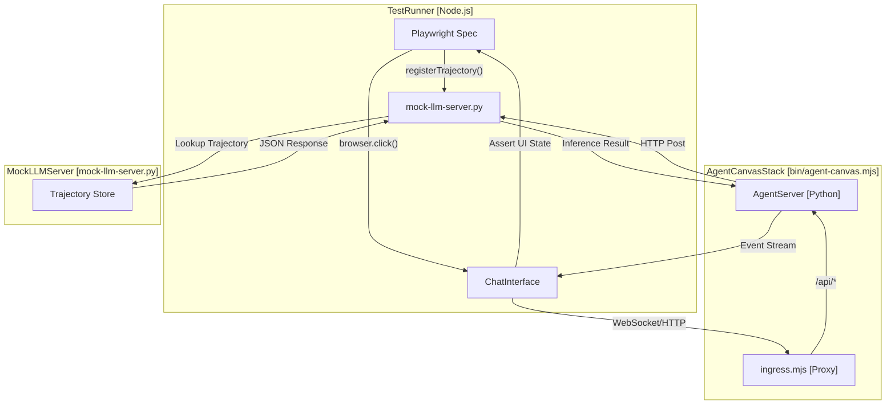
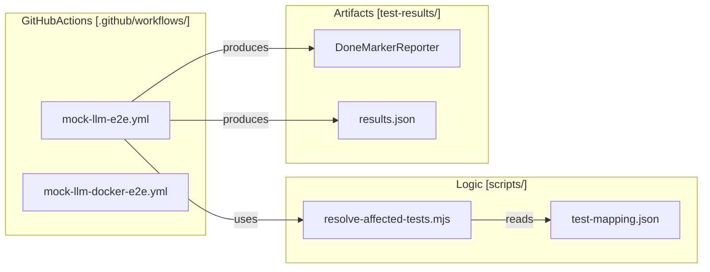

<!-- source: DeepWiki mcp.deepwiki.com · repo All-Hands-AI/OpenHands · page 14.1 Mock-LLM E2E Framework · fetched 2026-10-26 -->

# Mock-LLM E2E Framework

Relevant source files

The following files were used as context for generating this wiki page:

- [.github/pr-assets/pr-16970-terminal-verification.svg](.github/pr-assets/pr-16970-terminal-verification.svg)
- [.github/workflows/ci.yml](.github/workflows/ci.yml)
- [.github/workflows/docker.yml](.github/workflows/docker.yml)
- [.github/workflows/mock-llm-docker-e2e.yml](.github/workflows/mock-llm-docker-e2e.yml)
- [.github/workflows/mock-llm-e2e.yml](.github/workflows/mock-llm-e2e.yml)
- [.github/workflows/npm-publish.yml](.github/workflows/npm-publish.yml)
- [__tests__/components/features/conversation/conversation-mobile-panel-page.test.tsx](__tests__/components/features/conversation/conversation-mobile-panel-page.test.tsx)
- [__tests__/e2e/mock-llm-reporting.test.ts](__tests__/e2e/mock-llm-reporting.test.ts)
- [__tests__/hooks/query/use-task-polling.test.tsx](__tests__/hooks/query/use-task-polling.test.tsx)
- [__tests__/hooks/query/use-user-conversation.test.tsx](__tests__/hooks/query/use-user-conversation.test.tsx)
- [__tests__/routes/conversation-backend-switch.test.tsx](__tests__/routes/conversation-backend-switch.test.tsx)
- [docker/Dockerfile](docker/Dockerfile)
- [playwright.mock-llm-docker.config.ts](playwright.mock-llm-docker.config.ts)
- [playwright.mock-llm.config.ts](playwright.mock-llm.config.ts)
- [scripts/docker-build.mjs](scripts/docker-build.mjs)
- [src/components/features/conversation/conversation-main/conversation-mobile-panel-page.tsx](src/components/features/conversation/conversation-main/conversation-mobile-panel-page.tsx)
- [src/hooks/query/use-sub-conversations.ts](src/hooks/query/use-sub-conversations.ts)
- [src/hooks/query/use-task-polling.ts](src/hooks/query/use-task-polling.ts)
- [src/hooks/query/use-user-conversation.ts](src/hooks/query/use-user-conversation.ts)
- [src/routes/conversation.tsx](src/routes/conversation.tsx)
- [tests/e2e/mock-llm/automations/mock-llm-automation.spec.ts](tests/e2e/mock-llm/automations/mock-llm-automation.spec.ts)
- [tests/e2e/mock-llm/reporters/done-marker-reporter.ts](tests/e2e/mock-llm/reporters/done-marker-reporter.ts)
- [tests/e2e/mock-llm/scripts/mock-llm-server.py](tests/e2e/mock-llm/scripts/mock-llm-server.py)
- [tests/e2e/mock-llm/scripts/render-mock-llm-report.mjs](tests/e2e/mock-llm/scripts/render-mock-llm-report.mjs)
- [tests/e2e/mock-llm/scripts/upsert-pr-comment.mjs](tests/e2e/mock-llm/scripts/upsert-pr-comment.mjs)
- [tests/e2e/mock-llm/settings/mock-llm-profile-management.spec.ts](tests/e2e/mock-llm/settings/mock-llm-profile-management.spec.ts)
- [tests/e2e/mock-llm/utils/mock-llm-helpers.ts](tests/e2e/mock-llm/utils/mock-llm-helpers.ts)

The Mock-LLM E2E Framework provides a deterministic, cost-effective, and fast environment for testing the OpenHands Agent Canvas stack. It replaces real LLM providers with a local Python-based server that simulates agent trajectories, allowing for full end-to-end validation of the frontend, agent-server, and automation backend without incurring API costs or latency.

## Architecture Overview

The framework orchestrates three primary components:
1.  **Mock LLM Server**: A Python process (`mock-llm-server.py`) simulating an OpenAI-compatible API using `openhands-sdk` [tests/e2e/mock-llm/scripts/mock-llm-server.py:1-50]().
2.  **Agent Canvas Stack**: The production-ready entrypoint (`bin/agent-canvas.mjs`) including the `ingress.mjs` proxy, `static-server.mjs`, agent-server, and automation backend [playwright.mock-llm.config.ts:116-145]().
3.  **Playwright Test Runner**: Drives the browser and manages the lifecycle of the services via `playwright.mock-llm.config.ts` [playwright.mock-llm.config.ts:1-160]().

### Data Flow Diagram

The following diagram illustrates how a test interaction flows from the Playwright spec through the UI to the mock backend.

**Mock-LLM Request Pipeline**

Sources: [playwright.mock-llm.config.ts:106-156](), [tests/e2e/mock-llm/utils/mock-llm-helpers.ts:31-44](), [docker/Dockerfile:11-16]()

## Mock LLM Server (`mock-llm-server.py`)

The server is a Flask-based application that implements a subset of the OpenAI Chat Completions API. It uses `openhands-sdk`'s `TestLLM` logic to handle requests.

### Key Capabilities
*   **Trajectory Registration**: Tests can POST a sequence of "steps" (messages or tool calls) to `/register_trajectory` that the LLM will follow in order [tests/e2e/mock-llm/utils/mock-llm-helpers.ts:246-261]().
*   **State Reset**: The `/reset` endpoint clears all registered trajectories and history between test runs [tests/e2e/mock-llm/utils/mock-llm-helpers.ts:236-244]().
*   **Token-based Responses**: Common tokens like `MOCK_LLM_E2E_BASH_OK` and `MOCK_LLM_E2E_REPLY_OK` are used to trigger specific agent behaviors, such as successful command execution or text replies [tests/e2e/mock-llm/utils/mock-llm-helpers.ts:11-15]().

Sources: [tests/e2e/mock-llm/utils/mock-llm-helpers.ts:11-27](), [.github/workflows/mock-llm-e2e.yml:130-147](), [tests/e2e/mock-llm/scripts/mock-llm-server.py:1-50]()

## Test Helpers (`mock-llm-helpers.ts`)

A suite of TypeScript utilities provides the bridge between Playwright and the Mock-LLM administrative API.

| Function | Purpose |
| :--- | :--- |
| `registerTrajectory` | Sends a named sequence of LLM responses to the mock server [tests/e2e/mock-llm/utils/mock-llm-helpers.ts:246-261](). |
| `seedLocalStorage` | Pre-populates `localStorage` with `openhands-onboarded` and `openhands-backends` to skip onboarding and telemetry modals [tests/e2e/mock-llm/utils/mock-llm-helpers.ts:96-119](). |
| `ensureMockLLMProfile` | Uses the UI to create an LLM profile pointing to `MOCK_LLM_AGENT_URL` [tests/e2e/mock-llm/utils/mock-llm-helpers.ts:321-360](). |
| `waitForNonUserMessageText` | Polls the chat interface until a message from the agent contains specific text [tests/e2e/mock-llm/utils/mock-llm-helpers.ts:203-219](). |
| `routeSessionApiKey` | Intercepts Playwright requests to inject the `X-Session-API-Key` header for backend auth [tests/e2e/mock-llm/utils/mock-llm-helpers.ts:122-133](). |

Sources: [tests/e2e/mock-llm/utils/mock-llm-helpers.ts:1-360]()

## Playwright Configuration

The framework uses specialized configurations to mirror different deployment models.

### `playwright.mock-llm.config.ts`
This config targets the **npm-published binary** path. It uses `bin/agent-canvas.mjs` to launch the stack, which spawns the agent-server and automation backend via `uvx` [playwright.mock-llm.config.ts:116-145]().
*   **Isolation**: Uses a unique `STATE_DIR` (`.tmp/mock-llm-state`) and `AUTOMATION_DB_DIR` to prevent interference with local dev data [playwright.mock-llm.config.ts:48-53]().
*   **Wait Strategy**: Probes `http://localhost:${INGRESS_PORT}/api/automation/v1` to ensure the full stack, including the slow-starting automation backend, is ready [playwright.mock-llm.config.ts:146-155]().

### `playwright.mock-llm-docker.config.ts`
This config targets the **All-in-one Docker image**. It validates the containerized `entrypoint.sh`, ingress proxy, and service orchestration.
*   **Networking**: Configures `MOCK_LLM_AGENT_URL` to `http://host.docker.internal` so the container can reach the mock LLM server running on the CI host [tests/e2e/mock-llm/utils/mock-llm-helpers.ts:39-42]().
*   **Volume Mounts**: Mounts host directories for skills and workspaces into the container to allow the agent-server to interact with test fixtures [playwright.mock-llm-docker.config.ts:91-116]().

Sources: [playwright.mock-llm.config.ts:25-160](), [tests/e2e/mock-llm/utils/mock-llm-helpers.ts:31-56](), [docker/Dockerfile:142-144](), [playwright.mock-llm-docker.config.ts:1-150]()

## Reporting and CI Integration

### Done-Marker Reporter
The `done-marker-reporter.ts` is a custom Playwright reporter registered in the config [playwright.mock-llm.config.ts:91](). It writes a specific file to disk upon suite completion, acting as a synchronization primitive for CI workflows [tests/e2e/mock-llm/reporters/done-marker-reporter.ts:1-20]().

### CI Workflows
*   **`mock-llm-e2e.yml`**: Runs on `push` to `main` and `workflow_dispatch`. It builds the frontend (`npm run build:app`), sets up a Python venv (`.mock-llm-venv`) for the mock server, and executes the suite against the Node.js binary [ .github/workflows/mock-llm-e2e.yml:48-154]().
*   **`mock-llm-docker-e2e.yml`**: Triggered by `workflow_run` after the `Docker` workflow completes on `main` or `workflow_dispatch`. It pulls the GHCR image and runs tests in a containerized environment [ .github/workflows/mock-llm-docker-e2e.yml:17-42]().

### Selective E2E (`test-mapping.json`)
The `resolve-affected-tests.mjs` script uses `test-mapping.json` to perform selective testing. It maps source file changes to specific spec files, reducing CI time by only running relevant tests [ .github/workflows/mock-llm-e2e.yml:156-175]().

**CI Entity Relationship**

Sources: [ .github/workflows/mock-llm-e2e.yml:1-175](), [playwright.mock-llm.config.ts:87-92](), [.github/workflows/mock-llm-docker-e2e.yml:1-102](), [tests/e2e/mock-llm/reporters/done-marker-reporter.ts:1-20]()

---

