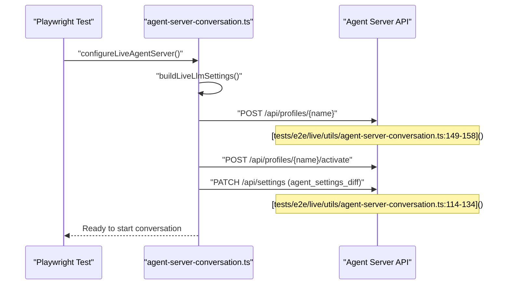

<!-- source: DeepWiki mcp.deepwiki.com · repo All-Hands-AI/OpenHands · page 14.2 Live and ACP E2E Tests · fetched 2026-10-26 -->

# Live and ACP E2E Tests

Relevant source files

The following files were used as context for generating this wiki page:

- [__tests__/components/analytics/telemetry-consent-banner.test.tsx](__tests__/components/analytics/telemetry-consent-banner.test.tsx)
- [__tests__/components/features/conversation/right-panel-toggle.test.tsx](__tests__/components/features/conversation/right-panel-toggle.test.tsx)
- [__tests__/components/features/files-tab/file-tree-view.test.tsx](__tests__/components/features/files-tab/file-tree-view.test.tsx)
- [__tests__/hooks/use-sync-telemetry-consent.test.ts](__tests__/hooks/use-sync-telemetry-consent.test.ts)
- [__tests__/scripts/acp-docker-env-sync.test.ts](__tests__/scripts/acp-docker-env-sync.test.ts)
- [docs/ACP_AGENTS.md](docs/ACP_AGENTS.md)
- [docs/README.md](docs/README.md)
- [docs/SELF_HOSTING.md](docs/SELF_HOSTING.md)
- [examples/acp-docker/.env.example](examples/acp-docker/.env.example)
- [examples/acp-docker/README.md](examples/acp-docker/README.md)
- [examples/acp-docker/docker-compose.yml](examples/acp-docker/docker-compose.yml)
- [scripts/gen-acp-docker-env.mjs](scripts/gen-acp-docker-env.mjs)
- [src/components/features/conversation/right-panel-toggle.tsx](src/components/features/conversation/right-panel-toggle.tsx)
- [src/components/features/files-tab/file-tree-view.tsx](src/components/features/files-tab/file-tree-view.tsx)
- [src/components/features/files-tab/tree-node.tsx](src/components/features/files-tab/tree-node.tsx)
- [src/hooks/use-sync-telemetry-consent.ts](src/hooks/use-sync-telemetry-consent.ts)
- [tests/e2e/live-acp/README.md](tests/e2e/live-acp/README.md)
- [tests/e2e/live-acp/acp-docker-e2e.mts](tests/e2e/live-acp/acp-docker-e2e.mts)
- [tests/e2e/live/utils/agent-server-conversation.ts](tests/e2e/live/utils/agent-server-conversation.ts)
- [tests/e2e/mock-llm/backends/mock-llm-auth-modes.spec.ts](tests/e2e/mock-llm/backends/mock-llm-auth-modes.spec.ts)
- [tests/e2e/mock-llm/backends/mock-llm-cross-connect.spec.ts](tests/e2e/mock-llm/backends/mock-llm-cross-connect.spec.ts)
- [tests/e2e/mock-llm/files/mock-llm-files-and-git.spec.ts](tests/e2e/mock-llm/files/mock-llm-files-and-git.spec.ts)
- [tests/e2e/mock-llm/settings/mock-llm-acp-agent.spec.ts](tests/e2e/mock-llm/settings/mock-llm-acp-agent.spec.ts)

This page documents the end-to-end (E2E) testing strategy for Agent Canvas when interacting with real or containerized backends. This includes the live test suite for verifying production-like environments, specialized ACP (Agent Client Protocol) tests for external coding agents, and the mock-LLM trajectory framework for regression testing.

## Live E2E Test Suite

The live E2E suite, located in `tests/e2e/live/`, is designed to verify the integration between Agent Canvas and a real `agent-server` instance using actual LLM providers [tests/e2e/live/utils/agent-server-conversation.ts:1-7](). These tests ensure that the frontend correctly handles the end-to-end lifecycle of a conversation, including tool calls and environment setup.

### Agent Server Conversation Utility

The `agent-server-conversation.ts` utility provides the backbone for live testing by managing environment configuration and session lifecycle [tests/e2e/live/utils/agent-server-conversation.ts:10-58]().

| Variable / Function | Role |
|:---|:---|
| `BACKEND_URL` | The target `agent-server` URL (defaults to `18100`) [tests/e2e/live/utils/agent-server-conversation.ts:10-11](). |
| `llmApiKey` | Resolves keys from `LIVE_E2E_LLM_API_KEY`, `OPENAI_API_KEY`, `ANTHROPIC_API_KEY`, or `LLM_API_KEY` [tests/e2e/live/utils/agent-server-conversation.ts:22-31](). |
| `routeBackendSessionApiKey` | Intercepts Playwright requests to inject the `X-Session-API-Key` header [tests/e2e/live/utils/agent-server-conversation.ts:73-86](). |
| `configureLiveAgentServer` | Patches backend settings to disable confirmation mode and set iteration limits [tests/e2e/live/utils/agent-server-conversation.ts:104-139](). |
| `ensureLiveLlmProfile` | Creates and activates a dedicated E2E LLM profile on the backend [tests/e2e/live/utils/agent-server-conversation.ts:141-171](). |

**Sources:** [tests/e2e/live/utils/agent-server-conversation.ts:1-220]()

## ACP E2E and Docker Tests

ACP (Agent Client Protocol) tests verify the integration with external agents like Claude Code, Codex, and Gemini CLI [docs/ACP_AGENTS.md:8-15](). These agents run as subprocesses of the `agent-server` via JSON-RPC over stdio [docs/ACP_AGENTS.md:17-27]().

### ACP Docker Integration

The `tests/e2e/live-acp/acp-docker-e2e.mts` suite specifically tests the containerized deployment model [tests/e2e/live-acp/acp-docker-e2e.mts](). This verifies that:
1. The `agent-server` can spawn ACP agents within a Docker environment [docs/ACP_AGENTS.md:133-136]().
2. Credentials (e.g., `ANTHROPIC_API_KEY`, `CODEX_AUTH_JSON`) provided in the UI are correctly relayed to the subprocess [docs/ACP_AGENTS.md:103-111]().
3. OAuth device flows (e.g., Gemini/Claude subscription logins) are correctly handled [docs/ACP_AGENTS.md:50-72]().

### ACP Environment Sync

The `scripts/gen-acp-docker-env.mjs` script is used to synchronize environment variables and version pins for the Dockerized ACP testing environment, ensuring the `examples/acp-docker/` setup matches the current build [scripts/gen-acp-docker-env.mjs](), [examples/acp-docker/docker-compose.yml]().

**Sources:** [docs/ACP_AGENTS.md:1-136](), [tests/e2e/live-acp/acp-docker-e2e.mts](), [scripts/gen-acp-docker-env.mjs](), [examples/acp-docker/docker-compose.yml]()

## Mock-LLM Spec Files

For scenarios where live LLM costs or latency are prohibitive, the `tests/e2e/mock-llm/` directory contains specialized specs that use a scripted trajectory to simulate agent behavior [tests/e2e/mock-llm/files/mock-llm-files-and-git.spec.ts:1-12]().

### Automations Lifecycle

The `mock-llm-automation.spec.ts` exercises the full automation lifecycle by hitting the real automation backend while using a mock LLM for agent responses.
*   **Trajectory Registration**: Scripted responses include terminal commands to create and dispatch cron automations via `AUTOMATION_API_BASE`.
*   **Verification**: The test polls `listAutomationRuns` until the status reaches `COMPLETED`.

### Cross-Connect and Auth Modes

*   **Cross-Connect**: Verifies that a frontend-only build can connect to separate standalone backend instances via the `Manage Backends` modal [tests/e2e/mock-llm/backends/mock-llm-cross-connect.spec.ts:1-23](). It uses `spawnAgentCanvas` with specific `PORT` and `OH_CANVAS_SAFE_STATE_DIR` values to isolate instances [tests/e2e/mock-llm/backends/mock-llm-cross-connect.spec.ts:50-97]().
*   **Auth Modes**: Tests fresh installs, key rotation (recovering from stale `localStorage` keys via `syncLauncherDefaultLocalBackend`), and public-mode auth gates (`ApiKeyEntryScreen`) [tests/e2e/mock-llm/backends/mock-llm-auth-modes.spec.ts:1-27](). It specifically verifies that the static-server's `__AGENT_CANVAS_SESSION_API_KEY__` injection works correctly [tests/e2e/mock-llm/backends/mock-llm-auth-modes.spec.ts:102-109]().

### MCP (Multi-Agent Coordination Protocol)

The `mock-llm-mcp-github.spec.ts` tests the installation and management of MCP servers, specifically focusing on the GitHub marketplace integration.
*   **Marketplace Card Visibility**: Ensures the GitHub marketplace card is visible on the MCP page.
*   **Install Modal**: Verifies that clicking the add control opens the install modal with correct fields, including the hosted endpoint and PAT field.
*   **Installation Flow**: Simulates filling in the PAT and submitting, intercepting the `POST /api/mcp/test` endpoint to mock a successful response.
*   **Persistence and Deletion**: Confirms the installed server appears in the list and can be deleted via the UI. The `useAddMcpServer` and `useUpdateMcpServer` hooks handle the API interactions for adding and updating MCP server configurations, ensuring sparse mutations preserve sibling servers.

### Files and Git Integration

The `mock-llm-files-and-git.spec.ts` covers the files tab, conversation overview git information, and browser tab functionality [tests/e2e/mock-llm/files/mock-llm-files-and-git.spec.ts:1-12]().
*   **Workspace Attachment**: Seeds `selected_workspace` into conversation metadata via `seedWorkspaceMetadata` to simulate an attached workspace [tests/e2e/mock-llm/files/mock-llm-files-and-git.spec.ts:39-66]().
*   **Git Remote Setup**: Registers a trajectory that bootstraps a git repository and adds a remote, ensuring the conversation overview displays the correct repo slug [tests/e2e/mock-llm/files/mock-llm-files-and-git.spec.ts:114-136]().
*   **File Tree View**: Verifies the file tree view (`TreeNode`) and diff viewer functionality when a workspace is attached [src/components/features/files-tab/tree-node.tsx:16-92]().

### Profile Management

The `mock-llm-profile-management.spec.ts` covers regressions in LLM profile handling:
1.  **Active Profile Deletion**: Verifies that deleting the active profile triggers reconciliation, promoting a remaining profile to active.
2.  **Profile Identity**: Ensures that when two profiles share the same model, the chat header displays the correct profile name by stamping metadata at creation.
3.  **Data Preservation**: Verifies that `base_url` values are preserved when switching between Basic and Advanced views in the UI.

**Sources:** [tests/e2e/mock-llm/backends/mock-llm-cross-connect.spec.ts:1-92](), [tests/e2e/mock-llm/backends/mock-llm-auth-modes.spec.ts:1-109](), [tests/e2e/mock-llm/files/mock-llm-files-and-git.spec.ts:1-190](), [src/components/features/files-tab/tree-node.tsx:16-92]()

## Telemetry Verification

The E2E environment also validates the telemetry consent flow. The `TelemetryConsentBanner` uses `ModalBackdrop` with an `elevated` prop to ensure it stacks above the onboarding modal. The `useSyncTelemetryConsent` hook handles the reconciliation of browser-side consent state with the backend settings, ensuring consistency across different backend types (local vs. cloud) and preventing stale values from overwriting user choices.

*   **Layering**: `elevated` modals use `z-[70]`, while default modals use `z-60`.
*   **State Persistence**: Consent choices are saved via `saveSettings` and `setTelemetryConsent`.

**Sources:** [src/hooks/use-sync-telemetry-consent.ts]()

## Implementation Diagrams

### Data Flow: Live E2E Initialization

This diagram shows how the `agent-server-conversation` utility prepares the environment for a live test.

**Sources:** [tests/e2e/live/utils/agent-server-conversation.ts:104-171]()

### Code Entity Mapping: Auth and Connectivity

Associates UI screens and logic with the underlying test specs and backend configurations.

```mermaid
graph TD
    subgraph "Natural Language Space"
        A["Fresh Install"]
        B["Key Rotation"]
        C["Public Auth"]
        D["Multi-Backend"]
        E["Automation Lifecycle"]
        F["MCP GitHub Install"]
        G["Files & Git"]
        H["Profile Management"]
        I["Telemetry Consent Sync"]
    end

    subgraph "Code Entity Space"
        spec1["mock-llm-auth-modes.spec.ts"]
        spec2["mock-llm-cross-connect.spec.ts"]
        spec3["mock-llm-automation.spec.ts"]
        spec4["mock-llm-mcp-github.spec.ts"]
        spec5["mock-llm-files-and-git.spec.ts"]
        spec6["mock-llm-profile-management.spec.ts"]
        spec7["mock-llm-acp-agent.spec.ts"]
        comp1["ApiKeyEntryScreen"]
        comp2["ManageBackendsModal"]
        comp3["mcp-install-modal"]
        comp4["FileTreeView"]
        comp5["TelemetryConsentBanner"]
        logic1["syncLauncherDefaultLocalBackend()"]
        func1["listAutomationRuns"]
        func2["useAddMcpServer()"]
        func3["useUpdateMcpServer()"]
        func4["seedWorkspaceMetadata()"]
        func5["useSyncTelemetryConsent()"]
        inject["__AGENT_CANVAS_SESSION_API_KEY__"]
    end

    A --- spec1
    A --- inject
    B --- logic1
    C --- comp1
    D --- spec2
    D --- comp2
    E --- spec3
    E --- func1
    F --- spec4
    F --- comp3
    F --- func2
    F --- func3
    G --- spec5
    G --- comp4
    G --- func4
    H --- spec6
    I --- comp5
    I --- func5
    spec1 --- logic1
```

**Sources:** [tests/e2e/mock-llm/backends/mock-llm-auth-modes.spec.ts:1-27](), [tests/e2e/mock-llm/backends/mock-llm-cross-connect.spec.ts:1-17](), [tests/e2e/mock-llm/files/mock-llm-files-and-git.spec.ts:1-190](), [src/components/features/files-tab/file-tree-view.tsx](), [tests/e2e/mock-llm/settings/mock-llm-profile-management.spec.ts](), [src/hooks/use-sync-telemetry-consent.ts]()

---

