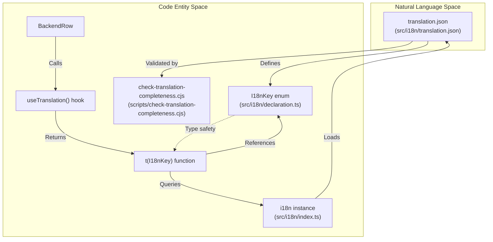
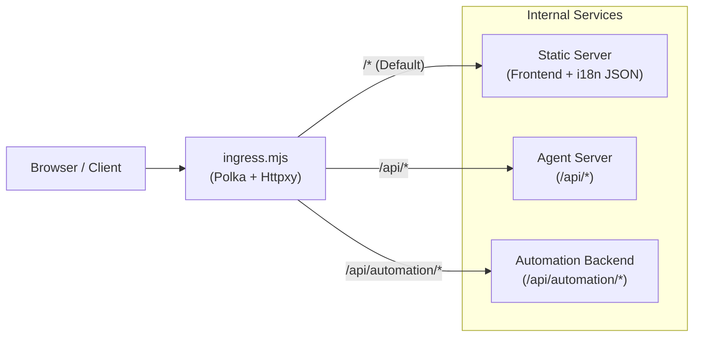

<!-- source: DeepWiki mcp.deepwiki.com · repo All-Hands-AI/OpenHands · page 15 Internationalization (i18n) · fetched 2026-10-26 -->

# Internationalization (i18n)

Relevant source files

The following files were used as context for generating this wiki page:

- [__tests__/components/backends/add-backend-modal.test.tsx](__tests__/components/backends/add-backend-modal.test.tsx)
- [__tests__/components/backends/backend-form-modal.test.tsx](__tests__/components/backends/backend-form-modal.test.tsx)
- [__tests__/components/backends/manage-backends-modal.test.tsx](__tests__/components/backends/manage-backends-modal.test.tsx)
- [__tests__/hooks/query/use-backends-health.test.tsx](__tests__/hooks/query/use-backends-health.test.tsx)
- [__tests__/root.test.tsx](__tests__/root.test.tsx)
- [src/components/features/backends/backend-form-modal.tsx](src/components/features/backends/backend-form-modal.tsx)
- [src/components/features/backends/backend-row.tsx](src/components/features/backends/backend-row.tsx)
- [src/components/features/backends/backend-version.tsx](src/components/features/backends/backend-version.tsx)
- [src/components/features/backends/manage-backends-modal.tsx](src/components/features/backends/manage-backends-modal.tsx)
- [src/hooks/query/use-backends-health.ts](src/hooks/query/use-backends-health.ts)
- [src/i18n/translation.json](src/i18n/translation.json)
- [src/root.tsx](src/root.tsx)

The internationalization (i18n) system in OpenHands provides multi-language support across 15 locales through a centralized translation management system. It utilizes `react-i18next` for runtime translation combined with compile-time type safety via auto-generated TypeScript enums.

---

## System Architecture

The i18n system follows a structured pipeline from translation source files to runtime translation lookups, with type safety enforced at compile time.

**Internationalization Data Flow**

**Sources:** [src/i18n/translation.json:1-18]()

---

## Translation Resources and Type Safety

All translations are stored in a centralized JSON structure where each key maps to supported language codes. To prevent runtime errors, the system uses a TypeScript enum (`I18nKey`) to reference these strings.

### Key Structure and Enums
Translation keys often use a `$` separator to denote namespaces (e.g., `COMMON$PATTERN`, `OBSERVATION$EXIT_CODE`) [src/i18n/translation.json:2-18](), [src/i18n/translation.json:87-102](). The `I18nKey` enum ensures that developers only use keys that actually exist in the resource file [src/components/features/backends/backend-form-modal.tsx:29]().

### Validation Script
The `check-translation-completeness.cjs` script acts as a quality gate. It ensures:
- All keys have entries for all supported languages.
- Values aren't just English copies (unless allow-listed in `IDENTICAL_VALUE_ALLOWLIST`).
- No unsupported language codes are present.

For details, see [Translation Resources and Type Safety](#15.1).

**Sources:** [src/i18n/translation.json:2-18](), [src/components/features/backends/backend-form-modal.tsx:29](), [src/i18n/translation.json:87-102]()

---

## React Integration

Components utilize the `useTranslation` hook from `react-i18next` to retrieve the `t` function.

### UI Localization Examples
- **Backend Management:** Components like `BackendFormModal` [src/components/features/backends/backend-form-modal.tsx:3]() and `ManageBackendsModal` [src/components/features/backends/manage-backends-modal.tsx:2]() use `useTranslation` to localize various UI elements. For instance, `BackendRow` uses `I18nKey.BACKEND$LOGGED_OUT` [src/components/features/backends/backend-row.tsx:53]() and `I18nKey.BACKEND$KIND_CLOUD` [src/components/features/backends/backend-row.tsx:116]() for status and kind labels.
- **Parameter Interpolation:** The system supports dynamic values within translations using the `{{variable}}` syntax, such as `COMMON$RESULTS` which takes a `count` [src/i18n/translation.json:40-40]() or `OBSERVATION$EXIT_CODE` which interpolates a numeric `code` [src/i18n/translation.json:87-91]().

**Sources:** [src/i18n/translation.json:40-40](), [src/i18n/translation.json:87-91](), [src/components/features/backends/backend-form-modal.tsx:3](), [src/components/features/backends/manage-backends-modal.tsx:2](), [src/components/features/backends/backend-row.tsx:53](), [src/components/features/backends/backend-row.tsx:116]()

---

## Network Routing and Ingress

While primarily a frontend concern, the i18n system's availability in different deployment environments is supported by the ingress proxy. The proxy handles routing for the frontend assets and API requests, ensuring that the correct translation bundles are served regardless of the deployment model.

**Ingress Proxy Mapping**

For details, see [Ingress Proxy and Network Routing](#15.2).

**Sources:** [src/root.tsx:1-398]()

---

## Testing and Quality Assurance

The i18n system is verified through both static analysis and functional tests:
- **Unit Tests:** The `ManageBackendsModal` test suite verifies that the modal correctly renders localized status messages, including `BACKEND$STATUS_DISCONNECTED_CHECK_API_KEY` [__tests__/components/backends/manage-backends-modal.test.tsx:178-179]() and `BACKEND$LOGGED_OUT` [__tests__/root.test.tsx:26](). The `AddBackendModal` tests confirm that backend options are rendered with correct descriptions using `I18nKey` [__tests__/components/backends/add-backend-modal.test.tsx:124-127]().
- **Completeness Checks:** The `check-translation-completeness.cjs` script is run as part of the CI/CD pipeline to prevent merging missing translations.
- **Integration Tests:** The `root.test.tsx` verifies that the application correctly displays localized messages for backend status, such as `BACKEND$MANAGE_TITLE` and `BACKEND$RECONNECT_CLOUD_TITLE` [__tests__/root.test.tsx:20-21]().

**Sources:** [__tests__/components/backends/manage-backends-modal.test.tsx:178-179](), [__tests__/components/backends/add-backend-modal.test.tsx:124-127](), [__tests__/root.test.tsx:20-21](), [__tests__/root.test.tsx:26]()

---

