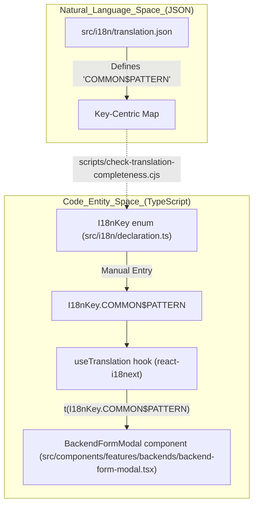
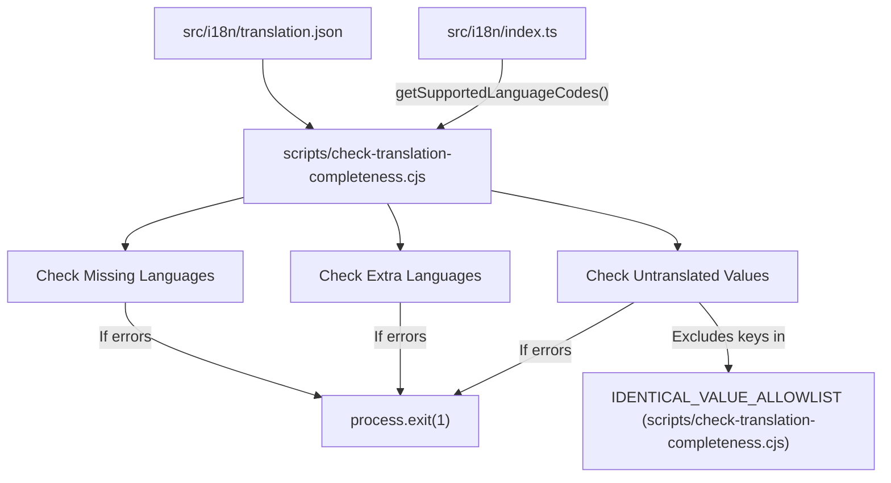
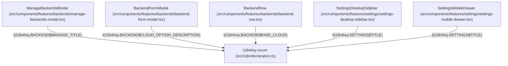

<!-- source: DeepWiki mcp.deepwiki.com · repo All-Hands-AI/OpenHands · page 15.1 Translation Resources and Type Safety · fetched 2026-10-26 -->

# Translation Resources and Type Safety

<details>
<summary>Relevant source files</summary>

The following files were used as context for generating this wiki page:

- [__tests__/components/backends/add-backend-modal.test.tsx](__tests__/components/backends/add-backend-modal.test.tsx)
- [__tests__/components/backends/backend-form-modal.test.tsx](__tests__/components/backends/backend-form-modal.test.tsx)
- [__tests__/components/backends/manage-backends-modal.test.tsx](__tests__/components/backends/manage-backends-modal.test.tsx)
- [__tests__/hooks/query/use-backends-health.test.tsx](__tests__/hooks/query/use-backends-health.test.tsx)
- [__tests__/package-library.test.ts](__tests__/package-library.test.ts)
- [__tests__/root.test.tsx](__tests__/root.test.tsx)
- [scripts/check-translation-completeness.cjs](scripts/check-translation-completeness.cjs)
- [src/api/agent-canvas-updates.test.ts](src/api/agent-canvas-updates.test.ts)
- [src/components/features/backends/backend-form-modal.tsx](src/components/features/backends/backend-form-modal.tsx)
- [src/components/features/backends/backend-row.tsx](src/components/features/backends/backend-row.tsx)
- [src/components/features/backends/backend-version.tsx](src/components/features/backends/backend-version.tsx)
- [src/components/features/backends/manage-backends-modal.tsx](src/components/features/backends/manage-backends-modal.tsx)
- [src/components/features/settings/agent-canvas-update-card.test.tsx](src/components/features/settings/agent-canvas-update-card.test.tsx)
- [src/components/features/settings/agent-canvas-update-card.tsx](src/components/features/settings/agent-canvas-update-card.tsx)
- [src/components/features/settings/agent-canvas-version-modal.tsx](src/components/features/settings/agent-canvas-version-modal.tsx)
- [src/components/features/settings/agent-canvas-version-tile.tsx](src/components/features/settings/agent-canvas-version-tile.tsx)
- [src/components/features/settings/settings-desktop-sidebar.tsx](src/components/features/settings/settings-desktop-sidebar.tsx)
- [src/components/features/settings/settings-mobile-drawer.tsx](src/components/features/settings/settings-mobile-drawer.tsx)
- [src/components/features/settings/settings-mobile-hub.tsx](src/components/features/settings/settings-mobile-hub.tsx)
- [src/hooks/query/use-backends-health.ts](src/hooks/query/use-backends-health.ts)
- [src/hooks/query/use-latest-agent-canvas-version.ts](src/hooks/query/use-latest-agent-canvas-version.ts)
- [src/i18n/translation.json](src/i18n/translation.json)
- [src/icons/docker.svg](src/icons/docker.svg)
- [src/root.tsx](src/root.tsx)

</details>


Agent Canvas employs a type-safe internationalization (i18n) architecture built on top of `react-i18next`. The system ensures that translation keys used in the TypeScript codebase exist in the resource files and that all supported languages have complete coverage through automated validation.

## Translation Resource Structure

The primary source of truth for translations is `src/i18n/translation.json`. Unlike standard i18n setups where each language has its own file, Agent Canvas uses a **key-centric** structure where each key contains an object mapping language codes to their respective translations [src/i18n/translation.json:1-17]().

### Key Conventions
Keys are typically structured using a `$` delimiter to denote namespaces (e.g., `COMMON$PATTERN`, `OBSERVATION$EXIT_CODE`, `ACTION_MESSAGE$TASK`) [src/i18n/translation.json:2-120]().

| Feature | Implementation |
| :--- | :--- |
| **Interpolation** | Uses double curly braces, e.g., `{{count}}`, `{{name}}`, or `{{code}}` [src/i18n/translation.json:37-102](). |
| **HTML Support** | Supports inline tags like `<cmd>` for specific styling in the UI [src/i18n/translation.json:105-119]().
| **Language Codes** | Supports standard codes (e.g., `en`, `ja`, `fr`) and region-specific codes (e.g., `ko-KR`, `zh-TW`) [src/i18n/translation.json:11-17]().

Sources: [src/i18n/translation.json:1-220]()

## Type-Safe Translation Keys

To prevent runtime errors caused by missing or misspelled keys, the project uses a TypeScript enum called `I18nKey`.

### The `I18nKey` Enum
The `I18nKey` enum serves as the central registry for all valid translation keys. Components import this enum from `#/i18n/declaration` to reference strings, ensuring that any removal or renaming of a key in the resources is caught at compile time [src/components/features/backends/backend-form-modal.tsx:29](), [src/components/features/settings/settings-desktop-sidebar.tsx:4]().

### Data Flow: Translation to UI
The following diagram illustrates how a raw key in the JSON file becomes a type-safe string in a React component, specifically within the Onboarding Modal.

**Translation Key Data Flow (Onboarding Modal)**

Sources: [src/i18n/translation.json:1-220](), [src/components/features/backends/backend-form-modal.tsx:29](), [src/components/features/settings/settings-desktop-sidebar.tsx:4]()

## Implementation in Components

Components utilize the `useTranslation` hook from `react-i18next`. By passing `I18nKey` values to the `t` function, developers receive IDE autocomplete and compile-time validation.

### Example Usage
In `SettingsDesktopSidebar`, labels for navigation items are resolved using `I18nKey` [src/components/features/settings/settings-desktop-sidebar.tsx:46]():
```typescript
label={t(renderedItem.item.text as I18nKey)}
```
Similarly, the `BackendFormModal` uses `I18nKey` for its various messages [src/components/features/backends/backend-form-modal.tsx:3]():
```typescript
const { t } = useTranslation("openhands");
```

### Complex Interpolation and Formatting
When translations require dynamic data, such as a host URL or a version number, the values are passed as the second argument to the `t` function. For example, `translation.json` defines `OBSERVATION$EXIT_CODE` with `{{code}}` [src/i18n/translation.json:87-102]().

Sources: [src/components/features/settings/settings-desktop-sidebar.tsx:46](), [src/components/features/backends/backend-form-modal.tsx:3](), [src/i18n/translation.json:87-102]()

## Validation and Completeness

To maintain high quality across all supported languages, Agent Canvas uses a validation script: `scripts/check-translation-completeness.cjs`.

### `check-translation-completeness.cjs`
This script ensures the integrity of the translation layer [scripts/check-translation-completeness.cjs:4-7]().

1.  **Missing Languages**: Checks every key in `translation.json` against the `SupportedLanguageCodes` extracted from the i18n index [scripts/check-translation-completeness.cjs:104-110]().
2.  **Untranslated Value Detection**: Flags keys where the English value has been copied verbatim to all other languages, signaling a lack of actual translation [scripts/check-translation-completeness.cjs:121-132]().
3.  **Allowlist**: Certain keys (e.g., `BRANDING$OPENHANDS`, `BACKEND$VERSION_LABEL`) are exempt from the "identical value" check via the `IDENTICAL_VALUE_ALLOWLIST` [scripts/check-translation-completeness.cjs:15-70]().

**Validation Logic Flow**

Sources: [scripts/check-translation-completeness.cjs:90-155](), [src/i18n/translation.json:1-220]()

## i18n Library Entrypoint

For host applications or embedded scenarios, the i18n system provides a centralized configuration. Components across different features (Settings, Backends, etc.) share the same `openhands` namespace to ensure consistency [src/components/features/backends/backend-form-modal.tsx:3](). The `package.json` defines an explicit export for the i18n module at `./i18n` [__tests__/package-library.test.ts:55-59]().

### Integration with UI Modals
The translation system is heavily used in critical setup flows. For instance, the `ManageBackendsModal` and `BackendFormModal` extensively use `I18nKey` for titles, labels, and various messages [src/components/features/backends/manage-backends-modal.tsx:2](), [src/components/features/backends/backend-form-modal.tsx:3]().

**Backend Management Translation Usage**

Sources: [src/components/features/backends/manage-backends-modal.tsx:2](), [src/components/features/backends/backend-form-modal.tsx:3](), [src/components/features/backends/backend-row.tsx:1](), [src/components/features/settings/settings-desktop-sidebar.tsx:1](), [src/components/features/settings/settings-mobile-drawer.tsx](), [__tests__/package-library.test.ts:55-59]()

## Adding New Translation Keys

To add a new translation:
1.  **Update JSON**: Add the key and its translations for all languages in `src/i18n/translation.json`. Ensure the key uses the `NAMESPACE$KEY_NAME` convention [src/i18n/translation.json:1-18]().
2.  **Update Declaration**: Add the new key to the `I18nKey` enum in `src/i18n/declaration.ts`.
3.  **Run Validation**: Execute `node scripts/check-translation-completeness.cjs` to ensure all languages are covered [scripts/check-translation-completeness.cjs:144-150]().
4.  **Use in Code**: Reference the key via `t(I18nKey.YOUR_NEW_KEY)` in your component.

Sources: [src/i18n/translation.json:1-18](), [scripts/check-translation-completeness.cjs:158-190]()

---

