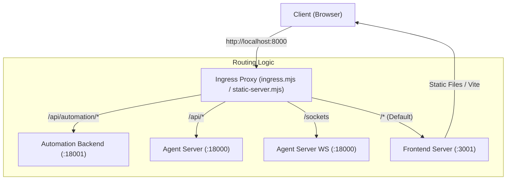
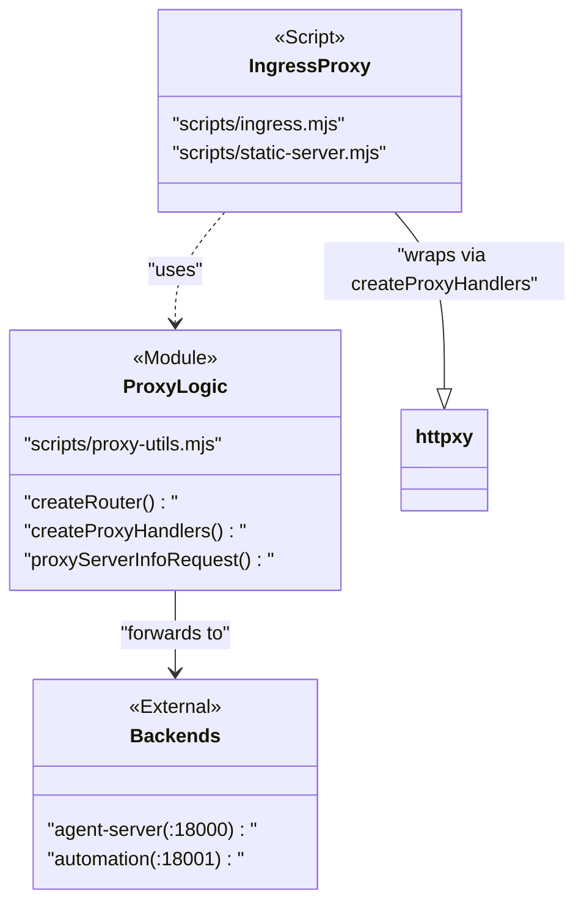

<!-- source: DeepWiki mcp.deepwiki.com · repo All-Hands-AI/OpenHands · page 15.2 Ingress Proxy and Network Routing · fetched 2026-10-26 -->

# Ingress Proxy and Network Routing

Relevant source files

The following files were used as context for generating this wiki page:

- [.github/pr-assets/pr-16605-test-results.png](.github/pr-assets/pr-16605-test-results.png)
- [__tests__/api/agent-server-compatibility-bundled-pin.test.ts](__tests__/api/agent-server-compatibility-bundled-pin.test.ts)
- [__tests__/api/option-service.test.ts](__tests__/api/option-service.test.ts)
- [__tests__/scripts/dev-static.test.ts](__tests__/scripts/dev-static.test.ts)
- [__tests__/scripts/dev-with-automation.test.ts](__tests__/scripts/dev-with-automation.test.ts)
- [__tests__/scripts/ingress.test.ts](__tests__/scripts/ingress.test.ts)
- [__tests__/scripts/static-server.test.ts](__tests__/scripts/static-server.test.ts)
- [__tests__/vite-config.test.ts](__tests__/vite-config.test.ts)
- [docker/entrypoint.sh](docker/entrypoint.sh)
- [public/mockServiceWorker.js](public/mockServiceWorker.js)
- [scripts/dev-static.mjs](scripts/dev-static.mjs)
- [scripts/dev-with-automation.mjs](scripts/dev-with-automation.mjs)
- [scripts/ingress.mjs](scripts/ingress.mjs)
- [scripts/proxy-utils.mjs](scripts/proxy-utils.mjs)
- [scripts/runtime-services-info.mjs](scripts/runtime-services-info.mjs)
- [scripts/static-build.mjs](scripts/static-build.mjs)
- [scripts/static-server.mjs](scripts/static-server.mjs)
- [src/api/agent-server-compatibility.ts](src/api/agent-server-compatibility.ts)
- [src/api/option-service/option-service.api.ts](src/api/option-service/option-service.api.ts)
- [src/hooks/query/use-config.ts](src/hooks/query/use-config.ts)
- [src/stores/btw-store.ts](src/stores/btw-store.ts)
- [vite.config.ts](vite.config.ts)

The OpenHands Agent Canvas employs a unified ingress strategy to present multiple independent backend services as a single origin to the frontend application. This architecture simplifies cross-origin resource sharing (CORS) management, provides a consistent endpoint for WebSocket connections, and enables flexible deployment models ranging from local development to multi-container Docker environments.

## Architecture Overview

The ingress system acts as a Layer 7 reverse proxy that routes traffic based on URL path prefixes. It is primarily implemented using a combination of `node:http` and `httpxy` to handle both standard HTTP requests and WebSocket upgrades.

### Network Topology

The following diagram illustrates the routing logic used in both development and production (Docker) environments:

**Unified Ingress Routing Flow**

Sources: [scripts/dev-with-automation.mjs:9-22](), [scripts/ingress.mjs:118-123](), [scripts/static-server.mjs:21-27]()

## Core Components

### 1. `scripts/ingress.mjs`
A standalone, implementation-independent reverse proxy used during development when running the full stack with automation. It uses `createRouter` to match the longest path prefix first, ensuring that specific routes like `/api/automation` take precedence over generic ones like `/api` [scripts/ingress.mjs:19-22]().

**Key Functions:**
- `startIngress(config)`: Initializes the HTTP server and attaches proxy handlers for both standard requests and WebSocket upgrades [scripts/ingress.mjs:164-198]().
- `server.on("upgrade", ...)`: Intercepts `UPGRADE` headers to facilitate bi-directional communication for agent sessions by routing to the appropriate backend [scripts/ingress.mjs:201-208]().

Sources: [scripts/ingress.mjs:19-22](), [scripts/ingress.mjs:164-198](), [scripts/ingress.mjs:201-208]()

### 2. `scripts/proxy-utils.mjs`
A utility module providing the shared logic for routing and proxying. It abstracts the complexities of `httpxy` and provides consistent behavior across different ingress entry points [scripts/proxy-utils.mjs:1-5]().

- **`createRouter(routes, defaultBackend)`**: Returns a routing function that performs prefix matching. It sorts routes by length (longest first) to ensure correct specificity [scripts/proxy-utils.mjs:22-35]().
- **`createProxyHandlers(options)`**: Returns an object containing `proxyHttp` and `proxyWebSocket`. It manages active request counters and handles "benign" socket errors (like `ECONNRESET`) to prevent process crashes [scripts/proxy-utils.mjs:206-285]().
- **`isBenignSocketError(err)`**: Filters out common network interruptions that do not require high-level error logging [scripts/proxy-utils.mjs:37-39]().
- **`proxyServerInfoRequest`**: A specialized handler that intercepts requests to `/server_info` to inject `runtime_services` metadata from the ingress layer into the JSON response [scripts/proxy-utils.mjs:69-185]().

Sources: [scripts/proxy-utils.mjs:1-5](), [scripts/proxy-utils.mjs:22-35](), [scripts/proxy-utils.mjs:37-39](), [scripts/proxy-utils.mjs:69-185](), [scripts/proxy-utils.mjs:206-285]()

### 3. `scripts/static-server.mjs`
In Docker and static deployment modes, this script replaces the Vite dev server. It combines `sirv` for serving static frontend assets with the proxy logic from `proxy-utils.mjs` [scripts/static-server.mjs:1-19]().

It is responsible for:
- Serving the React application from the configured `--dir` (usually `build/`) [scripts/static-server.mjs:300]().
- Injecting runtime configuration (like `sessionApiKey` and `runtimeServicesInfo`) into `index.html` at request time via `transformIndexHtml`, allowing the same static build to be used with different credentials [scripts/static-server.mjs:233-247]().
- Routing API and Socket requests to the appropriate backend using `createProxyHandlers` [scripts/static-server.mjs:37-43]().

Sources: [scripts/static-server.mjs:1-19](), [scripts/static-server.mjs:37-43](), [scripts/static-server.mjs:233-247](), [scripts/static-server.mjs:300]()

## Data Flow and Implementation

### Request Lifecycle
When a request hits the ingress port (default `8000`):
1. The `route(url)` function identifies the target backend URL by comparing the request path against configured prefixes [scripts/proxy-utils.mjs:27-34]().
2. If the request is for `/server_info`, the proxy intercepts the response from the backend to merge in `runtimeServicesInfo` metadata [scripts/ingress.mjs:189-194](), [scripts/static-server.mjs:292-297]().
3. For standard HTTP requests, `proxyHttp` uses `httpxy` to pipe the request to the target and return the response [scripts/proxy-utils.mjs:239-260]().
4. For WebSockets, `proxyWebSocket` handles the handshake and tunnels the duplex stream [scripts/proxy-utils.mjs:262-284]().

Sources: [scripts/proxy-utils.mjs:27-34](), [scripts/proxy-utils.mjs:239-260](), [scripts/proxy-utils.mjs:262-284](), [scripts/ingress.mjs:189-194](), [scripts/static-server.mjs:292-297]()

### Code Entity Mapping
The following diagram maps the logical network roles to the specific code entities responsible for their execution.

**Code Entity to Network Role Mapping**

Sources: [scripts/ingress.mjs:28-35](), [scripts/proxy-utils.mjs:3-35](), [scripts/static-server.mjs:37-43]()

## Deployment Integration

### Docker Entrypoint
In the all-in-one Docker image, `docker/entrypoint.sh` orchestrates the startup of the Agent Server, the Automation backend, and the `static-server.mjs` ingress [docker/entrypoint.sh:5-10]().

- **Port Mapping**: The ingress port (default `8000`) is the primary entry point [docker/entrypoint.sh:69]().
- **Internal Routing**: The `static-server.mjs` is invoked with `--route` flags that point to `127.0.0.1` at the internal ports for the backends [docker/entrypoint.sh:220-228]().
- **Config Injection**: It injects the `sessionApiKey` (derived from `OH_SECRET_KEY`) and `runtimeServicesInfo` to ensure the frontend can discover and authenticate with the sidecar services [docker/entrypoint.sh:196-207]().
- **VSCode Route Sync**: The entrypoint normalizes `VSCODE_BASE_PATH` and `AGENT_CANVAS_BASE_PATH` to prevent routing collisions where the editor might overwrite the SPA mount [docker/entrypoint.sh:89-120]().

Sources: [docker/entrypoint.sh:5-10](), [docker/entrypoint.sh:69](), [docker/entrypoint.sh:89-120](), [docker/entrypoint.sh:196-207](), [docker/entrypoint.sh:220-228]()

### Development Modes
- **`dev-with-automation.mjs`**: Spawns a standalone `ingress.mjs` process to bridge the Vite dev server (:3001) and the Python backends [scripts/dev-with-automation.mjs:10-22]().
- **`dev-static.mjs`**: Uses `static-server.mjs` directly as the ingress to serve the production `build/` directory while proxying to the backends [scripts/dev-static.mjs:12-17]().

| Feature | `ingress.mjs` | `static-server.mjs` |
| :--- | :--- | :--- |
| **Primary Use** | `npm run dev` | `Docker` / `npm run dev:static` |
| **Frontend Source** | Proxies to Vite (:3001) | Serves `build/` directory |
| **WebSocket Support** | Yes [scripts/ingress.mjs:201]() | Yes [scripts/static-server.mjs:319]() |
| **Config Injection** | No | Yes (via `index.html` transform) [scripts/static-server.mjs:233]() |
| **Metadata Injection**| Yes (via `/server_info`) [scripts/ingress.mjs:193]() | Yes (via `/server_info`) [scripts/static-server.mjs:292]() |

Sources: [scripts/dev-with-automation.mjs:10-22](), [scripts/dev-static.mjs:12-17](), [scripts/ingress.mjs:193](), [scripts/ingress.mjs:201](), [scripts/static-server.mjs:233](), [scripts/static-server.mjs:292](), [scripts/static-server.mjs:319]()

---

