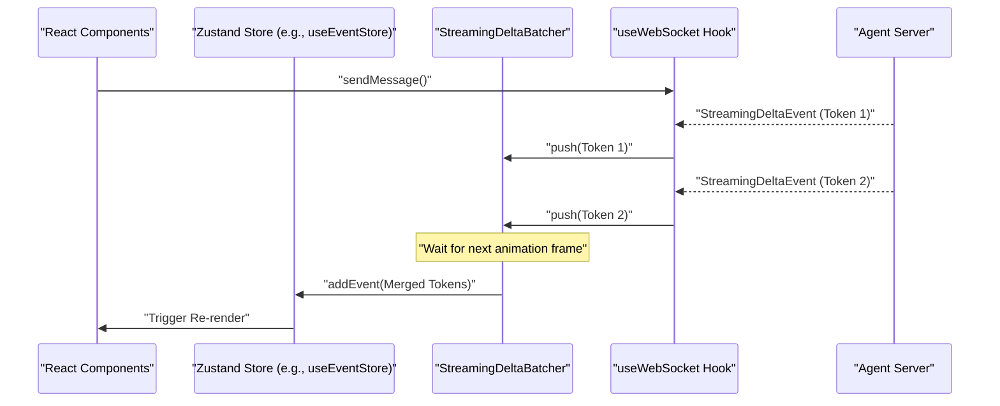

<!-- source: DeepWiki mcp.deepwiki.com · repo All-Hands-AI/OpenHands · page 16 State Management · fetched 2026-10-26 -->

# State Management

<details>
<summary>Relevant source files</summary>

The following files were used as context for generating this wiki page:

- [__tests__/hooks/chat/use-model-interceptor.test.tsx](__tests__/hooks/chat/use-model-interceptor.test.tsx)
- [__tests__/stores/btw-store.test.ts](__tests__/stores/btw-store.test.ts)
- [__tests__/stores/model-store.test.ts](__tests__/stores/model-store.test.ts)
- [__tests__/stores/pinned-conversations-store.test.ts](__tests__/stores/pinned-conversations-store.test.ts)
- [src/components/features/conversation-panel/conversation-card/conversation-card-title.tsx](src/components/features/conversation-panel/conversation-card/conversation-card-title.tsx)
- [src/hooks/chat/use-model-interceptor.ts](src/hooks/chat/use-model-interceptor.ts)

</details>


Agent Canvas utilizes a dual-layered state management architecture to handle the complexities of real-time AI interactions, multi-backend synchronization, and persistent UI state. The system distinguishes between **Server State** (handled by TanStack Query) and **Client/UI State** (handled by Zustand).

## Architectural Overview

The application follows a strict separation of concerns regarding how data is fetched, cached, and shared across components.

*   **Server State (TanStack Query):** Manages all asynchronous data fetched from the `agent-server` or external registries (e.g., NPM for updates). It handles caching, deduplication of requests, background refetching, and loading/error states.
*   **Client State (Zustand):** Manages local-only UI state that needs to be shared across the component tree but does not originate from a server API (e.g., sidebar collapse state, browser tool visibility, and real-time event accumulation).

### State Interaction Diagram

The following diagram illustrates how the different state layers interact with the UI and the communication layer.

```mermaid
graph TD
    subgraph "Server Space (agent-server / Cloud)"
        AS_API["Agent Server REST API"] -- "REST Endpoints"
        AS_WS["Agent Server WebSocket"] -- "WebSocket Events"
    end

    subgraph "Data Management Layer"
        TQ_Cache["TanStack Query Cache"] -- "Cached Data"
        Z_Stores["Zustand Stores"] -- "Client State"
        AB_Context["ActiveBackendContext"] -- "Active Backend Info"
    end

    subgraph "UI Space"
        RC["React Components"] -- "Render UI"
        O_UI["Optimistic UI State"] -- "User Input"
    end

    AS_API <--> TQ_Cache
    AS_WS --> Z_Stores
    TQ_Cache --> RC
    Z_Stores --> RC
    AB_Context --> TQ_Cache
    RC --> O_UI
    O_UI --> Z_Stores

    style TQ_Cache stroke-width:2px
    style Z_Stores stroke-width:2px
```
Sources: [src/contexts/conversation-websocket-context.tsx:144-180](), [src/hooks/query/use-conversation-history.ts:1-98]().

## TanStack Query Configuration

Agent Canvas uses a centralized `QueryClient` to manage server data. Key features include:

*   **Centralized Key Management:** All query keys are defined in a factory pattern to prevent collision and ensure cache invalidation works predictably [src/hooks/query/query-keys.ts:8-81]().
*   **Historical Synchronization:** The `useConversationHistory` hook fetches historical events via REST, which are then merged into the real-time event store [src/hooks/query/use-conversation-history.ts:12-45]().
*   **Cache Strategy:** Global configuration sets `staleTime` and `gcTime` for configuration data to minimize redundant network traffic [src/hooks/query/query-keys.ts:92-95]().

### Query Key Conventions

To prevent typos and ensure cache consistency, query keys are centralized in `src/hooks/query/query-keys.ts`.

| Domain | Key Factory / Constant | Purpose |
| :--- | :--- | :--- |
| **Settings** | `SETTINGS_QUERY_KEYS` | Fetches personal or global settings [src/hooks/query/query-keys.ts:15-19]() |
| **LLM Profiles** | `LLM_PROFILES_QUERY_KEYS` | Manages available LLM configurations [src/hooks/query/query-keys.ts:21-23]() |
| **Plugins** | `PLUGINS_QUERY_KEYS` | Tracks marketplace, installed, and local plugins [src/hooks/query/query-keys.ts:48-55]() |
| **Canvas Extensions** | `CANVAS_EXTENSIONS_QUERY_KEYS` | Manages installed Canvas extensions [src/hooks/query/query-keys.ts:57-70]() |
| **Workspaces**| `LOCAL_WORKSPACES_QUERY_KEYS` | Manages local workspace directories [src/hooks/query/query-keys.ts:44-46]() |
| **App Updates** | `APP_UPDATE_QUERY_KEYS` | Checks for the latest published Agent Canvas version [src/hooks/query/query-keys.ts:78-80]() |

For details on caching strategies and key factories, see [TanStack Query Configuration and Conventions](#16.2).

Sources: [src/hooks/query/query-keys.ts:1-97](), [src/hooks/query/use-conversation-history.ts:12-45]().

## Zustand Store Architecture

Zustand is used for high-frequency updates and complex UI state, particularly for real-time event streams where a React state write per frame would be inefficient.

### The Conversation Store (`useConversationStore`)

The `useConversationStore` manages the state related to the active conversation, including the visibility of UI panels, selected tabs, and user input. It also handles the temporary storage of files and images for messages. The right-side drawer's open/closed state (`isRightPanelShown`, `hasRightPanelToggled`) is session-only, meaning it resets on app load but persists across in-app navigation [src/stores/conversation-store.ts:120-128]().

The store also manages the currently selected tab within the conversation panel, such as "files", "commits", "browser", "terminal", "planner", "tasklist", and "usage" [src/stores/conversation-store.ts:8-15](). This selection can be persisted to local storage for a given conversation ID [src/components/features/conversation/conversation-tabs/conversation-tabs.tsx:66-67]().

### The Event Store (`useEventStore`)

The `useEventStore` is the primary store for conversation events. It handles:
*   **Deduplication:** Prevents duplicate events from appearing in the UI by tracking IDs in a `Set` [src/stores/use-event-store.ts:99-107]().
*   **Chronological Sorting:** Ensures events are displayed in order, even when paginated history is loaded out of sequence [src/stores/use-event-store.ts:131-135]().
*   **Streaming Compaction:** Merges consecutive `StreamingDeltaEvent` frames from the same sender into a single event to prevent the store from growing quadratically [src/stores/use-event-store.ts:111-121]().

### The Model Store (`useModelStore`)

The `useModelStore` manages the display of LLM profile information and profile switches within a conversation. It stores entries scoped to specific conversations, allowing for inline display of available profiles and recording when a profile switch occurs [__tests__/stores/model-store.test.ts:26-37](). It also handles optimistic updates for active profiles [__tests__/stores/model-store.test.ts:54-58](). The store provides methods to `show` profiles, `recordSwitch`, `clearActiveProfile`, `clear` entries for a conversation, `clearAll` entries, and `seedSwitches` for historical data [__tests__/stores/model-store.test.ts:27-132](). This store is integrated with the `/model` command interception logic [src/hooks/chat/use-model-interceptor.ts:10-10]().

### The BTW Store (`useBtwStore`)

The `useBtwStore` manages "By The Way" (BTW) entries, which are typically questions or prompts from the user that are pending a response from the agent. These entries are scoped to specific conversations and can have statuses like "pending", "done", or "error" [__tests__/stores/btw-store.test.ts:16-40](). It provides methods to `addPending` entries, `resolve` them with a response, `fail` them with an error, and `dismiss` them [__tests__/stores/btw-store.test.ts:16-56]().

### The Pinned Conversations Store (`usePinnedConversationsStore`)

The `usePinnedConversationsStore` manages conversations that users have explicitly pinned. It stores pinned conversation IDs per backend and persists this state to `localStorage` [__tests__/stores/pinned-conversations-store.test.ts:4-5](). It provides methods to `pinConversation`, `unpinConversation`, `togglePin`, and `pruneMissingConversations` to keep the list synchronized with available conversations [__tests__/stores/pinned-conversations-store.test.ts:13-79]().

### Optimistic Updates

The `useOptimisticUserMessageStore` manages messages that the user has sent but the server has not yet echoed back. The `ConversationWebSocketProvider` reconciles these by consuming matching pending messages when the server echo arrives [src/contexts/conversation-websocket-context.tsx:152-154]().

For a full catalog of stores and their responsibilities, see [Zustand Stores](#16.1).

Sources: [src/stores/use-event-store.ts:1-208](), [src/contexts/conversation-websocket-context.tsx:144-180](), [src/stores/conversation-store.ts:1-396](), [src/components/features/conversation-panel/conversation-card/conversation-card-title.tsx:1-59](), [src/components/features/conversation/conversation-tabs/conversation-tabs.tsx:15-153](), [src/components/features/conversation/conversation-tabs/conversation-tabs-context-menu.tsx:8-118](), [src/components/features/conversation/conversation-main/conversation-main.tsx:8-129](), [src/components/features/conversation/conversation-main/chat-interface-wrapper.tsx:5-27](), [src/components/features/conversation/conversation-tabs/conversation-tab-content/conversation-tab-content.tsx:6-38](), [__tests__/stores/model-store.test.ts:1-207](), [src/hooks/chat/use-model-interceptor.ts:1-92](), [__tests__/stores/btw-store.test.ts:1-118](), [__tests__/stores/pinned-conversations-store.test.ts:1-130]().

## WebSocket and Sync Logic

Real-time state is synchronized via specialized hooks that bridge the WebSocket transport to the Zustand stores.

*   **`useWebSocket`**: A low-level hook that manages connection lifecycle, exponential backoff with jitter, and authentication handshakes [src/hooks/use-websocket.ts:22-152]().
*   **`useBashCommandRunner`**: Orchestrates a persistent WebSocket to the `/sockets/bash-events` endpoint, providing a Promise-based interface for synchronous-like bash interactions [src/hooks/use-bash-command-runner.ts:61-206]().
*   **`StreamingDeltaBatcher`**: Coalesces high-frequency streaming tokens to ensure store commits occur at most once per animation frame [src/contexts/conversation-websocket-context.tsx:164-180]().

### Communication Logic Flow


Sources: [src/contexts/conversation-websocket-context.tsx:161-177](), [src/utils/streaming-delta-batcher.ts:1-50]().

Sources: [src/hooks/use-websocket.ts:1-184](), [src/hooks/use-bash-command-runner.ts:1-206](), [src/contexts/conversation-websocket-context.tsx:164-180]().

## Child Pages
- [Zustand Stores](#16.1) — Catalog of all stores (event-store, browser-store, metrics-store, etc.), their responsibilities, and cross-store interaction patterns.
- [TanStack Query Configuration and Conventions](#16.2) — Detailed look at query-client setup, centralized `query-keys.ts`, and the hooks directory conventions.

---

