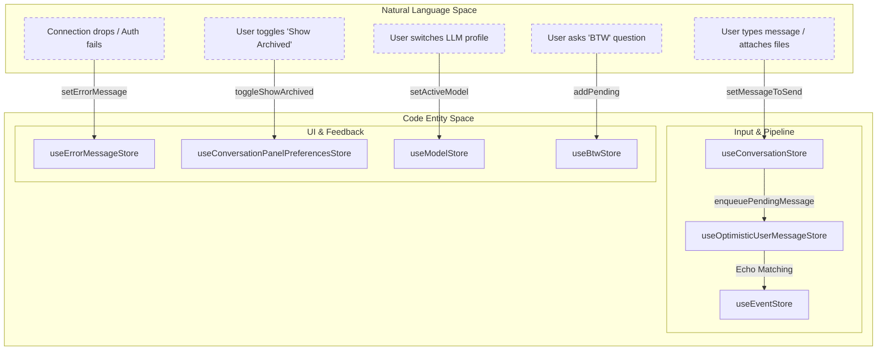
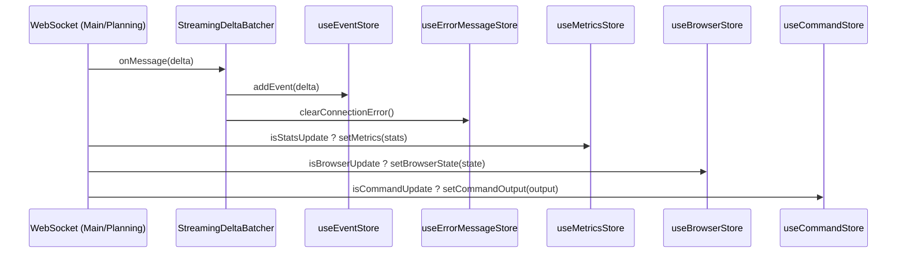

<!-- source: DeepWiki mcp.deepwiki.com · repo All-Hands-AI/OpenHands · page 16.1 Zustand Stores · fetched 2026-10-26 -->

# Zustand Stores

Relevant source files

The following files were used as context for generating this wiki page:

- [__tests__/components/chat/error-message-banner.test.tsx](__tests__/components/chat/error-message-banner.test.tsx)
- [__tests__/components/features/conversation-panel/start-task-status-badge.test.tsx](__tests__/components/features/conversation-panel/start-task-status-badge.test.tsx)
- [__tests__/hooks/chat/use-model-interceptor.test.tsx](__tests__/hooks/chat/use-model-interceptor.test.tsx)
- [__tests__/stores/btw-store.test.ts](__tests__/stores/btw-store.test.ts)
- [__tests__/stores/error-message-store.test.ts](__tests__/stores/error-message-store.test.ts)
- [__tests__/stores/model-store.test.ts](__tests__/stores/model-store.test.ts)
- [__tests__/stores/pinned-conversations-store.test.ts](__tests__/stores/pinned-conversations-store.test.ts)
- [__tests__/utils/error-handler.test.ts](__tests__/utils/error-handler.test.ts)
- [__tests__/utils/status.test.ts](__tests__/utils/status.test.ts)
- [__tests__/utils/utils.test.ts](__tests__/utils/utils.test.ts)
- [src/components/features/chat/error-message-banner.tsx](src/components/features/chat/error-message-banner.tsx)
- [src/components/features/conversation-panel/conversation-card/conversation-card-title.tsx](src/components/features/conversation-panel/conversation-card/conversation-card-title.tsx)
- [src/components/features/conversation-panel/start-task-card/start-task-status-badge.tsx](src/components/features/conversation-panel/start-task-card/start-task-status-badge.tsx)
- [src/components/shared/buttons/conversation-confirmation-buttons.tsx](src/components/shared/buttons/conversation-confirmation-buttons.tsx)
- [src/hooks/chat/use-chat-input-events.ts](src/hooks/chat/use-chat-input-events.ts)
- [src/hooks/chat/use-model-interceptor.ts](src/hooks/chat/use-model-interceptor.ts)
- [src/stores/error-message-store.ts](src/stores/error-message-store.ts)
- [src/utils/error-handler.ts](src/utils/error-handler.ts)
- [src/utils/status.ts](src/utils/status.ts)
- [src/utils/transcript-export/index.ts](src/utils/transcript-export/index.ts)
- [src/utils/transcript-export/load-complete-events.ts](src/utils/transcript-export/load-complete-events.ts)
- [src/utils/utils.ts](src/utils/utils.ts)

Agent Canvas utilizes **Zustand** for lightweight, performant state management. Stores are primarily used for UI-driven state that needs to be shared across deep component trees, persisted to `localStorage`, or used to manage complex event pipelines that fall outside the typical request/response cycle of TanStack Query.

## Architecture Overview

The application follows a pattern where stores are defined in `src/stores/` and consumed via React hooks. For data that requires persistence (like user preferences or workspace history), the `zustand/middleware` `persist` is used to synchronize state with `localStorage` [src/stores/pinned-conversations-store.ts:25-27]().

### Data Flow and Store Interaction

The following diagram illustrates how different stores interact during a typical agent session, bridging user intent to code entities:

**Store Interaction Flow**

**Sources:** [src/stores/conversation-store.ts:23-44](), [src/stores/optimistic-user-message-store.ts:16-37](), [src/stores/error-message-store.ts:8-19](), [src/stores/conversation-panel-preferences-store.ts:38-48](), [src/stores/model-store.ts:12-23](), [src/stores/btw-store.ts:12-23]()

---

## Catalog of Core Stores

### 1. Conversation Store (`useConversationStore`)
Manages the interactive state of the chat input and the right-hand side panels.

*   **Responsibility:** Tracks draft messages, file attachments (images and documents), panel visibility, and the current conversation mode (`code` or `plan`) [src/stores/conversation-store.ts:23-44]().
*   **Session-Only State:** The drawer's open/closed state (`isRightPanelShown`) is session-only, while the `selectedTab` is restored from `localStorage` via the `useConversationLocalStorageState` hook to ensure users don't lose their context across reloads [src/components/features/conversation/conversation-tabs/conversation-tabs.tsx:57-66]().
*   **Key Functions:** `setSelectedTab` and `setPlanContent` are used to coordinate the planning agent's output with the UI [src/components/features/conversation/conversation-tabs/conversation-tabs.tsx:36-37]().
Sources: [src/stores/conversation-store.ts:23-44](), [src/components/features/conversation/conversation-tabs/conversation-tabs.tsx:57-66](), [src/components/features/conversation/conversation-tabs/conversation-tabs.tsx:36-37]()

### 2. Optimistic User Message Store (`useOptimisticUserMessageStore`)
Handles the "immediate feedback" loop to prevent UI lag during WebSocket communication.

*   **Responsibility:** Stores messages sent by the user that have not yet been acknowledged by the server.
*   **Consumption Logic:** The `ConversationWebSocketProvider` uses `consumeMatchingPendingMessage` to pop the correct optimistic bubble when a `UserMessageEvent` returns from the server [src/contexts/conversation-websocket-context.tsx:155-157]().
*   **Text Matching:** It matches server echoes by concatenating `text` fields from the server's `llm_message.content` to reconstruct the original prompt [src/contexts/conversation-websocket-context.tsx:110-119]().
Sources: [src/contexts/conversation-websocket-context.tsx:155-157](), [src/contexts/conversation-websocket-context.tsx:110-119]()

### 3. Event Store (`useEventStore`)
The primary repository for all agent actions and observations within a session.

*   **Responsibility:** Aggregates events from the WebSocket and REST history. It supports streaming deltas via a batching mechanism to prevent excessive re-renders [src/contexts/conversation-websocket-context.tsx:162-180]().
*   **State Management:** Provides `addEvent`, `addEvents`, and `clearEventsForConversation` to manage the event timeline [src/contexts/conversation-websocket-context.tsx:148-152]().
*   **Sorting & Deduplication:** Newly-added events are de-duped against existing `eventIds` (a `Set` for O(1) lookup) and re-sorted by timestamp [src/stores/use-event-store.ts:99-107](), [src/stores/use-event-store.ts:159-208]().
Sources: [src/contexts/conversation-websocket-context.tsx:162-180](), [src/contexts/conversation-websocket-context.tsx:148-152](), [src/stores/use-event-store.ts:99-107](), [src/stores/use-event-store.ts:159-208]()

### 4. Conversation Panel Preferences Store (`useConversationPanelPreferencesStore`)
Persists user UI choices for the sidebar and conversation list.

*   **Responsibility:** Tracks visibility of older/archived conversations, repository metadata, LLM profiles, and tags [src/stores/conversation-panel-preferences-store.ts:38-48]().
*   **Persistence:** Uses `zustand/persist` with `localStorage` to ensure the sidebar configuration (like `organizeMode` or `conversationSort`) survives full application reloads [src/stores/conversation-panel-preferences-store.ts:124-126]().
*   **Logic:** Includes togglers like `toggleShowArchivedConversations` and `toggleShowOlderConversations` [src/stores/conversation-panel-preferences-store.ts:78-81](), [src/stores/conversation-panel-preferences-store.ts:82-85]().
Sources: [src/stores/conversation-panel-preferences-store.ts:38-48](), [src/stores/conversation-panel-preferences-store.ts:124-126](), [src/stores/conversation-panel-preferences-store.ts:78-81](), [src/stores/conversation-panel-preferences-store.ts:82-85]()

### 5. Model Store (`useModelStore`)
Manages the currently active LLM profile and model.

*   **Responsibility:** Stores the `activeModel` and `activeLlmProfileId` for the current conversation. This is crucial for displaying the correct model in the UI and for agent interactions [src/stores/model-store.ts:12-23](). It also stores a history of model changes within a conversation, anchored to specific events [__tests__/stores/model-store.test.ts:27-36]().
*   **Interaction:** The `useSwitchLlmProfile` hook updates this store when a user changes their LLM profile [src/hooks/mutation/use-switch-llm-profile.ts:20-21](). The `recordModelSwitchMessage` utility also interacts with this store to log model changes in the conversation [src/hooks/chat/record-model-switch-message.ts:10-11](). The `/model` command handler in `useModelInterceptor` uses this store to display available profiles or switch the active one [src/hooks/chat/use-model-interceptor.ts:27-79]().
Sources: [src/stores/model-store.ts:12-23](), [src/hooks/mutation/use-switch-llm-profile.ts:20-21](), [src/hooks/chat/record-model-switch-message.ts:10-11](), [__tests__/stores/model-store.test.ts:27-36](), [src/hooks/chat/use-model-interceptor.ts:27-79]()

### 6. Error Message Store (`useErrorMessageStore`)
Manages global error state.

*   **Responsibility:** Stores an `errorMessage` string, an `errorType` (either "connection" or "conversation"), an optional `errorCode`, and an `errorClassification` [src/stores/error-message-store.ts:8-21](). "Connection" errors are transient and auto-clear, while "conversation" errors are sticky [src/stores/error-message-store.ts:8-9]().
*   **Interaction:** The WebSocket provider calls `clearConnectionError` upon receiving successful deltas, signaling recovered connectivity [src/contexts/conversation-websocket-context.tsx:169-178](). The `ErrorMessageBanner` component consumes this store to display relevant error messages, including code-specific headers and recovery actions [src/components/features/chat/error-message-banner.tsx:14-15](), [src/components/features/chat/error-message-banner.tsx:122-127]().
Sources: [src/stores/error-message-store.ts:8-21](), [src/contexts/conversation-websocket-context.tsx:169-178](), [src/components/features/chat/error-message-banner.tsx:14-15](), [src/components/features/chat/error-message-banner.tsx:122-127](), [src/stores/error-message-store.ts:8-9]()

### 7. Browser Store (`useBrowserStore`)
Tracks the state of the agent's internal browser.

*   **Responsibility:** Stores the current `url`, `screenshot`, and `content` of the browser, along with its `status` [src/stores/browser-store.ts:12-23]().
*   **Interaction:** It is reset whenever a new conversation session begins [src/contexts/conversation-websocket-context.tsx:160]().

Sources: [src/stores/browser-store.ts:12-23](), [src/contexts/conversation-websocket-context.tsx:160]()

### 8. Command Store (`useCommandStore`)
Manages the terminal command history and output buffers.

*   **Responsibility:** Stores `commandHistory` and `commandOutput` for the terminal tab [src/stores/command-store.ts:12-23]().
*   **Interaction:** The `ConversationWebSocketProvider` updates this store with new command outputs [src/contexts/conversation-websocket-context.tsx:159]().

Sources: [src/stores/command-store.ts:12-23](), [src/contexts/conversation-websocket-context.tsx:159]()

### 9. Metrics Store (`useMetricsStore`)
Tracks token usage and execution statistics for the active session.

*   **Responsibility:** Stores `tokenUsage`, `cost`, and `executionStats` for the current conversation [src/stores/metrics-store.ts:12-23]().
*   **Interaction:** The `ConversationWebSocketProvider` updates this store with `isStatsUpdate` events [src/contexts/conversation-websocket-context.tsx:66]().

Sources: [src/stores/metrics-store.ts:12-23](), [src/contexts/conversation-websocket-context.tsx:66]()

### 10. Sidebar Store (`useSidebarStore`)
Manages the state of the main application sidebar.

*   **Responsibility:** Controls the `isCollapsed` state of the sidebar and the `activeTab` within it [src/stores/sidebar-store.ts:12-23]().
*   **Persistence:** Uses `zustand/persist` to remember the collapsed state across sessions.

Sources: [src/stores/sidebar-store.ts:12-23]()

### 11. Files Tab Store (`useFilesTabStore`)
Manages the state of the files tab within a conversation.

*   **Responsibility:** Tracks the `selectedFile` and `selectedCommit` in the files tab [src/stores/files-tab-store.ts:12-23]().
*   **Interaction:** Used by components within the files tab to display file content and commit details.

Sources: [src/stores/files-tab-store.ts:12-23]()

### 12. Pinned Conversations Store (`usePinnedConversationsStore`)
Manages user-pinned conversations.

*   **Responsibility:** Stores a map of `pinsByBackendId` to conversation IDs, allowing users to pin conversations for quick access [src/stores/pinned-conversations-store.ts:12-23]().
*   **Persistence:** Uses `zustand/persist` to save pinned conversations to `localStorage` [src/stores/pinned-conversations-store.ts:25-27]().
*   **Interaction:** The `ConversationCard` component interacts with this store to toggle pin status [src/components/features/conversation-panel/conversation-card/conversation-card.tsx:99-100](), [src/components/features/conversation-panel/conversation-card/conversation-card.tsx:205-210](). It also includes logic to prune missing conversations from the pinned list [__tests__/stores/pinned-conversations-store.test.ts:60-79]().

Sources: [src/stores/pinned-conversations-store.ts:12-23](), [src/stores/pinned-conversations-store.ts:25-27](), [src/components/features/conversation-panel/conversation-card/conversation-card.tsx:99-100](), [src/components/features/conversation-panel/conversation-card/conversation-card.tsx:205-210](), [__tests__/stores/pinned-conversations-store.test.ts:60-79]()

### 13. Archived Conversations Store (`useArchivedConversationsStore`)
Manages user-archived conversations.

*   **Responsibility:** Stores a map of `archivesByBackendId` to conversation IDs, allowing users to archive conversations [src/stores/archived-conversations-store.ts:12-23]().
*   **Persistence:** Uses `zustand/persist` to save archived conversations to `localStorage` [src/stores/archived-conversations-store.ts:25-27]().
*   **Interaction:** The `ConversationCard` component interacts with this store to archive/unarchive conversations [src/components/features/conversation-panel/conversation-card/conversation-card.tsx:74-75](), [src/components/features/conversation-panel/conversation-card/conversation-card.tsx:133-138]().

Sources: [src/stores/archived-conversations-store.ts:12-23](), [src/stores/archived-conversations-store.ts:25-27](), [src/components/features/conversation-panel/conversation-card/conversation-card.tsx:74-75](), [src/components/features/conversation-panel/conversation-card/conversation-card.tsx:133-138]()

### 14. Environment Switch Store (`useEnvironmentSwitchStore`)
Manages the state of the environment switch overlay.

*   **Responsibility:** Tracks whether the environment switch overlay is `isOpen` [src/stores/environment-switch-store.ts:12-23]().
*   **Interaction:** Used to control the visibility of the backend selection UI.

Sources: [src/stores/environment-switch-store.ts:12-23]()

### 15. BTW Store (`useBtwStore`)
Manages the "By The Way" (BTW) feature, which provides contextual information or suggestions.

*   **Responsibility:** Stores a map of `entriesByConversation` for BTW questions, each with an `id`, `question`, `status` (pending, done, error), and `response` [src/stores/btw-store.ts:12-23](), [__tests__/stores/btw-store.test.ts:15-20]().
*   **Interaction:** Provides functions to `addPending`, `resolve`, `fail`, and `dismiss` BTW entries, scoped to a specific conversation [__tests__/stores/btw-store.test.ts:23-56]().

Sources: [src/stores/btw-store.ts:12-23](), [__tests__/stores/btw-store.test.ts:15-20](), [__tests__/stores/btw-store.test.ts:23-56]()

---

## Implementation Details

### WebSocket and Store Synchronization
The `ConversationWebSocketProvider` acts as the central orchestrator, routing incoming WebSocket data into various Zustand stores. It uses `createStreamingDeltaBatcher` to coalesce streaming deltas into a single store commit per frame [src/contexts/conversation-websocket-context.tsx:162-177]().

**WebSocket to Store Data Flow**

**Sources:** [src/contexts/conversation-websocket-context.tsx:162-180](), [src/contexts/conversation-websocket-context.tsx:298-310](), [src/contexts/conversation-websocket-context.tsx:159-160]()

### Store Catalog Table

| Store Name | File Path | Primary Responsibility | Persistence |
| :--- | :--- | :--- | :--- |
| `useConversationStore` | `src/stores/conversation-store.ts` | Input drafts, panel toggles, file loading | None (Session) |
| `useEventStore` | `src/stores/use-event-store.ts` | Action/Observation history, streaming deltas | None (In-memory) |
| `useConversationPanelPreferencesStore` | `src/stores/conversation-panel-preferences-store.ts` | Sidebar filters, sort order, metadata visibility | `localStorage` |
| `useOptimisticUserMessageStore` | `src/stores/optimistic-user-message-store.ts` | Immediate UI feedback for sent messages | None |
| `useErrorMessageStore` | `src/stores/error-message-store.ts` | Connection and conversation error states | None |
| `useBrowserStore` | `src/stores/browser-store.ts` | Agent browser state (URL, screenshots) | None |
| `useMetricsStore` | `src/stores/metrics-store.ts` | Token usage, cost, and execution stats | None |
| `useModelStore` | `src/stores/model-store.ts` | Active LLM profile and model | None |
| `useSidebarStore` | `src/stores/sidebar-store.ts` | Sidebar collapsed state and active tab | `localStorage` |
| `useFilesTabStore` | `src/stores/files-tab-store.ts` | Selected file/commit in files tab | None |
| `usePinnedConversationsStore` | `src/stores/pinned-conversations-store.ts` | User-pinned conversations | `localStorage` |
| `useArchivedConversationsStore` | `src/stores/archived-conversations-store.ts` | User-archived conversations | `localStorage` |
| `useEnvironmentSwitchStore` | `src/stores/environment-switch-store.ts` | Environment switch overlay visibility | None |
| `useBtwStore` | `src/stores/btw-store.ts` | "By The Way" contextual messages | None |

**Sources:** [src/stores/conversation-store.ts:23-44](), [src/stores/conversation-panel-preferences-store.ts:124-126](), [src/contexts/conversation-websocket-context.tsx:148-160](), [src/stores/use-event-store.ts:153-157](), [src/stores/model-store.ts:12-23](), [src/stores/error-message-store.ts:8-19](), [src/stores/browser-store.ts:12-23](), [src/stores/command-store.ts:12-23](), [src/stores/metrics-store.ts:12-23](), [src/stores/sidebar-store.ts:12-23](), [src/stores/files-tab-store.ts:12-23](), [src/stores/pinned-conversations-store.ts:12-23](), [src/stores/archived-conversations-store.ts:12-23](), [src/stores/environment-switch-store.ts:12-23](), [src/stores/btw-store.ts:12-23]()

---

