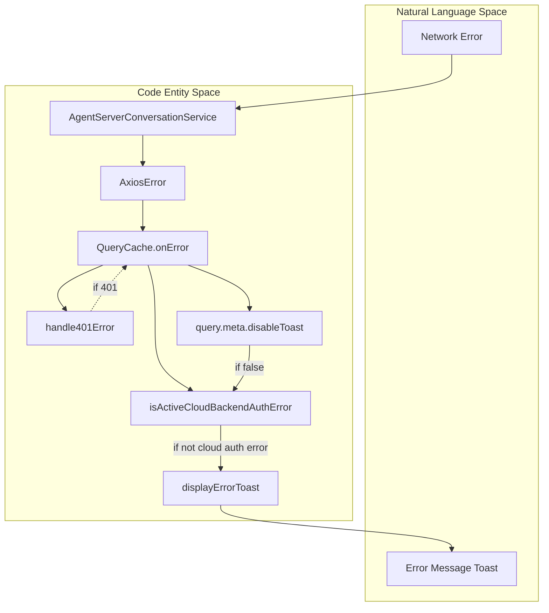
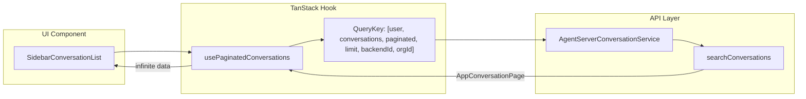
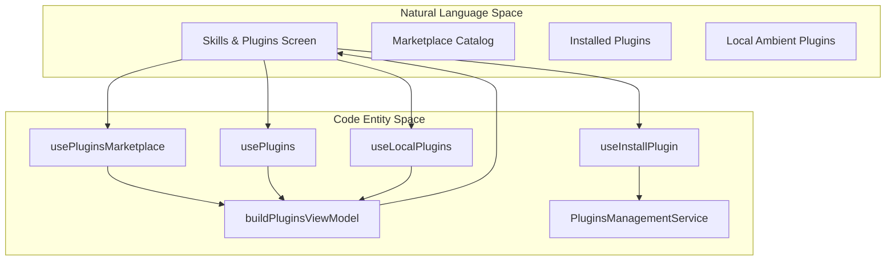

<!-- source: DeepWiki mcp.deepwiki.com · repo All-Hands-AI/OpenHands · page 16.2 TanStack Query Configuration and Conventions · fetched 2026-10-26 -->

# TanStack Query Configuration and Conventions

Relevant source files

The following files were used as context for generating this wiki page:

- [__tests__/components/features/plugins/build-plugins-view-model.test.ts](__tests__/components/features/plugins/build-plugins-view-model.test.ts)
- [__tests__/components/features/plugins/plugin-files-section.test.tsx](__tests__/components/features/plugins/plugin-files-section.test.tsx)
- [__tests__/hooks/query/concurrency-limiter.test.ts](__tests__/hooks/query/concurrency-limiter.test.ts)
- [__tests__/hooks/query/use-automation-run-summaries.test.tsx](__tests__/hooks/query/use-automation-run-summaries.test.tsx)
- [__tests__/hooks/query/use-latest-automation-runs.test.tsx](__tests__/hooks/query/use-latest-automation-runs.test.tsx)
- [__tests__/hooks/query/use-paginated-conversations.test.tsx](__tests__/hooks/query/use-paginated-conversations.test.tsx)
- [__tests__/manifests/automation-interface.test.ts](__tests__/manifests/automation-interface.test.ts)
- [__tests__/routes/plugins-page.test.tsx](__tests__/routes/plugins-page.test.tsx)
- [src/api/plugins-management-service.ts](src/api/plugins-management-service.ts)
- [src/api/plugins-service.test.ts](src/api/plugins-service.test.ts)
- [src/api/plugins-service.ts](src/api/plugins-service.ts)
- [src/components/features/plugins/build-plugins-view-model.ts](src/components/features/plugins/build-plugins-view-model.ts)
- [src/components/features/plugins/plugin-card.tsx](src/components/features/plugins/plugin-card.tsx)
- [src/components/features/plugins/plugin-detail-modal.tsx](src/components/features/plugins/plugin-detail-modal.tsx)
- [src/components/features/plugins/plugin-files-section.tsx](src/components/features/plugins/plugin-files-section.tsx)
- [src/components/features/plugins/plugins-toolbar.tsx](src/components/features/plugins/plugins-toolbar.tsx)
- [src/hooks/query/concurrency-limiter.ts](src/hooks/query/concurrency-limiter.ts)
- [src/hooks/query/query-keys.ts](src/hooks/query/query-keys.ts)
- [src/hooks/query/use-automation-run-summaries.ts](src/hooks/query/use-automation-run-summaries.ts)
- [src/hooks/query/use-latest-automation-runs.ts](src/hooks/query/use-latest-automation-runs.ts)
- [src/hooks/query/use-paginated-conversations.ts](src/hooks/query/use-paginated-conversations.ts)
- [src/manifests/automation-interface.ts](src/manifests/automation-interface.ts)
- [src/routes/skills-plugins.tsx](src/routes/skills-plugins.tsx)

This page details the implementation of **TanStack Query** (formerly React Query) in OpenHands. The architecture focuses on centralized cache management, type-safe query keys, and robust error handling tailored for multi-backend environments.

## Query Client Configuration

The `QueryClient` is initialized via a factory pattern to ensure consistent behavior across the application, including shared error handling and backend health tracking.

### Implementation Details
The `createAgentServerQueryClient` function configures global `QueryCache` and `MutationCache` behaviors [src/query-client-config.ts:31-81]().

*   **Global Error Handling**: Errors (primarily `AxiosError`) are processed by `handle401Error`, which invalidates authentication queries if a 401 status is detected [src/query-client-config.ts:10-14]().
*   **Toast Suppression**: The client respects a `disableToast` flag in the query/mutation `meta` object to prevent UI noise for background or information-only checks [src/query-client-config.ts:48-62]().
*   **Backend Health Integration**: Successful queries record success in the `health-store` if a `backendId` is provided in the query metadata [src/query-client-config.ts:34-40]().
*   **Deduplication**: Error toasts for the same message are throttled using a `shownErrors` Set with a 3-second cooldown [src/query-client-config.ts:54-61]().
*   **Cloud Auth Filtering**: `isActiveCloudBackendAuthError` prevents showing generic error toasts for 401 errors originating from a cloud backend, as these are typically handled by the `ActiveBackendContext` or specific auth flows [src/query-client-config.ts:16-27]().

### Diagram: Query Error Flow
This diagram shows how a failed network request transitions from the service layer through the TanStack Query cache to the UI.

**Sources:** [src/query-client-config.ts:10-78](), [src/utils/custom-toast-handlers.ts]()

## Centralized Query Keys

OpenHands uses a centralized key factory in `query-keys.ts` to prevent typos and ensure cache consistency.

### Key Structure
Keys are defined as `const` objects with `as const` assertions for maximum type safety [src/hooks/query/query-keys.ts:8-81]().

| Key Factory | Scope | Purpose |
| :--- | :--- | :--- |
| `QUERY_KEYS` | Global | Core config and auth status [src/hooks/query/query-keys.ts:8-13](). |
| `SETTINGS_QUERY_KEYS` | Settings | Hierarchical keys for personal vs. global settings [src/hooks/query/query-keys.ts:15-19](). |
| `LLM_PROFILES_QUERY_KEYS` | LLM | Management of LLM configuration profiles [src/hooks/query/query-keys.ts:21-23](). |
| `AGENT_PROFILES_QUERY_KEYS`| Agents | Backend agent profiles with specific retry logic [src/hooks/query/query-keys.ts:25-27](). |
| `PLUGINS_QUERY_KEYS` | Extensions | Marketplace, installed, and local plugins [src/hooks/query/query-keys.ts:48-55](). |
| `CANVAS_EXTENSIONS_QUERY_KEYS`| Canvas | Installed extensions per backend and org [src/hooks/query/query-keys.ts:57-71](). |
| `APP_UPDATE_QUERY_KEYS` | Updates | Tracking latest Agent Canvas version [src/hooks/query/query-keys.ts:78-81](). |

### Cache Configurations
Common cache durations are standardized in `CONFIG_CACHE_OPTIONS` [src/hooks/query/query-keys.ts:91-94]():
*   `staleTime`: 5 minutes.
*   `gcTime` (Garbage Collection): 15 minutes.

**Sources:** [src/hooks/query/query-keys.ts:1-97]()

## Directory Conventions

The codebase follows a strict separation between data fetching (queries) and data modification (mutations).

*   **`src/hooks/query/`**: Contains hooks using `useQuery`, `useInfiniteQuery`, or `useQueries`. These are read-only operations. Examples include `usePlugins` [src/routes/skills-plugins.tsx:17]() and `useAutomationRunSummaries` [src/hooks/query/use-automation-run-summaries.ts:46]().
*   **`src/hooks/mutation/`**: Contains hooks using `useMutation`. These are operations that change state on the server (e.g., `useInstallPlugin` [src/routes/skills-plugins.tsx:46](), `useSetPluginEnabled` [src/routes/skills-plugins.tsx:47](), or `useUninstallPlugin` [src/routes/skills-plugins.tsx:48]()).

## Paginated Conversations Pattern

The `usePaginatedConversations` hook implements an infinite loading pattern for the conversation sidebar [src/hooks/query/use-paginated-conversations.ts:10-61]().

### Implementation Highlights
*   **Multi-Backend Isolation**: The `queryKey` includes `active.backend.id` and `active.orgId`. This ensures that switching backends automatically triggers a fresh fetch and prevents "bleeding" data from one backend into another's UI [src/hooks/query/use-paginated-conversations.ts:21-28]().
*   **Conditional Polling**: A `refetchInterval` of 30 seconds is used, but it is paused when the user is on automation routes to prevent unnecessary background traffic [src/hooks/query/use-paginated-conversations.ts:54](). The `isAutomationsRoute` utility [src/manifests/automation-interface.ts:133-136]() determines if the current path is an automation route.
*   **Health Signal**: It passes `backendId` in the `meta` object. Every successful page fetch re-arms the success status for that specific backend [src/hooks/query/use-paginated-conversations.ts:59]().

### Diagram: Paginated Data Flow

**Sources:** [src/hooks/query/use-paginated-conversations.ts:10-61](), [src/api/conversation-service/agent-server-conversation-service.api.ts](), [src/manifests/automation-interface.ts:133-136]()

## Automation Fan-out Pattern

For the automations dashboard, the app uses a fan-out pattern to fetch run summaries for multiple automations simultaneously.

### Concurrency Management
To prevent overwhelming the server during a fan-out, the `automationRunRequestsLimiter` is used to bound the number of concurrent requests [src/hooks/query/concurrency-limiter.ts:1-10]().

*   **`useAutomationRunSummaries`**: Issues one query per listed automation using `useQueries` [src/hooks/query/use-automation-run-summaries.ts:53-94]().
*   **Dynamic Polling**: The `refetchInterval` is dynamic; it polls every 15 seconds only if the latest run is in a non-terminal state (Pending or Running) [src/hooks/query/use-automation-run-summaries.ts:82-93]().

**Sources:** [src/hooks/query/use-automation-run-summaries.ts:1-108](), [src/hooks/query/use-latest-automation-runs.ts:43-86](), [src/hooks/query/concurrency-limiter.ts:1-10]()

## Plugin Management Pattern

The plugin system utilizes multiple queries and mutations to reconcile the dynamic marketplace with local installations [src/routes/skills-plugins.tsx:41-49]().

### Multi-Source Reconciliation
The `buildPluginsViewModel` utility merges data from three distinct query sources into a unified view model [src/components/features/plugins/build-plugins-view-model.ts:51-130]():
1.  `usePluginsMarketplace`: The dynamic catalog from the server [src/api/plugins-service.ts:68-90]().
2.  `usePlugins`: The list of installed plugins [src/api/plugins-management-service.ts:10-12]().
3.  `useLocalPlugins`: Ambient plugins discovered in local directories [src/api/plugins-service.ts:104-117]().

### Diagram: Plugin State Reconciliation
This diagram associates UI states with the underlying TanStack Query entities and services.

**Sources:** [src/routes/skills-plugins.tsx:35-123](), [src/components/features/plugins/build-plugins-view-model.ts:51-130](), [src/api/plugins-management-service.ts](), [src/api/plugins-service.ts:68-90](), [src/api/plugins-service.ts:104-117]()

### Mutation Handling
Mutations like `useInstallPlugin`, `useSetPluginEnabled`, `useUninstallPlugin`, and `useRefreshPlugin` are used to manage the lifecycle of a plugin [src/routes/skills-plugins.tsx:46-49](). The UI tracks `isPending` states across multiple mutations to determine if a specific plugin card is "busy" [src/routes/skills-plugins.tsx:86-89]().

**Sources:** [src/routes/skills-plugins.tsx:78-113](), [src/hooks/mutation/use-install-plugin.ts](), [src/hooks/mutation/use-set-plugin-enabled.ts](), [src/hooks/mutation/use-uninstall-plugin.ts](), [src/hooks/mutation/use-refresh-plugin.ts]()

---

