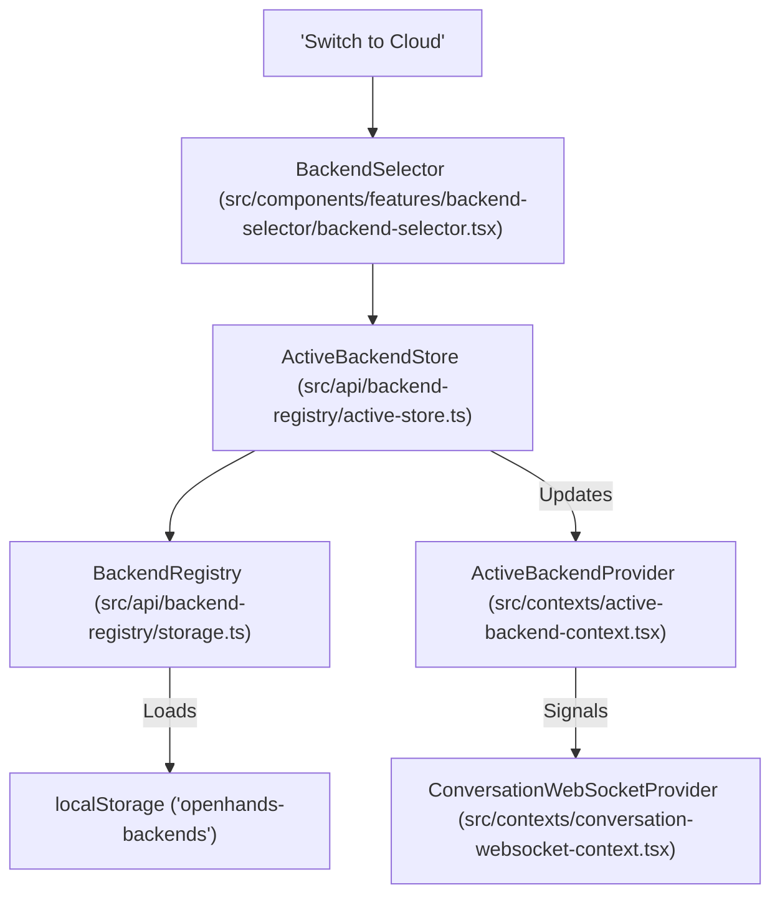
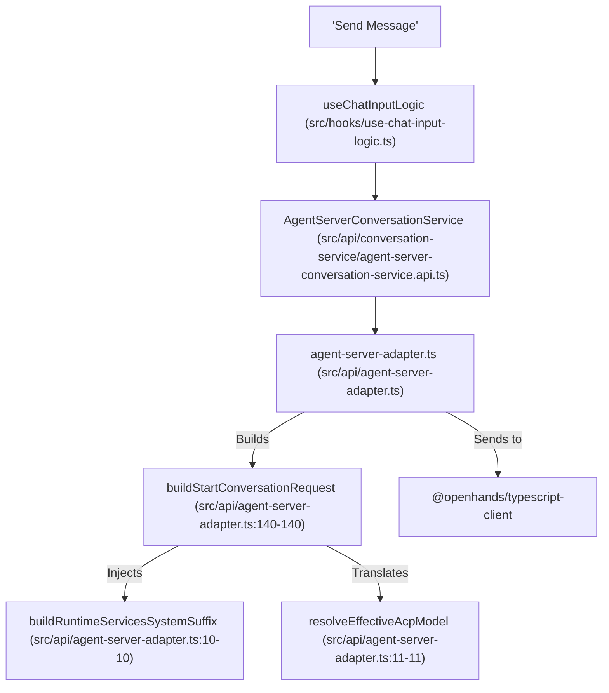

<!-- source: DeepWiki mcp.deepwiki.com · repo All-Hands-AI/OpenHands · page 17 Glossary · fetched 2026-10-26 -->

# Glossary

Relevant source files

The following files were used as context for generating this wiki page:

- [.env.sample](.env.sample)
- [.release-please-manifest.json](.release-please-manifest.json)
- [AGENTS.md](AGENTS.md)
- [README.md](README.md)
- [README.windows.md](README.windows.md)
- [__tests__/api/agent-server-adapter.test.ts](__tests__/api/agent-server-adapter.test.ts)
- [__tests__/api/agent-server-config.test.ts](__tests__/api/agent-server-config.test.ts)
- [__tests__/api/agent-server-conversation-service.test.ts](__tests__/api/agent-server-conversation-service.test.ts)
- [__tests__/api/hooks-service.test.ts](__tests__/api/hooks-service.test.ts)
- [__tests__/api/use-create-conversation-metadata.test.ts](__tests__/api/use-create-conversation-metadata.test.ts)
- [__tests__/components/features/chat/skill-install-restart-banner.test.tsx](__tests__/components/features/chat/skill-install-restart-banner.test.tsx)
- [__tests__/hooks/mutation/use-create-conversation.test.tsx](__tests__/hooks/mutation/use-create-conversation.test.tsx)
- [__tests__/scripts/dev-safe.test.ts](__tests__/scripts/dev-safe.test.ts)
- [config/defaults.json](config/defaults.json)
- [helm/agent-canvas/Chart.yaml](helm/agent-canvas/Chart.yaml)
- [package-lock.json](package-lock.json)
- [package.json](package.json)
- [scripts/check-sdk-version-sync.mjs](scripts/check-sdk-version-sync.mjs)
- [scripts/dev-safe.mjs](scripts/dev-safe.mjs)
- [src/api/agent-server-adapter.test.ts](src/api/agent-server-adapter.test.ts)
- [src/api/agent-server-adapter.ts](src/api/agent-server-adapter.ts)
- [src/api/agent-server-config.ts](src/api/agent-server-config.ts)
- [src/api/conversation-service/agent-server-conversation-service.api.ts](src/api/conversation-service/agent-server-conversation-service.api.ts)
- [src/api/hooks-service.ts](src/api/hooks-service.ts)
- [src/hooks/mutation/use-create-conversation.ts](src/hooks/mutation/use-create-conversation.ts)

This page defines codebase-specific terms, jargon, and domain concepts used throughout the OpenHands project, specifically focusing on the **Agent Canvas** frontend and its integration with the **agent-server**. It serves as a technical reference for onboarding engineers to understand the internal language of the system, bridging natural language concepts to their implementation in code.

## Core System Concepts

### Agent
An autonomous entity capable of perceiving its environment through observations and taking actions.
- **OpenHands Agent**: The default coding agent driven by the `CodeActAgent` logic on the backend [__tests__/api/agent-server-adapter.test.ts:164-164]().
- **ACP Agent**: An agent implementing the **Agent Client Protocol (ACP)**. Agent Canvas supports driving external agents like Claude Code, Codex, or Gemini CLI via the agent-server subprocess model [src/api/agent-server-adapter.ts:90-107](). These are identified by the `kind: "ACPAgent"` discriminator [src/api/agent-server-adapter.ts:90-94]().
- **Agent Profile**: A saved configuration of an agent, including its model, system prompt, and tools [src/api/agent-server-adapter.ts:122-125]().

### Backend
A service instance that hosts the agent execution environment. Agent Canvas supports a multi-backend architecture [AGENTS.md:59-62]().
- **Local Backend**: An `agent-server` running on the user's machine (often via `uvx` or Docker) [README.md:68-73]().
- **Cloud Backend**: A remote agent-server hosted by OpenHands Cloud, accessed via a proxy and authenticated using the **Device Flow** [AGENTS.md:18-18]().
- **Backend Registry**: The frontend module responsible for persisting and switching between different backends using `localStorage` [src/api/backend-registry/active-store.ts:18-18]().

### Runtime Services Info
A metadata block rendered into the agent's system prompt to inform it about reachable services (like the automation backend or the frontend itself) from within its sandbox [src/api/agent-server-adapter.ts:158-180]().
- It is derived from the backend's `/server_info` endpoint and identifies the deployment mode (e.g., `docker`, `dev:automation`) [src/api/agent-server-adapter.ts:158-180]().

## Architectural Components

### Agent-Server
The primary backend service that manages agent sessions, tool execution (terminal, file editor), and WebSocket communication. It is typically pinned to a specific version in the frontend config [config/defaults.json:4-4]().

### Automation Backend
A sidecar service (default port `18001`) that handles scheduled tasks and event-driven workflows [config/defaults.json:21-21](). It uses a separate database for persistence [config/defaults.json:30-30]().

### Ingress Proxy
A local proxy (typically running on port `8000`) that routes traffic between the static frontend, the agent-server, and the automation backend [config/defaults.json:22-22](). Implementation logic is referenced in [scripts/dev-with-automation.mjs:9-15]() and [scripts/dev-safe.mjs:39-47]().

## Data Entities and Implementation

| Term | Definition | Code Pointer |
| :--- | :--- | :--- |
| **AppConversation** | The frontend representation of an agent session, including metadata and execution status. | [src/api/conversation-service/agent-server-conversation-service.types.ts:23-23]() |
| **LLM Profile** | A named configuration for a Language Model (provider, model name, API key). | [src/types/settings.ts:6-7]() |
| **Skill** | A specialized tool or set of instructions. Canvas loads a `SKILLS_CATALOG` from `@openhands/extensions`. | [src/api/agent-server-adapter.ts:4-4]() |
| **MCP** | Model Context Protocol. A standard for LLMs to interact with external tools and data sources. | [src/utils/mcp-config.ts:1-20]() |
| **LookupSecret** | A mechanism for agents to securely access sensitive information (e.g., API keys) without exposing them directly in prompts or logs. The frontend manages these secrets via the `SecretsService` [src/api/secrets-service.ts](). | [src/api/secrets-service.ts]() |
| **Manifest** | A declarative configuration file used for guided automation setup, defining capabilities and validation rules [src/types/automation.ts:1-10](). | [src/types/automation.ts:1-10]() |
| **Session API Key** | A cryptographically secure random API key generated and persisted locally for authentication between the frontend, agent-server, and automation backend in development environments [scripts/dev-safe.mjs:71-73](). It's stored in `~/.openhands/agent-canvas/api-key.txt` [scripts/dev-safe.mjs:87-89](). | [scripts/dev-safe.mjs:71-73]() |

## Natural Language to Code Entity Mapping

### Multi-Backend Orchestration
This diagram shows how the frontend manages connections to different agent environments.

Sources: [src/api/backend-registry/active-store.ts:18-18](), [AGENTS.md:18-18](), [src/contexts/conversation-websocket-context.tsx:1-20]()

### Conversation Initialization Flow
Mapping of the "Start Chat" action to the internal request adaptation layer.

Sources: [src/api/agent-server-adapter.ts:8-17](), [src/hooks/mutation/use-create-conversation.ts:1-10]()

## Technology Stack Jargon

- **uv / uvx**: The Python package installer and runner used to bootstrap the `agent-server` in local development modes [scripts/dev-safe.mjs:56-65]().
- **Zustand**: The state management library used for stores like `conversation-store`, `event-store`, and `model-store` [package.json:72-72]().
- **TanStack Query**: Used for server-state synchronization and caching of settings and conversations [package.json:31-31]().
- **PostHog**: The telemetry and analytics platform used to track app usage, gated by user consent [config/defaults.json:41-44]().

## Abbreviations

- **ACP**: Agent Client Protocol.
- **MCP**: Model Context Protocol.
- **RSI**: Runtime Services Info.
- **SDK**: Software Agent SDK (specifically the `@openhands/typescript-client`).
- **OH_SECRET_KEY**: A 256-bit encryption key used to protect secrets in the local state directory [scripts/dev-safe.mjs:94-106]().

Sources: [src/api/agent-server-adapter.ts:1-207](), [config/defaults.json:1-45](), [scripts/dev-safe.mjs:30-106](), [README.md:33-46](), [AGENTS.md:32-45](), [package.json:22-73](), [__tests__/api/agent-server-adapter.test.ts:164-164]()