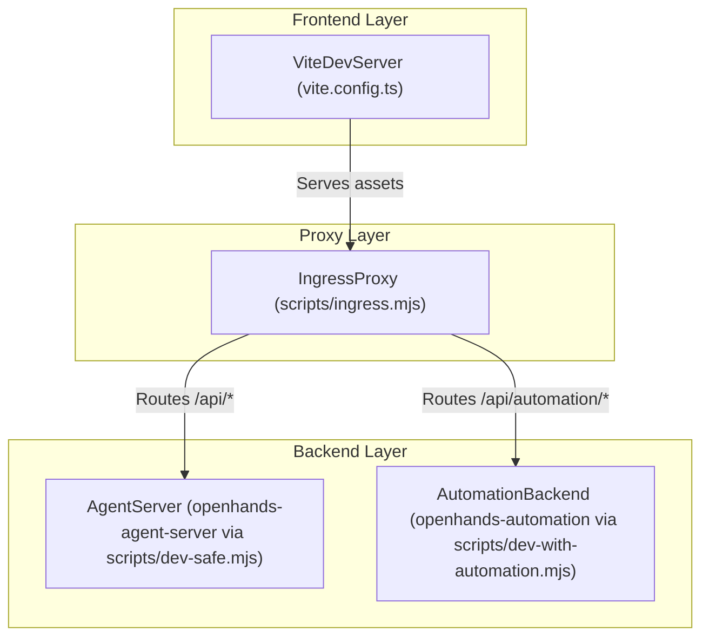
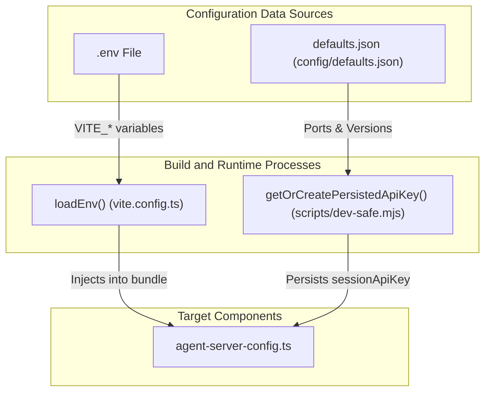

<!-- source: DeepWiki mcp.deepwiki.com · repo All-Hands-AI/OpenHands · page 2 Getting Started · fetched 2026-10-26 -->

# Getting Started

<details>
<summary>Relevant source files</summary>

The following files were used as context for generating this wiki page:

- [.release-please-manifest.json](.release-please-manifest.json)
- [AGENTS.md](AGENTS.md)
- [README.md](README.md)
- [README.windows.md](README.windows.md)
- [__tests__/scripts/dev-safe.test.ts](__tests__/scripts/dev-safe.test.ts)
- [config/defaults.json](config/defaults.json)
- [helm/agent-canvas/Chart.yaml](helm/agent-canvas/Chart.yaml)
- [package-lock.json](package-lock.json)
- [package.json](package.json)
- [scripts/check-sdk-version-sync.mjs](scripts/check-sdk-version-sync.mjs)
- [scripts/dev-safe.mjs](scripts/dev-safe.mjs)

</details>


This page provides a high-level guide for setting up a local development environment for Agent Canvas, running the application in various modes, and understanding the configuration system. Developers new to the codebase should start here to understand the relationship between the React frontend and the `agent-server` backend [AGENTS.md:5-9]().

For detailed instructions, prerequisites, environment variables, and self-hosting strategies, refer to the child pages:
- Development Environment Setup: See [Development Environment Setup](#2.1)
- Configuration and Environment Variables: See [Configuration and Environment Variables](#2.2)
- Self-Hosting and Docker Deployment: See [Self-Hosting and Docker Deployment](#2.3)

---

## Development Workflow Overview

Agent Canvas is a React/TypeScript application that serves as the control center for OpenHands agents [AGENTS.md:30-48](). Development typically involves running the frontend via Vite and connecting it to one or more `agent-server` instances.

### Local Development Stack and Launchers

The recommended local workflow uses `npm run dev`, orchestrated by `scripts/dev-with-automation.mjs` and `scripts/dev-safe.mjs`, which sets up a full stack without requiring Docker.

Diagram: Local Development Stack Architecture to Code Entities

Sources: [scripts/dev-safe.mjs:30-40](), [package.json:74-78]()

---

## Development Environment Setup

Setting up a local development environment requires Node.js (>=24), package management tools, and Python execution via `uv/uvx` [README.md:68](), [package.json:19-21](). The codebase supports multiple runtime modes such as full stack (`dev`), minimal mode without automation (`dev:minimal`), static server mode (`dev:static`), and mock mode (`dev:mock`) [package.json:74-80]().

For complete prerequisites, port allocation strategies managed by `findFreePort` and `findFreePorts`, and state directory isolation via `dev-safe.mjs`, see [Development Environment Setup](#2.1).

Sources: [package.json:74-80](), [__tests__/scripts/dev-safe.test.ts:51-175]()

---

## Configuration and Environment Variables

Agent Canvas combines build-time configurations, environment files (`.env`), default JSON settings (`config/defaults.json`), and runtime injections [config/defaults.json:1-45]().

Diagram: Configuration and Environment Resolution Flow

Sources: [config/defaults.json:1-45](), [scripts/dev-safe.mjs:123-180]()

For full details on `.env` variables, build-time `VITE_*` parameters, and runtime injection of `sessionApiKey` and `runtimeServicesInfo`, see [Configuration and Environment Variables](#2.2).

Sources: [config/defaults.json:1-45](), [scripts/dev-safe.mjs:123-180]()

---

## Deployment and Self-Hosting

For production and containerized deployments, Agent Canvas relies on an all-in-one Docker image orchestrated by `docker/entrypoint.sh`, a three-service topology behind an ingress proxy, and Helm charts (`helm/agent-canvas/Chart.yaml`) [helm/agent-canvas/Chart.yaml:1-6](). Security features include cryptographically secure key generation via `generateRandomApiKey()` persisted in `~/.openhands/agent-canvas/api-key.txt` [scripts/dev-safe.mjs:72-89]().

For a deep dive into container entrypoints, topology, and security guidelines, see [Self-Hosting and Docker Deployment](#2.3).

Sources: [helm/agent-canvas/Chart.yaml:1-6](), [scripts/dev-safe.mjs:72-89]()

---

## Code Quality and Testing Infrastructure

The repository enforces strict quality standards through linting, unit testing with Vitest, mutation testing with Stryker, and end-to-end suites [package.json:84-97]().

```bash
npm run lint           # Run typecheck, eslint, and prettier
npm run test           # Run unit tests via Vitest
npm run test:mutation  # Run mutation testing via Stryker
```

Sources: [package.json:84-97]()

---

