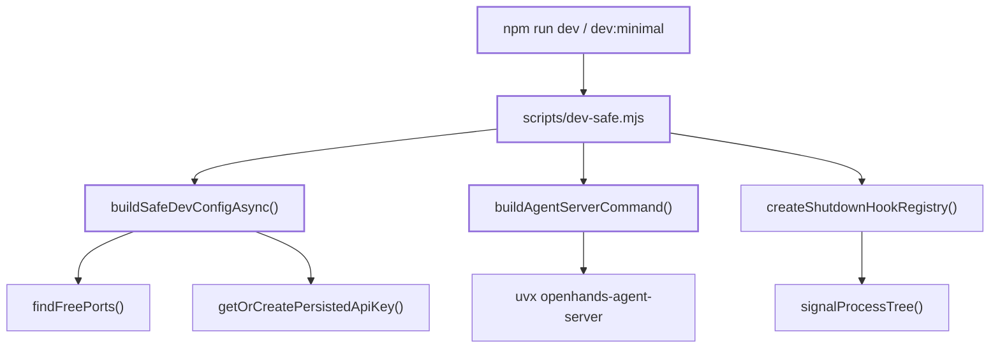
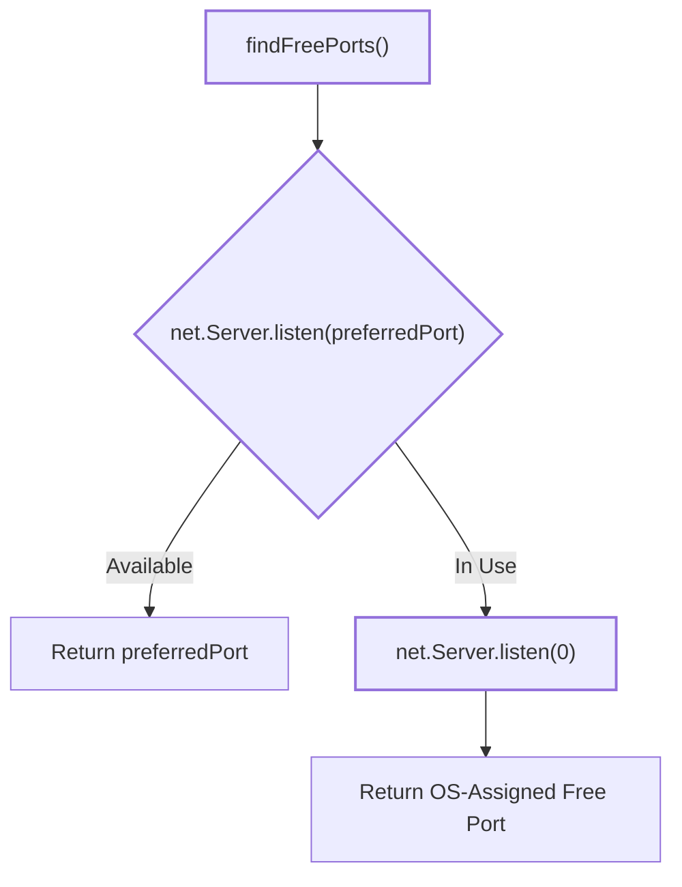
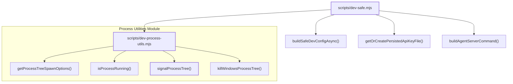

<!-- source: DeepWiki mcp.deepwiki.com · repo All-Hands-AI/OpenHands · page 2.1 Development Environment Setup · fetched 2026-10-26 -->

# Development Environment Setup

<details>
<summary>Relevant source files</summary>

The following files were used as context for generating this wiki page:

- [.github/workflows/desktop-windows.yml](.github/workflows/desktop-windows.yml)
- [.release-please-manifest.json](.release-please-manifest.json)
- [AGENTS.md](AGENTS.md)
- [README.md](README.md)
- [README.windows.md](README.windows.md)
- [__tests__/scripts/dev-extra-backend.test.ts](__tests__/scripts/dev-extra-backend.test.ts)
- [__tests__/scripts/dev-process-utils.test.ts](__tests__/scripts/dev-process-utils.test.ts)
- [__tests__/scripts/dev-safe.test.ts](__tests__/scripts/dev-safe.test.ts)
- [config/defaults.json](config/defaults.json)
- [helm/agent-canvas/Chart.yaml](helm/agent-canvas/Chart.yaml)
- [package-lock.json](package-lock.json)
- [package.json](package.json)
- [scripts/check-sdk-version-sync.mjs](scripts/check-sdk-version-sync.mjs)
- [scripts/dev-extra-backend.mjs](scripts/dev-extra-backend.mjs)
- [scripts/dev-process-utils.mjs](scripts/dev-process-utils.mjs)
- [scripts/dev-safe.mjs](scripts/dev-safe.mjs)
- [tests/e2e/mock-llm/conversations/mock-llm-conversation.spec.ts](tests/e2e/mock-llm/conversations/mock-llm-conversation.spec.ts)

</details>


This page details the local development environment setup for Agent Canvas, covering prerequisites, installation steps, development modes (`npm run dev`, `npm run dev:minimal`, `npm run dev:static`, `npm run dev:mock`), port allocation, state directory initialization, and the `dev-safe.mjs` isolation mechanism.

## Purpose and Prerequisites

Agent Canvas is a React/TypeScript frontend control center that interacts with agent-server and automation backends. Setting up the development environment requires Node.js for frontend compilation and `uv`/`uvx` for managing Python-based agent backends.

### System Requirements

*   **Node.js**: Version 24 or later (enforced via `engines` in `package.json` [package.json:19-21]()).
*   **npm**: The Node.js package manager.
*   **`uv` / `uvx`**: Python package runner used by `scripts/dev-safe.mjs` [scripts/dev-safe.mjs:1-182]() to launch `openhands-agent-server` [config/defaults.json:36]() and `openhands-automation` [config/defaults.json:37]() without manual virtual environment provisioning.

Sources: [package.json:19-21](), [config/defaults.json:36-37](), [scripts/dev-safe.mjs:1-182]()

### Installation Steps

1.  **Clone the repository**:
    ```bash
    git clone https://github.com/All-Hands-AI/OpenHands.git
    cd OpenHands
    ```
2.  **Install Node.js dependencies**:
    ```bash
    npm install
    ```
    This reads `package.json` [package.json:22-73]() and installs all workspace dependencies.
3.  **Ensure `uv` is available**:
    `uvx` must be present in the system `PATH` so that `scripts/dev-safe.mjs` can spawn Python-based backend servers using version pins defined in `config/defaults.json` [config/defaults.json:3-7]().

Sources: [package.json:22-73](), [config/defaults.json:3-7](), [scripts/dev-safe.mjs:1-182]()

---

## Development Modes

Development workflows are defined as npm scripts in `package.json` [package.json:74-80](). 

### Summary of Development Commands

| Script | Command | Description |
| :--- | :--- | :--- |
| `npm run dev` | `node --env-file-if-exists=.env scripts/dev-with-automation.mjs` | Full stack: Frontend + Agent Server + Automation backend orchestrated via ingress. |
| `npm run dev:minimal` | `node --env-file-if-exists=.env scripts/dev-safe.mjs` | Minimal stack: Frontend + Agent Server (managed via `dev-safe.mjs`). |
| `npm run dev:static` | `node --env-file-if-exists=.env scripts/dev-static.mjs` | Static build server combined with backend services. |
| `npm run dev:mock` | `npm run make-i18n && cross-env VITE_MOCK_API=true react-router dev` | Frontend running standalone with MSW mocking backend responses. |

Sources: [package.json:74-80]()

### `npm run dev` and `npm run dev:minimal` (Stack Orchestration)

The `dev-safe.mjs` script (`scripts/dev-safe.mjs`) builds the safe dev configuration using `buildSafeDevConfigAsync` [__tests__/scripts/dev-safe.test.ts:17-20](), checking free ports and setting up API keys.

Title: "Safe Dev Orchestration Data Flow"

Sources: [scripts/dev-safe.mjs:1-182](), [__tests__/scripts/dev-safe.test.ts:17-20]()

### `npm run dev:mock` (Mock API Mode)

In mock mode (`VITE_MOCK_API=true`), Mock Service Worker (MSW) intercepts network requests at the browser layer, avoiding the need for a live Python backend. Translation files are generated via `scripts/make-i18n-translations.cjs` [package.json:80]() prior to starting the Vite development server.

Sources: [package.json:74-80]()

---

## Port Allocation and State Directory Initialization

### Port Allocation Mechanics
Port selection is handled by `findFreePort` and `findFreePorts` in `scripts/dev-safe.mjs`, backed by Node's `net` module [__tests__/scripts/dev-safe.test.ts:51-175](). If preferred ports (such as `18000` for the agent server or `3001` for Vite) are occupied, the allocator dynamically binds to OS-assigned free ports [__tests__/scripts/dev-safe.test.ts:68-91]().

Title: "Port Allocation Resolution Flow"

Sources: [__tests__/scripts/dev-safe.test.ts:51-175](), [scripts/dev-safe.mjs:1-182]()

### State Directory and Cryptographic Key Initialization
Agent Canvas initializes its state in `~/.openhands/agent-canvas/` [scripts/dev-safe.mjs:84-89](). 
*   **API Key (`api-key.txt`)**: Generated via `generateRandomApiKey()` (64-character hex string) and persisted with file mode `0o600` [scripts/dev-safe.mjs:72-172](). Loaded via `getOrCreatePersistedApiKey()` [scripts/dev-safe.mjs:148-180]() so that session keys remain stable across restarts.
*   **Secret Key (`secret-key.txt`)**: Stored in the same state directory to ensure development and Docker environments share consistent encryption keys [scripts/dev-safe.mjs:101-106]().

Sources: [scripts/dev-safe.mjs:72-180]()

---

## `dev-safe.mjs` Isolation Mechanism

The `scripts/dev-safe.mjs` orchestration script encapsulates lifecycle management, error handling, and clean shutdown procedures.

Title: "Code-Entity Space: dev-safe.mjs and Process Utilities"

Sources: [scripts/dev-safe.mjs:1-182](), [scripts/dev-process-utils.mjs:1-150]()

### Process Tree Isolation and Cleanup
To prevent zombie Python processes and lingering server handles when terminating development tasks, `scripts/dev-process-utils.mjs` provides robust process group control [scripts/dev-process-utils.mjs:1-150]().
*   **POSIX Process Groups**: Spawns child services with `getProcessTreeSpawnOptions()` (`detached: true`) so they become process group leaders [scripts/dev-process-utils.mjs:34-40](). On `SIGINT`, `signalProcessTree()` sends the signal to `-pid`, terminating wrapper chains (`launcher -> uvx -> python`) [scripts/dev-process-utils.mjs:76-97]().
*   **Windows Process Trees**: Uses `killWindowsProcessTree()` invoking `taskkill /pid <pid> /t /f` to clean up child processes on Windows platforms where process groups are unsupported [scripts/dev-process-utils.mjs:118-129]().

Sources: [scripts/dev-safe.mjs:1-182](), [scripts/dev-process-utils.mjs:1-150]()

---

