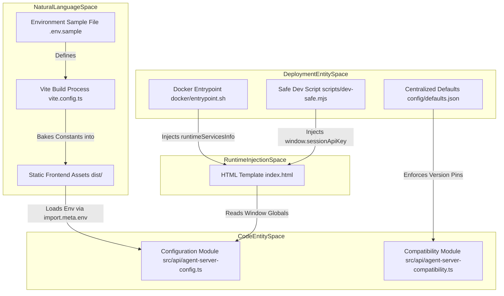
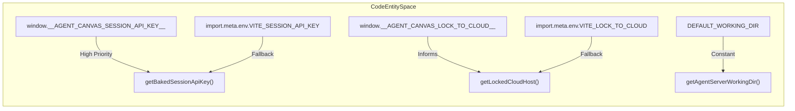

<!-- source: DeepWiki mcp.deepwiki.com · repo All-Hands-AI/OpenHands · page 2.2 Configuration and Environment Variables · fetched 2026-10-26 -->

# Configuration and Environment Variables

Relevant source files

The following files were used as context for generating this wiki page:

- [.env.sample](.env.sample)
- [.github/pr-assets/pr-16605-test-results.png](.github/pr-assets/pr-16605-test-results.png)
- [__tests__/api/agent-server-adapter.test.ts](__tests__/api/agent-server-adapter.test.ts)
- [__tests__/api/agent-server-config.test.ts](__tests__/api/agent-server-config.test.ts)
- [__tests__/api/agent-server-conversation-service.test.ts](__tests__/api/agent-server-conversation-service.test.ts)
- [__tests__/api/hooks-service.test.ts](__tests__/api/hooks-service.test.ts)
- [__tests__/api/use-create-conversation-metadata.test.ts](__tests__/api/use-create-conversation-metadata.test.ts)
- [__tests__/components/features/chat/skill-install-restart-banner.test.tsx](__tests__/components/features/chat/skill-install-restart-banner.test.tsx)
- [__tests__/hooks/mutation/use-create-conversation.test.tsx](__tests__/hooks/mutation/use-create-conversation.test.tsx)
- [__tests__/scripts/dev-static.test.ts](__tests__/scripts/dev-static.test.ts)
- [__tests__/scripts/dev-with-automation.test.ts](__tests__/scripts/dev-with-automation.test.ts)
- [__tests__/scripts/static-server.test.ts](__tests__/scripts/static-server.test.ts)
- [docker/entrypoint.sh](docker/entrypoint.sh)
- [scripts/dev-static.mjs](scripts/dev-static.mjs)
- [scripts/dev-with-automation.mjs](scripts/dev-with-automation.mjs)
- [scripts/runtime-services-info.mjs](scripts/runtime-services-info.mjs)
- [scripts/static-server.mjs](scripts/static-server.mjs)
- [src/api/agent-server-adapter.test.ts](src/api/agent-server-adapter.test.ts)
- [src/api/agent-server-adapter.ts](src/api/agent-server-adapter.ts)
- [src/api/agent-server-config.ts](src/api/agent-server-config.ts)
- [src/api/conversation-service/agent-server-conversation-service.api.ts](src/api/conversation-service/agent-server-conversation-service.api.ts)
- [src/api/hooks-service.ts](src/api/hooks-service.ts)
- [src/hooks/mutation/use-create-conversation.ts](src/hooks/mutation/use-create-conversation.ts)
- [vite.config.ts](vite.config.ts)

## Purpose and Scope

Agent Canvas utilizes a multi-layered configuration system designed to support diverse deployment models—from local development via `uvx` to containerized Docker environments and Electron desktop applications. This system bridges build-time constants, centralized defaults, and dynamic runtime injection to ensure the frontend can discover and authenticate with backend services seamlessly.

This document details the configuration architecture of Agent Canvas, explaining how environment variables (`.env.sample`), centralized defaults (`config/defaults.json`), build-time flags (`VITE_*`), runtime injection (`sessionApiKey` and `runtimeServicesInfo`), and core configuration modules (`src/api/agent-server-config.ts`) interact during application startup and operation.

Sources: `[config/defaults.json:1-45]()`, `[src/api/agent-server-config.ts:1-213]()`

---

## Configuration Hierarchy and Data Flow

Configuration is resolved through a priority chain. Build-time variables (`VITE_*`) are baked into the application bundle by Vite, while runtime variables are injected into `index.html` at serve-time or resolved dynamically by the `src/api/agent-server-config.ts` module.

### Configuration Data Flow Diagram

Sources: `[config/defaults.json:1-45]()`, `[src/api/agent-server-config.ts:1-132]()`, `[vite.config.ts:91-106]()`

---

## Centralized Defaults (`config/defaults.json`)

The `config/defaults.json` file is the single source of truth for version pins, ports, and paths shared across the monorepo. It is consumed by build scripts and deployment pipelines `[config/defaults.json:1-2]()`.

| Key | Purpose | Code Entity Reference |
| :--- | :--- | :--- |
| `versions.agentServer` | Pinned version of the agent-server SDK. | `DEFAULT_AGENT_SERVER_VERSION` `[config/defaults.json:4]()` |
| `compatibility.minimumAgentServer` | Minimum backend version required for the UI. | `SHARED_DEFAULTS.compatibility.minimumAgentServer` `[config/defaults.json:9]()` |
| `ports.agentServer` | Default port for the agent-server (18000). | `DEFAULT_BACKEND_PORT` `[config/defaults.json:20]()` |
| `ports.automation` | Default port for the automation service (18001). | `DEFAULT_AUTOMATION_PORT` `[config/defaults.json:21]()` |
| `paths.vscodeBasePath` | Prefix for the bundled editor (default `/vscode`). | `vscodeBasePath` `[config/defaults.json:33]()` |
| `telemetry.posthogApiKey` | Default PostHog key for telemetry. | `posthogApiKey` `[config/defaults.json:42]()` |
| `constraints.agentClientProtocol` | Version pin for the ACP dependency. | `agentClientProtocol` `[config/defaults.json:13]()` |

Sources: `[config/defaults.json:1-45]()`

---

## Environment Variables (`.env.sample`)

Agent Canvas uses `VITE_` prefixed variables for frontend configuration. These are defined in `.env.sample` and loaded during development via Vite configuration hooks `[vite.config.ts:91-106]()`.

### Core Connectivity
- `VITE_BACKEND_BASE_URL`: The full URL for the agent-server API. If omitted, the frontend defaults to the current window origin `[src/api/agent-server-config.ts:181-190]()`.
- `VITE_SESSION_API_KEY`: An optional static API key for backend authentication `[src/api/agent-server-config.ts:119-132]()`.

### Runtime Behavior
- `VITE_WORKING_DIR`: The default workspace path sent when starting conversations. Defaults to `workspace/project` `[src/api/agent-server-config.ts:1-201]()`.
- `VITE_ENABLE_BROWSER_TOOLS`: Controls whether `browser_tool_set` is requested in conversation payloads `[src/api/agent-server-adapter.ts:147-149]()`.
- `VITE_BASE_PATH`: The subpath for serving the SPA (e.g., `/canvas`) `[config/defaults.json:31]()`, normalized via `normalizeBasePath` `[vite.config.ts:28-34]()`.

Sources: `[config/defaults.json:31]()`, `[src/api/agent-server-config.ts:119-201]()`, `[src/api/agent-server-adapter.ts:147-149]()`, `[vite.config.ts:28-106]()`

---

## Runtime Variable Injection

To allow the frontend to adapt to dynamic environments without a re-build, variables are injected into `index.html` at serve time by servers like `scripts/static-server.mjs` or development orchestrators.

### `window.sessionApiKey`
The `scripts/dev-safe.mjs` utility generates a cryptographically secure random API key, persisting it to storage and injecting it into the frontend. This key is used as the `X-Session-API-Key` header for both `agent-server` and `automation` backends `[src/api/agent-server-config.ts:119-132]()`.

### `window.runtimeServicesInfo`
Modules generate a JSON structure describing available sidecar services, informing the UI about the automation backend's URL and status via `RuntimeServicesInfo` `[src/api/agent-server-adapter.ts:158-180]()`. In Vite dev mode, runtime services info is passed through `VITE_RUNTIME_SERVICES_INFO` `[vite.config.ts:100-106]()`.

Sources: `[src/api/agent-server-config.ts:119-132]()`, `[src/api/agent-server-adapter.ts:158-180]()`, `[vite.config.ts:100-106]()`, `[scripts/static-server.mjs:137-139]()`

---

## Configuration Module (`src/api/agent-server-config.ts`)

The `src/api/agent-server-config.ts` module is the central internal consumer for all configuration. It implements the resolution logic that prioritizes runtime injection over build-time environment variables.

### Configuration Resolution Diagram

- `getBakedSessionApiKey()`: Resolves the key used for authenticated requests from `VITE_SESSION_API_KEY` or `window.__AGENT_CANVAS_SESSION_API_KEY__` `[src/api/agent-server-config.ts:119-132]()`.
- `DEFAULT_WORKING_DIR`: Exported as `workspace/project` `[src/api/agent-server-config.ts:1]()` and resolved via `getAgentServerWorkingDir()` `[src/api/agent-server-config.ts:196-201]`.
- `getAgentServerBaseUrl()`: Resolves the base URL for the `agent-server` with fallback to `window.location.origin` `[src/api/agent-server-config.ts:181-190]()`.

Sources: `[src/api/agent-server-config.ts:1-213]()`

---

## Compatibility and Versioning

The compatibility subsystem enforces version constraints and capability flags between the frontend and backend servers.

- **Minimum Version**: It reads `minimumAgentServer` from the bundled `config/defaults.json` `[config/defaults.json:9]()`.
- **Feature Detection**: The `isAgentServerToolAvailable` function checks if specific tools are supported by the current backend `[src/api/agent-server-adapter.ts:15-17]()`.
- **Runtime Info**: The `fetchBackendRuntimeServicesInfo` function retrieves and parses the `runtime_services` block from the backend's `/server_info` endpoint `[src/api/agent-server-adapter.ts:13-17]()`.

Sources: `[config/defaults.json:8-10]()`, `[src/api/agent-server-adapter.ts:13-17]()`

---

