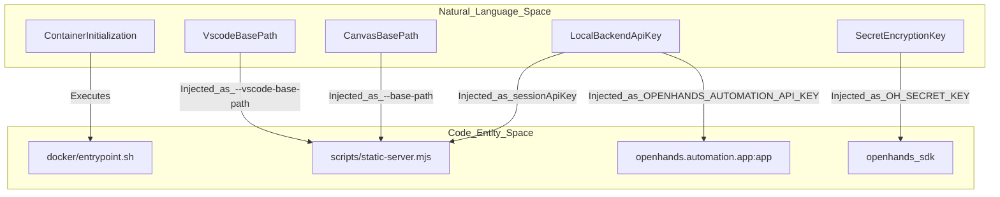
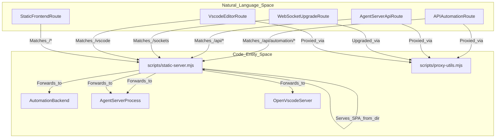
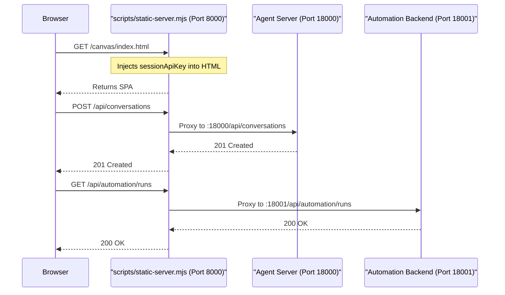

<!-- source: DeepWiki mcp.deepwiki.com · repo All-Hands-AI/OpenHands · page 2.3 Self-Hosting and Docker Deployment · fetched 2026-10-26 -->

# Self-Hosting and Docker Deployment

Relevant source files

The following files were used as context for generating this wiki page:

- [.github/pr-assets/pr-16605-test-results.png](.github/pr-assets/pr-16605-test-results.png)
- [__tests__/scripts/acp-docker-env-sync.test.ts](__tests__/scripts/acp-docker-env-sync.test.ts)
- [__tests__/scripts/dev-static.test.ts](__tests__/scripts/dev-static.test.ts)
- [__tests__/scripts/dev-with-automation.test.ts](__tests__/scripts/dev-with-automation.test.ts)
- [__tests__/scripts/static-server.test.ts](__tests__/scripts/static-server.test.ts)
- [docker/entrypoint.sh](docker/entrypoint.sh)
- [docs/ACP_AGENTS.md](docs/ACP_AGENTS.md)
- [docs/README.md](docs/README.md)
- [docs/SELF_HOSTING.md](docs/SELF_HOSTING.md)
- [examples/acp-docker/.env.example](examples/acp-docker/.env.example)
- [examples/acp-docker/README.md](examples/acp-docker/README.md)
- [examples/acp-docker/docker-compose.yml](examples/acp-docker/docker-compose.yml)
- [scripts/dev-static.mjs](scripts/dev-static.mjs)
- [scripts/dev-with-automation.mjs](scripts/dev-with-automation.mjs)
- [scripts/gen-acp-docker-env.mjs](scripts/gen-acp-docker-env.mjs)
- [scripts/runtime-services-info.mjs](scripts/runtime-services-info.mjs)
- [scripts/static-server.mjs](scripts/static-server.mjs)
- [tests/e2e/live-acp/README.md](tests/e2e/live-acp/README.md)
- [tests/e2e/live-acp/acp-docker-e2e.mts](tests/e2e/live-acp/acp-docker-e2e.mts)
- [vite.config.ts](vite.config.ts)

This page explains the self-hosting architecture of OpenHands Agent Canvas, focusing on the all-in-one Docker image, the initialization logic in `docker/entrypoint.sh`, the three-service topology behind the ingress proxy, the Helm chart for Kubernetes orchestration, and core security guidelines for production deployments.

## All-in-One Docker Architecture and Entrypoint Initialization

The Docker deployment utilizes a multi-stage build process to package a unified runtime environment. At container startup, `docker/entrypoint.sh` coordinates the initialization of three core services (and optional sidecars) behind a single ingress proxy [docker/entrypoint.sh:1-56]().

### Service Components

1.  **Static Server / Ingress Proxy**: Serves the production build of the React/TypeScript frontend and reverse-proxies API requests and WebSockets to the respective backend services [scripts/static-server.mjs:1-44]().
2.  **Agent Server**: The core execution engine from the `software-agent-sdk`, responsible for managing agent sessions, tool execution, and the bundled `openvscode-server` instance [docker/entrypoint.sh:16-32]().
3.  **Automation Backend**: A Python-based service handling scheduled runs and event-driven automations [docker/entrypoint.sh:18-18]().

Sources: [docker/entrypoint.sh:1-56](), [scripts/static-server.mjs:1-44]()

## Component Topology and Ingress Routing

A Node.js-based static server and reverse proxy (`scripts/static-server.mjs`) unifies these services behind a single port (`8000` by default) [scripts/static-server.mjs:86-102](). It handles runtime injection of the session API key and runtime service metadata into the frontend bundle [scripts/static-server.mjs:134-140]().

| Path Prefix | Destination Service | Internal Port | Source Reference |
| :--- | :--- | :--- | :--- |
| `/api/automation/*` | Automation Backend | `18001` | [docker/entrypoint.sh:18-18]() |
| `/api/*`, `/sockets` | Agent Server | `18000` | [docker/entrypoint.sh:17-17]() |
| `/vscode` | Bundled Editor (`openvscode-server`) | `8001` | [docker/entrypoint.sh:20-20]() |
| `/*` (default) | Static Frontend SPA | N/A | [docker/entrypoint.sh:8-10]() |

Sources: [docker/entrypoint.sh:1-56](), [scripts/static-server.mjs:86-102]()

## Code Entity Maps

### Code Entity Map 1: Entrypoint Environment and Service Initialization

The following diagram bridges natural language configuration concepts to the underlying shell scripts and environment mappings executed during container startup.

Sources: [docker/entrypoint.sh:33-56](), [scripts/static-server.mjs:134-155]()

### Code Entity Map 2: Ingress Proxy Routing

This diagram illustrates how client HTTP requests map from URL paths to internal proxy handler routes defined in `scripts/static-server.mjs` and `scripts/proxy-utils.mjs`.

Sources: [scripts/static-server.mjs:30-44](), [docs/SELF_HOSTING.md:25-42]()

## Network Data Flow

The ingress proxy (`scripts/static-server.mjs`) acts as the central traffic controller, injecting configuration and forwarding requests to upstream local backends [scripts/static-server.mjs:1-44]().

Sources: [scripts/static-server.mjs:1-44](), [docker/entrypoint.sh:1-56]()

## Kubernetes Deployment (Helm)

For cloud orchestration, Helm charts and templates are provided for cluster deployments.

*   **Topology**: Deploys workloads configured with persistent volume claims to ensure stable network identifiers and persistent storage for agent workspaces and conversation history.
*   **Version Pinning**: Container images reference release tags matching the application version specifications.
*   **Configuration**: Exposes parameters for customizing ports, replica counts, persistent volume storage classes, and ingress routes via Helm `values.yaml` configurations.

Sources: [docs/SELF_HOSTING.md:1-50]()

## Self-Hosting Security Guide

When deploying Agent Canvas in a production or self-hosted environment (such as a remote cloud VM), observe the following security practices [docs/SELF_HOSTING.md:1-178]():

1.  **API Key Management**: Always configure an explicit `LOCAL_BACKEND_API_KEY` to prevent reliance on auto-generated keys that can invalidate state if storage volumes are recreated. Both the agent server and automation service authenticate requests using the `X-Session-API-Key` header [docs/SELF_HOSTING.md:120-130]().
2.  **Secret Encryption**: Ensure `OH_SECRET_KEY` is persistently maintained. Loss of this key prevents decryption of stored provider credentials, API keys, and secure configuration settings [docs/SELF_HOSTING.md:35-36]().
3.  **Network Isolation**: Restrict container network access and firewalls (e.g., exposing only SSH and reverse-proxied HTTPS ports) when executing untrusted target repositories, as agents execute shell operations directly within the sandbox environment [docs/SELF_HOSTING.md:72-94]().
4.  **Telemetry Control**: Telemetry can be fully disabled using environment flags such as `AGENT_CANVAS_DISABLE_TELEMETRY=true` [scripts/static-server.mjs:101-102]().

Sources: [docs/SELF_HOSTING.md:1-178](), [scripts/static-server.mjs:101-102]()

---

