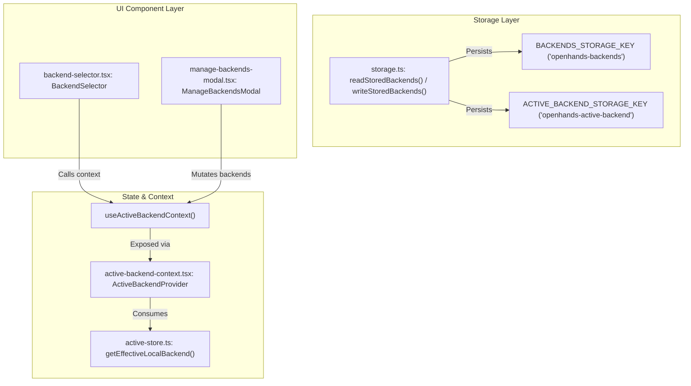
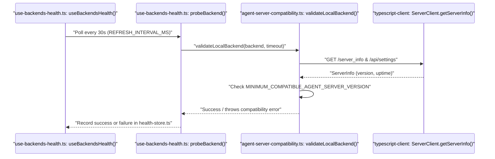

<!-- source: DeepWiki mcp.deepwiki.com · repo All-Hands-AI/OpenHands · page 3 Backend Registry and Multi-Backend Architecture · fetched 2026-10-26 -->

# Backend Registry and Multi-Backend Architecture

Relevant source files

The following files were used as context for generating this wiki page:

- [.screenshots/progress-event-fix.png](.screenshots/progress-event-fix.png)
- [__tests__/api/backend-registry/storage.test.ts](__tests__/api/backend-registry/storage.test.ts)
- [__tests__/api/to-app-conversation-session-key.test.ts](__tests__/api/to-app-conversation-session-key.test.ts)
- [__tests__/components/backends/add-backend-modal.test.tsx](__tests__/components/backends/add-backend-modal.test.tsx)
- [__tests__/components/backends/backend-form-modal.test.tsx](__tests__/components/backends/backend-form-modal.test.tsx)
- [__tests__/components/backends/manage-backends-modal.test.tsx](__tests__/components/backends/manage-backends-modal.test.tsx)
- [__tests__/contexts/active-backend-context.test.tsx](__tests__/contexts/active-backend-context.test.tsx)
- [__tests__/hooks/query/use-backends-health.test.tsx](__tests__/hooks/query/use-backends-health.test.tsx)
- [__tests__/root.test.tsx](__tests__/root.test.tsx)
- [__tests__/vitest-setup-progress-event.test.ts](__tests__/vitest-setup-progress-event.test.ts)
- [specs/backend-management.md](specs/backend-management.md)
- [src/api/backend-registry/auth.ts](src/api/backend-registry/auth.ts)
- [src/api/backend-registry/default-backend.ts](src/api/backend-registry/default-backend.ts)
- [src/api/backend-registry/storage.ts](src/api/backend-registry/storage.ts)
- [src/api/backend-registry/types.ts](src/api/backend-registry/types.ts)
- [src/components/features/backends/backend-form-modal.tsx](src/components/features/backends/backend-form-modal.tsx)
- [src/components/features/backends/backend-row.tsx](src/components/features/backends/backend-row.tsx)
- [src/components/features/backends/backend-version.tsx](src/components/features/backends/backend-version.tsx)
- [src/components/features/backends/manage-backends-modal.tsx](src/components/features/backends/manage-backends-modal.tsx)
- [src/contexts/active-backend-context.tsx](src/contexts/active-backend-context.tsx)
- [src/hooks/query/use-backends-health.ts](src/hooks/query/use-backends-health.ts)
- [src/hooks/query/use-cloud-current-user-id.ts](src/hooks/query/use-cloud-current-user-id.ts)
- [src/hooks/query/use-cloud-organizations.ts](src/hooks/query/use-cloud-organizations.ts)
- [src/i18n/translation.json](src/i18n/translation.json)
- [src/root.tsx](src/root.tsx)
- [vitest.setup.ts](vitest.setup.ts)

The Agent Canvas architecture is designed to be backend-agnostic, allowing users to connect to multiple `agent-server` instances simultaneously. These backends can be local instances running on a developer's machine or managed cloud instances [src/api/backend-registry/types.ts:1-23](). The **Backend Registry** acts as the central source of truth for managing these connections, handling persistence, credential storage, active backend selection, and continuous health monitoring [src/contexts/active-backend-context.tsx:31-69]().

### Multi-Backend Topology

Agent Canvas maintains a registered list of `Backend` entities. At any given time, exactly one backend is designated as the **Active** backend, dictating where API requests for conversations, settings, and automations are routed [src/api/backend-registry/types.ts:1-23]().

Title: Multi-Backend Architecture Code Mapping

**Sources:**
- [src/api/backend-registry/types.ts:1-23]()
- [src/api/backend-registry/storage.ts:13-14]()
- [src/contexts/active-backend-context.tsx:31-69]()

---

### Backend Registry Internals

The backend-registry module (`storage.ts`, `active-store.ts`, `types.ts`, `auth.ts`, `default-backend.ts`) provides persistent configuration management across browser restarts [src/api/backend-registry/storage.ts:1-150](). It leverages `localStorage` for durable storage across tabs and `sessionStorage` for tab-scoped active selections [src/api/backend-registry/storage.ts:205-236](). On initial boot, the system seeds a default local backend if configuration environment variables like `VITE_BACKEND_BASE_URL` and `VITE_SESSION_API_KEY` are supplied [src/api/backend-registry/storage.test.ts:71-86]().

For deep technical details on storage schemas, seeding rules, active state management, and testing specs, see [Backend Registry Internals](#3.1).

**Sources:**
- [src/api/backend-registry/storage.ts:95-150]()
- [src/api/backend-registry/active-store.ts:1-50]()
- [__tests__/api/backend-registry/storage.test.ts:34-86]()

---

### ActiveBackendProvider Context

The `ActiveBackendProvider` component wraps the React tree and exposes registry operations via the `useActiveBackendContext` hook [src/contexts/active-backend-context.tsx:71-80](). It coordinates state synchronization and triggers React Query cache invalidation whenever the active backend or organization changes [src/contexts/active-backend-context.tsx:89-121]().

| Function | Role / Action |
| :--- | :--- |
| `setActive` | Switches the current backend or organization ID, triggering cache re-keying [src/contexts/active-backend-context.tsx:89-121]() |
| `addBackend` | Appends a new backend configuration and immediately switches to it [src/contexts/active-backend-context.tsx:123-139]() |
| `updateBackend` | Patches an existing backend entry, incrementing its `connectionRevision` to reset health checks [src/contexts/active-backend-context.tsx:141-182]() |
| `removeBackend` | Deletes a backend entry and safely falls back to the next available healthy instance [src/contexts/active-backend-context.tsx:184-206]() |

For further details on context implementation and state hooks, see [Backend Registry Internals](#3.1).

**Sources:**
- [src/contexts/active-backend-context.tsx:71-215]()
- [__tests__/contexts/active-backend-context.test.tsx:97-121]()

---

### Backend Selector and Switching UI

The UI layer provides visual components for switching environments, managing connections, and authenticating against cloud infrastructure [src/components/features/backends/manage-backends-modal.tsx:63-128](). When a user interacts with the `BackendSelector` or `ManageBackendsModal`, the application coordinates environment transition overlays to cleanly reset queries and cache states [src/components/features/backends/backend-form-modal.tsx:43-58](). Cloud integrations leverage OAuth device-flow authentication via `DeviceFlowAuth` [src/components/features/backends/backend-row.tsx:122-135]().

For detailed documentation on the BackendSelector, modal forms, device-flow login, and resizable layout panels, see [Backend Selector UI and Environment Switching](#3.2).

**Sources:**
- [src/components/features/backends/manage-backends-modal.tsx:63-128]()
- [src/components/features/backends/backend-form-modal.tsx:43-58]()
- [src/components/features/backends/backend-row.tsx:122-135]()

---

### Health Monitoring and Compatibility

Agent Canvas continuously monitors backend availability through background probes and checks version compatibility floors defined in `config/defaults.json` [src/api/agent-server-compatibility.ts:19-20]() via `useBackendsHealth` [src/hooks/query/use-backends-health.ts:29-30]().

Title: Health Probing and Version Enforcement Flow

*   **Probing and Retries:** The system polls each backend every 30 seconds, executing quick internal retries (2 attempts with a 300ms delay) to prevent transient warmup errors from showing false disconnects [src/hooks/query/use-backends-health.ts:29-30]().
*   **Status Indicators:** Connectivity is rendered using `BackendStatusDot` [src/components/features/backends/backend-status-dot.tsx:1-20]() to indicate connected, disconnected, or missing API key states [src/components/features/backends/backend-row.tsx:41-62]().
*   **Version Enforcement:** The `agent-server-compatibility.ts` module enforces minimum version requirements, raising `AgentServerUnsupportedVersionError` when a server falls below the required threshold [src/api/agent-server-compatibility.ts:19-93]().

For deep technical details on version pins, feature detection, and compatibility warning banners, see [Agent Server Compatibility and Version Checks](#3.3).

**Sources:**
- [src/hooks/query/use-backends-health.ts:29-30]()
- [src/hooks/query/use-backends-health.ts:153-166]()
- [src/api/agent-server-compatibility.ts:19-93]()
- [__tests__/components/backends/manage-backends-modal.test.tsx:185-202]()

---

