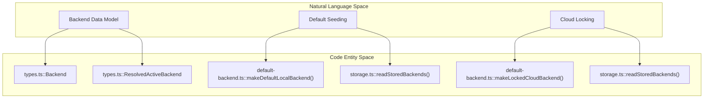
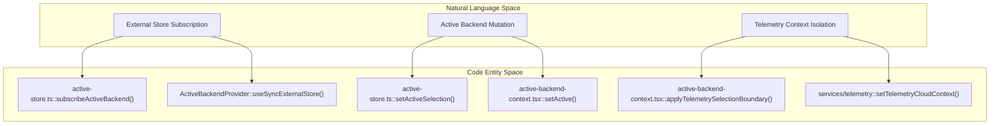
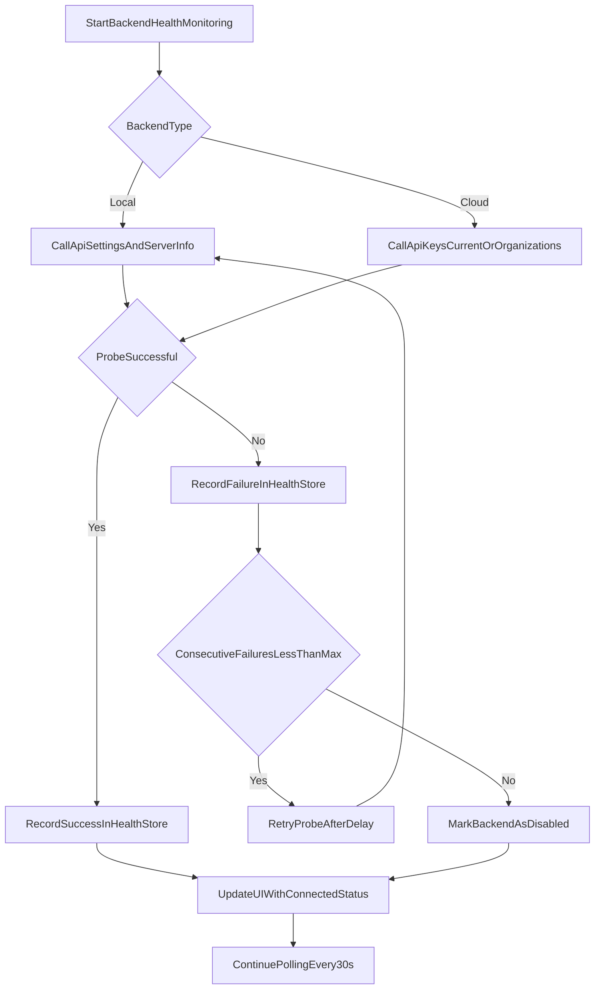
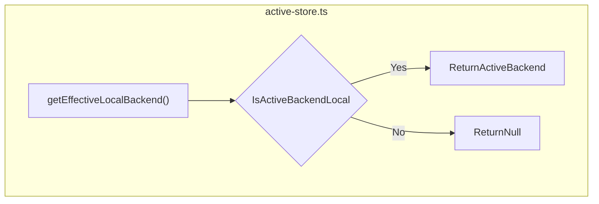

<!-- source: DeepWiki mcp.deepwiki.com · repo All-Hands-AI/OpenHands · page 3.1 Backend Registry Internals · fetched 2026-10-26 -->

# Backend Registry Internals

Relevant source files

The following files were used as context for generating this wiki page:

- [.screenshots/progress-event-fix.png](.screenshots/progress-event-fix.png)
- [__tests__/api/backend-registry/active-store.test.ts](__tests__/api/backend-registry/active-store.test.ts)
- [__tests__/api/backend-registry/storage.test.ts](__tests__/api/backend-registry/storage.test.ts)
- [__tests__/api/backend-registry/url-selection.test.ts](__tests__/api/backend-registry/url-selection.test.ts)
- [__tests__/api/to-app-conversation-session-key.test.ts](__tests__/api/to-app-conversation-session-key.test.ts)
- [__tests__/components/shared/navigation-link.test.tsx](__tests__/components/shared/navigation-link.test.tsx)
- [__tests__/contexts/active-backend-context.test.tsx](__tests__/contexts/active-backend-context.test.tsx)
- [__tests__/hooks/use-backend-scoped-path.test.tsx](__tests__/hooks/use-backend-scoped-path.test.tsx)
- [__tests__/vitest-setup-progress-event.test.ts](__tests__/vitest-setup-progress-event.test.ts)
- [specs/backend-management.md](specs/backend-management.md)
- [src/api/backend-registry/active-store.ts](src/api/backend-registry/active-store.ts)
- [src/api/backend-registry/auth.ts](src/api/backend-registry/auth.ts)
- [src/api/backend-registry/default-backend.ts](src/api/backend-registry/default-backend.ts)
- [src/api/backend-registry/storage.ts](src/api/backend-registry/storage.ts)
- [src/api/backend-registry/types.ts](src/api/backend-registry/types.ts)
- [src/api/backend-registry/url-selection.ts](src/api/backend-registry/url-selection.ts)
- [src/api/conversation-service/agent-server-conversation-service.types.ts](src/api/conversation-service/agent-server-conversation-service.types.ts)
- [src/components/features/conversation-panel/compact-conversation-row.tsx](src/components/features/conversation-panel/compact-conversation-row.tsx)
- [src/components/shared/navigation-link.tsx](src/components/shared/navigation-link.tsx)
- [src/contexts/active-backend-context.tsx](src/contexts/active-backend-context.tsx)
- [src/hooks/query/use-cloud-current-user-id.ts](src/hooks/query/use-cloud-current-user-id.ts)
- [src/hooks/query/use-cloud-organizations.ts](src/hooks/query/use-cloud-organizations.ts)
- [vitest.setup.ts](vitest.setup.ts)

The `backend-registry` module is the core architectural component responsible for managing multiple agent-server backends. It handles persistence, active backend selection, health monitoring, protocol routing, and multi-tenant organization resolution for cloud environments across local and remote instances [src/api/backend-registry/storage.ts:1-15](), [src/api/backend-registry/active-store.ts:1-20]().

---

## Overview and Core Types

The registry relies on several foundational modules to define data contracts and fallback parameters:
- `types.ts`: Defines core interfaces including `Backend`, `BackendKind` (`"local"` | `"cloud"`), `BackendAuthMode` (`"api-key"` | `"cookie"`), `BackendSelection`, and `ResolvedActiveBackend` [src/api/backend-registry/storage.ts:6-11](), [src/api/backend-registry/active-store.ts:8-8]().
- `default-backend.ts`: Supplies factory functions `makeDefaultLocalBackend()` and `makeLockedCloudBackend()` used during initial boot sequences [src/api/backend-registry/storage.ts:1-5]().
- `auth.ts`: Manages authentication states and credential injection for registered backends [src/api/backend-registry/auth.ts:1-18]().

### Code Entity Relationship: Architecture & Types
The following diagram maps natural language concepts to their specific code implementations within the registry foundation.

**Entity Mapping: Registry Foundation to Code**

Sources: [src/api/backend-registry/storage.ts:1-11](), [src/api/backend-registry/storage.ts:104-149]()

---

## Storage and Persistence

Agent Canvas uses a hybrid storage approach managed in `storage.ts` to ensure that backend selection is both persistent across browser sessions and isolated across browser tabs [src/api/backend-registry/storage.ts:1-244]().

| Key | Storage Type | Purpose |
|:--- |:--- |:--- |
| `openhands-backends` | `localStorage` | The full list of registered `Backend` objects. [src/api/backend-registry/storage.ts:13-13]() |
| `openhands-active-backend` | `sessionStorage` | Tab-scoped active selection. Prevents Tab A from changing Tab B's backend. [src/api/backend-registry/storage.ts:208-214]() |
| `openhands-active-backend` | `localStorage` | Fallback for fresh tabs to inherit the last-used backend. [src/api/backend-registry/storage.ts:216-218]() |

### Default Backend Seeding and Cloud Locking
On first initialization, the registry reads or seeds backends using environment variables and default definitions (`default-backend.ts`). If valid configuration parameters (`VITE_BACKEND_BASE_URL` and `VITE_SESSION_API_KEY`) are present, `readStoredBackends()` generates a default local backend with the ID `default-local` [src/api/backend-registry/storage.ts:122-128](), [src/api/backend-registry/storage.ts:71-86]().

The `storage.ts` module also handles seeding a cookie-authenticated cloud backend if `window.__AGENT_CANVAS_LOCK_TO_CLOUD__` is set and matches the current origin [src/api/backend-registry/storage.ts:108-116]().

### URL Selection Override
A backend pinned in the URL via query parameters (`url-selection.ts`) wins over stored state, ensuring links opened in new tabs land on the correct backend [src/api/backend-registry/active-store.ts:104-114](), [src/api/backend-registry/url-selection.ts:17-18]().

Sources: [src/api/backend-registry/storage.ts:1-244](), [src/api/backend-registry/active-store.ts:104-114](), [src/api/backend-registry/url-selection.ts:1-83]()

---

## Active Backend Store and Context

The `ActiveBackendProvider` (`active-backend-context.tsx`) wraps the synchronous `active-store.ts` implementation using `useSyncExternalStore` [src/contexts/active-backend-context.tsx:71-80](), [src/api/backend-registry/active-store.ts:1-193]().

### Key Functions
- `setActive(backendId, orgId)`: Switches the current backend and clears telemetry cloud contexts [src/contexts/active-backend-context.tsx:89-121]().
- `addBackend(backend)`: Registers a new backend and automatically switches to it (**BM-001**) [src/contexts/active-backend-context.tsx:124-139]().
- `updateBackend(id, patch)`: Updates backend metadata, resetting health status and incrementing `connectionRevision` if the host or API key changes [src/contexts/active-backend-context.tsx:141-182]().
- `removeBackend(id)`: Removes a backend from the registry and drops its health history [src/contexts/active-backend-context.tsx:184-204]().

### Telemetry Boundaries
When switching between Local and Cloud backends, or between different Cloud backends, `applyTelemetrySelectionBoundary` invokes `setTelemetryCloudContext(null)` to prevent leaking analytics data across boundaries [src/contexts/active-backend-context.tsx:53-69]().

### Code Entity Relationship: Store and Context
**Entity Mapping: State Management to Code**

Sources: [src/api/backend-registry/active-store.ts:158-185](), [src/contexts/active-backend-context.tsx:53-121]()

---

## Health Monitoring and Effective Local Backend

### Backend Health
Health states are tracked to determine backend availability and skip unreachable nodes via `pickFallbackBackend()` [src/api/backend-registry/active-store.ts:52-62](). Consecutive failures are recorded up to `MAX_CONSECUTIVE_FAILURES` [src/api/backend-registry/health-storage.ts:4-4]().

**Backend Health Monitoring Flow**

Sources: [src/api/backend-registry/active-store.ts:52-62](), [src/api/backend-registry/health-storage.ts:4-4]()

### Effective Local Backend Resolution
Most UI services (settings, conversation CRUD, skills, MCP) speak the local agent-server protocol. `getEffectiveLocalBackend()` ensures cloud selections do not improperly borrow local endpoints [src/api/backend-registry/active-store.ts:140-144]().

**Effective Backend Resolution**

Sources: [src/api/backend-registry/active-store.ts:140-144]()

---

## Backend Management Specifications

The implementation adheres to specific requirements defined in the backend management specifications:

| Spec ID | Requirement | Implementation |
|:--- |:--- |:--- |
| **BM-001** | Auto-switch to newly connected backend | Handled in `addBackend` within `ActiveBackendProvider`. [src/contexts/active-backend-context.tsx:124-139]() |
| **BM-002** | Probing backends for health | Logic used by `pickFallbackBackend` to skip disabled backends. [src/api/backend-registry/active-store.ts:53-57]() |
| **BM-003** | Fallback on active backend removal | If the active backend is deleted, `pickFallbackBackend` selects the first healthy local backend or the first available entry. [src/api/backend-registry/active-store.ts:52-62](), [src/api/backend-registry/active-store.ts:82-86]() |

Sources: [src/api/backend-registry/active-store.ts:52-62](), [src/contexts/active-backend-context.tsx:124-139]()

---

